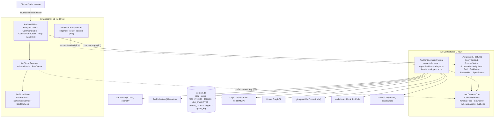
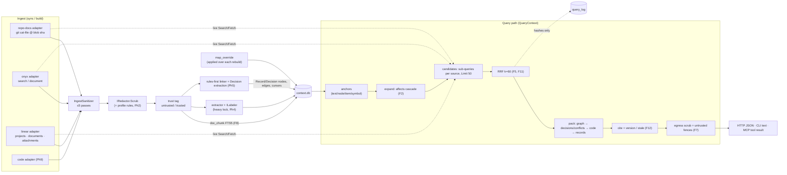
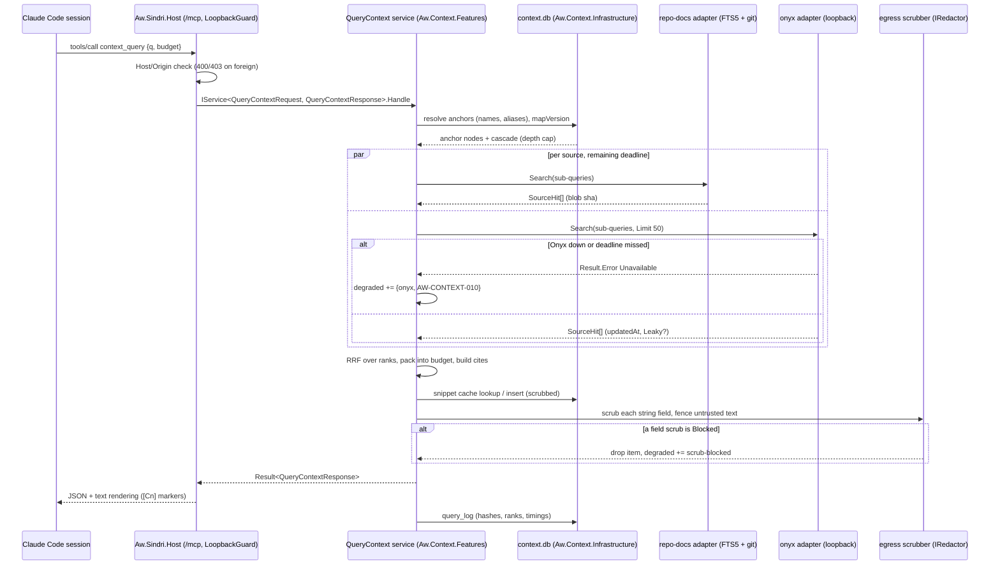

# Architecture Review: Sindri context retrieval engine (product graph and retrieval)

_Reviewed by `/archReview` on 2026-10-10_

Target: `docs/superpowers/specs/2026-10-10-sindri-context-retrieval-design.md` (cited below as "spec:<line>").
Checked against `.agents/rules/csharp.md`, `deps.yaml` (main and the S1 worktree), factory addendum §17.3/§17.29,
core spec §7.5/§8.3/§8.4, `src/Redaction/Aw.Redaction`, `docs/readiness/aot-spike.md` and the S1 app shell at
`.claude/worktrees/sindri-s1-app-shell` (read only). Owner-settled decisions are not reopened: Onyx CE recall-only,
Sindri owns ranking, product graph core, query-time `affects`, override layer, MCP in Phase 1, no rate limiting.

## Verdict: NEEDS WORK

There are five HIGH findings and no CRITICAL ones:
- **F1:** the `compose` edge as written can't carry Phase 1. The Sindri Host needs `Aw.Context.Features` request and
  response types, not only `Add…()` methods. Sindri's package fan-out is already at the limit of 4.
- **F2:** the `affects` traversal can't reach the spec's own headline cascade at depth 2.
- **F3:** node-level eval truth needs `implements` edges, which only arrive in Phase 9. Phases 7 and 8 gate on
  metrics they can't compute.
- **F4:** the graph arm of the backtest leaks future knowledge through the override layer and the hand-authored map.
- **F5:** no canonical identity joins one record across sources (`onyx` and `linear`).

None needs a redesign. The product-graph-first direction, the adapter contract, the read-only ports, the
ingest-once scrub boundary and the citation and version model are sound. Every finding has a contained fix in the
spec text or in a phase's scope. Maintainability scores 2 because F1 and F5 are structural.

## Scores

_Anchored 1–5 scale from `_shared/severity.md` (5 = no findings above LOW … 1 = CRITICAL or unaddressed)._

| Dimension | Score (1–5) | Notes |
|-----------|:---:|-------|
| Complexity | 3 | F2, F3 and F4 are HIGH but local to one section each (cascade rule, phase order, as-of cut). The pipeline itself (anchors → expand → candidates → RRF → pack) is appropriately small |
| Scalability | 4 | Local, single user. Only MEDIUM issues: per-citation live version checks on the query path (F12), and long rebuild write transactions against sync writers (F21) |
| Maintainability | 2 | F1 (how a tier-1 library is composed into the tier-3 app: endpoints, MCP tools, scheduled services, doctor, labeler, profile) and F5 (record identity across adapters) are structural. Each affects several phases |

## Component Diagram

## Data Flow Diagram

## Sequence Diagram

The most critical flow: a Claude Code session calls `context_query` (Phase 1, extended through Phase 5).

## Top Risks

| # | Risk | Impact | Likelihood | Mitigation |
|---|------|--------|------------|------------|
| 1 | Phase 1 stalls on the composition rule: endpoints and MCP tools need `Aw.Context.Features` types. Sindri's project fan-out is already 4/4 (S1 `deps.yaml:441`) (F1) | high | high | Settle the `compose` edge in the spec now, before Phase 1's plan: what it allows, and whether it counts toward fan-out |
| 2 | The cascade, the thing nobody else builds, can't reach its own motivating example at depth 2 (F2) | high | high | Define traversal over typed steps (including `on` and Surface `part-of`), count a state hop as one step, and add a fixture test for the Orientation → layout-restore case |
| 3 | The eval gates (Phases 7–8) enable layers on numbers that are uncomputable (F3) or optimistic (F4) | high | med | File-level `implements` from the Phase 4 extractor; per-sample as-of maps and override filtering by `when` |
| 4 | Duplicate or contradictory records when the same Linear issue arrives through Onyx and the native adapter (F5) | med | high | A canonical record key, deduplicated before fusion |
| 5 | The override layer loses human work on a key-scheme bump, or re-proposes rejected items after every doc edit (F9) | med | med | A key migration that writes aliases; evidence identity without the version |

## Edge Case Matrix

Boundaries (Step 3's named list):
1. Sindri Host surfaces → Aw.Context.Features (HTTP, CLI via ControlPlaneClient, MCP)
2. QueryContext planner (anchors, expand, fusion, pack)
3. repo-docs adapter (git + FTS5)
4. onyx adapter (loopback)
5. linear adapter (GraphQL)
6. code adapter (code index db)
7. Ingest boundary (IngestSanitizer + IRedactor)
8. context.db store (Aw.Kernel.Data)
9. Extractor + labeler (ILabeler, Claude CLI, heavy lock)
10. Sync and scheduled services (IChangeFeed, IScheduledService)
11. Eval harness (corpus, arms, adjudicator)
12. Egress (response scrub, untrusted fences)

| Boundary | Dependency unavailable | Invalid/malicious input | Load 10x | State leakage |
|---|---|---|---|---|
| 1 Host → Features | F1 | OK — S1 `LoopbackGuard.cs:9-21` (Host 400 / Origin 403); aot-spike.md:316-330 HttpSlim hardening; typed ids → 400 (csharp.md Types) | F17 (MCP session state on restart) | F17 |
| 2 Planner | OK — spec:136-143 (Unavailable → `degraded`, deadline per source) | F2 (cycle/visited rule undefined) | F11, F12 | OK — spec:220 (query_log holds hashes only) |
| 3 repo-docs | F8 (refresh trigger before Phase 3) | F8 (unscrubbed FTS text) | F18 (FTS5 must be compiled in) | OK — spec:75-76 (writes under `$AW_STATE_DIR`, 0700/0600) |
| 4 onyx | OK — spec:136-137, 490-492 (degraded: onyx, graph still returns) | OK — spec:79 (loopback literal enforced at profile validation), spec:144-145 (raw text sanitized in engine) | F12 | F5 |
| 5 linear | F14 (token from secret pointers) | OK — spec:135 (read-only by construction), spec:144 | OK — spec:153 (change feed `updatedAt` filter by team, not query-path search) | F5 |
| 6 code | F3 (absent until Phase 9) | OK — spec:154 (read-only index db, symbol at sha) | OK — spec:154 (index lookup, local db) | OK — spec:222 (code text fetched live, never stored) |
| 7 Ingest boundary | OK — spec:233-234 (Blocked drops text, keeps ref, reports `scrub-blocked`); `ScrubResult.cs:8-11` | F16 (profile rule shape) | OK — `Redactor.cs:11-14` (match timeout per 128K window, input size alone never blocks) | OK — spec:241-242 (stored text clean) except F8 |
| 8 context.db | OK — csharp.md SQL rule (WAL checked, busy_timeout via SqliteConnectionFactory) | F10 (dual source of truth for decisions) | F9 (map_version retention), F21 | F9 |
| 9 Extractor + labeler | F14 (heavy lock placement) | OK — spec:203 (model links never sole evidence), spec:73-74 (switch off until approved) | OK — spec:365 (`context.labeling.maxTokens` per build) | F9 |
| 10 Sync | OK — spec:140-141 (cursor advances only after commit; replay idempotent) | OK — spec:144-145 (adapters raw; engine sanitizes once) | F15 | F21 |
| 11 Eval harness | F3 | OK — spec:330 (adjudicator twice, reversed, agreeing only) | OK — spec:364 (≤ 1.5M tokens per run), spec:367 (<30 samples can't pass) | F4 |
| 12 Egress | F7 | F7, F19 | OK — spec:281-282 (budget caps output, refs-only overflow) | OK — spec:237-239 (every response re-scrubbed; untrusted fenced) |

### Findings

| id | severity | lens | location | finding | recommended fix |
|---|---|---|---|---|---|
| F1 | HIGH | arch | spec:94-104, §8.5, §11 | **The `compose` edge as proposed can't carry Phase 1.** It allows "a lower-tier package's `Add…()` methods and nothing else". But an endpoint and an MCP tool bind `QueryContextRequest` and resolve `IService<QueryContextRequest, QueryContextResponse>`, and request and response records live in `Aw.Context.Features/<Slice>/` (csharp.md package shape; S1 `EndpointTable.cs` binds Features types directly). Four more Sindri-owned adapters need Aw.Context types: the `IScheduledService` wrapper for `SyncSource` and rebuilds, the `context:sources` `DoctorCheck`, a Judge-backed `ILabeler`, and profile validation. Each lives where the rules allow only lower-tier **Core** references (DEPS-PROJ-007/008: Infrastructure uses tier 0 only). Sindri's package fan-out is already 4 of `packageFanOut: 4` (S1 `deps.yaml:441`, "No exceptions"). Packets and Readiness are reached by CLI for exactly this reason (S1 `deps.yaml:426-436`). | Settle it in this spec rather than "if the workflow-engine spec settles this first". Option A: `compose` lets the Host reference `Aw.<Pkg>.Features` and `.Infrastructure` for (i) the `Add…()` registration classes and (ii) the public request and response records of slices, and nothing else, with an ArchUnitNET rule. Compose edges are exempt from `packageFanOut` or carry a recorded exception. Option B: `Aw.Context.Core` exposes one facade port (`IContextEngine`) with its request and response records, and Sindri Features calls it. State where the scheduled-service, doctor and labeler adapters live (Sindri Features, through whichever option) |
| F2 | HIGH | correctness | spec:190-191, spec:17-19 | **The `affects` rule can't produce the spec's headline example.** The rule follows `depends-on` (reverse), `writes → reads` and `part-of` (up and down) to depth 2. From `feature:…orientation`, reaching "tab manager's layout restore" needs: Surface `part-of` Feature (reverse) → Action `on` Surface (reverse) → `writes` Thing → `reads` by another Surface/Action → `part-of` Feature. That is about 5 edges, and `on` isn't in the traversal at all. Meanwhile "part-of up and down" at depth 2 returns every sibling feature of the anchor, which is over-broad. Cycles and multiple paths have no visited-set or shortest-path rule | Define the cascade as typed steps: descend to the anchor's own surfaces and actions (reverse `part-of`, reverse `on`, free); a state hop (`writes` → Thing → `reads`) counts as one step; ascend to the owning feature (free); `depends-on` reverse is one step. Don't expand siblings through `part-of` up-then-down. Use a visited set; report the shortest path. Add a unit fixture for the Orientation → layout-restore cascade and a sibling-exclusion case |
| F3 | HIGH | phases | spec:327-328, Phases 4, 7, 8, 9 | **Node-level eval truth is "files and symbols its PRs changed, mapped to nodes through `implements`"**, but `implements` edges come from the code adapter in Phase 9. Phase 4's extractor lists no `implements` output. Phase 7 (node recall and precision) and Phase 8 (arms that "enable only by a passing arm") would gate on metrics they can't compute. File recall@20 needs code refs in results, and those also arrive only in Phase 9 | Phase 4's extractor emits file-level `implements` (CodeUnit file refs) from the deterministic anchors it already reads (command registries, routes, component names), with `provenance: deterministic`. Phase 9 refines them to symbols. Alternatively, Phase 7 reports file recall and the probe set only, and node metrics wait for Phase 9. Say which, and make Phase 8's gating metric one Phase 7 can compute |
| F4 | HIGH | eval validity | spec:332-334, Phase 3 import, §6.1 overrides | **As-of leakage through the graph.** The cut says "code and map at the creation commit (no leak)". But the map is today's extractor output plus today's `map_override` rows, and Phase 3 starts from a hand-authored map. All of these encode features that shipped after the cut, so the `graph` and `all` arms look better than they are. Those are the arms that decide which layers get enabled (§9.3). Re-extracting per sample is also unbudgeted | Per sample: deterministic extraction at the cut commit (cached per distinct commit; labeling off or counted against the 1.5M budget), plus only the overrides whose `when` ≤ cut. A hand-authored or imported map counts as `leaky` unless it carries dates. Report the leaky share per arm and exclude leaky samples from the pass line |
| F5 | HIGH | data model | spec:111-113, spec:173, §5.2 | **No canonical record identity across adapters.** Identity is `(Source, Id)`, so ENG-482 arriving as an Onyx document (`onyx`, Onyx doc id) and through the native adapter (`linear`, issue id) gives two refs. The `Record` key `record:linear/ENG-482` implies a canonical key, but no rule maps an Onyx doc id to it. Consequences: RRF double-counts one issue, citations duplicate, `mentions` links split across two Record nodes, and a `stale` check may compare versions from different systems | Add `RecordKey` (source system + native id) to the data model. Each adapter derives it (Onyx: from the document's source type and link metadata; Linear: native key). Deduplicate on `RecordKey` before fusion, keeping the best rank per list, and cite the preferred source (native over Onyx, for its versioning). Add contract-base tests: the same record through two fakes yields one item |
| F6 | MEDIUM | contracts | spec:386, S1 `SindriProfile.cs` | The profile `context:` key: `SindriProfile` sits in `Aw.Sindri.Core`, which may reference only `Aw.Kernel`, and it uses `JsonUnmappedMemberHandling.Disallow`. So it can't type the key with `Aw.Context`'s settings record. The loopback-literal check (spec:79) and the extra-pattern validation (Phase 2) have no specified home either | Type the key as `JsonElement?` in `SindriProfile` (BCL only), so the profile hash and approval cover it raw. `Aw.Context` owns parsing and validation behind a request that Sindri's `ValidateProfile` calls (through the F1 mechanism). Unknown sub-keys are errors there |
| F7 | MEDIUM | security/contracts | spec:237-239 | Egress scrub placement and shape. `Aw.Context.Features` can't use `Aw.Redaction` (ARCH-DIR-005). Scrubbing a serialized response as one string means a `Blocked` outcome replaces the whole body with `[REDACTED:blocked]` (`ScrubResult.cs:8-11`), so the result is invalid JSON or MCP content. Fence attributes (`ref=…`, from source permalinks or ids) are attacker-shaped too | Add an `IEgressScrubber` port in Core, implemented in Infrastructure over `IRedactor` and applied per string field in `QueryContext` (or a decorator registered in Features' `Add…()`). A blocked field drops its item and adds `degraded: scrub-blocked`. Escape attribute values as well as fence bodies, and test both |
| F8 | MEDIUM | data | spec:151, spec:219, spec:241-242 | `doc_chunk` + FTS5 stores repo-doc text in `context.db`, but the "stored text is already clean" list omits it. If chunks are indexed before scrubbing, secrets sit in the FTS vocabulary. Phase 1 also has no refresh trigger: `IScheduledService` is first used in Phase 3+, so nothing says when the index follows HEAD | Chunks go through the ingest boundary before insertion. Line-span citations are computed against the original blob at `git cat-file` time. Phase 1 refreshes lazily: on query, compare each repo's HEAD with the indexed sha and reindex changed globs within the deadline, or report `stale-index` in `degraded` |
| F9 | MEDIUM | data integrity | spec:194, spec:199-201, spec:212 | Override durability, three gaps. (a) `EntryKey()` is versioned, so a version bump re-keys every node and orphans every override. (b) "never proposed again for the same evidence": evidence is `SourceRef` **with version**, so any edit to the cited doc re-proposes rejected nodes. (c) `node`/`edge` rows carry a map version, but nothing says how many versions are kept or when old ones are collected | (a) A key-scheme migration writes `node_alias` rows from old to new keys, with a golden test. (b) Rejection identity = (kind, proposed key, evidence `(Source, Id)` + hash of the cited span), with no version. (c) Keep `current` plus N drafts and collect the rest in the rebuild service |
| F10 | MEDIUM | data model | spec:186-188, spec:216 | The `decision` table has `supersedes` and "record ref and version" columns, and the `supersedes` and `quotes` edges hold the same facts: two sources of truth. The input to `decision:<hash>` is undefined. A hash of the model's wording changes on relabel and drops overrides and supersession | Keep one: decision attributes on the node, relations only as edges (or the reverse). Key = hash(canonical `RecordKey` (F5), normalized verbatim quote) |
| F11 | MEDIUM | correctness | spec:248-252, spec:262-265 | Fusion details are undefined. (a) Phase 1's `text` shape has no graph, so "sub-queries built from the anchors" has no input: the no-anchor path isn't defined. (b) Deterministic graph neighbors have no rank to feed RRF. (c) Summing RRF over sub-queries favors whichever source gets more sub-queries | (a) With no anchors, sub-queries come from the query terms. (b) Graph neighbor rank = order by cascade distance, then edge type. (c) Fuse sub-queries within a source first (RRF or max), then fuse across sources, so each source contributes one list per layer |
| F12 | MEDIUM | performance | spec:298-300, spec:363 | The `stale` rule ("a cited version that no longer matches the source at query time") needs a live version lookup per citation per query. With Onyx and Linear on the path, that's N extra calls on top of the searches, against a p95 of 2 s | Batch version checks per source, bounded by the remaining deadline. Citations not checked in time are marked `unverified`, not dropped. Repo docs check against the indexed HEAD sha at no extra cost |
| F13 | MEDIUM | phases | spec:61, Phase 5 goal (spec:483-484), Phase 9 | Phase 5's goal promises "conflicts between intent and code", but the code layer arrives in Phase 9 (which lists "the conflict check against code behavior"). The detection method (deterministic or model, and its budget) is unspecified | Phase 5 covers decision-vs-decision (`supersedes` missing) and decision-vs-graph-fact conflicts. Code-behavior conflicts come in Phase 9. Name the mechanism and its token budget |
| F14 | MEDIUM | arch | spec:391-392, `deps.yaml` Evidence note | The heavy-job lock is "built by Phase 4" with no location. `deps.yaml`'s Evidence node says a tier-0 or tier-1 package can't take the lock and that locks move to the Kernel Lease port, so `BuildMap` in tier-1 `Aw.Context` can't use a Sindri-owned lock. Secret pointers are resolved "in Sindri Infrastructure", but the Onyx and Linear adapters live in `Aw.Context.Infrastructure` and read their settings from the environment | Build the two-slot lock as the Kernel Lease port (tier 0), with an Infrastructure adapter. Sindri's `Compose` passes `Aw.Context` an environment function that resolves `keychain:`/`env:`/`op:`/`file:` pointers, so no tier-crossing type is needed. Say so in §11 |
| F15 | MEDIUM | cost | spec:73-74, Phase 5 | Decision extraction runs during sync for every changed record (a model call), with no per-sync budget. The switches cover map labeling and the adjudicator only | Put decision extraction under `context.labeling.enabled` with its own `maxTokensPerSync`. Queue unprocessed records and report the backlog in `context sources status` |
| F16 | LOW | contracts | Phase 2 signal (spec:453-454), `RedactionRule.cs:8` | The example pattern `ACME-\d{6}` breaks `Aw.Redaction`'s pattern rule ("explicit ASCII classes, no \b, \s or \d"). The rule id `profile/acme-id` contains `/`, which the placeholder and its test fixtures haven't seen | Use `ACME-[0-9]{6}`. Validate profile patterns against the same rule (and the timeout) at profile validation. Test a `/` in a rule id end to end |
| F17 | LOW | contracts | spec:313-317, aot-spike.md:340-347 | MCP details. `ModelContextProtocol.AspNetCore` isn't in `Directory.Packages.props` (a package review). Default Streamable HTTP sessions are in memory, so a Sindri restart breaks a live Claude Code session's tool calls. The attribute style returns a generic error on bad arguments. `AW1004` doesn't check `MapMcp` tool handlers | Use stateless mode. Use the low-level handlers (or explicit error mapping) so `AW-CONTEXT-…` codes reach the session. Add a contract test that each tool calls exactly one service |
| F18 | LOW | infra | spec:151, spec:152 | Two unproven pieces. FTS5 support in the bundled `e_sqlite3` is assumed, not tested. An Onyx adapter over MCP would bring the MCP SDK **client** under AOT, but the spike tested servers only | Add an integration test that creates an FTS5 table through `SqliteConnectionFactory`. Prefer Onyx's HTTP search API, or record the client's AOT check before using it |
| F19 | LOW | consistency | spec:238 vs core spec §8.3 | The fence format is `<untrusted kind=… ref=…>`, but the core spec's pack format uses `<untrusted source="…" author="…">`, and the session preamble keys on one form | Use one fence format across packs and context results |
| F20 | LOW | retention | spec:218 | The snippet cache's 14-day expiry has no owning phase or purge service | Purge in the Phase 3 rebuild service or on read; test the expiry |
| F21 | LOW | concurrency | §6.2, Phases 4–5 | A map rebuild (a long writer) and scheduled syncs share `context.db`. One long build transaction makes sync hit `busy_timeout` | Write the build in batches as a `draft` map version and flip `current` in one short transaction |

## Missing Error Handling

- `QueryContext` egress (spec:237): there is no per-field rule for a `Blocked` scrub outcome. Today a blocked
  whole-response scrub would ship invalid JSON (F7).
- Profile validation of `context:` (spec:79, spec:386): the spec doesn't say which validator refuses a
  non-loopback Onyx URL, or how unknown sub-keys are rejected under `Disallow` (F6).
- `repo-docs` index (spec:151): there is no error or degraded code for an index that lags HEAD (F8).
- `SyncSource` (Phase 5): no behavior is defined when decision extraction exceeds budget or the model runner fails
  mid-page. The cursor must not advance, and the page needs a resumable marker (F15).
- Override application (spec:199-201): an override whose target key exists in neither the keys nor the aliases
  after a key-scheme bump has no error path beyond `orphaned` (F9).
- MCP tools (spec:313): no mapping of `Result` errors to MCP `isError` results with the `AW-CONTEXT-…` code (F17).
- Eval harness (spec:332-334): a sample whose creation commit can't be checked out (for example a squashed history)
  has no rule. Mark it as an excluded sample with a reason, so it isn't silently dropped.

## Suggested Improvements (Prioritized)

_Severity per `_shared/severity.md` (legacy P0→CRITICAL, P1→HIGH)._

| Severity | Improvement | Effort | Impact |
|----------|------------|--------|--------|
| HIGH | Settle the `compose` edge (or an `Aw.Context.Core` facade) in this spec, covering endpoints, MCP tools, scheduled services, doctor, labeler, profile and fan-out (F1, F6) | M | Unblocks Phase 1 and every later block (Judge, Evidence) the same way |
| HIGH | Rewrite the `affects` rule as typed steps with a fixture for the headline example (F2) | S | The product graph's main promise holds |
| HIGH | File-level `implements` from the Phase 4 extractor, or re-scope the Phase 7 metrics (F3) | S | The eval gates become computable |
| HIGH | Per-sample as-of maps and override filtering for the backtest (F4) | M | The graph arm isn't inflated |
| HIGH | A canonical `RecordKey`, deduplicated before fusion (F5, F10) | S | One record, one item, one citation |
| MEDIUM | Per-field egress scrub port; scrub `doc_chunk` before indexing (F7, F8) | S | No secret at rest, valid output under Blocked |
| MEDIUM | Override durability: key migration, versionless rejection identity, map-version retention (F9) | S | Human review work isn't lost or repeated |
| MEDIUM | Define fusion inputs: anchorless path, graph ranks, per-source pre-fusion (F11); batched stale checks (F12) | S | Predictable ranking within the p95 budget |
| MEDIUM | Re-scope Phase 5 conflicts; budget decision extraction; place the lock and secrets (F13, F14, F15) | S | The phases match what each can deliver |
| LOW | F16–F21: pattern example, MCP stateless mode and error mapping, FTS5 test, fence format, snippet purge, batched rebuild writes | S | Polish |

verdict: NEEDS_WORK
