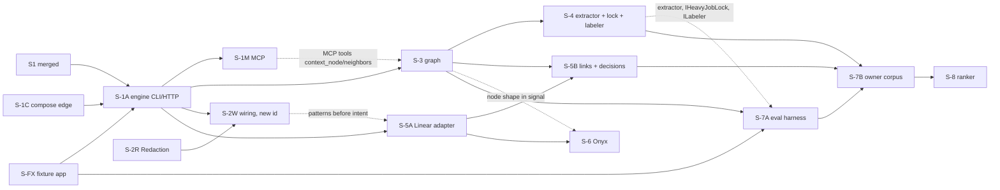

# Architecture Review (round 2): Sindri context retrieval engine

_Reviewed by `/archReview --slim` on 2026-10-10. Spec: `ctx-wt/docs/superpowers/specs/2026-10-10-sindri-context-retrieval-design.md` (917 lines).
Checked against `.agents/rules/csharp.md`, `deps.yaml` + `schemas/deps.schema.json` + `scripts/check-deps.mjs`, factory addendum
§17.3 / §17.29.2, `src/Aw.Kernel.Data/MigrationChecks.cs`, and the S1 worktree `.claude/worktrees/sindri-s1-app-shell` (read only)._

## Verdict: NEEDS WORK

The round-1 HIGHs are fixed in substance. F1, F2, F3 and F5 hold. F4 holds for leakage, but it leaves the build cost
of the as-of maps open (N7). The design itself doesn't need rework. Three new HIGH findings block the plan as written,
and all three have contained text fixes:

- **N1:** the migration-number reservations don't work with `Aw.Kernel.Data`'s runner, which refuses gaps.
- **N2:** the stage DAG misses dependencies that the phase contents need.
- **N3:** the heavy-job lock placement fails `DEPS-TIER-002`. The §14 answer to A-F14 is therefore wrong.

## Scores

| Dimension | Score | Notes |
|---|:---:|---|
| Complexity | 3 | The facade plus `compose` is the right size. The cascade rule is clear except for re-expansion after ascend (N5) |
| Scalability | 4 | Per-query caps, batched stale checks and batched builds are fine. Retained as-of map versions grow with the sample count (N7) |
| Maintainability | 3 | N1–N3 are HIGH but not structural. The fan-out exception is time-boxed for a permanent edge (N4) |

## Round-1 HIGH verification

| R1 | Fix in the spec | Verified against | Status |
|---|---|---|---|
| F1 compose / fan-out | §4: `IContextEngine` facade and its records in `Aw.Context.Core`. `compose` covers `Add…()` only, enforced by `DEPS-COMPOSE-001` and `ARCH-COMPOSE-001`. A recorded fan-out exception | S1 puts doctor rules in Core and `RunDoctorService` in Features. Scheduled services sit in Host (`Host/Server/HeartbeatService.cs`) and composition in `Host/Composition.cs`. Every Sindri caller that §4 names (Features, endpoints, CLI, MCP, scheduler, doctor) can reach a tier-1 Core under `ARCH-DIR-004` and `DEPS-PROJ-007/008` | **Resolved**. Residual issues are in N4: the exception expires, `compose` vs `project` counting is unstated, and the `DEPS-PROJ-007` carve-out is unstated |
| F2 cascade | §6.1: typed steps; own scope and ascend are free; a state hop counts as one step; visited set; shortest path; sibling exclusion | Orientation → writes `thing:pane-layout` → read by `action:tabs.restore-layout` → ascends to `feature:tabs.layout-restore` reaches the target at depth 1, and §8.4's example path matches | **Resolved**. It is not yet fully specified: N5 |
| F3 implements | Phase 4 extractor emits deterministic file-level `implements`. §9.1 truth is files mapped through it | The Phase 7 metrics are now computable. Phase 8 gates on Phase 7 output | **Resolved**. The truth-map choice is open: N6 |
| F4 as-of leak | §9.1: map built at the cut commit with the extractor under test. Only overrides dated before the cut count; imports count as overrides with their import date | Today's hand-authored import is dated after every cut, so it is correctly excluded | **Resolved for leakage**. Labeling, caching and budget for per-sample builds are unstated: N7 |
| F5 canonical key | D16, `SourceRef.Canonical`, §5.2 dedup before per-source RRF, citations list every ref, decision key hashes the canonical key and the span | The data flow is consistent end to end (§5.1 → §5.2 → §8.2 step 4 → §8.4 `cites`) | **Resolved**. The key is a mutable Linear identifier: N11 |

## Parallel delivery section: review

Corrected dependencies. Edges that the spec's DAG lacks are dashed:

Result of the review:

- **Sound:** the roles, the cap of 3 tied to the two-slot lock, the stacking rule ("never on blocking findings"),
  the human merge gates, the error-code ranges (they match §8.6: 001–005 and 010 in S-1A, 030 in S-3, 040–042 in S-4,
  050 in S-5, 070 in S-6), and the shared-file rules for `deps.yaml`, PublicAPI, and the endpoint and command tables.
- **Broken:** the migration reservations (N1); the DAG edges (N2, N8, N9); per-stage signals and isolation of
  parallel hand tests (N10).

## Findings

| id | severity | lens | location | finding | recommended fix |
|---|---|---|---|---|---|
| N1 | HIGH | delivery / data | "Shared files and reservations", migrations row | **The reserved numbers can't land out of order.** `MigrationChecks.CheckSequence` (`src/Aw.Kernel.Data/MigrationChecks.cs:21-24`) requires versions to run 1..n with "no gaps, duplicates or reordering". S-4 (`005`) depends only on S-3, and it sits on the critical path, so it will usually merge before S-5A (`003`) and S-5B (`004`). That leaves S-4's own branch and `main` with {1, 2, 5}, and the runner refuses the set. S-7A (`006`, S-3 only) and S-8 have the same problem. Reservation doesn't fix renumbering either: `CheckApplied` compares the version, name and checksum of applied rows. A hand-test database that applied a stage's `003` breaks when `main` later assigns `003` to a different stage | Drop the fixed reservations. **A migration takes the next free number at rebase time**, and the lead renumbers a stage's migration when an earlier one merges. That is a one-file rename, because migrations are embedded by name. Its test runs on the schema of every migration already on `main`. Hand tests use a throwaway `AW_SINDRI_HOME` per stage (N10), so a renumbered migration never meets an old database. Alternatively, keep the reservations and merge strictly in number order, which serializes the critical path. Not recommended |
| N2 | HIGH | delivery | Stage table and mermaid; Phases 3, 6, 7 | **The DAG misses edges that the phase contents need.** (a) **S-7A needs S-4.** Per-sample as-of maps are "built at the cut commit with the extractor version under test" (§9.1), and the extractor is S-4. `IHeavyJobLock` (exit 75 for `eval`) and `ILabeler` (adjudicator) also land in S-4. Phase 7 itself says "S1: heavy-job lock (Phase 4)". (b) **S-3 needs S-1M:** Phase 3 adds MCP `context_node` and `context_neighbors`, but the `/mcp` host lands in S-1M, a wave-2 sibling. (c) **S-6 needs S-3:** its signal runs `context query --node <feature>`, and the `node` shape arrives in S-3 | Add S-4 → S-7A, which moves S-7A to wave 4 and puts it on the critical path. Add S-1M → S-3, or move the two MCP tools into a stacked follow-up. Add S-3 → S-6, or change S-6's signal to the `text` shape. Update the mermaid and the waves to match |
| N3 | HIGH | arch / deps | §4 "Labeler and lock", §11 row, Phase 4 | **A tier-1 package can't take the heavy-job lock.** `deps.yaml` puts `locks/heavy-job.lock` under Evidence (tier 2, `files:`), and its note says "A tier-0 or tier-1 package can't take those locks (that would be an upward file edge, DEPS-TIER-002)". `check-deps.mjs:165` fails a `file` edge that points up. An `IHeavyJobLock` adapter in `Aw.Context.Infrastructure` that "takes a slot in the shared lock directory" is that edge, so S-4 fails merge gate 4. The §14 answer that A-F14 is "placed" is therefore wrong | Keep the `IHeavyJobLock` **port** in `Aw.Context.Core`. **Implement it in Sindri** (tier 3; `Sindri → Evidence kind: file` already exists at `deps.yaml:258-262`), in `Aw.Sindri.Host`, which may reference `Aw.Context.Core`. Register it in `Composition` before `AddContextInfrastructure`. Alternatively, a Kernel lease port, as round 1 suggested. Fix the §11 row and the §14 A-F14 line |
| N4 | MEDIUM | deps | §4 "Fan-out", §11 | **The fan-out exception is time-boxed, but the need is permanent.** Exceptions run "at most `limits.exceptionMaxDays` long" (183 days, `deps.yaml:25,70`), and the spec states the edge is permanent ("one of Sindri's three engines by definition"). The same mechanism "serves later blocks (Judge, Evidence)", so Sindri's count goes to 6, then 7, and each step extends the exception. The spec also doesn't say whether Sindri → Context is one `compose` edge, or a `project` edge to `Aw.Context.Core` plus a `compose` edge, or which of them `DEPS-FANOUT-001` counts. It also doesn't say that `DEPS-PROJ-007` and `ARCH-DIR-004` gain a `compose` carve-out | In S-1C, define the counting by rule. `compose` edges are not counted by `packageFanOut` and are capped separately (for example `limits.composeFanOut`). The Core reference is a normal `project` edge, counted as usual. That way no exception is needed and none expires. State the `DEPS-PROJ-007` and `ARCH-DIR-004` amendment in S-1C's scope |
| N5 | MEDIUM | correctness | §6.1 cascade | **The cascade doesn't say what happens after ascend.** After a step reaches an action and it "resolves to its owning feature", the spec doesn't say whether the next step starts from that action alone or from the owning feature's full own scope (all its surfaces and actions). That choice changes result size by an order of magnitude at depth 2, and the only fixtures are at depth 1. The flow hop says "the next node". It doesn't say whether the direction is downstream only | State it: the next step starts from the **reached node** only (narrow); the ascended feature is a label, not a new scope. Flow hops go downstream only. Add a depth-2 fixture and one fixture where a feature reaches itself again (visited set) |
| N6 | MEDIUM | eval validity | §9.1 truth | **The spec doesn't say which map maps truth files to nodes.** If it is the cut map, files the PR created have no `implements`, so new features drop out of truth silently. If it is the post-merge map, truth holds nodes the cut map can't contain. Node recall then has an unreachable floor, and the reader can't tell it from a retrieval miss. Truth also comes from the same extractor whose graph arm is being judged | Map truth through the map at the PR's **merge commit**. Report `new-node` truth separately: excluded from node recall, counted in an "unreachable at cut" column. Keep file recall@20 as the extractor-independent gate, and say so in §9.4 |
| N7 | MEDIUM | cost / storage | §9.1, §6.1 retention, §9.4 | Per-sample as-of builds don't say whether the labeling pass runs. If it does, each build can spend up to `maxTokens` (400k), and three builds exceed the 1.5M-per-run budget. The spec also doesn't say whether builds are cached per distinct commit. "Every version a backtest sample cuts at" is kept in `context.db`, so it grows with the sample count | State that as-of builds are **deterministic-only** (or reuse labels by content hash, counted against the run budget) and cached per distinct cut commit. Build them in an eval-scoped database under `eval/` with the 90-day TTL, not as retained versions in `context.db` |
| N8 | MEDIUM | delivery / security | Phase 2 size line; §14 P-L2 | The S-2R wiring "rides in S-1A, or in a one-line follow-up if S-2R merges after S-1A". The follow-up has no stage id, and S-5A depends on S-2R (the library) but not on the wiring. Linear (an intent source) can therefore land before profile patterns are applied, which contradicts P-L2 ("Phase 2 lands before any intent source") and Phase 2's goal | Give the wiring an id (S-2W: depends on S-2R and S-1A), make S-5A depend on it, and point the Phase 2 signal at S-2W |
| N9 | MEDIUM | delivery | Phase 4 files; §14 A-F13 | S-4 owns the "intent-vs-file conflict check (decision cites a file…)", but decisions are extracted in S-5B, and S-4 doesn't depend on S-5B. S-4 can only test it against imported or fixture decisions | Move the check to S-5B (it needs S-4's file-level `implements` too, so S-5B gets an S-4 edge), or to a small stage after both. Update §14 A-F13 |
| N10 | MEDIUM | delivery / ops | "The team", "Keeping agents busy" | (a) Stages that split a phase (S-1C, S-1A, S-2R, S-5A, S-7A) have no stated **per-stage signal**, but `/specToProvenPR` requires a hand test of each PR in the running app. S-1A's natural signal is the CLI half of Phase 1. S-1C and S-FX have no running-app signal. (b) Three stages hand-testing at once would share one S1 host lease, port 7410, `context.db` (see N1's checksum problem) and the owner's profile approvals | Add a **Signal** column to the stage table, with "CI-only: check-deps and test output as evidence" for S-1C, S-2R and S-FX. Require each stage owner to hand-test with its own `AW_SINDRI_HOME`, `AW_SINDRI_PORT` and `AW_SINDRI_PROFILE` (all read by S1: `LoopbackBinding.cs:17` and the app home), and to register MCP per worktree port. Count the owner's `profile approve` per stage home as an owner step in "Gates that stay sequential" |
| N11 | MEDIUM | data model | D16, §5.1 `Canonical`, §6.1 decision key | `linear:issue/ENG-482` keys on Linear's **identifier**, which changes when an issue moves teams, and the profile reads two teams (`[ENG, APP]`). A move re-keys the `Record` node, splits `mentions` links, and changes every decision key (it hashes the canonical key), which orphans those overrides | The native adapter records the identifier's history (Linear exposes previous identifiers on an issue) as `node_alias` rows. Canonical resolution goes through aliases. The decision key hashes the record's stable id (Linear UUID, resolved through the alias) rather than the display key. Add a contract test: a moved issue keeps one node and its decisions |
| N12 | LOW | consistency | §8.1 vs Phase 4 signal | §8.1 lists `symbol` as Phase 9, but the Phase 4 signal runs `--symbol src/layout/SplitPane.ts` at file level | Mark `symbol` as "4 (file), 9 (symbol)" in §8.1 |
| N13 | LOW | sizing | Phase 1 size, S-1A | S-1A is "M (≤600)" and covers the package, facade, contract, sanitizer, egress scrubber, repo-docs with FTS5 and refresh service, RRF, packing, citations, two slices, HTTP, CLI and migration 1. That is likely L | Pre-split S-1A (for example, engine and pipeline, then repo-docs with FTS5) in `stages.md`, rather than discovering it at step 1 |

## Edge Case Matrix

| Boundary | Dependency unavailable | Invalid / malicious input | Load 10x | State leakage |
|---|---|---|---|---|
| Sindri Host ↔ `Aw.Context` (facade, compose) | OK: §8.6 exit 2 / `SND-CONTEXT-004` when the store can't open | OK: §4 `CheckSettings` validates the profile's `context:` key as JSON | OK: one facade, no per-call fan-out | N3 (lock adapter tier), N4 |
| Source adapters (repo-docs, Linear, Onyx) | OK: §5.1 `Unavailable` → `degraded`; deadline (§8.2 step 8) | OK: §5.1 argument validation; §7 sanitize, scrub and permalink allowlist | OK: §8.3 caps (`Limit` ≤ 200, 64 KB per record) | N11 |
| `context.db` (Kernel.Data) | OK: §6.2 batched build, then flip | OK: §5.1 FTS terms quoted as phrases | N7 (retained versions) | N1 (migration order and checksums) |
| Egress (HTTP / CLI / MCP) | OK: §8.4 `degraded` returned outside the budget | OK: §7 per-field scrub, fence escaping; §3 `LoopbackGuard` (S1 `LoopbackGuard.cs`) | OK: §8.3 budget cap of 32k | OK: §3 MCP `--scope local`, doctor `context:mcp-scope` |
| Cascade / planner | OK: graph-only results when sources are down (Phase 6 signal) | OK: §8.3 depth ≤ 4, path ≤ 8 | N5 (re-expansion size) | OK: §6.1 visited set |
| Eval harness | OK: §9.1 refs only, re-fetched per run | OK: §3 outputs refused inside worktrees (`SND-CONTEXT-005`) | N7 | N6 (truth map) |
| Parallel delivery (stages, worktrees) | N2, N8, N9 | n/a, input is the spec | OK: cap of 3 tied to the two lock slots | N10 (shared lease, port, db, profile) |

Findings: N1–N13 above.

## Missing Error Handling

- Out-of-order or renumbered migrations: AW-DATA sequence and checksum errors would surface at Sindri start as
  `SND-CONTEXT-004`, and its fix text ("rebuild with `context map build`") doesn't help with that cause (N1).
- No code or doctor check for an issue whose canonical key moved, and no `orphaned` path for a re-keyed Record (N11).

verdict: NEEDS_WORK
