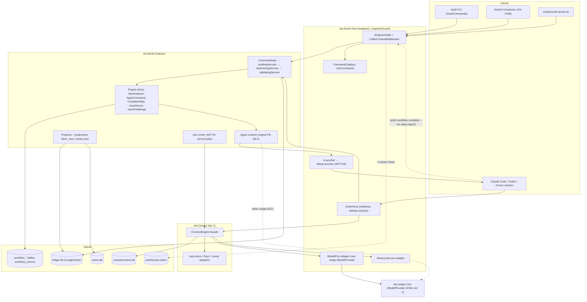
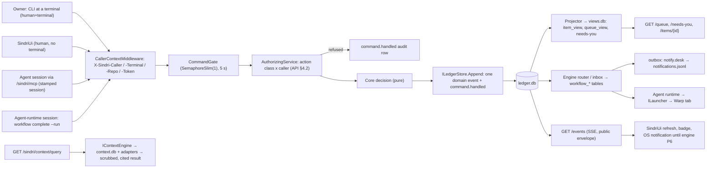

# Architecture Review: Sindri application design epic (PR #170), pass 2

_Reviewed by `/archReview` on 2026-10-11. The worktree `docs/sindri-app-epic` at `1c328de9`: `docs/sindri/README.md` (X1–X34), the API surface spec, the workflow engine spec (rev 5 + X19–X33) and the context retrieval spec. Pass 1 is in `pass1/arch-review.md` (F1–F20) and `pass1/consolidated-review.md` (E1–E29)._

## Verdict: NEEDS WORK

X19–X34 closed most of pass 1's structural gaps. The tier-legal model port, context jobs on API P6, a context dependency on API P1, the engine-to-item map, the agent runtime, launch-time MCP for Codex and Cursor, and the nonce and challenge carve-outs are now all written down. 6 of 20 pass-1 architecture findings are fully resolved, 9 are partly resolved, and 1 (F19) is deferred to the UI design spec. 4 are not resolved (F8, F17, F18, F20), and one of those, F8, is now HIGH because X34 depends on it.

The edits themselves opened four HIGH gaps:
- **N1:** the `step-report` credential has no transport. The CLI sends `session`, `/sindri/mcp` drops every header except the repo, and the "run token" in the spec is the public `--run 1.1` counter.
- **N2:** nothing records `session.ended`, two phases claim to own it, and the double-launch guard depends on it.
- **N3:** the engine has no route table. That covers X34's `GET /workflow/recipes`, the challenge and nonce routes, and addresses that contain `/`.
- **N4:** X28's table puts `parked` items in both `waitingOnYou` and the `parked` group.

There are also eleven MEDIUM findings, most of them X-edits that never reached every spec. No CRITICAL. The verdict comes from the four HIGH findings.

## Scores

_Anchored 1–5 scale from `_shared/severity.md`._

| Dimension | Score (1–5) | Notes |
|-----------|:---:|-------|
| Complexity | 3 | The model is coherent: one chain, one needs-you list, one MCP endpoint and one lock. N1 and N2 add unresolved moving parts to the newest piece, the agent runtime |
| Scalability | 4 | Nothing new is unbounded. The serialized `CommandGate` is kept free of jobs (X27). N6's in-handler terminal launch is the one new gate-holding risk (MEDIUM) |
| Maintainability | 3 | Three wave tables still disagree with the "one order" (N5). Several X-answers were written into one spec but not the others (N7). There is no engine route table (N3) |

## Component Diagram



## Data Flow Diagram



## Sequence Diagram

The most critical new flow is the unattended factory Step (engine P8). Error paths are shown, and the gaps are marked.

```mermaid
sequenceDiagram
  participant ENG as Engine (RunPostCommit)
  participant L as ILauncher (WarpLauncher)
  participant S as Agent session (Claude Code)
  participant CLI as sindri CLI (in session)
  participant API as Command chain (Gate→Audit→Authorize→Validate)
  participant CS as CompleteStep handler
  participant LED as ledger.db
  ENG->>L: launch(runToken, target, repo, injection plan, MCP endpoint)
  L->>S: Warp launch config (no item text)
  L-->>LED: session.launched (API P10 or engine P8? N2)
  S->>API: GET /workflow/instances/{address} via MCP? (route undeclared, N3)
  S->>CLI: sindri workflow complete <address> --run 1.1 --outcome done
  CLI->>API: POST … X-Sindri-Caller: session (agent vars set). Run credential header: undefined (N1)
  API->>API: AuthorizingService: class step-report needs a run-scoped token
  alt token valid for the open run
    API->>CS: validate report (§5.5)
    CS->>LED: workflow.transition (via: agent, token usage)
    CS-->>CLI: CommandAccepted(sequence)
  else no token / other run
    API->>LED: command.handled refused
    API-->>CLI: 403 SND-AUTH-002
  end
  Note over S,ENG: Session exits without reporting → session.ended → step.failed. Nothing observes a Warp tab's exit (N2); only the Step timeout fires
```

## Pass-1 findings: resolution check

| Pass 1 | E-id | Status | Evidence | What's left |
|---|---|---|---|---|
| F1 code collision | E1 | **Resolved** | API §9: new codes are `SND-API-011/012`. The S1 table lists `SND-API-001…005` | The "Fixed, from stage S1" table still omits `SND-CLI-002` and `SND-PROFILE-006` (S1 `docs/csharp/sindri.md` lines 179, 170). Whether `SND-AUTH-002` precedes `SND-PROFILE-004` isn't stated (L1) |
| F2 nonce/challenge vs CQRS | E8 | **Partly** | API §2.5 `ARCH-CQRS-001` carve-outs (X26) | Kind `issue` isn't an action class in API §4.1 or §4.2. The nonce's "any caller whose class may run a command on that instance" is a dynamic rule the static table can't express (N9) |
| F3 model port vs tiers | E9 | **Partly** | CTX §4: `IModelPort` in `Aw.Context.Core`, adapted in Sindri Host | A Sindri → Judge project edge would push Sindri past `packageFanOut: 4`. `deps.yaml` already has 4 project edges (lines 405–424), and only the Context edge has an exception. No phase owns the edge or its exception (N10) |
| F4 build order vs API P1 | E3 | **Resolved** for CTX | CTX stage table: S-1A depends on "API P1 merged" | WF P1/P3 signals run under the `sindri-prove.sh` alias (WF §6.1), which only exists after API P1 (wave 1), but README wave 0 schedules them (LOW, in L2) |
| F5 jobs inside the gate | E10 | **Resolved** | CTX S-4 and S-5B depend on API P6; X27 | `map import` (now `protected`) still runs as a whole map inside the 5 s gate, and nobody bounds it (in L2) |
| F6 agent runtime unowned | E2 | **Partly** | X21; WF §6.5 and P8; API §4.1 `step-report` | The credential and transport are undefined (N1). Session end isn't observed (N2). The metering source is unclear (N11) |
| F7 engine → item map | E12 | **Partly** | API §3.6 table (X28) | The new table contradicts the group table (N4). `escalated (timeout)` is answered with `--resume`, not accept/reject (L3) |
| F8 engine routes and addresses | — | **Not resolved** | WF §6.3 names only `GET /workflow/instances/{address}`. API §2.5 names the nonce and challenge routes. X34 adds `GET /workflow/recipes` | No route table anywhere. Addresses contain `/` (N3) |
| F9 protected list | E15 | **Partly** | API §2.1 names `answer-grant-tokens` | API §4.1, the "single list", still omits `recipe revoke`, `answer-grant-tokens` and the context `map import`, `promote` and `review` (L4) |
| F10 `workflow.request` | E25 | **Resolved** | API §3.4 "dropped"; WF status line 14 | — |
| F11 map review confirmation | E16 | **Partly** | CTX §8.6 retires `SND-CONTEXT-041`; X30 | Whether each interactive `[a]ccept` is a challenged command isn't settled. CTX Phase 3 says "the HTTP route imports them as `model` provenance", but API §3.7 makes the route `protected` outright. The challenge has no subject kind for a map batch or a profile hash (N12) |
| F12 per-provider registration | E6 | **Partly** | API §8 (X22) | CTX §3 still says "Codex and Cursor get the equivalent entry", and its doctor check reads only `~/.claude.json` (N8). Claude's local scope in a worktree is deferred to API P8 (acceptable) |
| F13 context repo scope and items | E7 | **Partly** | CTX §3 "Repo scope" (X25) | `ContextQuery` still carries no repo, so it's unstated how `X-Sindri-Repo` reaches tier-1 `Aw.Context`. No `IItemLinks` port; `item.linked` is unowned (N13) |
| F14 cross-spec DAG | E3, E27 | **Partly** | README "Build order" table (X19) | The API and WF wave tables still differ from it. API and CTX don't cite it (N5) |
| F15 context ledger events | E26 | **Resolved** | CTX §3 "Every command writes an event" | `map build`, a `job`, now appends `context.map.built`, which contradicts API §4.1's `job` row (L5) |
| F16 scoping owner | E11 | **Resolved** | X34; WF §3.2 `inputs` | The route it depends on is undeclared (N3) |
| F17 stale text | E29 | **Not resolved** | README spec table "API P0–P10", "S2 (P1–P7)"; API §3.7 before §3.6; CTX §4 "labeler (claude CLI)"; CTX §8.4 `linear:issue/ENG-482` | (L6) |
| F18 GET export writes a file | — | **Not resolved** | CTX Phase 3: exports written under `context/exports/`; API §3.7 classes `GET /context/map/export` as a query | (L6) |
| F19 launch host vs UI host | — | **Deferred** to the UI slot | README "Build order" puts the UI spec before API P10 | Listed in "UI design slot" below |
| F20 MCP architecture test | — | **Not resolved** | WF §4.2 line 284 still uses an assembly-reference rule | (L6) |

## Top Risks

| # | Risk | Impact | Likelihood | Mitigation |
|---|------|--------|------------|------------|
| 1 | The agent runtime can't report (N1). Or, if the "run token" is the public `--run`, any session that reads `status` can complete another agent's Step. That is an honest-mistake path: `next` prints the exact command | high | high | Define a separate run credential: name, header, storage, expiry, and that it isn't readable from `GET /workflow/instances`. Engine P8 owns it, and API P1 reserves the header |
| 2 | Opening an item is refused forever after its session closes, because nothing records `session.ended`. An agent Step whose session died waits for its full timeout (N2) | high | high | One owner (API P10) and a defined observer per target (a launch wrapper process that outlives the agent and appends `session.ended`, or a SessionEnd hook), plus a stale-session expiry |
| 3 | The UI design and the catalog test have no engine routes to build against (N3) | high | high | An engine route table in WF §6.3, with typed instance ids or the address in the query string |
| 4 | Parallel agent teams follow three different wave tables (N5) | med | high | Replace the API and WF wave tables with references to README "Build order", or make them match it |
| 5 | A Codex or Cursor implementer follows CTX §3 and registers Sindri MCP user-wide (N8) | med | med | Rewrite the CTX §3 bullet to point at API §8, and widen doctor `context:mcp-scope` to all three files |

## New findings (introduced or exposed by X19–X34)

| id | severity | lens | location | finding | recommended fix |
|---|---|---|---|---|---|
| N1 | HIGH | arch | API §4.1 and §4.2 `step-report`, §6 tokens, §8 ("stamps `session` … keeping only `X-Sindri-Repo`"; "no … job tool"); WF §6.5, §5.1 `run.token: {entry}.{n}`, §6.3 (`GET /workflow/instances` returns "the run token"), §6.4 (`next` prints `complete … --run 1.1`) | **The `step-report` credential has no transport, and the spec conflates it with the public run token.** The launched session reports with the CLI, and the CLI inside an agent sends `session`. The only token header, `X-Sindri-Token`, carries the human token. The MCP endpoint strips everything but the repo, and there is no MCP tool for reporting. WF §6.5 says the session is "proven by a run-scoped token `ILauncher` hands the session", but the `--run` it passes is `{entry}.{n}`. Any query caller can read that from `status`, and the `next` line prints it ready to copy. Also: WF §6.5 calls `step-report` a "caller class" (it's an action class). The `CompleteStep` variant isn't in the WF §6.2 class table, the API §3.5 ownership row or the catalog rows. API §2.1 classifies it by caller, while `IClassifiedCommand` is "by arguments" | Define `X-Sindri-Run-Token`, a random secret per launch. Store only its hash in `workflow_*`, never return it from a query, pass it as an environment variable that the CLI forwards, and have the server check it against the open run. Add a catalog row `CompleteStep:step-report`. Say that the class comes from the credential, not the arguments. API P1 reserves the header and the class; engine P8 builds the check. Optionally add `sindri_step_report` on MCP with the token as a tool argument |
| N2 | HIGH | arch | API P10 (`session.launched`/`ended`, `ItemView.session?`, "second open … refused (fact key per item and session)"); WF §6.5 "Ends", P8 Files (also `session.launched`/`ended`) and P8 signal ("Killing the session parks the Step") | **Nothing observes a session ending, and two phases own the same events.** `WarpLauncher` hands Warp a launch configuration and returns, so it can't see the exit. No hook, collector or wrapper is assigned (collector sessions are §11, later). Consequences: (a) "attach only when live" and the double-launch refusal never clear, so an item can't be reopened; (b) engine P8's signal can't pass except through the Step timeout. The key "per item **and session**" also wouldn't stop a second launch, because each launch has a new session id | API P10 owns both events in `EventCatalog`, and engine P8 only uses them. Define the observer per target: a small `sindri session run` wrapper that launches the agent, waits, and appends `session.ended` with the exit code, or provider SessionEnd hooks. Add a liveness expiry (for example, no heartbeat for N minutes means ended). Key the guard `session.launched:<itemId>:<generation>` |
| N3 | HIGH | arch | WF §6.3 (one GET route named), §5.4 `POST /workflow/instances/{a}/nonce`, §6.1 addresses `T-3/item/1/step.4`; API §2.5 `POST /workflow/challenges`; WF §3.2 and README X34 `GET /workflow/recipes`; API §3.3 catalog test "a row's route isn't in the endpoint table" | **The engine has no route table.** Pass 1's F8 is unresolved and X34 adds to it: the app's start form depends on `GET /workflow/recipes`, which no route table defines. Nothing defines routes for `StartInstance`, `ApplyCommand` and its variants, `CompleteStep`, `ListInstances`, `recipe show/list/register/approve/revoke`, `outbox list` or `workflow events`. The `{address}`/`{a}` segment can hold `/`. `ApplyCommand:command-<verb>` can't be a static catalog row | Add the route table to WF §6.3 (method, route, slice, class, catalog action id, phase), in API §3.2's format. Bind instances by a typed `InstanceId` (or `?address=`), as CTX does for keys. Use one row `ApplyCommand:command` with the verb validated in the body |
| N4 | HIGH | arch | API §3.6: the group table (`parked` group ← `parked` state; `waitingOnYou` ← `needs-decision`, `needs-answer`) vs the X28 table (`parked (any reason)` → `ItemState parked`, group `waitingOnYou`; `escalated` → `parked`, `waitingOnYou`) and the sentence "the `parked` group only holds items parked by a human's own choice" | **One `ItemState` maps to two groups.** Groups are keyed by `ItemState`, so X28's "every park sits in `waitingOnYou`" can't be built as written. P11 and the UI's queue have no single answer | Either map engine parks and escalations to `ItemState needs-answer` (with `reason` carrying the park reason), and keep `parked` for human-chosen parks. Or add an `ItemState` such as `parked-needs-you`. Fix both tables in one edit |
| N5 | MEDIUM | arch, devex | README "Build order" (X19: "every spec's dependency column cites" it); API "Dependency graph and waves" (P6 in W2 with P3, P10 straight after P8, no P11, gate on a "contract unit"); WF "Parallel execution" graph and wave table (no P8, P2 "S1 merged" only, P4 "P2 and P3 merged" only); CTX stage table (its own "Wave" 0–6 numbering; S-3/S-5A/S-2W after S-1A) vs README wave 6 "the rest of its stages"; README wave 5 puts API P6 behind engine P4 although P6 needs only P2 + P5 | **There are still three orders.** Only WF's Phases intro cites the README table, and WF's own wave table right below it contradicts it. API and CTX don't cite it. README wave 6 also holds back context stages that only need S-1A, and wave 5 holds back API P6, which delays S-4 and S-5B | Rename the local columns to "stage" (no wave numbers). Each spec's wave table becomes "see README Build order", or is regenerated from it. Move API P6 to wave 3 or 4 (needs P2 + P5). Put S-2W, S-3 and S-5A in the wave after S-1A. Add WF P8 to the WF graph |
| N6 | MEDIUM | arch | API P10 (`OpenItem` "takes it over (`pause`) in the same command"; records `session.launched`); API §2.1 ("exactly one domain event"; "handlers never do slow work … never git or the network"); API §3.2 `OpenItem` class `desk` | **`OpenItem` breaks the chain's own rules.** One command appends a pause on the engine instance, `session.launched`, and its own acceptance. It is classed `desk` while doing a `pause`. And it spawns a terminal inside the handler, under the 5 s `CommandGate` | `OpenItem` decides and appends `session.launch-requested` (one event). The engine's post-commit loop issues `ApplyCommand:takeover` as `service:launcher`, and `ILauncher` runs after commit, outside the gate. `SND-LAUNCH-001` arrives as a `session.ended` with reason `launch-failed`. State it in API P10 |
| N7 | MEDIUM | docs, arch | API §8 tool table "off while `context.mcp.enabled` is false" (X25 renamed it `context.sessions.enabled`); WF §6.3 "the app … never raises an OS notification itself" (X32: the app notifies until engine P6); API §3.5 `ILauncher` row and WF §7.2 "The desk runtime (W20) gives way to it" (X21: the desk runtime stays; the agent runtime is added in P8); API §3.5 "`EventFactory` … whichever phase lands first" (X33: API P1); WF §7.2 S1-D6 owner "P4" (API §3.5: API P5, and README puts P5 first); WF P4 Files "S1-D7", "the actor table"; WF §5.1 `runtime: desk\|launcher` vs §6.5 `agent`; README spec table "API P0–P10", "S2 (P1–P7)" | **X-answers written into one spec but not the others.** Each line is a small edit, but together they contradict the reconciliation they're meant to record | One sweep, line by line, as listed |
| N8 | MEDIUM | security, arch | CTX §3 "MCP registration … (Codex and Cursor get the equivalent entry)" and doctor `context:mcp-scope` reading only `~/.claude.json`; CTX Phase 1 Files (`context:mcp-scope`) vs API §8 (X22: Codex and Cursor never registered; doctor checks all three files) | **The context spec still prescribes the registration X22 forbids.** S-1M can create `/sindri/mcp` and `sindri mcp register` before API P8 (wave 3 vs wave 7). Its owner follows CTX §3 | Replace the CTX §3 bullet with a pointer to API §8. Doctor `context:mcp-scope` checks `~/.claude.json`, `~/.codex/config.toml` and `~/.cursor/mcp.json`. `register` emits Claude only |
| N9 | MEDIUM | arch | API §2.5 carve-outs "catalog rows of kind `issue`"; API §3.3 row fields (class, allowed callers, terminal); §4.1 and §4.2 have no `issue` | **X26's `issue` kind isn't part of the authorization model.** `AuthorizingService` checks a class against the table. The nonce rule ("any caller whose class may run a command on that instance") depends on the target command, so no row can express it. It's also unstated whether the issuing routes go through `CommandGate` | Add `issue` to §3.3 as a row kind whose authorization is "the class of the target action id" (the nonce takes `targetAction` in the body) or `protected-precheck` (challenge). Say both routes skip the gate and are audited. Add the case to the §12 authorization unit test |
| N10 | MEDIUM | arch | README X18; CTX §4 (Sindri Host adapts Judge's `IModelProvider`); WF P8 "Judge's provider port"; `deps.yaml` lines 405–424 (Sindri: Kernel, KernelData, KernelTelemetry, Redaction = `packageFanOut: 4`); CTX S-1C (fan-out exception on the Context edge only) | **The Sindri → Judge edge has no owner and would fail `check-deps.mjs` on fan-out.** The tier pattern is right, but the edge is a fifth (with Context, a sixth) project edge and has no exception | Name the phase that declares `Sindri → Judge` (`project`, planned) and its `DEPS-FANOUT-001` exception, presumably the first consumer: CTX S-4 or engine P8, whichever lands first. Or move `IModelProvider` and `IProviderCatalog` to a tier-0 contracts package |
| N11 | MEDIUM | arch | WF §6.5 "Tokens … read by the target's provider adapter (Judge's `IModelProvider` catalog, X18) from the session's own usage output" | **The metering source is a port that doesn't do this.** `IModelProvider` makes model calls. Reading a Claude Code, Codex or Cursor session's usage is transcript parsing, which scorer does today (`scorer live`). It's also unstated whether the session reports its own usage (honour system) or the server reads it | Name an `ISessionUsage` port per launch target, adapted over scorer's CLI (`deps.yaml` already has `Sindri → Scorer` as a `cli` edge). Budgets read it at report time. Self-reported numbers are fine under the threat model, but say so |
| N12 | MEDIUM | arch, security | WF §4.2 (the challenge's subject: "the recipe hash and version, or the instance version"); API §3.2 (it replaces `profile approve`'s flag); CTX §8.6 and §8.7 and Phase 3 (map review apply, `import` and `promote` use it) | **The shared challenge has no subject for the non-engine protected actions.** Profile hash, map draft version and review batch hash are missing. The interactive `[a]ccept` loop has no stated command granularity. CTX Phase 3's "HTTP route imports as `model`" contradicts API §3.7 making that route `protected` | Make `IssueChallenge` take `{actionId, subject}`, with subject kinds `recipe`, `instance`, `profile`, `map-draft` and `review-batch`. Interactive review records decisions locally and applies one batch through one challenged command. Split `ImportMap` into `ImportMap:draft` (`desk`) and `ImportMap:current` (`protected`) |
| N13 | MEDIUM | arch | CTX Phase 6 (`item.linked`, service `context-sync`, "which API routes resolve"); API §3 `ItemId` aliases (P3); API §3.4 (no `item.linked`); CTX §4 (`Aw.Context` uses no Sindri types) | **Linking items to Linear records has a name but no design.** Tier-1 `Aw.Context` can't know `ITM-…` ids. No `EventCatalog` row, no projection folding the alias for API P3's resolver, and no matching rule (how `context-sync` decides which item an issue belongs to). API P3 resolves aliases from wave 2, but links only exist from CTX S-6 | API owns `item.linked` (event, key `item.linked:<itemId>:<recordKey>`, alias projection) in P3. Context exposes `IContextEngine.LinkCandidates(...)`, and a Sindri service decides and appends the event. Until S-6, aliases resolve only from links made explicitly with `sindri item link` |
| N14 | MEDIUM | arch, devex | API §6 "The `human` token before the app writes" (no phase); API §12 `sindri-prove.sh human` and `curl` (send no token); P1–P11 signals | **The `human` token has no phase.** Once it lands, a `human` header without it counts as `session`, so every prover `curl` and earlier signal starts failing with `SND-AUTH-002` | Assign it an API phase (for example P3b, before the UI's first write phase). That phase updates `sindri-prove.sh` to read `auth/human.token` from the guarded temp home, and adds the case to the §12 header tests |
| N15 | MEDIUM | security, arch | CTX §8.7 "`map promote` (or emptying the review queue, **or a build whose queue is empty from the start**) makes it `current`"; API §3.7 (build is `job`; import and promote are `protected` *because* they make content current); CTX Phase 4 "a scheduled rebuild" | **A `job` (or the scheduler) can make a map `current` without the protected confirmation X30 required.** The app (human, no terminal) can run it | A build only ever writes a draft. An empty-queue draft becomes a one-line `needs-you` row ("promote v14?", `cli-only`), or the protected promote accepts empty-queue drafts in bulk |
| L1 | LOW | docs | API "Fixed, from stage S1" | `SND-CLI-001/003` omits `-002`, and `SND-PROFILE-001…005` omits `-006`. `SND-AUTH-002` vs `SND-PROFILE-004` precedence isn't stated | Copy S1's list. State that `AUTH-002` comes first and `PROFILE-004` stays for a wrong typed confirmation |
| L2 | LOW | arch | README wave 0 (WF P1/P3); WF §6.1 alias; CTX §11 and Phase 1 "S1" lines (no API P1); `map import` size in the gate | Small order leftovers | WF P1/P3 run `$SINDRI` directly until API P1. CTX §11 and Phase 1 list API P1. Bound `map import` or run it as a job |
| L3 | LOW | arch | API §3.6 `escalated` row | `escalated (timeout)` and `escalated (child)` aren't answered by accept/reject | Set the primary action per escalation reason |
| L4 | LOW | arch | API §4.1 `protected` row | Not the single list (pass-1 F9) | List every protected action id, including the context ones. A catalog test checks that every row WF or CTX marks protected is protected |
| L5 | LOW | arch | API §4.1 `job` ("writes only its own job events and, for `RunService`, the run's `service.ran`") vs CTX §3 `context.map.built` and `context.sources.synced` | The class definition excludes the events X32 added | Widen the `job` row: "… and the domain event its job kind registers" |
| L6 | LOW | docs | F17, F18, F20 leftovers (see the table above) | Stale lines and a GET with a side effect | Sweep. `GET /context/map/export` returns the body, and the CLI writes the file |

## Edge Case Matrix

| Boundary | Dependency unavailable | Invalid/malicious input | Load 10x | State leakage |
|---|---|---|---|---|
| Command chain (`CommandGate` → audit → authorize → validate) | OK — gate 5 s → `SND-API-009`; stalled projector fails fast `SND-VIEW-001`; audit failure → `SND-LEDGER-002` (API §2.1) | OK — 64 KiB cap, 400/415 before the chain; unknown caller `SND-API-007`; `Origin` refused `SND-API-008` (API §2.1, §6) | N6 (in-handler launch holds the gate) | OK — `CallerContext` via `AsyncLocal` accessor; fact keys settle races `SND-ITEM-409` (API §2.1) |
| `/sindri/mcp` (shared endpoint) | OK — not running → client reports failed, nothing starts it (API §7) | N1 (no step-report path; only repo header kept) · OK — tools fenced, `trust` field (API §8, X32) | OK — stateless mode; stream caps 12 session / 16 total (API §5.4) | N8 (CTX §3 user-wide registration for Codex/Cursor) |
| Agent runtime ↔ `ILauncher` | N2 (session exit unobserved; launch failure only `SND-LAUNCH-001`) | N1 (public run token reused as credential) | OK — at most 3 implementers / 2 builds is a team limit; the runtime itself is per Step (WF §6.5); no concurrency cap stated is acceptable for a single owner | N2 (stale `ItemView.session` blocks reopen) |
| Engine routes (nonce, challenge, instances, recipes) | OK — nonce expiry 10 min, consumed in `Commit` (WF §5.4) | N3 (addresses with `/` in a path segment), N9 (nonce authorization) | OK — timers service purges nonces (WF §5.4) | N12 (challenge subject set too narrow) |
| Projector → item and needs-you views | OK — rebuild/stall states, `EmptyText` (API §2.3, §3.6) | OK — scrubbed + sanitized text, no raw control characters (API §3.6 "Agent text") | OK — paged `ReadAfter(cursor, 100)`, signal-woken (API §5.4–5.5) | N4 (state↔group ambiguity) |
| `IContextEngine` facade (HTTP/CLI/MCP) | OK — degraded per source `SND-CONTEXT-010`, all down `-011` exit 2 (CTX §8.6) | OK — repo scope as unknown anchor `SND-CONTEXT-003`; keys never in path (CTX §3, §8.5) · N13 (item ids) | OK — map build and sync as P6 jobs (CTX S-4/S-5B, X27) | N15 (job makes content current) |
| Model port (`IModelPort` / Judge `IModelProvider`) | OK — `claude` CLI adapter stands in until #156 (CTX §4) | OK — keys as secret pointers only (README X18, CTX §4) | N11 (no session-usage source for budgets) | N10 (Sindri → Judge edge unowned, fan-out) |
| Build order across specs | N5 | OK — owner merges only; stacked PRs change to specs first (README X17) | N5 (waves delay P6 and context stages) | OK — per-agent temp homes via `sindri-prove.sh` (API §12) · N14 (token breaks prover) |

### Findings

N1–N15 and L1–L6, defined in "New findings" above. Every `OK` cell above was checked against the cited section text in the worktree at `1c328de9`.

## Missing Error Handling

- API P10 / WF §6.5: no code or event for "the session ended without a report" other than `step.failed`. No code for "attach requested but no live session" (presumably `SND-ITEM-409`; state it). No code for "open refused, a session is live".
- API §6: no code for a run token that is wrong or expired on `step-report` (only `SND-AUTH-002`, which says nothing about the run).
- CTX Phase 6: no refusal for an `item.linked` conflict (one Linear record linked to two items).
- WF §4.2: no stated error for a challenge requested for a subject kind it doesn't support (map batch, profile) until N12 is fixed.

## UI design slot: what `<date>-sindri-ui-design.md` must settle

These are open contract items only, not design content.
1. The launch host vs the UI host (F19): server-side `ILauncher`, or a launch descriptor the client runs.
2. The launch targets' failure states and per-item vs profile-default target (API P10 defers them to the UI spec).
3. The first write phase that triggers the `human` token (N14 needs it as a phase).
4. The recipe start form from `inputs` (needs N3's `GET /workflow/recipes`).
5. How `cli-only` rows show the copy flow for the context protected actions too (N12, L4).
6. How queue groups show engine parks (after N4).
7. Attach and open availability from `ItemView.session` (after N2).
8. In-app OS notifications until engine P6, and turning them off at P6 (API §5.1; WF §6.3 must agree, N7).

## Suggested Improvements (Prioritized)

| Severity | Improvement | Effort | Impact |
|----------|------------|--------|--------|
| HIGH | Define the `step-report` run credential: header, secret, never readable from queries, CLI forwarding, catalog row (N1) | S | The factory line can report without opening a cross-session completion path |
| HIGH | One owner and an observer for `session.ended`, a liveness expiry, and a per-generation guard key (N2) | M | Items can be reopened; dead agent Steps fail fast |
| HIGH | Engine route table with typed instance ids, including `GET /workflow/recipes`, nonce and challenge (N3) | S | The UI spec and the catalog test have something to bind to |
| HIGH | Make the item state ↔ group mapping consistent (N4) | S | P11 and the queue have one answer |
| MEDIUM | One build order: local wave tables reference README; move API P6 and early context stages forward (N5) | S | Agent teams stop following conflicting schedules |
| MEDIUM | `OpenItem` appends one event; takeover and launch run post-commit (N6) | S | The chain's invariants hold |
| MEDIUM | Propagate X-answers: the N7 sweep, the CTX §3 registration (N8) | S | Specs match the reconciliation |
| MEDIUM | `issue` row kind in the auth model; challenge subjects; import split; no auto-promote (N9, N12, N15) | M | Protected stays protected for every action |
| MEDIUM | Owners for the Judge edge, session usage, `item.linked` and the human-token phase (N10, N11, N13, N14) | M | No orphaned work between specs |
| LOW | L1–L6 sweep | S | Doc hygiene |

verdict: NEEDS_WORK
