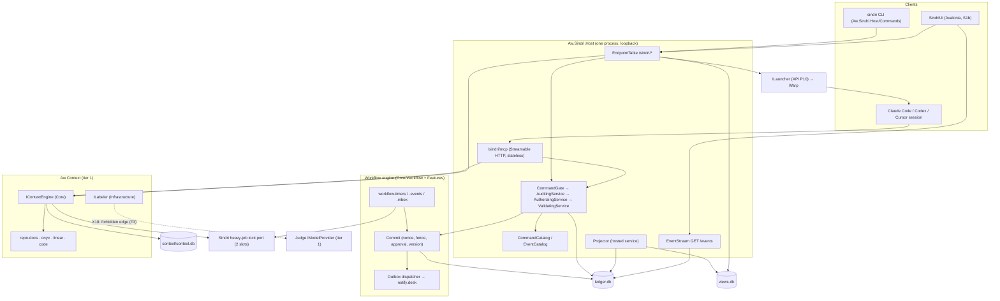
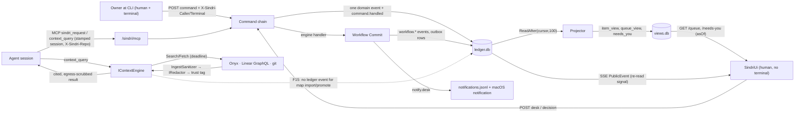

# Architecture Review: Sindri application design epic (PR #170), cross-spec coherence

_Reviewed by `/archReview` on 2026-10-11_

Scope (from `plan.md`): cross-spec coherence only, after the X1–X18 reconciliation. Settled internals of each spec are not re-reviewed. Threat model: honest agent mistakes, single owner.

Documents read in full (worktree `docs/sindri-app-epic`):
- `docs/sindri/README.md` (README): "The application", the spec table, X1–X18
- `docs/superpowers/specs/2026-10-10-sindri-api-surface-design.md` (API)
- `docs/superpowers/specs/2026-10-10-sindri-workflow-engine-design.md` (WF)
- `docs/superpowers/specs/2026-10-10-sindri-context-retrieval-design.md` (CTX)
- Checked against: `deps.yaml` (tiers and edge rules) and the S1 contract `docs/csharp/sindri.md` on `origin/feat/sindri-s1-app-shell`

## Verdict: NEEDS WORK

The X1–X18 pass closed most of the earlier seams. The caller model, `/needs-you`, the notifier, `ItemId`, state home, error-doc location and heavy lock are now consistent. Six HIGH findings remain, and none of them is CRITICAL:
- **F1:** API's new error codes collide with codes S1 already ships.
- **F2:** the engine's nonce and challenge POSTs fall outside the CQRS and authorization model, which breaks session takeover (X3).
- **F3:** the X18 model port, as written, is a project edge that `deps.yaml` forbids.
- **F4:** the context stages' build order ignores API P1, which contradicts X17.
- **F5:** long-running context commands would run inside the 5 s, serialized `CommandGate`.
- **F6:** nobody owns the engine's launcher Step runtime or a session-to-engine completion path. X15 handed it to API P10, but P10 only builds the human `OpenItem` handoff.

Each has a contained fix in text, so the specs need edits, not a redesign.

## Scores

_Anchored 1–5 scale from `_shared/severity.md`._

| Dimension | Score (1–5) | Notes |
|-----------|:---:|-------|
| Complexity | 3 | Three idempotency and confirmation mechanisms meet at the seams: API fact keys, engine nonces, and challenge versus y/N. Engine routes are undeclared (F2, F8, F11). The fixes are local |
| Scalability | 3 | The single `CommandGate` is sound for short commands. Context `map build` and `sources sync` would serialize behind it (F5). Nothing else is unbounded across the seams |
| Maintainability | 3 | The code collision (F1), the forbidden dependency edge (F3) and the scattered phase graphs (F4, F14) would surface as CI or merge failures, not silent drift. Each has a clear owner once named |

## Component Diagram



## Data Flow Diagram



## Sequence Diagram

The most critical cross-spec flow is a park that the human answers from the app, with the hook-driven takeover path as its error branch.

```mermaid
sequenceDiagram
  participant Timers as workflow.timers (service)
  participant Commit as Workflow Commit
  participant Ledger as ledger.db
  participant Proj as Projector (API P11)
  participant UI as SindriUi
  participant Chain as Command chain (API P1)
  participant Hook as Takeover hook (in session)
  Timers->>Commit: deadline trigger {entry}:state:{arm}
  Commit->>Ledger: workflow.transition (parked: timeout) + outbox notify.desk
  Ledger-->>Proj: ReadAfter
  Proj->>Proj: fold → item state ? / needs-you row kind park (F7: mapping undefined)
  UI->>Chain: GET /needs-you (X-Sindri-After)
  Chain-->>UI: row primaryAction = ApplyCommand:answer
  UI->>Chain: POST /workflow/instances/{address}/nonce (F2: unclassified POST; F8: '/' in address)
  Chain-->>UI: nonce
  UI->>Chain: POST ApplyCommand:answer --resume + nonce (desk, human no terminal)
  Chain->>Commit: Commit (nonce, fence, approval, version)
  Commit->>Ledger: workflow.transition (rearm)
  Chain-->>UI: CommandAccepted(sequence)
  alt error path: agent session attaches
    Hook->>Chain: POST nonce (caller session) 
    Chain-->>Hook: class undefined → desk → 403 SND-AUTH-002 (F2), so takeover (pause, X3) cannot proceed
  end
  alt error path: grant needed (rounds/budget park)
    UI-->>UI: protected → show "copy: sindri workflow answer … --grant 1"
  end
```

## Top Risks

| # | Risk | Impact | Likelihood | Mitigation |
|---|------|--------|------------|------------|
| 1 | Engine nonce and challenge POSTs have no class or catalog row. Either ARCH-CQRS-001/003 fails on engine P2/P4, or they default to a class that refuses session takeover (F2) | high | high | Classify both explicitly, or drop engine nonces in favour of API's `CommandId` and fact keys |
| 2 | Context stages ship routes and the MCP endpoint before API P1 exists, outside the chain (F4). A `map build` POST then holds `CommandGate` for minutes (F5) | high | high | Add API P1 (and P6 for jobs) to the CTX stage DAG, and make `map build` and `sources sync` jobs |
| 3 | Code collision: `SND-API-004` and `-005` already mean "uncoded error" and "unhandled exception" in S1 (F1) | high | certain | Re-baseline API §9 against S1's real table |
| 4 | The labeler cannot reference Judge's `IModelProvider` under `deps.yaml` (F3) | med | certain | Use a Context-Core model port, adapted in Sindri Host (the `IHeavyJobLock` pattern) |
| 5 | The factory's automated Steps have no launcher runtime and no completion channel, so engine-launched agents can't finish a Step (F6) | high | med (later phases) | Name the owner spec now and define a run-token-scoped report class |
| 6 | Per-repo MCP registration doesn't reach worktree sessions or Codex, and may leak via Cursor or Codex user config (F12) | med | med | Write the per-provider registration rules and add doctor checks |

## Edge Case Matrix

Rows are the cross-spec boundaries. Evidence cites spec sections, because nothing is built yet.

| Boundary | Dependency unavailable | Invalid/malicious input | Load 10x | State leakage |
|---|---|---|---|---|
| CLI → API (`control.json`, headers) | OK — API §7: stale `control.json` is `SND-API-001`, 2 s ping, never auto-start in a session | OK — API §6: unknown caller is `SND-API-007`; `Origin` is `SND-API-008`; body cap 64 KiB (§2.1) | OK — API §2.1: gate times out at 5 s with `SND-API-009` | F1 (code meanings collide with S1, so clients map the wrong fix text) |
| SindriUi → API + SSE | OK — API §2.4 and §5.4: 30 s staleness, 5 s re-query fallback on `SND-API-005` (but see F1) | OK — API §3.6: text sanitized at projection; UI renders plain text | OK — API §5.4: 16 streams, 4 reserved for humans | F7 (engine item states and desk tasks unmapped, so the UI shows the wrong group) |
| `/sindri/mcp` → handlers and `IContextEngine` | OK — API §7: endpoint down means the MCP client reports failed and nothing starts | F13 (context tools: no repo in `ContextQuery`, so X8's repo scope isn't enforced for `context_*`) | OK — API §5.4 / CTX §8.3: server-side caps, depth ≤ 4, `Limit` ≤ 200 | F12 (registration scope across providers and worktrees) |
| Command chain → ledger (API P1) | OK — API §2.1: audit-write failure rules, `StopProcess` self-audited | F9 (protected set and fail-closed field names differ across specs) | F5 (context `job`/`desk` commands would do slow work inside the gate) | F10 (two request paths: `workflow.request` vs `request.filed`) |
| Engine `Commit` ↔ API chain (X4) | OK — WF §5.3: gate answers in their own transaction; system triggers re-decide up to 3 times | F2 (nonce and challenge POSTs outside the chain's classes); F8 (`/` in address path params) | OK — WF §5.6: one loop per service (S1-D10); W13: one transaction per trigger | F14 (S1-D7/C6 claimed by both API P1 and WF P4) |
| Projector / `views.db` ← engine events (API P11) | OK — API §2.3: `stalled`, `SND-VIEW-001`, rebuild always runs | OK — API §3.6: scrub and escape on write | OK — API §2.3: 100-row pages, no sleep between full pages | F7 (park reason → `ItemState` and needs-you kind mapping unowned) |
| Context facade → Onyx / Linear / git | OK — CTX §5.1: `Unavailable` is degraded; every source down is `SND-CONTEXT-011` | OK — CTX §5.1 and §7: argument validation, `IngestSanitizer`, per-field egress scrub, trust by provenance | F5 (`map build` route vs `CommandGate`; needs API P6 jobs) | F15 (context commands append no ledger event, so the stream and UI never refresh) |
| Context ↔ Sindri items (X6) | F13 (Aw.Context can't resolve `ITM-…` to `linear:issue/<uuid>`; no port) | OK — CTX §5.1: aliases only from structured metadata, regex-checked | OK — CTX §8.3: caps | OK — CTX §3: per-repo registration and `context.mcp.enabled` off by default |
| Heavy-job lock port (X13) | OK — CTX §8.6: exit 75, `SND-CONTEXT-040`; WF §3.4: parks `SND-WF-010` until the port lands | OK — CTX §4: port in Core, adapter in Host, no upward edge | OK — two slots (`AW_HEAVY_SLOTS`) | OK — CTX §4: one Sindri lock port serves both |
| Model provider port (X18) | F3 (no legal edge from `Aw.Context.Infrastructure` to Judge) | OK — CTX §7: text scrubbed before labeling | F6 (no token meter for session Steps; budgets in WF §3.7 have no source) | OK — CTX §3: egress switches off until approved |
| `ILauncher` (API P10) → Warp / agent | OK — API §9: `SND-LAUNCH-001` | OK — API P10: ids and repo path only, no item text | F19 (launch happens on the server host; `--headless` or a remote UI) | F6 (engine Step runtime and completion path unowned) |

### Findings

| id | severity | lens | location | finding | recommended fix |
|---|---|---|---|---|---|
| F1 | HIGH | arch | API §9 table, API "Fixed, from stage S1"; S1 `docs/csharp/sindri.md` lines 173–177 | **Error-code collision with S1.** S1's branch already defines `SND-API-004` (an API error without a catalogue code) and `SND-API-005` (an unhandled handler exception), plus `SND-CLI-003` and `SND-PROFILE-006`. API reserves `SND-API-004` for "views didn't reach the head" and `SND-API-005` for stream limits, and lists S1's fixed set as `SND-API-001…003`, `SND-PROFILE-001…005` and `SND-CLI-001/002`. API §1's "new codes start at 004" rule is stale. S1's `SND-PROFILE-004` ("no terminal or wrong confirmation") also overlaps `SND-AUTH-002` once the chain runs first | Re-baseline API §9 and the "Fixed" table from S1's actual catalogue. Give the view-wait, rebuild and stream codes unused numbers (`SND-API-006` stays reserved for tokens). State that `SND-AUTH-002` precedes `SND-PROFILE-004` for the no-terminal case, and keep `-004` only for a wrong typed confirmation |
| F2 | HIGH | arch | WF §5.4 (`POST /workflow/instances/{a}/nonce`), §4.2 / §7.1 `IssueChallenge`, §6.3; API D1, §2.1, ARCH-CQRS-001/003, §4.2 | **Engine nonce and challenge issuance are POSTs with no action class, no catalog row and no domain event.** API D1 and ARCH-CQRS-001 say every POST is an `ICommand` that appends one domain event and has a catalog row with a class. Every engine write, `takeover` (`pause`, open to sessions, X3) included, needs a nonce first (WF §6.3). If nonce issuance is `desk` by default, the hook can't take over. If it is unclassified, the architecture and catalog tests fail | Pick one approach. (a) Carve out explicitly: nonce issuance takes the class of the action it is for (at minimum `pause`), is audited but appends no domain event, and is listed as an ARCH-CQRS-001 exception. The challenge needs `human` with a terminal. (b) Drop engine nonces and use API's `CommandId` with WF's trigger key `wf:{instance}:{trigger}`, which already gives idempotency. Either way, add the rows to the catalog and the UI slot |
| F3 | HIGH | arch | CTX §4 (labeler in `Aw.Context.Infrastructure`, project edges Kernel / Kernel.Data / Redaction, tier 1), §11; README X18; `deps.yaml` rules lines 19–33 (`Judge` tier 1) | **The X18 model port is an illegal edge as written.** Project edges must point strictly down the tiers (Context and Judge are both tier 1). Infrastructure may use tier-0 packages only (DEPS-PROJ-008). CTX's declared edges don't include Judge. `check-deps.mjs` will refuse S-4's labeler | Apply the `IHeavyJobLock` pattern: declare `IContextModel` (or `ILabelerModel`) in `Aw.Context.Core`, and adapt Judge's `IModelProvider` in Sindri Host, which may reference `Aw.Judge.Core` from Features or Host (tier 3 → 1). Pass the adapter to `AddContextInfrastructure`. Alternatively, move `IModelProvider` and `IProviderCatalog` to a tier-0 package. Write the chosen edge into `deps.yaml` and CTX §4 and §11 |
| F4 | HIGH | arch | CTX "Stages" table (S-1A: "S1 merged · S-1C · S-FX"; S-1M: "S-1A"), §3 "every route goes through the API spec's command chain"; README X17; API Phases "Gate"; WF §6.1 dev loop alias, P1/P3 "stacked on S1" | **Build order contradicts X17.** The CTX stage DAG never depends on API P1, but CTX §3 and §8.5 require the chain, the caller classes, catalog rows, `session` stamping on `/sindri/mcp`, and the `Origin` refusal. S-1M is likely to create `/sindri/mcp` before API P8 and before API P1's `CallerContext` exists. Separately, WF's dev loop aliases `scripts/sindri-prove.sh`, which API P1 adds, while WF P1 and P3 run "now, stacked on S1" | Add "API P1 merged (or its contract unit, per the API gate)" to S-1A and S-1M in the CTX table and mermaid, and "API P6" to the S-4 `map build` route (F5). Mark WF P1 and P3 signals as `local`-only (no wrapper) until API P1. Put one consolidated cross-spec DAG in README X17 |
| F5 | HIGH | arch | CTX §8.5 (`POST /context/map/build`, `/sources/sync`), §8.6 (exit 75, progress lines), Phase 4; API §2.1 ("handlers never do slow work", `CommandGate` 5 s, serialized), §3.7 (class `job`), P6 (jobs) | **Long-running context commands vs the single command gate.** A synchronous map build or sync inside a command handler holds the process-wide `SemaphoreSlim(1)` for minutes, and every other command fails `SND-API-009`. The `job` class presumes API P6's job runner (`JobId`, `job.*` events, cancel), which no CTX stage depends on. `map import` (desk) is all-or-nothing over a whole map, so it also risks exceeding the gate | `map build` and `sources sync` return `JobStarted` and run on API P6's job runner; the CTX dependency is API P6. `map import` validates then appends a decision event, and the write runs as a job, or the spec bounds the import size under the gate. State it in CTX §8.5 and API §3.7 |
| F6 | HIGH | arch | README X15; API §3.5 (`ILauncher` row), P10 (`OpenItem` only); WF W20 ("desk runtime … until `ILauncher` exists"), §5.1 `run.runtime: desk\|launcher`, §6.2 (`CompleteStep` is `desk`), §13 "ILauncher gets its own design next" | **Ownership gap: the engine's launcher Step runtime.** API P10 builds only the human handoff (open or attach a terminal for an item). Nobody owns the runtime that starts an agent session for a Step, carries the run token, and receives its report. Under API §4.2 a session may not call `CompleteStep` (`desk`), so an engine-launched agent can't finish its Step. WF Step budgets (`spent`, `budget.tokens`) have no metering source for session-run Steps | Split X15 in two. API P10 keeps `OpenItem`. Name the owner of the "launcher runtime" (the worker-recipes design WF §13 already points to) and require it to define: (1) the completion channel, either a `service:launcher` that turns session output into `CompleteStep` or a new run-token-scoped class callable by `session`; (2) the token meter (provider usage via the X18 port, or scorer); (3) how `ILauncher` targets serve both. Reference it from WF W20 and API §3.5 |
| F7 | MEDIUM | arch | API §3.6 (ItemState groups), P11; WF §3.8 (park reasons, escalated, desk tasks), §6.3 `--needs-me` (Decisions vs Tasks) | **The engine → item-state and needs-you mapping is unowned.** API P11 lists target states but no mapping. Which park reasons are `needs-answer` and which are `parked`? `escalated` has no `ItemState` or queue group. Is an open desk task `running` or waiting on the human? WF splits needs-me into Decisions and Tasks, but `NeedsYouRow.kind` has only `park` | Add a mapping table to API §3.6, owned by P11: frame or park reason → `ItemState`, group, needs-you kind, and `primaryAction` (`copy:` for protected answers). Add `kind: task` (or a `reason` field) so the Tasks split is reproducible |
| F8 | MEDIUM | arch | WF §5.4, §6.3 (`GET /workflow/instances/{address}`), §6.1 addresses `T-3/item/1/step.4`, §6.2 `ApplyCommand:command-<verb>`; API §3.3 catalog test (route must exist), CTX §8.5 ("keys never in the path; they hold `/`") | **Engine routes are undeclared and addresses don't fit a path segment.** The catalog requires method and route per action id, and WF names none for `StartInstance`, `ApplyCommand` or `CompleteStep`. Addresses contain `/`. Dynamic `command-<verb>` variants can't each be a static catalog row | List every engine route in WF §6.3. Bind the instance by a typed id, or the address in a query or body (as CTX does). Make one catalog row for `ApplyCommand:command` with the verb as a validated parameter |
| F9 | MEDIUM | arch | API §2.1 (fail-closed rule names `grant`/`accept`), §4.1 protected list; WF §6.2 protected list (adds `recipe revoke`, `answer-grant-tokens`); CTX §3.7 (map review apply) | **The protected set differs across specs.** API §4.1 omits `recipe revoke`, `answer-grant-tokens` and the context map review apply. The `IClassifiedCommand` rule names only `grant` and `accept`, so the `grantTokens` field may not trip fail-closed | Make API §4.1 the single list, with every protected action id. Extend the rule to "any of `grant`, `grantTokens`, `accept`". Add a catalog test that every row WF or CTX marks protected is protected |
| F10 | MEDIUM | arch | WF §5.2 (`workflow.request`: "A session's request (MCP)"); API §3.2 `FileRequest`, §3.4 ("acted on once the workflow engine runs") | **Two request paths, and no consumer for accepted requests.** WF still lists its own `workflow.request` event, and the X-list doesn't reconcile it. API says accepted requests are "recorded only" until S2, but no WF phase acts on an accepted `rescope`, `add-task` or `handback` | Drop `workflow.request` from WF §5.2. Assign "accepted request → engine action" (for example `rescope` → `command.rescope` on the instance) to a named WF or API phase, or record it as `recordedOnly` until the scoping workflow exists |
| F11 | MEDIUM | arch | CTX §8.7 (per-proposal `[a]ccept`, `--apply` y/N confirm), §8.6 `SND-CONTEXT-041`, Phase 3 (import restores `human` rows "at an interactive terminal"); API §3.2 / WF §4.2 (every protected action confirms by the server challenge, S1-D5) | **Map review doesn't follow the shared confirmation.** Is each interactive accept a protected command with its own challenge? `SND-CONTEXT-041` duplicates `SND-AUTH-002`, the same way WF already retired `SND-RECIPE-004` and `SND-WF-007`. `map import` (desk) changes provenance by terminal flag instead of by class | Define a review session as a local queue that produces one review batch, applied by one protected command whose challenge is bound to the batch hash. Retire `041` for `SND-AUTH-002`. Make human-provenance import a protected variant (`ImportMap:human`) |
| F12 | MEDIUM | arch | API §8 registration; CTX §3, doctor `context:mcp-scope` (checks `~/.claude.json` only) | **Per-repo MCP registration is only specified for Claude.** Claude's `--scope local` is keyed by the project path, so sessions in `.claude/worktrees/*`, the way the factory and `/specToProvenPR` run, likely won't see the server, while API §3.1 resolves worktrees to their repo. Codex's MCP config is user-level (`~/.codex/config.toml`), so "personal repos never see work context" doesn't hold. Cursor's project `mcp.json` sits inside the repo | Specify each provider's mechanism and its worktree behaviour, and verify Claude's local scope in a worktree. Make doctor `context:mcp-scope` cover Codex and Cursor user configs. Have `OpenItem` (P10) pass the MCP config explicitly for launched sessions (as the API proof does with `--mcp-config`) instead of relying on registration |
| F13 | MEDIUM | arch | README X6, X8; CTX D5 (no Sindri imports), §8.1 `item` shape, §8.5 MCP tools (no repo argument) | **Context can't honour repo scope or `ITM-…` items.** `ContextQuery` carries no repo, so X8's "repo-scoped the same way" isn't enforceable for `context_*`. `Aw.Context` can't resolve an `ItemId` to its linked `linear:issue/<uuid>` without a port | Add `Scope` (repo) to `ContextQuery`, filled by the endpoint from `X-Sindri-Repo`, and restrict anchors and sources to that repo's `context.repos` entry. Add an `IItemLinks` port in `Aw.Context.Core`, adapted in Sindri Host over the item views, or resolve aliases in Sindri before calling the facade |
| F14 | MEDIUM | arch | WF Phases (P2: "API P1 merged"; P4: S1-D6, S1-D7, `--needs-me`); API Phases Gate ("contract unit"), §3.5 rows, P11 (missing from the wave graph); README spec table ("API P0–P10") | **The phase dependencies don't agree across specs.** WF P4 reads `GET /needs-you` (API P4) and claims S1-D7 (API P1's C6) and the event filter (API P5), but lists only "S1 merged". The API gate says contract unit; WF says merged. API P11 depends on WF P4 but sits in no wave | One cross-spec DAG in README X17, naming API P1–P6, P8, P10, P11, WF P1–P7 and CTX S-1A…S-10 with their edges. Update each spec's table to cite it. Remove S1-D7 from WF P4 (API P1 owns it, per API §3.5) |
| F15 | MEDIUM | arch | API D1 (every command appends one domain event), §3.4 `EventCatalog`; CTX §8.5 POST routes, §6.2 (state only in `context.db`) | **Context commands write no ledger event.** Import, promote, review and sync leave nothing in the ledger, so the SSE stream never tells the UI to re-read, the audit has only `command.handled`, and `EventCatalog` has no rows | Define `context.map.imported`, `.promoted`, `.reviewed`, `context.source.synced` and `context.map.built` (as `job.finished`) with public payloads of counts and versions. Or write an explicit carve-out in API D1 |
| F16 | MEDIUM | product/arch | README X2 (the app "starts workflows (scoping included)"); WF §12 (first recipes are `workflow.item` and `.step`); CTX §12 (the scoping workflow is "rebuilt later") | **"The UI starts scoping" has no owner.** No spec defines a scoping recipe, its blocks, or the `StartInstance` input forms it needs | In the UI slot, mark scoping `pending:<phase>` in the catalog. Assign the scoping recipe to the step-5 workflows design and say so in README |
| F17 | LOW | docs | README spec table "API P0–P10" (P11 exists); API §3.7 placed before §3.6; WF W27 exit codes (no 75, despite X12); CTX §8.4 example `linear:issue/ENG-482` (contradicts D16); CTX §4 package listing "labeler (claude CLI)" (contradicts X18 two paragraphs later); WF §7.1 "/new-slice doesn't fit Sindri's host" (contradicts API P0 `--slice-only --surface http`); API §2.1 "exactly one domain event" unqualified (the engine may append two, §3.5) | **Stale text left after the reconciliation.** | Fix each line in place |
| F18 | LOW | arch | CTX Phase 3 (`GET /context/map/export` writes under `$AW_SINDRI_HOME/context/exports/`) | A `GET` with a side effect (a file write) contradicts CQRS D1 | Make the export a `desk` command (`POST /context/map/export`), or have the GET return the body and let the CLI write the file |
| F19 | LOW | arch | API P10 (`ILauncher` in the server process), README "Starting it" (`--headless` always-on box) | "Open in Warp" opens on the host that runs Sindri, not where the UI runs. That matters for a headless box or later UI heads | The UI slot settles this. For example, `OpenItem` returns a launch descriptor that the client executes locally, and the server-side launch is used only when the client is on the same host |
| F20 | LOW | arch | WF §4.2 ("an architecture test checks that the Avalonia client and the MCP server reference none of these routes") | The MCP tools live in `Aw.Sindri.Host` beside the routes, so an assembly-reference rule can't express the test | Restate it as "no MCP tool maps to a protected catalog row" (a catalog test), and keep the Avalonia rule as a reference check |

## Missing Error Handling

- API §8 / CTX S-1M: a `/sindri/mcp` built before API P1 has no caller stamping or chain. A `context_*` call runs with no `CallerContext`, which API §2.1 says is refused (`SND-AUTH-002`, caller `none`), so every MCP call fails until P1 (F4).
- WF §5.4 nonce issuance: no error is specified for a session asking for a nonce on a `desk` action, or for nonce issuance while the projector is stalled or rebuilding (F2).
- CTX `map build` over HTTP: no defined client behaviour when the heavy lock is busy (exit 75 on the CLI) and the call arrives as a command. Would it be a 503 with `SND-CONTEXT-040`, or a job that waits? (F5)
- API P10 `OpenItem` for a repo with no MCP registration: the launched session silently lacks `sindri_*` and `context_*` tools. There is no `SND-LAUNCH-*` or doctor warning (F12).
- API P11 projector: no defined behaviour for a `workflow.*` event whose item has no `item.created` (an engine started on a tracker alias), for example a stall versus an implicit item row (F7, X6).

## UI design slot: what `<date>-sindri-ui-design.md` must settle

These specs leave the following to the UI spec:
1. **Screen-by-catalog mapping.** Each screen renders buttons from catalog action ids, including engine variants and context rows. Each row's `ui` status (`ready`, `pending:<phase>`, `cli-only:typed-confirmation`) needs a value, scoping among them (F16).
2. **Which park answers the app can give.** The app can answer `--text`, `--resume` and `--reject` (desk). It can't give `--grant`, `--grant-tokens`, `--accept`, `recipe approve` or `revoke`, map review apply, or profile approve. Those are protected, so the app shows the CLI to copy. The UI spec should say how the owner learns this per park (F9, F7).
3. **Nonce and challenge handling in the client** (F2), and how `SND-WF-009`, `SND-ITEM-409`, `SND-API-004` and `SND-API-010` read on screen.
4. **`StartInstance` forms.** Recipe picker, item, `--attempt next`, and facts as uploaded content with a 1 MiB cap (WF §6.1).
5. **Item-state presentation for engine states** (F7): escalated, desk task versus running, child mirroring, takeover and handback.
6. **Launch targets.** Claude Code, Codex or Cursor in Warp. The per-item versus profile default, `attach` versus `open`, their failure states (`SND-LAUNCH-001` variants), where the launch executes (F19), and how the launched session gets the MCP config (F12).
7. **Context in the UI, if any.** A query view, map status and drift, and review handoff (copy CLI). The API's v0 UI view list doesn't include context.
8. **Version mismatch, stale and stalled views, stream fallback**, and the 30 s staleness rule. These are already specified in API §2.4 and §9 and need screens.
9. **Badge and pulse only.** No OS notifications from the app (X5); before WF P6 there are none at all.
10. **Reconciling S1b (#168)**, already built, with all of the above before it leaves draft (X17).

## Suggested Improvements (Prioritized)

| Severity | Improvement | Effort | Impact |
|----------|------------|--------|--------|
| HIGH | Re-baseline API §9 codes against S1's shipped catalogue (F1) | S | Stops two meanings sharing one stable code |
| HIGH | Classify or remove engine nonce and challenge POSTs, keeping session takeover reachable (F2) | S | Keeps ARCH-CQRS green and X3 working |
| HIGH | Use a Context-Core model port adapted in Sindri Host for X18 (F3) | S | A legal `deps.yaml` edge; S-4 can merge |
| HIGH | Make API P1 (and P6) explicit dependencies in the CTX DAG; build one cross-spec DAG in README (F4, F14) | S | Removes surfaces that ship outside the chain |
| HIGH | Run `map build` and `sources sync` as API P6 jobs (F5) | S | No gate starvation |
| HIGH | Split X15: `OpenItem` (API P10) versus the launcher Step runtime with a completion class and token meter (F6) | M | The factory loop can close |
| MEDIUM | Engine state mapping table (F7); engine routes and address binding (F8); one protected list (F9); request path (F10); map-review challenge (F11); provider MCP registration (F12); context scope and item port (F13); context ledger events (F15); scoping owner (F16) | M | Coherent UI and engine seams |
| LOW | Stale text sweep (F17); export as a command (F18); launch locality (F19); restate the MCP architecture test (F20) | S | Polish |

Findings by severity: CRITICAL 0 · HIGH 6 · MEDIUM 10 · LOW 4.

verdict: NEEDS_WORK
