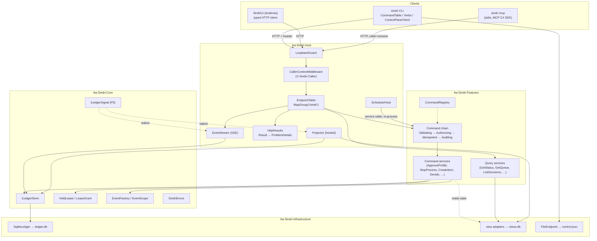
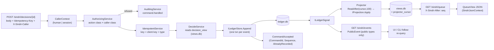

# Architecture Review: Sindri API surface (commands, queries, event stream, MCP server)

_Reviewed by `/archReview` on 2026-10-10_

Target: `docs/superpowers/specs/2026-10-10-sindri-api-surface-design.md` (branch `docs/sindri-api-surface`), checked against
`.agents/rules/csharp.md`, `docs/csharp/scaffolds/new-slice.md` and S1's code at
`.claude/worktrees/sindri-s1-app-shell` (HEAD `a363f22`, read only).

The owner's decisions were taken as given and are not raised as findings: CQRS with an async in-process projector, v0
auth local-only through `X-Sindri-Caller` with no tokens, webhooks cut, MCP proven by a real subagent, and a threat
model of honest mistakes rather than adversarial agents.

## Verdict: NEEDS WORK

The CQRS shape, the authorization table and the phase plan are sound. Five HIGH findings stop a SOUND verdict. All five
are local fixes, not structural ones:

- **F1:** `SND-API-003` is already S1's `PortInUse`. `ErrorCatalogue.Validate` refuses duplicate codes (AW-KERNEL-003).
- **F2:** "first decision wins" and the `itemVersion` check can't hold. Commands check against an async projection, the
  key scheme (client key + type) gives two concurrent commands different ledger keys, and Kestrel runs requests
  concurrently.
- **F3:** `Idempotency-Key` replay is underspecified. The port has no lookup by key, so `SND-API-005` can't be
  detected, and a replayed command that creates ids returns fresh ids instead of the recorded ones.
- **F4:** the decorator order puts `AuthorizingService` outside `AuditingService`. A refused command never writes the
  `command.handled` row that §4.2 and the P1 signal need.
- **F5:** `ValidateProfile` has no HTTP route in S1. It runs in process in the CLI while the server is down, so
  wrapping it in a chain that appends to the ledger breaks S1's offline `profile validate`.

Scores are 3/4/3 (HIGH findings, none structural).

## Scores

_Anchored 1–5 scale from `_shared/severity.md` (5 = no findings above LOW … 1 = CRITICAL or unaddressed)._

| Dimension | Score (1–5) | Notes |
|-----------|:---:|-------|
| Complexity | 3 | The four-decorator chain, the async projector and read-your-writes are justified, but the spec gets the decorator order wrong (F4) and leaves replay semantics open (F3). The bounded SSE channel adds machinery a pull-model stream doesn't need (F15). |
| Scalability | 4 | Single-user, single-process, loopback. The limits are bounded (16 streams, pages of 100, a 2 s wait). Open points: ledger growth from `job.progress` and audit rows (F21), and projector stall and rebuild behaviour (F8, F9). |
| Maintainability | 3 | The registry, the arch tests (`ARCH-CQRS-001..003`), reserved codes and anchored shared files are good. HIGH contract drift against S1's real code (F1, F5) and unlisted S1 conflicts (F7, F13, F14, F17) would land on implementers mid-phase. |

## Component Diagram



## Data Flow Diagram



## Sequence Diagram

The most critical flow is a session filing a request and a human deciding it (P4). It covers the authorization table,
read-your-writes and the event stream.

```mermaid
sequenceDiagram
  participant Agent as Claude subagent
  participant M as sindri mcp
  participant H as Host (LoopbackGuard, CallerContext)
  participant C as Command chain
  participant FR as FileRequestService
  participant L as SqliteLedger (ledger.db)
  participant P as Projector (views.db)
  participant S as EventStream (SSE)
  participant Human as Human (sindri CLI)

  Agent->>M: tools/call sindri_request {kind: rescope, text}
  M->>H: POST /sindri/requests  X-Sindri-Caller: session
  H->>C: FileRequest (CallerContext session:mcp)
  C->>C: Authorize(request class, session) = allowed
  C->>FR: Handle
  FR->>L: Append request.filed (grant from HeldLease)
  FR->>L: Append decision.requested (separate txn, F6)
  L-->>FR: LedgerAppend(seq)
  C->>L: Append command.handled (accepted)
  FR-->>M: 200 RequestFiled(Sequence, RequestId, DecisionId)
  M-->>Agent: tool result
  L-->>P: ILedgerSignal pulse → fold into decision_view / queue_view
  L-->>S: pulse → event: decision.requested
  Human->>H: POST /sindri/decisions/D-… {choice: accept, itemVersion}  (no header = human)
  H->>C: Decide
  C->>C: Authorize(decision, human) = allowed
  C->>L: Append decision.recorded, request.accepted
  C-->>Human: CommandAccepted(seq)
  Human->>H: GET /sindri/queue  X-Sindri-After: seq
  H->>P: wait ≤ 2 s for cursor ≥ seq
  alt projector reached seq
    P-->>Human: QueueView
  else stalled > 2 s
    H-->>Human: 503 SND-API-003 (collides with PortInUse, F1)
  end
  Note over Agent,H: Error path: agent calls POST /decisions with session header → AuthorizingService refuses 403 SND-AUTH-002;<br/>with the spec's order, AuditingService (inner) never runs, so no command.handled row (F4)
```

## Top Risks

| # | Risk | Impact | Likelihood | Mitigation |
|---|------|--------|------------|------------|
| 1 | Two decides, or two item commands on one version, both get recorded. The async projection plus per-invocation keys make "first wins" and `itemVersion` advisory only (F2). | high | med | Use natural fact keys as the compare-and-swap (`decision.recorded:<decisionId>`, `item.state-changed:<itemId>:v<n+1>`). Map `AlreadyRecorded` from a different command to `SND-ITEM-409`. |
| 2 | The error-code collision fails the catalogue test the moment P2 adds `SND-API-003` (F1). | med | high | Renumber in the spec now: read-your-writes timeout → `SND-API-004`, and shift the rest. |
| 3 | Idempotent replays return ids that were never recorded, and `SND-API-005` has no way to be detected (F3). | high | med | Derive minted ids from the idempotency key, and add a lookup by key to `ILedgerStore` as conflict C6. |
| 4 | A projector exception stalls views for good. Every `X-Sindri-After` read returns 503 and the UI shows stale data with no signal (F8). | med | low | Contain the failure per page, surface it in `GetStatus` and `doctor`, and retry with backoff. |
| 5 | Phase-graph gaps (P6 needs P2, P8 needs P6, public events need P5) stall stacked branches mid-wave (F10). | med | high | Add the edges, or move the public-event registry into P1. |

## Edge Case Matrix

| Boundary | Dependency unavailable | Invalid/malicious input | Load 10x | State leakage |
|---|---|---|---|---|
| HTTP edge (`LoopbackGuard`, `CallerContextMiddleware`, `HttpResults`) | OK: a ledger that can't be opened maps to 503 through `ErrorKind.Unavailable` (`HttpResults.cs:19`, `SindriErrors.cs:36`) | OK: a non-loopback Host is refused with 400 and a non-loopback Origin with 403 (`LoopbackGuard.cs:10-21`); an unknown caller value is 400 `SND-API-006` (spec §6, §9); the Origin gap is an accepted v0 deferral (C3) | OK: Kestrel on loopback, single user (spec §6) | OK: `CallerContext` is a scoped service filled per request (spec §2.1); S1 registers services scoped (`SindriFeaturesServiceCollectionExtensions.cs:25-33`) |
| Command chain (Validating, Authorizing, Idempotent, Auditing) | F5 (in-process `ValidateProfile` with no lease: the audit append fails) | F4 (refusals not audited), F3 (key reuse with a different body can't be detected), F22 | F21 (an audit row per command, and job progress rows) | OK: decorators built per scope through factory lambdas (`csharp.md` §DI, line 129-137) |
| Command handlers → `ILedgerStore` (`ledger.db`) | OK: `Append` returns `SND-LEASE-003` on a stale epoch and handlers return the error (`ILedgerStore.cs:16`, `StopProcessService.cs:29`) | F2 (version and first-wins checks race) | F2 (concurrent Kestrel requests), F6 (multi-event commands aren't atomic) | F7 (actor fixed to `host:sindri`, fresh correlation per entry: `EventScope.cs:10`, `EventFactory.cs:25`) |
| Projector → `views.db` | F8 (a poison event stalls the loop, with no surfacing) | OK: projections are pure folds, unit-tested from event lists (spec §2.3, §12) | OK: pages of 100, one transaction per page, wakes on the signal or every 1 s (spec §2.3) | F9 (rebuild exposes empty or partial views to queries and command checks) |
| Query handlers (read ports, `X-Sindri-After`) | OK: a stalled projector is a bounded 2 s wait, then 503 (spec §2.4); code collides (F1) | OK: typed ids with route-binding tests (spec §3.2 note, `docs/csharp/typed-ids.md`); `ARCH-CQRS-002` keeps write ports out | OK: read-only connections (`SqliteConnectionFactory.OpenReadOnly`, spec §2.2); WAL readers don't block the writer | OK: no write port in query handlers (`ARCH-CQRS-002`) |
| Event stream (`GET /events`, SSE) | F14 (S1 swallows page errors: `EventStream.cs:28`) | OK: public types only, payloads carry ids and short scrubbed titles (spec §5.3); filter parsing is part of P5 | OK: at most 16 streams, a 429 past that (spec §5.4); F15 (the bounded channel is unnecessary) | OK: a cursor per connection in a local enumerator (`EventStream.cs:22-43`) |
| CLI client (`ControlPlaneClient`, `control.json`, auto-start) | OK: 2 s probe, epoch check, `SND-API-001`/`SND-CLI-002` (spec §7; `Verbs.cs:22-27`) | F17 (`--json` re-serializes instead of passing the body through), F13 (approve body shape) | OK: short-lived process per verb (`CommandTable.cs:21-30`) | F11 (an agent-session CLI auto-starts `serve`, which inherits the agent's environment and sandbox) |
| MCP server (`sindri mcp`) | OK: never starts the process, returns `SND-API-001` with "ask the human" (spec §7, §8) | OK: tools are one API call each with `session` set, and no decision, desk or protected tool exists (spec §8) | OK: stdio, one session per process | F20 (stdout must stay protocol-only; AOT tool registration) |
| `CommandRegistry` / `EndpointTable` (static tables) | OK: static, no I/O (spec §3.3) | F16 (`/ping` and `/events` request types missing from the CQRS table) | OK: static | F19 (HTTP route and CLI form held in `Features`) |
| In-process callers (scheduler and engine as `service`) | OK: each run gets its own scope (`SchedulerHost.cs:68` `CreateAsyncScope`) | OK: `service` never arrives over HTTP, and the header maps only to `session` or `human` (spec §4.2, §6) | F21 (`job.progress` per round in the ledger) | OK: caller context per scope; `HeldLease` is a volatile singleton grant (`HeldLease.cs:9-16`) |

### Findings

| id | severity | lens | location | finding | recommended fix |
|---|---|---|---|---|---|
| F1 | HIGH | arch | spec §9 table; S1 `SindriErrors.cs:45`, `docs/csharp/sindri.md:147` | `SND-API-003` is already `PortInUse` in S1 (used by `sindri serve` exit 2). The spec reserves it for the `X-Sindri-After` timeout. `ErrorCatalogue.Validate` returns AW-KERNEL-003 for duplicates, and `SindriErrorsTests` would fail in P2. The "codes reserved per phase" rule for parallel delivery is built on this table. | Renumber: `SND-API-004` read-your-writes timeout, `-005` stream limit, `-006` idempotency mismatch, `-007` unknown caller (or move the timeout to a `SND-VIEW-001` area). Update the phase rows. |
| F2 | HIGH | arch | spec §2.1 (handler loads a projection row), §3.2 notes (`itemVersion`, first decision wins), §3.4 (key = command key + type) | Commands decide against `views.db`, which lags the ledger. `Append` owns one transaction per event (`ILedgerStore.cs:17`), and Kestrel serves requests concurrently. Two `Decide` calls with different `Idempotency-Key`s both read "pending", both write distinct keys, and both get recorded. The same race lets two `park`/`unpark` calls on one `itemVersion` both succeed. A command right after `CreateItem` can also see `SND-ITEM-404` before the projector catches up. | Make the fact's natural key the compare-and-swap: `decision.recorded:<decisionId>`, `item.state-changed:<itemId>:v<version+1>`. The ledger's unique key then rejects the loser (`AlreadyRecorded`), and the handler maps that to `SND-ITEM-409` when the recorded event's command id differs. Before checking, command handlers wait for the projector to reach the ledger head (the same wait as `X-Sindri-After`). Optionally, serialize commands per item with an in-process lock. |
| F3 | HIGH | arch | spec §2.1 item 3, §9 `SND-API-005`; S1 `ILedgerStore.cs` (no lookup by key) | (a) To detect "same key, different body", the server has to look up what that key recorded and compare a body hash. `ILedgerStore` offers only `Append`, `ReadAfter`, `Latest(type)` and `Schema`. (b) Commands that create ids (`CreateItem`, `FileRequest`, `RunService`) use `IIdGenerator`. On a replay the events are `AlreadyRecorded`, but the response carries freshly generated ids that were never recorded. | Derive created ids deterministically from the idempotency key (or read them back from the recorded event). Put a body hash in `command.handled` under key `cmd:<Idempotency-Key>`, and add `Find(idempotencyKey)` to `ILedgerStore` and its contract suite. List that as a new S1 conflict (C6) or drop `SND-API-005` from v0. |
| F4 | HIGH | arch | spec §2.1 chain order vs §4.2 "nothing is written except the `command.handled` audit row" and the P1 signal | With Validating → Authorizing → Idempotent → Auditing (outermost first), a refusal returns from `AuthorizingService` before `AuditingService` runs, so no audit row is written. Validation failures aren't audited either. The P1 signal ("ledger gains only the `command.handled` row with outcome `refused`") can't pass. | Order: Auditing (outermost) → Authorizing → Validating → Idempotent → handler. Authorizing before validation also means a session gets a 403 rather than a 400 on a protected route. |
| F5 | HIGH | arch | spec §3.2 row `POST /profile/validate` "(S1)", §4.1 class `job`; S1 `EndpointTable.cs:13-25`, `Verbs.cs:15-16,43-45` | S1 maps no `/profile/validate`. `profile validate` (and `doctor`) run the handler in process in the CLI "so they work while it is down". Classing it as a command puts it in the chain, and `AuditingService` appends to the ledger, which needs a lease grant the CLI process doesn't hold. That breaks S1's offline validate. The note that it is "a POST in S1" is wrong. | Make `ValidateProfile` (and `RunDoctor`) an `IQuery`, local and read-only, outside the command chain and outside `ARCH-CQRS-001`'s endpoint check. Remove the route from §3.2 and §4.1. |
| F6 | MEDIUM | arch | spec §3.4 "Requests become decisions", `Decide` | `FileRequest` writes `request.filed` then `decision.requested`, and `Decide` writes `decision.recorded` then `request.accepted`, each in its own transaction. A crash between them leaves a request with no decision (never surfaced to the human) or a decision with no request outcome. | One fact per command, and let projections derive the rest (`request.accepted` derived from `decision.recorded` on an `accept-request` decision). Or add `AppendMany` (one transaction) as an S1 conflict row. |
| F7 | MEDIUM | arch | spec §2.1 (`Actor` composed per caller; audit "under the same correlation id"), §5.3 (`item` from the ledger row); S1 `EventFactory.cs:25-27`, `EventScope.cs:10` | S1's `EventFactory` stamps every event with the process-wide `EventScope.ControlPlane` actor (`host:sindri`), creates a fresh correlation per `Entry`, and always sets `Item: null`. None of this is in §10's conflict list. | Add a C6/C7 row: `EventFactory.Entry` takes the `CallerContext` actor, a per-command correlation (created once by the chain) and an `item`. |
| F8 | MEDIUM | arch | spec §2.3 projector loop | Nothing says what happens when `Apply` throws or `views.db` can't be written. The loop either dies (the hosted service stops) or spins on the same page. Every `X-Sindri-After` read then returns 503 forever and plain reads show stale data silently. | Don't advance the cursor on failure. Log, back off, and expose `projector {cursor, head, lastError}` in `GetStatus` plus a `doctor` check. Use a `views.stalled` notice for the UI. |
| F9 | MEDIUM | arch | spec §2.3 Rebuild | "Stops the projector, deletes the view tables, sets the cursor to 0 and replays" in one transaction per page. Queries (and the F2 command checks) see empty or partial views during a rebuild, and the UI shows an empty queue. | Rebuild into `views.db.next` and swap it in atomically (rename while holding a short read gate), or make queries wait as with `X-Sindri-After` for the head sequence at rebuild start. |
| F10 | MEDIUM | arch | spec Phases table and dependency graph | P6's `GetJob` (`GET /jobs/{id}`) reads a projection, so it needs P2, but P6 sits on P1 + P5. P8's `sindri_job` tool calls `GET /jobs` (P6), but P8 sits on P4. P3, P4, P6 and P7 add public events (§3.4), but the public-event registry is P5, which they don't depend on. P2 "sleeps on the ledger signal" from P5, but no phase owns wiring the signal into the projector. | Add edges P6→P2 and P8→P6 (or drop `sindri_job` from P8), and move the public-event registry (types plus `isPublic`) into P1 so later phases add rows. Say which of P2 and P5 merges second and wires `ILedgerSignal` into the projector. |
| F11 | MEDIUM | arch | spec §7 table vs §8 | An agent-session CLI (`CLAUDECODE=1 sindri queue`) auto-starts `serve`, while `sindri mcp` never does because "the process lifecycle is the human's". The detached `serve` also inherits the agent's environment and sandbox. | When the caller class is `session`, the CLI never starts the process: it prints `SND-API-001` with "ask the human to run `sindri`", the same as MCP. |
| F12 | LOW | arch | spec §10 C1; S1 `EndpointTable.cs:15-16` | C1 is stale: S1 already maps `/status` inside `MapGroup("/sindri")`, so the route is `/sindri/status`. | Drop C1, or mark it resolved in S1. |
| F13 | LOW | arch | spec §3.2 (`hash?`, `confirmHash`), §6; S1 `ApproveProfileRequest.cs:12`, `Verbs.cs:83` | S1's body is `Hash` + `Confirmed: bool`, and the CLI checks the typed prefix. The spec says `confirmHash` checked by the handler, and C2 says "S1's handlers don't change". | Keep S1's shape. The caller class (P1) is what closes the gap. Fix §3.2 and §6. |
| F14 | LOW | arch | spec §5.2 vs S1 `EventStream.cs:18,28` | In S1, `?after` wins over `Last-Event-ID` (the spec says the reverse), and page errors are swallowed (`page.IsSuccess ? … : []`). | Add both to C4, and have P5 end the stream with a `reset` or close on a ledger error. |
| F15 | LOW | arch | spec §5.4 | `TypedResults.ServerSentEvents` pulls from an `IAsyncEnumerable`, so a slow reader already back-pressures the producer. The ledger never prunes, so "older than the ledger keeps" can't happen. The per-connection bounded channel and the overflow `reset` add a producer task per stream for no gain. | Keep the pull model, the 16-stream cap and the ping. Keep `reset` only for a future pruning ledger, and drop "reader that stops reading gets reset" from P5's signal. |
| F16 | LOW | arch | spec §3.1 and `ARCH-CQRS-001`; S1 `EndpointTable.cs:18-19,24` | S1's `GET /ping` (`PingProcess`) isn't in the query table or the registry. `/events` is a method group, and its request type has to implement `IQuery<>` for `ARCH-CQRS-001`. | List `GetPing` (P1) and mark `StreamEventsRequest : IQuery<StreamEventsResponse>`. |
| F17 | LOW | arch | spec §9 JSON (`--json` byte-equal to curl); S1 `Verbs.cs:30-31`, `ControlPlaneClient.cs:26` | The S1 client deserializes into `T` and `Output.Json` re-serializes, so the output isn't the body verbatim. This S1 conflict isn't listed. | Add a raw-body path (`GetRaw`) for `--json` and list it in §10. |
| F18 | LOW | arch | spec §9 ("`docs/sindri/errors.md`") | The C# error catalogue is documented in `docs/csharp/sindri.md` (lines 145-147). `docs/sindri/errors.md` is the TS sindri's. | Point the spec and the shared-file list at `docs/csharp/sindri.md`. |
| F19 | LOW | arch | spec §3.3, §2.4 | `CommandRegistry` in `Features` holds the HTTP method, route and CLI form, which are Host concerns (`csharp.md` request flow). The 2 s `X-Sindri-After` wait is described as per-handler. | Keep class and callers in `Features`; join route and CLI form in a Host table test. Implement the wait once as a query decorator (`ConsistentReadService`) registered in `AddSindriFeatures()`. |
| F20 | LOW | arch | spec §8, P8 | NativeAOT MCP: reflection-based tool discovery isn't trim-safe, and anything written to stdout corrupts stdio framing. | Register tools explicitly with `SindriJsonContext` options and keep `Output` off stdout under `mcp`. Extend `aot-smoke` with `initialize` and `tools/list` over stdio. |
| F21 | LOW | arch | spec §3.4 `job.progress`, `command.handled` | Each progress line and each command adds a durable, never-pruned ledger row and a commit. Long jobs bloat the ledger. | Cap progress events per job (or keep progress in memory and stream it, recording only `job.finished` with its summary). |
| F22 | LOW | arch | spec §2.1 item 4 | Refused calls without an `Idempotency-Key` fall back to "the handler's natural key", so repeated refused attempts collapse into one audit row. | Key `command.handled` by the fresh `CommandId`, not the command key. |

## Missing Error Handling

- **Projector loop** (spec §2.3, `Host/Projector.cs`): no behaviour is defined for a throwing `IProjection.Apply` or a
  failed `views.db` write. Nothing contains it, retries it, or surfaces it in status or doctor (F8).
- **`EventStream`** (S1 `EventStream.cs:28`): a failed `ReadAfter` is treated as an empty page and the stream idles
  silently (F14).
- **Multi-event commands** (`FileRequest`, `Decide`): there is no recovery for a partial write between the two
  `Append` calls (F6).
- **`AuditingService` without a lease** (in-process CLI, or after `SND-LEASE-002`): the spec doesn't say whether a
  failed audit append fails the command or is logged and skipped (F5).
- **`IdempotentService` replay**: the response contents on `AlreadyRecorded` aren't specified, nor are minted ids
  (F3).
- **`X-Sindri-After` during a rebuild**: the wait target is reached only after the full replay, and nothing says
  whether commands also wait (F9, F2).

## Suggested Improvements (Prioritized)

_Severity per `_shared/severity.md` (legacy P0→CRITICAL, P1→HIGH)._

| Severity | Improvement | Effort | Impact |
|----------|------------|--------|--------|
| HIGH | Renumber the new `SND-API-*` codes around S1's `PortInUse` (F1) | S | The catalogue test passes, and the per-phase code reservations hold |
| HIGH | Natural fact keys as the compare-and-swap for decisions and item versions; commands wait for the projector head (F2) | M | "First wins" and `itemVersion` become real guarantees |
| HIGH | Define replay: deterministic created ids, `command.handled` keyed by the client key with a body hash, `ILedgerStore.Find` as an S1 conflict row (F3) | M | Idempotent retries return the recorded result |
| HIGH | Put `AuditingService` outermost (F4) | S | The P1 signal and the §4.2 audit guarantee hold |
| HIGH | Re-class `ValidateProfile` (and `RunDoctor`) as local queries, and drop the nonexistent route (F5) | S | Keeps S1's offline `profile validate` |
| MEDIUM | One fact per command, or `AppendMany` (F6); `EventFactory` with actor, correlation and item (F7) | M | Consistent ledger, and events that match the envelope spec |
| MEDIUM | Projector failure containment and status surfacing; atomic rebuild swap (F8, F9) | M | No silent stale views |
| MEDIUM | Fix the phase edges, and move the public-event registry to P1 (F10) | S | Stacked waves don't stall |
| MEDIUM | Session-class CLI never auto-starts (F11) | S | Consistent lifecycle rule |
| LOW | F12–F22: stale C1, approve body shape, SSE cursor precedence and simplification, `/ping` in the registry, raw `--json`, docs path, registry placement, MCP AOT and stdout, progress bloat, audit keying | S each | Fewer surprises for implementers mid-phase |

verdict: NEEDS_WORK
