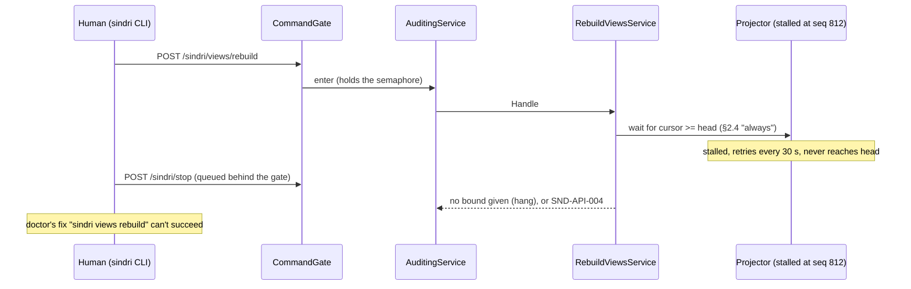

# Architecture Review (pass 2): Sindri API surface, rev 2

_Reviewed by `/archReview --slim` on 2026-10-10_

**Target:** `docs/superpowers/specs/2026-10-10-sindri-api-surface-design.md` (rev 2, branch `docs/sindri-api-surface`).

**Checked against:**
- S1's code at `.claude/worktrees/sindri-s1-app-shell` (HEAD `a7d2ada`, read only);
- `.agents/rules/csharp.md`;
- the engine spec `2026-10-10-sindri-workflow-engine-design.md` (rev 2);
- core design §9.3.

**Scope.** This pass reports only:
- pass-1 findings that are still open;
- new issues that rev 2 introduced.

**Not raised.** These are owner decisions:
- CQRS;
- the async projector;
- v0 without tokens;
- webhooks cut;
- MCP proven by a subagent;
- the honest-mistake threat model.

## Verdict: NEEDS WORK

Rev 2 resolves every pass-1 HIGH (table below), and most of the MEDIUM and LOW findings. Two new HIGH findings keep it
at NEEDS WORK. Both are small text fixes:

- **N1:** the `CommandGate` and the head wait have no bound and no opt-out.
  - The documented fix for a stalled projector is `sindri views rebuild`. That's a command, so it waits for a head the
    stalled projector never reaches.
  - `stop` queues behind whichever command holds the gate.
  - Engine `ApplyCommand` runs gates, which can mean judge calls. While it does, it holds the process-wide gate.
- **N2:** the two specs define two different authorization models for the same commands.
  - The API spec has caller classes `human`/`session`/`service`, per-command action classes, and `SND-AUTH-002`.
  - The engine (W22) has actor classes `human-terminal`/`human`/`session`/`system`, per-argument checks (`grant`,
    `--accept`), and `SND-WF-007`.
  - §3.5 says the API spec owns the table, but P1's `CallerContext` can't express `human-terminal`.

**Scores.** 3/4/3. There are HIGH findings, but none is structural.

## Scores

| Dimension | Score (1–5) | Notes |
|-----------|:---:|-------|
| Complexity | 3 | The gate, fact keys and one event per command are simpler than rev 1. The gate's head wait is underspecified (N1) and contradicts the stall recovery path |
| Scalability | 4 | Single user on loopback. The global gate is fine for human commands, but not for gate-evaluating engine commands (N1) |
| Maintainability | 3 | The engine boundary is now written down, but with contradictions (N2, N5, N6). Several v0 needs-you and services sources have no ledger event to fold (N7) |

## Pass-1 resolution check

| Pass 1 | Status | Evidence |
|---|---|---|
| F1 `SND-API-003` clash (HIGH) | **Resolved** | New codes start at `SND-API-004` (§9). They don't collide with S1's `SindriErrors.All` or the engine's `SND-RECIPE-001..007` and `SND-WF-001..019` |
| F2 first-wins and version race (HIGH) | **Resolved** | The `CommandGate`, the head wait and fact keys (§2.1), with a concurrency test (§12). S1 `SqliteLedger.InsertOnce` returns `LedgerAppend(earlierSeq, AlreadyRecorded: true)` (`SqliteLedger.cs:47-51`), so the fallback works as described. See N1 for the gate's own gaps |
| F3 idempotent replay (HIGH) | **Resolved** | Client `Idempotency-Key` dropped from v0. Only fact keys remain (§2.1, §11) |
| F4 audit innermost (HIGH) | **Resolved** | Order is Gate → Auditing → Validating → Authorizing, pinned by a test. But see N3: audit appends after `StopProcess` has released the lease |
| F5 `ValidateProfile` route (HIGH) | **Resolved** | Class `local`, not a route (§3.1, §4.1) |
| F6 two events per command | **Resolved** | One event per command, decision derived (§3.4). The "atomic" claim ignores the audit row (N3) |
| F7 `EventFactory` actor and correlation | **Partly** | C6 added. Its mechanism doesn't fit S1's singleton `EventFactory`, and it overlaps engine S1-D7 (N4) |
| F8 projector failure | **Resolved** | `stalled`, `SND-VIEW-001`, status, doctor and the UI (§2.3). But the stated fix is unreachable (N1) |
| F9 rebuild exposes partial views | **Resolved for queries** | `asOf.rebuilding`. Commands during a rebuild block on the head wait (N1) |
| F10 phase edges | **Resolved** | P6 is on P2 + P5, P8 is on P4 + P6, `EventCatalog` is in P1. Who wires `ILedgerSignal` into P2's projector is still unstated (folded into N8) |
| F11 agent CLI auto-start | **Resolved** | §7 |
| F12–F22 (LOW) | **Resolved** | Except F15: the `reset`-on-retention case is still in §5.4, §12 and P5, and the ledger never prunes (L3) |

## Findings (new in rev 2, or unresolved)

| id | severity | location | finding | recommended fix |
|---|---|---|---|---|
| N1 | **HIGH** | §2.1 "Commands run one at a time", §2.3 Failure, §2.4 "Commands always wait for the head", §3.2 `RebuildViews`, `StopProcess` | (a) **Stall recovery deadlock.** A stalled projector never reaches the head. §2.4 has every command wait for the head, and `RebuildViews` is a command, so the fix that `doctor` and §2.3 print can't run. It either blocks forever or times out, with an unspecified code. (b) **No bound.** No timeout is given for the gate or for the command-side head wait. `stop` queues behind a waiting command, so a stalled projector also blocks `sindri stop`. A rebuild blocks every command until the replay ends. (c) **Long holders.** Engine `ApplyCommand` evaluates gates (engine §5.3–5.4, judge and evidence blocks) and goes through "the same chain" (§3.5). It holds a process-wide `SemaphoreSlim(1)` for that whole time, so "costs nothing measurable" doesn't hold once S2 runs | Make the head wait **opt-in per command**: a catalog flag `readsViews`. `StopProcess`, `RebuildViews`, `ApproveProfile`, `PauseService` and `ResumeService` skip it. Bound the wait at 2 s with `SND-API-004`, and say so. Bound the gate wait (for example 5 s, then 503 `SND-API-00x`). State that commands which evaluate gates or start jobs either decide and append inside the gate and do their slow work outside it, or rely on the engine's own version and nonce check (engine §5.3) and skip the gate. Add P2 signals: `views rebuild` and `stop` both succeed while `stalled = true` |
| N2 | **HIGH** | §3.5 last row, §4.2, §6 vs engine W7, W22, §6.2, §8 (`SND-WF-007`), S1-D5 | **Two authorization models for one chain.** (a) The engine needs `human-terminal`, so that `grant` and `--accept` can be refused to the app and to a non-TTY human. P1's `CallerClass` has no terminal dimension. The Avalonia app sends `human`, which would satisfy an engine check that maps `human-terminal` to `human`. (b) The engine authorizes per **argument** (`answer` is `human`, `answer --grant` is `human-terminal`). The API spec classes per **command**, so `ApplyCommand` gets one class (`desk`). (c) There are two refusal codes for the same refusal, `SND-AUTH-002` and `SND-WF-007`. (d) The engine's S1-D5 (engine P2) replaces `profile approve`'s `confirmed` body flag with a server-issued challenge. This spec keeps the flag (§3.2 note) and builds the prover recipe on it (§12 "Seed an approved profile"). Both specs are being implemented in parallel, so whichever P1 lands first fixes the vocabulary the other must change | Add a terminal dimension to `CallerContext`: either `human-terminal` as a caller value (the CLI at a TTY sends it, the app sends `human`), or a `Terminal` flag. Map the engine's actor classes onto the caller context (`system` is `service`). Let a command declare an argument-level class (`ApplyCommand` with `grant` or `accept` is `protected`) through a small `IAuthorizationRequirement`-style method on the request, checked by the same `AuthorizingService`. Pick one refusal code, and have the engine reuse `SND-AUTH-002` or alias it. Settle S1-D5 in one place: either the challenge lands in API P1 for `ApproveProfile` and the prover recipe uses it, or the engine drops S1-D5 for profiles |
| N3 | MEDIUM | §2.1 `AuditingService` ("for every attempt"), "a command is atomic: one event, one transaction"; S1 `StopProcessService.cs:23-29` | (a) `StopProcess` releases the lease and calls `held.Clear()`. `AuditingService` runs after the handler (it wraps it), so it has no grant to append `command.handled` under. The `stop` audit row can't be written, and the spec doesn't say whether that turns an accepted stop into an error. (b) Nothing says what happens when the audit append fails in general (`SND-LEASE-002/003`, `SND-LEDGER-002`), or whether a refused or invalid command still gets its 403 or 400 when the audit append fails. This was pass 1's "Missing error handling" item, still open. (c) Every command writes two events in two transactions, the fact then the audit row. "A command is atomic: one event" is true only of the fact | Define it: audit failure is logged plus `sindri.commands{outcome=audit_failed}`, and the command's own result is returned unchanged. `AuditingService` takes the grant **before** calling inner, and `StopProcess` writes `process.stopped` and then its audit row before release, or `StopProcess` is audited by its `process.stopped` event and skipped by `AuditingService`. Reword §2.1 to "one fact event per command, plus the audit row". (S1-D2's outer unit of work, engine P4, would later let both share one transaction) |
| N4 | MEDIUM | §10 C6; S1 `SindriCoreServiceCollectionExtensions.cs:15-16` (`AddSingleton<EventFactory>`), `EventFactory.cs:25-28`; engine S1-D7 | (a) "P1 makes `EventFactory` read `CallerContext`" conflicts with DI lifetimes. `EventFactory` is a singleton, and `CallerContext` is scoped, so that's a captive dependency (`csharp.md` lifetimes, line 141). It's also used outside any request by `StartProcessService` at startup and by `RecordHeartbeatService` from the scheduler. (b) Engine S1-D7 (engine P4) changes the same method differently (`Entry` takes `item` and `causation`). Neither spec cross-references the other | Change `Entry` once, in API P1: `Entry(type, payload, key, EventOrigin origin)` with `origin = (actor, correlationId, causationId?, item?)`. The chain builds `EventOrigin` from `CallerContext`, and the in-process services build their own. `EventFactory` stays a singleton. Record that engine S1-D7 is then met by API P1 (W26: "the phase drops it") |
| N5 | MEDIUM | §3.5 row 1 ("Takeover is set by the hook's turn classification through the `service` caller"), §4.2 "`service` never arrives over HTTP"; core design §9.3; engine §6.2 (`workflow takeover`, actor `human`) | The `UserPromptSubmit` hook is a bash process inside the agent session (`CLAUDECODE` set). It can only reach Sindri over HTTP or the CLI, so it's `session`. `service` is in-process only, by this spec's own rule. The takeover route this spec assigns can't be reached, and the engine lists takeover as a `human` verb instead | Say which route the hook uses. One option is a `FileRequest` of kind `takeover` (class `request`), which the engine's event router turns into the transition through the `system` caller in-process (W15 inbox). Another is a named hook command class. Add `takeover` to §3.2's request kinds if the first option is chosen, and align engine §6.2 |
| N6 | MEDIUM | §3.4 "Later the engine raises its own gates as pending decisions through the same catalog, and reads `decision.recorded`"; §3.6 needs-you `primaryAction`; engine §5.4 (a command trigger is a nonce bound to the instance version), §6.2 `workflow answer`, `workflow list --needs-me` | Two answer paths for one park. The engine answers parks and escalations with `ApplyCommand(answer)`, using a nonce and a version, and never reads `decision.recorded` as a trigger. This spec says the engine's gates become pending decisions answered by `Decide`. Two "needs me" surfaces also exist (`GET /needs-you` and `workflow list --needs-me`) with no stated relation | State that engine parks and escalations appear in needs-you as rows of kind `decision`, with `primaryAction` = the engine's `ApplyCommand` catalog row, not `Decide`. `Decide` and `decision.recorded` stay for `accept-request` and the §17.12 list. Make `workflow list --needs-me` a filtered client of `GET /needs-you`, or say why it isn't |
| N7 | MEDIUM | §3.6 needs-you v0 sources ("failed service runs (`service.failed`, from S1)", "a profile that changed since approval (P4)"); §3.1 `ListServices` ("last run (slot, outcome, code)"), `GetProfile` ("the live hash"); S1 `EventTypes.cs`, `SchedulerHost.cs:81` | S1 records no `service.failed` event. A failed run is only logged (`LogServiceFailed`), and `EventTypes` has just `process.started/stopped`, `profile.approved` and `service.heartbeat`. Projections are pure ledger folds (§2.3), so these v0 rows have nothing to fold: needs-you failure rows, `ListServices` last outcome and code, and the "profile changed" row (the live profile is a file on disk, not an event) | Add `service.ran {service, slot, outcome, code?}` (with a key such as `service.ran:<name>:<slot>`) to `EventCatalog`, owned by P2 since `ListServices` needs it, with `SchedulerHost` appending it. For profile drift, either have a built-in service append `profile.drifted {liveHash}` when the live hash changes, or serve `GetProfile` and the needs-you profile row from `IProfileSource` directly (then not a projection, and say how `asOf` applies) |
| N8 | MEDIUM | §2.2 `asOf.ledgerHead`, §2.1 and §2.4 "wait for the head", §2.5 `ARCH-CQRS-002`, §5.5 "S1's `ILedgerStore` doesn't change" | (a) Nothing in the design supplies the ledger head. `ILedgerStore` has `Append`, `ReadAfter`, `Latest(type)` and `Schema` (`ILedgerStore.cs`), with no head query. `ARCH-CQRS-002` forbids `ILedgerStore` in query handlers, yet every view carries `asOf.ledgerHead`. (b) `ILedgerSignal` could carry the last committed sequence, but it lands in P5, and P2 (which implements `asOf` and the head wait) runs in parallel with P5. The signal also misses appends by other writers (heartbeats, engine services) unless every append goes through the adapter. (c) Nobody wires the signal into the projector (pass-1 F10 remainder) | Add a read port in P2, `ILedgerHead.Current()`: `SELECT MAX(seq)` read-only, or an in-memory value updated by the `ILedgerStore` adapter after each commit. Allow it in queries, and name it in `ARCH-CQRS-002`'s allow-list. Say that P5's `ILedgerSignal` wakes the projector, and that whichever of P2 and P5 merges second wires it |
| L1 | LOW | §2.1 fact-key table (`v<n+1>`) vs §3.4 (`v<n>`); §3.4 `item.state-changed`; §9 `SND-ITEM-409` | (a) The two tables give different version suffixes. (b) After the instance commands moved to the engine, no command in this spec writes `item.state-changed`, and the engine writes `workflow.transition`. The event is registered as public in P3 with no writer, and "the item changed since you looked" has no producing command. (c) "If another command id wrote it": the envelope has no command id field (`LedgerEntry`/`EventEnvelope`), and with no client keys every `AlreadyRecorded` is someone else's | Pick one suffix. Drop `item.state-changed`, or name its writer: the engine item projection derives state from `workflow.transition`. Map `AlreadyRecorded` straight to `SND-ITEM-409`, or put `commandId` in `causationId` and say so |
| L2 | LOW | P3 signal ("`curl …/queue` byte-matches `$SINDRI queue --json`") | `asOf.cursor` and `ledgerHead` move with every `service.heartbeat` (as often as every 5 s) between the two calls, so the byte match is flaky. P2's signal already says "apart from `asOf`" | Compare with `asOf` stripped, or run both calls with `X-Sindri-After` against a profile with no heartbeat |
| L3 | LOW | §5.4 Retention, §12 event-stream row, P5 goal | The ledger never prunes, so `reset` on retention can't be produced or tested (pass-1 F15 remainder) | Keep `reset` in the protocol, and drop it from P5's goal and §12's tests until a pruning ledger exists |
| L4 | LOW | engine §6.1 "Every other verb is a client call to `sindri serve`, which starts if needed" vs §7 "Any verb run inside an agent session: never start it" | The engine's text contradicts the API spec's rule for `workflow …` verbs run in a session | Add one line to engine §6.1 that points at API §7 |
| L5 | LOW | §6 "Commands refuse any `Origin` header" vs CLAUDE.md (Avalonia "browser heads later") | A future Avalonia browser head will send `Origin` on every command | Note in §11 that the browser head needs an allow-listed origin plus tokens |

## Edge Case Matrix (boundaries changed in rev 2)

| Boundary | Dependency unavailable | Invalid/malicious input | Load 10x | State leakage |
|---|---|---|---|---|
| `CommandGate` + head wait | N1 (a stalled projector blocks every command, including the stall's own fix) | OK: the gate is input-agnostic | N1 (one slow engine command blocks all) | OK: a singleton semaphore, released in `finally` (implementation detail; ask for it in P1's test) |
| `AuditingService` → `ILedgerStore` | N3 (no grant after `stop`; failure semantics) | OK: per-attempt key `command.handled:<commandId>` (§2.1), no collapse (pass-1 F22 fixed) | OK: one row per attempt; single user | OK: `CallerContext` scoped |
| `AuthorizingService` / `CallerContext` | OK: no I/O; the catalog is in memory (§3.3) | N2 (no terminal dimension; per-argument engine checks); OK: unknown header gives `SND-API-007`, `Origin` gives `SND-API-008` (§6) | OK | N4 (singleton `EventFactory` can't read the scoped context) |
| Fact keys → `SqliteLedger.Append` | OK: `SND-LEASE-003` on a stale epoch (`SqliteLedger.cs:31-35`) | L1 (no command id to compare) | OK: the gate serializes; the unique key backs it (`LedgerSql.SelectByKey`) | OK |
| Projector → `views.db` | OK: `stalled`, retried every 30 s (§2.3); N1 for its recovery | OK: pure folds | OK: pages of 100 | OK: `asOf.rebuilding` during a rebuild (§2.3) |
| Query handlers (`asOf`, `X-Sindri-After`) | OK: 2 s, then `SND-API-004` (§2.4) | OK: typed ids with binding tests (§3) | OK: read-only connections | N8 (no head source) |
| Needs-you / services projections | N7 (no `service.failed` or profile-drift event to fold) | OK: scrubbed and sanitized at write (§3.6) | OK | OK |
| API ↔ engine boundary (§3.5) | N5 (the hook can't reach `service`) | N2, N6 | N1(c) | N4 (S1-D7 overlap) |

## Sequence: the N1 recovery path as written

## Suggested Improvements (Prioritized)

| Severity | Improvement | Effort | Impact |
|----------|------------|--------|--------|
| HIGH | N1: an opt-in head wait (`readsViews`), bounded gate and head waits, no slow work under the gate, P2 signal for rebuild and stop while stalled | S | Stall recovery works; `stop` is never blocked |
| HIGH | N2: one caller model with a terminal dimension and argument-level classes; one refusal code; S1-D5 settled in one spec | S–M | P1 doesn't have to be reworked by engine P4 |
| MEDIUM | N3: audit failure semantics, and the grant taken before inner (or `stop` excluded) | S | The `stop` audit row and every refused path stay defined |
| MEDIUM | N4: one `Entry(…, EventOrigin)` change, shared with engine S1-D7 | S | No captive dependency, one owner |
| MEDIUM | N5, N6: hook takeover route; engine parks answered via `ApplyCommand`, not `Decide`; one needs-you | S | A consistent engine boundary |
| MEDIUM | N7: `service.ran` (P2) and a profile-drift source | S | v0 needs-you and services views have data |
| MEDIUM | N8: `ILedgerHead` read port in P2; signal wiring owner | S | `asOf` and the head wait can be built in P2 |
| LOW | L1–L5 | S each | Fewer mid-phase surprises |

verdict: NEEDS_WORK
