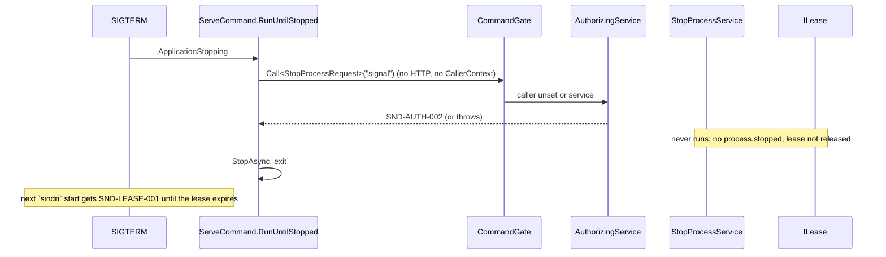

# Architecture Review (pass 3, final): Sindri API surface, rev 3

_Reviewed by `/archReview --slim` on 2026-10-10_

**Target:** `docs/superpowers/specs/2026-10-10-sindri-api-surface-design.md` (rev 3, `eca342e`).

**Checked against:**
- S1's code at `.claude/worktrees/sindri-s1-app-shell` (HEAD `a7d2ada`, read only);
- `.agents/rules/csharp.md`;
- the engine spec, rev 3 (`8b40317`, committed after this spec's rev 3).

**Scope.** Two things only:
- pass-2 findings that are still open;
- new issues that rev 3 introduced.

**Not raised.** These are owner decisions:
- CQRS;
- the async projector;
- v0 without tokens;
- webhooks cut;
- the `pause` class open to sessions;
- MCP proven by a subagent;
- the honest-mistake threat model.

## Verdict: NEEDS WORK

Rev 3 resolves both pass-2 HIGHs as far as this spec goes, and most of the MEDIUMs:
- **N1:** the waits have limits now, and the recovery commands skip them.
- **N2:** there is one auth model, with a terminal flag and `IClassifiedCommand`.

Two new HIGH findings come from checking rev 3's text against S1's code. Each needs only a few lines in the spec:
- **R1:** S1 calls `StopProcess` in-process on SIGTERM and on port-in-use. P1 moves it into the command chain, and the
  chain would refuse it or fail. The process would then exit without writing `process.stopped` and without releasing the
  lease.
- **R2:** C8 records only `service.run-failed`. Nothing records a successful run. A needs-you `failure` row can then
  never clear, though §3.6 says "cleared when the next run succeeds". `ListServices.lastRun` stays `failed` forever.

## Scores

| Dimension | Score (1–5) | Notes |
|-----------|:---:|-------|
| Complexity | 4 | The gate and wait limits are simple and stated. The command head comes from a lagging status (R3) |
| Scalability | 4 | Single user. Handlers do no slow work, so the gate is held for a short time |
| Maintainability | 3 | The engine spec (rev 3, later commit) still has its own caller model (R5). The C8 event set is incomplete (R2, R4) |

## Pass-2 resolution check

| Pass 2 | Status | Evidence |
|---|---|---|
| N1 the gate and head wait are unbounded and deadlock (HIGH) | **Resolved** | 5 s gate with `SND-API-009`; 2 s head wait with `SND-API-004`; `StopProcess` and `RebuildViews` don't wait; handlers never do slow work (§2.1). There's a P2 test for rebuild while stalled (§12). See R1 for the in-process stop path |
| N2 two authorization models (HIGH) | **Resolved in this spec. Open across the specs (R5)** | §2.1 `IClassifiedCommand` and `CallerContext.Terminal`, §3.5, §4.2. But engine rev 3 still defines `human-terminal`, `script`, `system`, `SND-WF-007` and its own list of harness markers (engine §6.2, §6.3, line 593) |
| N3 audit for `stop` and audit failures | **Resolved** | `SelfAudited`, and the failure rules (§2.1). S1 `StopProcessService.cs` appends `process.stopped` before `Release`, so self-audit holds. A refused `stop` is open: see L6 |
| N4 singleton `EventFactory` | **Resolved** | An `AsyncLocal` `ICallerContextAccessor` (C6). The fallback with no context is unstated (L7) |
| N5 the takeover route can't be reached | **Resolved** | Class `pause`, open to sessions (§4.2) |
| N6 two answer paths | **Resolved** | Rows of kind `park` → `ApplyCommand:answer` (§3.4, §3.5). The engine still describes its own two-section `--needs-me` (engine §6.3), but the request to align it is flagged in §3.5 |
| N7 nothing to fold for needs-you and services | **Partly** | C8 adds `service.run-failed` and `profile.drifted`. There is no success event (R2). `profile-watch` can't be scheduled, and drift never clears (R4) |
| N8 no ledger head | **Resolved** | C9 `ILedgerStore.Head()` (S1's port has no such member today, `ILedgerStore.cs`), plus `IProjectorStatus`. But see R3 |
| L1 | **Resolved** | One `v<version>`; `commandId` in every payload |
| L2 | **Resolved** | `jq 'del(.asOf)'` |
| L3 | **Resolved** | `reset` reserved, not tested |
| L4 | **Resolved** | §3.5 last row (the engine text still says "starts if needed"; folded into R5) |
| L5 | **Resolved** | §11 |

## Findings (new in rev 3, or unresolved)

| id | severity | location | finding | recommended fix |
|---|---|---|---|---|
| R1 | **HIGH** | §2.1 chain and caller context, §4.2 (`service` × `desk` = "only the engine commands…"), C2 "registrations move to `AddCommand`"; S1 `Host/Commands/ServeCommand.cs:55,79` (`Call<StopProcessRequest,…>` on port-in-use and SIGTERM) | After P1, resolving `IService<StopProcessRequest, StopProcessResponse>` returns the decorated chain, and two calls reach it outside HTTP. No middleware sets a `CallerContext` for them, so the chain either throws or authorizes an unset or `service` caller. The §4.2 table refuses `service` for `desk`. Either way, Ctrl-C or SIGTERM on `sindri serve` stops writing `process.stopped` and stops releasing the lease (the handler never runs). The next `sindri` start then gets `SND-LEASE-001` until the lease expires. P1's signals don't exercise this path | Say how host-internal calls run. Either `ServeCommand` sets a `service:host` context and §4.2 allows `service` to run `StopProcess`, or the host resolves the undecorated handler for internal stops; the second is simpler, since `StopProcess` is self-audited. Add a P1 integration test: SIGTERM (or a call to the in-process stop) leaves `process.stopped` in the ledger and a free lease |
| R2 | **HIGH** | §3.6 rows by kind (`failure`, "cleared when the service's next run succeeds"), §3.1 `ListServices` ("last run (slot, outcome, code)"), C8, §3.4 event table; S1 `SchedulerHost.RunOne` | Projections are pure folds (§2.3), and only failures become events. No event says that a run succeeded, so the `failure` row from one transient failure stays in needs-you, at `colour` urgency, forever. `lastRun` can't show `succeeded` either. P2's signal checks only the failure case, so the phase passes and ships the bug | Replace `service.run-failed` with `service.ran {service, slot, outcome, code?}`, keyed `service.ran:<name>:<slot>`, appended by `SchedulerHost` after every run. It is public, and failures are the rows to fold. If you want fewer heartbeat-like events, add `service.recovered` on the first success after a failure. Add a P2 signal: fail once, then succeed, and `lastRun.outcome` is `succeeded` |
| R3 | MEDIUM | §2.1 "Waiting for the views", §2.3 "Commands and queries read the head from `IProjectorStatus`, never from `ILedgerStore`", §2.3 "Why asynchronous … the same answers an inline one would" | `IProjectorStatus.head` is refreshed only when the projector loops (on the signal, or every 1 s). Take command A, which appends at sequence N, and command B, which runs right after it. B can read a head of N−1 and see `cursor ≥ head`. It then decides on views without A's event. Fact keys still catch the double decide and the stale close, which return `SND-ITEM-409`. But the request caps (§4.2) and anything else checked against views can be off by one, and the "same as inline" claim doesn't hold | Write-side code may hold `ILedgerStore`, since `ARCH-CQRS-002` restricts only query handlers. Have the gate's head wait call `ILedgerStore.Head()`, or have the `CommandGate` remember the highest `Sequence` appended under it. Keep `IProjectorStatus` for queries and `asOf` |
| R4 | MEDIUM | C8 `profile-watch`, §3.4 `profile.drifted` key `profile.drifted:<liveHash>`, §3.6 `profile` row; S1 `SchedulerHost.Refresh` and `ServiceSchedule.From` | (a) S1's scheduler runs only the services the **approved profile** names, at the cadence the profile gives. A built-in "every 30 s" `profile-watch` is never scheduled unless every profile lists it, so P4's signal "editing the live profile adds a row within 30 s" fails. (b) If the profile changes A→B, back to A, and to B again, the row stays after the revert (there's no "matches again" event). Then `profile.drifted:B` collides on the second change and `AlreadyRecorded` drops it. `GetProfile`'s "changed since approval" is wrong after a revert | Make `profile-watch` a host hosted service, like the projector, rather than an `IScheduledService`. Or say that the scheduler always adds the built-ins. Append `profile.drifted` on every change of the live hash, with the key `profile.drifted:<liveHash>:<approvedSeq>:<n>` or the check's slot. Add `profile.matched` (or treat `liveHash == approvedHash` as clearing the row) |
| R5 | MEDIUM | §3.5 auth row ("the engine spec should drop `SND-WF-007` and `human-terminal`"), §6 headers; engine rev 3 §6.2 and §6.3, §8 `SND-WF-007`, §4.2 challenge codes `SND-RECIPE-004/009` | Engine rev 3 landed after this rev and still defines a different model: <ul><li>caller classes `script` and `system`;</li><li>`human-terminal` as a caller rather than a flag;</li><li>`SND-WF-007`;</li><li>takeover as `human`, where this spec has `pause` open to sessions;</li><li>a different harness-marker list, including `CURSOR_TRACE_ID`, which §13 dropped because Cursor's normal terminal sets it, and `CLAUDE_CODE_ENTRYPOINT`/`SINDRI_SESSION`, which this spec lacks;</li><li>"starts if needed".</li></ul> One CLI binary implements both. Whichever P1 lands second has to rework its headers and table | Before the engine's P2 or P4 starts, make one sync edit to engine §6.2 and §6.3 pointing at API §4 and §6. Map `system` to `service` and `script` to `session`. Give one marker list. Map the challenge's `SND-RECIPE-004` ("not from a terminal") to `SND-AUTH-002`. Or record the owner's choice of which spec wins in both |
| L6 | LOW | §2.1 `SelfAudited`, "a row for every attempt" | It's unstated whether `SelfAudited` skips the audit for a **refused** `stop`, like the P1 signal "in an agent session, `$SINDRI stop` gets `SND-AUTH-002`". If it skips, refused stops go unaudited | `SelfAudited` skips only the `accepted` outcome; refused and invalid stops still get `command.handled` |
| L7 | LOW | §2.1 caller context, C6; S1 `StartProcess` and `RecordHeartbeat` run with no request | With no `AsyncLocal` value set, what `EventFactory` stamps is unstated. A job started by `RunService` inherits the human's context for its whole life (P6) | No context means S1's `EventScope` actor (`host:sindri`). A job copies the context as causation and takes a `service:job` actor |
| L8 | LOW | §2.1 "A command that reads views waits" | Nothing says how the gate knows whether a command reads views. The catalog has `SelfAudited`, but no flag for reading views | Add a `ReadsViews` (or `SkipsHeadWait`) catalog flag, with a test that `StopProcess` and `RebuildViews` have it unset |
| L9 | LOW | §3.1 repo scope, §4.2 `request` and `pause` for sessions | Repo scope covers queries only. A session can file a request against another repo's `itemId`, or take over another repo's instance | Apply the `X-Sindri-Repo` check to session commands that name an item or instance (`SND-ITEM-404`) |

## Edge case matrix (rev-3 boundaries)

| Boundary | Dependency unavailable | Invalid/malicious input | Load 10x | State leakage |
|---|---|---|---|---|
| `CommandGate` and head wait | OK: 5 s → `SND-API-009`, 2 s → `SND-API-004`; recovery commands skip the wait (§2.1) | OK: no input | OK: no slow work under the gate (§2.1) | R3 (stale head) |
| Host-internal calls → chain | R1 (SIGTERM and port-in-use stop) | OK | OK | L7 |
| `AuditingService` | OK: failure rules (§2.1) | OK | OK | L6 |
| `AuthorizingService` and `CallerContext` | OK: in memory | OK: `SND-API-007/008` (§6) | OK | R5 (the engine's model), L9 |
| Scheduler → `service.run-failed` | R2 | OK | OK: one event per slot | OK |
| `profile-watch` → `profile.drifted` | R4 (never scheduled) | OK | OK | R4 (key collision after a revert) |
| Projector and `IProjectorStatus` | OK: `stalled`, `SND-VIEW-001`, rebuild (§2.3) | OK: pure folds | OK: pages of 100 | OK: `asOf.rebuilding` |

## Sequence: R1, SIGTERM after P1

## Suggested Improvements (Prioritized)

| Severity | Improvement | Effort | Impact |
|----------|------------|--------|--------|
| HIGH | R1: define how host-internal calls run (an undecorated stop, or `service:host` allowed), plus a SIGTERM test in P1 | S | Ctrl-C keeps releasing the lease |
| HIGH | R2: `service.ran` with an outcome, replacing `service.run-failed`, plus a P2 signal for recovery | S | Failure rows clear, and `lastRun` is true |
| MEDIUM | R3: the command head from `ILedgerStore.Head()` or the gate's last sequence | S | Read-your-writes holds between commands |
| MEDIUM | R4: `profile-watch` as a hosted service, per-change keys, a clearing event | S | P4's signal can pass, and drift rows are correct |
| MEDIUM | R5: one sync edit to engine §6.2 and §6.3 | S | No P1 rework across the specs |
| LOW | L6–L9 | S each | Fewer mid-phase questions |

verdict: NEEDS_WORK
