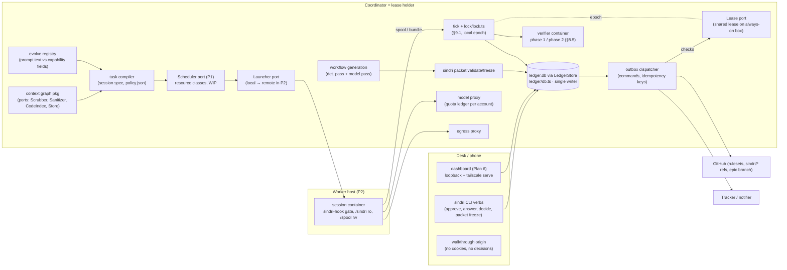
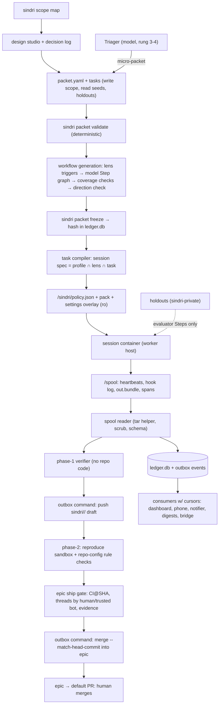

# Architecture Review: Sindri factory addendum (§17), revision 3 — round 2

_Reviewed by `/archReview` on 2026-10-09_

**Target:** `docs/superpowers/specs/2026-10-09-sindri-factory-addendum.md` (rev 3: §17.19 resolutions, §17.20 parallelism P1–P4, §17.21 multiplayer foundations).
**Checked against:** main spec `2026-10-07-sindri-design.md` (invariants §3, §5.2, §5.3, §8, §9.1, §9.4), `2026-10-09-agent-readiness-design.md` §4b, `2026-10-09-sindri-dashboard-design.md`, and the code in `sindri/src` (`lock/lock.ts`, `ledger/db.ts`, `ledger/items.ts`, `observe/observe.ts`, `profile/schema.ts`).
**Round 1:** `round1/consolidated-review.md` (C1–C17), `round1/arch-review.md`.
**Out of scope (decided):** C# port, stacked epics, swappable host, ring order, core tenet. Findings below work inside those decisions.

## Verdict: NEEDS WORK

Revision 3 resolves most of round 1. The capability ceiling, the split between prompt text and capability fields, the pattern-vs-boundary table, the holdout mounts, the phase-2 placement of repo-config rule checks, the context-graph ports, the phone-decision binding, the ring-1 table and the devex commands all hold up against the main spec. Three HIGH findings remain, so the rule gives NEEDS WORK:
- **F1:** micro-packets auto-freeze a write scope that a model drafted. That breaks invariant 13 and the rule that freezing is a desk action.
- **F2:** the shared lease (C6's fix) isn't specified enough to fence anything. It has no TTL, renewal or margin, and it doesn't say how it relates to the §9.1 ledger epoch (still per host in `ledger/db.ts`) or to `hosts.active` (still read from the approved profile in `observe/observe.ts:189-192`). It doesn't arrive until F7, but outward actions start at F0.5, and `handover --back` reads as a snapshot restore.
- **F3:** desk authority (`approve`, `freeze`, `profile approve`) isn't defined when the human's desk machine isn't the active host.

The new §17.20 and §17.21 hang together in direction. They have five MEDIUM consistency gaps: the exactly-once claim, the idempotency key shape, Step-attempt fencing for workers, where proxy credentials live in P2, and tenant vs ring cardinality. All have clear fixes. Scores: Complexity 3, Scalability 3, Maintainability 4.

## Round-1 fix verification

| id | Round-1 finding | Rev-3 status | Evidence | Residual |
|---|---|---|---|---|
| C1 | Model-added lenses widen the sandbox | **Resolved** | Inv. 13 (L93-96) lists the forbidden fields; §17.19 ceiling = profile ∩ lens ∩ task (L633-634); added lenses are review-only (L353-354) | §17.5 table (L240) still says `skills/agents/mcp` = "the lens definition's allowlist" with no ceiling. §17.19 overrides it, but the text is stale (F9). Micro-packets reopen the hole (F1) |
| C2 | Lens capabilities, templates and security rules self-adopt | **Resolved** | §17.19 L627-636: capability fields are approval-tier; imported packs come in as prompt text at the lowest tier, with capabilities dropped | None |
| C3 | Enforcement table overstated | **Resolved in §17.19** | Pattern/boundary table L638-646; overlay in ro `/sindri`; gate and safety hooks in root-owned managed settings (matches main §5.3, §8.2 Identity) | §17.5 L247 still says out-of-scope actions are "refused by the gate and the container, never left to the agent", and L253 still lists command allowlists as gate-enforced without the "pattern" caveat (F9) |
| C4 | Holdouts leak | **Resolved for mounts** | L646: sindri-private, mounted only into evaluator Steps, canary example | The evaluator→implementer handoff and the per-item `/state` volume (main §8.2) are still leak paths (F10) |
| C5 | Repo-config rule checks in the phase-1 verifier | **Resolved** | L649-650 moves them to phase 2, consistent with main §8.5 step 5 | LOW: they now report after the draft push, which is fine for drafts |
| C6 | Per-host fencing; unsigned handover; host tags; passkey binding | **Partly resolved** | Shared lease L653-656; host tags L657; signed handover L658-659; stable tailnet name L660-661 | Lease semantics, the epoch relation, `hosts.active`, `--back` semantics and the F7 sequencing are open (F2). Desk authority across hosts is open (F3) |
| C7 | Context graph not separable; laundering through consolidation | **Resolved** | L663-668: injected ports, `Source→Connector` shim, one store per profile, lowest-trust propagation, evals in Sindri | None |
| C8 | Phone path replayable; protected kinds on the phone; shared origin | **Resolved** | L670-678 plus §17.12 L485 and L495-496 | The item version must cover head SHA and evidence, and the offline queue conflicts with WebAuthn challenges (F12) |
| C9 | Epic auto-merge trusts agent inputs | **Resolved in the sindri-side gate** | §17.10 L421-425 | The gate is sindri-side only, with no server-side ruleset on epic branches, and phase-1/phase-2 verdicts aren't named in it (F11) |
| C10 | Ring-1 policy may block "F3 holds" | **Resolved** | Ring-1 table L687-697 | None |
| C11 | Phone states, WCAG, captions, queue map | **Resolved** | L679-685 | None (design lens owns depth) |
| C12 | Devex: init/amend, error area, session spec, why-denied, SINDRI_MODE, lint | **Resolved** | L700-712; `SND-SANDBOX-1xx` (L259) | `SND-SANDBOX` already exists in main §8.2 for `2xx` spool quarantine. The ranges don't collide, but the area now has two meanings (F14) |
| C13 | No thin slice | **Resolved** | F0.5 (L552) | None |
| C14 | Micro-packets | **Resolved, but introduces F1** | L708-709 | F1 |
| C15 | Human effort ceiling | **Resolved** | L715-718 | None |
| C16 | Versioning, schemas, command aliases, glossary | **Resolved** | L710-712 | The glossary should also fix "lease", which now has three meanings (F14) |
| C17 | Handover dry-run and rollback | **Resolved in name** | L658-659 | `--back` restoring the *previous* snapshot would drop events recorded since (F2) |

## Scores

_Anchored 1–5 scale from `_shared/severity.md` (5 = no findings above LOW … 1 = CRITICAL or unaddressed)._

| Dimension | Score (1–5) | Notes |
|-----------|:---:|-------|
| Complexity | 3 | The core pipeline (packet → compiler → session → verifier → outbox) is coherent and mostly deterministic. F1 and F3 are HIGH but local fixes, not structural |
| Scalability | 3 | The P1–P4 ladder reuses its seams well (LedgerStore, Lease, Launcher, Scheduler ports). F2 (lease semantics) is HIGH. F5–F8 are MEDIUM gaps in the distribution contract |
| Maintainability | 4 | The ports and contract-test suites are right. The remaining issues are stale text in §17.5 and §17.13, invariants amended without being listed, and an overloaded term (F9, F14) |

## Component Diagram



## Data Flow Diagram



## Sequence Diagram

The most critical flow: one task, from frozen packet to merge into the epic, on a P2 worker, with the error paths.

```mermaid
sequenceDiagram
  participant H as Human (desk)
  participant C as Coordinator tick (lease holder)
  participant L as Lease store (always-on box)
  participant DB as ledger.db (LedgerStore)
  participant W as Worker host Launcher
  participant S as Session container
  participant V as Verifier (phase 1/2)
  participant O as Outbox dispatcher
  participant G as GitHub

  H->>C: sindri packet freeze <id>
  C->>DB: record packet hash + events (outbox, same txn)
  C->>L: renew lease (epoch N)
  C->>DB: Step queued (attempt a1)
  W->>C: pull Step (resource classes, heartbeat lease)
  C->>W: session spec + pack (attempt a1)
  W->>S: launch with /sindri ro, proxies
  S-->>W: /spool: heartbeats, out.bundle
  alt worker heartbeat lost
    C->>DB: Step → queue from last checkpoint (attempt a2)
    Note over C,W: F7: a late a1 bundle must be refused by attempt fence
  end
  W->>C: ship spool + bundle (attempt a1)
  C->>V: phase 1 on bundle copy (hash pinned)
  alt phase 1 fails
    V-->>C: signed verdict fail
    C->>DB: park item (needs-approval)
  end
  C->>DB: enqueue command push(item, sha, key)
  O->>L: check epoch == N (F2: TTL margin, check-then-act)
  alt lease lost / unreachable
    L-->>O: stale or no answer
    O->>DB: hold command; host goes passive
  end
  O->>G: push sindri/<user>/<item>, draft PR
  G-->>O: ok (F5: crash here → reconcile before retry)
  O->>DB: command done
  C->>V: phase 2 (reproduce sandbox, rule checks)
  C->>C: epic gate: CI@sha, threads, evidence, rounds
  C->>DB: enqueue merge(item, sha)
  O->>G: merge --match-head-commit sha into epic
  G-->>O: ok or head moved (refuse, re-verify)
```

## Top Risks

| # | Risk | Impact | Likelihood | Mitigation |
|---|------|--------|------------|------------|
| 1 | Micro-packets freeze a model-drafted write scope with no desk step, which widens a capability outside the ceiling (F1) | high | high | Derive the micro-packet write scope from a profile-declared micro ceiling and cap it deterministically, or queue the freeze for a binary desk/phone approval |
| 2 | The lease doesn't actually fence: two epochs, check-then-act on outward actions, `hosts.active` still static, `--back` restoring an old snapshot (F2) | high | med | One fencing token: the lease epoch is written into the ledger meta epoch on acquire; TTL with a safety margin; reconcile-before-retry on commands; `--back` is a forward handover |
| 3 | Desk verbs run on a passive host write to a stale ledger (F3) | high | med | Verbs refuse on a non-lease host with a code and route to the holder (Tailscale SSH to the active host, authenticated as its OS user) |
| 4 | "Exactly-once" outward actions are only at-least-once against GitHub and trackers (F5) | med | high | Per-adapter `reconcile(cmd)` that looks for the command's marker or remote state before any retry |
| 5 | P2 worker hosts hold the real model bearer if the proxy runs there (F4) | high | med | The bearer-swapping model proxy stays on the coordinator, and workers relay over the tailnet with per-session dummy credentials |
| 6 | A stale worker attempt ships a bundle after its Step was requeued (F7) | med | med | Attempt-scoped fencing: the coordinator accepts spool and bundle only for the current attempt token |

## Edge Case Matrix

Boundaries come from the spec plus code exploration (done directly, without a subagent). Each one is named after the component that owns it.

| Boundary | Dependency unavailable | Invalid/malicious input | Load 10x | State leakage |
|---|---|---|---|---|
| B1 `sindri packet validate/freeze` (incl. micro-packets) | OK — validation is local and deterministic (L217-225); a freeze records a hash in the ledger | **F1** | OK — runs once per deliverable (L346-347) | OK — holdouts kept where the implementer can't read them (L224, L646) |
| B2 Workflow generation (det. pass + model pass) | OK — model pass is a bounded job; the direction check on a different model gates it (L351-358); a failure parks under inv. 4 | OK — the model can't write capability fields; coverage checks are deterministic (L353-357, L630-631) | OK — once per deliverable, not per turn (L346) | OK — read-only job (L351) |
| B3 Task compiler → session spec / `/sindri/policy.json` | OK — no model, pure code (L233) | **F9** (stale §17.5 text without the ceiling; §17.19 wins) | OK — splits by write scope when the pack exceeds half the window (L269-270) | OK — policy in the ro `/sindri` mount; gate in root-owned managed settings (L647-648; main §5.3) |
| B4 Session container ↔ `sindri-hook` gate | OK — the wrapper fails closed with `SND-HOOK-9xx` (main §5.3) | OK — boundary is mounts, egress and the verifier (L638-646) | OK — per-container CPU and memory caps (main §8.2) | **F10** (evaluator→implementer handoff and per-item `/state`) |
| B5 Spool → tick ingest → `ledger.db` (single writer) | OK — the spool persists until the ledger txn commits (main §5.2; `index/spool.ts:140`) | OK — tar helper, entry validation, scrub, schema (main §8.2) | OK — per-file and per-session quotas (main §8.2) | **F6** (event idempotency key collides across distinct events) |
| B6 Outbox dispatcher → GitHub / tracker | **F2** (lease check is check-then-act) | OK — status comments composed from structured fields; outward scrubber (main §8.5) | OK — one dispatcher, a queue in the ledger (L763) | **F5** (a retry after an unacknowledged success repeats the action) |
| B7 Shared lease ↔ hosts / handover | **F2** | OK — signed snapshot verified on arrival (L658) | OK — one lease, low write rate | **F2** (`--back` snapshot restore), **F3** (verbs on a passive host) |
| B8 Coordinator ↔ worker hosts (P2 Launcher) | OK — a dead worker's Step returns to the queue from its checkpoint (L730) | **F4** (worker proxy credentials) | OK — resource-class slots and capacity model (L729) | **F7** (stale attempt bundles) |
| B9 Model proxy / egress proxy | OK — rate limit → checkpoint and relaunch on another allowed account (L532-533) | OK — fixed upstream, model and endpoint allowlists (main §8.2) | OK — quota ledger per account; `reserveForHuman` (L529-531) | OK — accounts tagged work/personal; ring-1 never on a personal account (L534-535) |
| B10 Dashboard / phone decision API (`tailscale serve`) | **F12** (offline queue vs WebAuthn challenge) | OK — signed `(item id, version, nonce, choice)`; stale or reused refused (L672-673) | OK — one decision per item; first signed decision wins (L767) | **F12** (item version must cover head SHA + evidence) |
| B11 Epic ship gate → merge into epic | OK — CI not green → no merge (L421) | **F11** (no server-side ruleset on the epic; phase verdicts not named) | OK — a task that conflicts twice is serialized (L739-740) | OK — threads resolved by Sindri sessions don't count (L422-423) |
| B12 Context graph package ↔ connectors | OK — an adapter is enabled only when its backtest arm helps (L183-185); missing → arm off | OK — consolidation keeps the lowest trust; model links are `provenance: model` (L174-175, L666-667) | OK — bounded expansion depth and per-dimension budgets (L179-181) | OK — one store per profile; ring-1 profiles can't name personal stores (L187-188, L665) |
| B13 Evolve registry (prompt text vs capability fields) | OK — manual adoption in step 1 (main §7.4) | OK — capability fields approval-tier; imports drop them (L630-636) | OK — 3 per artifact and 10 per week (main §7.4) | OK — variants can't edit their own eval suite (main §7.4, inv. 11) |
| B14 Federation pack exchange (P3) | OK — instances are independent; nothing is shared but packs (L731) | OK — lowest trust tier, prompt text only (L731, L635) | OK — packs are small and published on demand | OK — no shared state or credentials (L731) |
| B15 Tenancy and rings in the store (P4 seam) | OK — single-valued until P4 (L748) | OK — a query without a tenant fails (L766) | OK — per-tenant fair scheduling (L766) | **F8** (ring vs tenant cardinality contradicts P1's per-ring WIP) |
| B16 Telemetry (OTel) from sessions | OK — spans are optional; loss isn't a failure | OK — logs scrubbed by the processor (L769) | OK — sampled per trace | **F13** (export path from a container with no default route) |

### Findings

| id | severity | lens | location | finding | recommended fix |
|---|---|---|---|---|---|
| F1 | HIGH | arch | §17.19 L708-709 vs inv. 13 (L93-96), §17.12 L485, L496 | A micro-packet's write scope comes "from triage", and the Triager is a model (rung 3–4) standing workflow. The packet is "frozen without a desk step". Write scope is a capability field that no model may set, and freezing is a desk action that §17.12 also keeps off the phone. So a tracker item can get a model-chosen write scope frozen and built with no human approval | Pick one: (a) the micro-packet write scope is computed by code from a **profile-declared `microPacket` ceiling** (path allowlist, max files, no protected paths, no dependency changes), with the triage proposal only able to narrow inside it, and the verifier refusing bundles outside it; or (b) a micro-packet freeze becomes a binary, non-protected phone or desk item with the compiled scope shown. State which, and add it as an exception to inv. 13 and §17.12 |
| F2 | HIGH | arch | §17.19 L653-661, §17.13 L508-510, §17.16 F7 (L559), main §3 inv. 1, §9.1, §9.4; `ledger/db.ts:258-288`, `observe/observe.ts:189-192`, `lock/lock.ts` (`owner.host !== hostname` → never steal) | The lease is named but not specified. (1) There are two epochs: §9.1's ledger `meta.epoch` (per host, still how the code fences) and the lease epoch. §17.13 still says handover uses a "fenced epoch bump (§9.1)". (2) No TTL, renewal or safety margin, so "checked before every outward action" is check-then-act: a paused holder can push after losing the lease. (3) `hosts.active` is a static, approval-tier profile field that `observe` enforces, and handover doesn't say it replaces it. (4) `handover --back` "keeps the previous host's snapshot". If it restores that snapshot, the decisions and outward actions recorded since are lost, and replaying them can repeat them. (5) The lease arrives at F7, but outward actions start at F0.5 | Specify the `Lease` contract: `acquire → (epoch, expiresAt)`, `renew`, TTL and margin; the holder stops dispatching outward commands at `expiresAt − margin` unless renewed. On acquire, write the lease epoch into the ledger's `meta.epoch`, so §9.1 fencing and the lease share one token. Amend inv. 1 and §9.4: the lease supersedes `hosts.active`, which becomes the set of *eligible* hosts. Make `--back` a forward handover from the current holder; the kept snapshot is used only when the target never took the lease. Until F7, state that the factory runs on one fixed host, with handover refused, and ship a trivial single-host `Lease` implementation at F0.5 |
| F3 | HIGH | arch | §17.12 L491, §17.13 L513, §17.19 L653-661, main §8.2 Identity ("host-side verbs authenticated by the host OS user") | Host CLI verbs are "the authority", but the swappable host means the human's desk machine is often not the lease holder (the box is active while the human sits at the laptop). The spec only says the desk *reads* the active dashboard. `sindri approve`, `packet freeze`, `answer` or `profile approve` on a passive host write to a stale local ledger that the holder never sees, or worse, that a later `--back` revives | Rule: authority verbs on a host without the lease refuse with a new code (for example `SND-LEASE-0xx`, "active host is X") and offer `sindri --on <active> <verb>`, which runs over Tailscale SSH as the active host's OS user. That keeps main §8.2's authentication model. Passive ledgers are read-only for decisions. At P4 this becomes the versioned API (§17.21 L776) |
| F4 | MEDIUM | arch, security | §17.20 L730, main §8.2 Credentials (proxy swaps in the real bearer) | "Workers hold no tokens beyond their session proxies." If the model proxy runs on the worker, it holds the subscription bearer, which then sits on cloud boxes. The quota ledger per account (§17.15) also has to be central, or two workers overspend the same window | The bearer-swapping model proxy and the quota ledger run only on the coordinator. Worker containers reach it through a worker-local relay that carries per-session dummy credentials over the tailnet. Do the same for the egress proxy's credentialed endpoints. Say so in §17.20 |
| F5 | MEDIUM | arch | §17.21 L763 "Retries and a second worker can't repeat it" | GitHub and tracker APIs don't take idempotency keys. A crash after a successful comment, label or push but before `command done` replays it. The outbox gives at-least-once delivery, not exactly-once | Each outward adapter declares `reconcile(cmd) → done | not-done | unknown`. It checks for a marker (hidden key in the comment body, label present, ref at SHA, PR merged at SHA) before any retry. `unknown` parks. Commands without a reconcile must be harmless to repeat. Rename the row "effectively-once" |
| F6 | MEDIUM | arch | §17.20 L745-746 | The idempotency key `(kind, item, attempt, sha)` collides for distinct events of the same kind in one attempt: heartbeats, multiple review-round comments, decisions with no SHA. Dedupe would silently drop real events | The producer assigns each event a unique id (ULID from the session, spool line or dispatcher), and the ledger enforces `UNIQUE(event_id)`. Keep `(kind, item, attempt, sha)` as a *semantic* key only for commands that must happen once per SHA (push, merge) |
| F7 | MEDIUM | arch | §17.20 L730; main §9.2 relaunch is kill-before-relaunch, which a coordinator can't guarantee for a partitioned remote worker | A partitioned but alive worker keeps running a Step that was requeued, then ships a spool or bundle for the old attempt | Every Step dispatch carries an attempt token. The coordinator ingests spool and bundles only for the current token and quarantines the rest (reuse `SND-SANDBOX-2xx`). The worker kills its container when its Step lease lapses |
| F8 | MEDIUM | arch | §17.20 L729 ("WIP limit per packet and per ring") vs L748 ("tenant and ring key … single value until P4"); §17.21 L766 | P1 schedules across several rings on one instance (rings 0 and 2 on the personal instance), so ring can't be single-valued. The relation between tenant and ring isn't defined: is ring a tenant attribute or orthogonal? | Define it: ring is a property of a repo (from the profile); a tenant is the isolation unit; one instance may hold several rings of the same class (work or personal) and never both classes (P3 split mandatory once ring 1 begins, which matches L751). Only the tenant key is single-valued until P4 |
| F9 | MEDIUM | arch | §17.5 L240, L247, L253; §17.13 L508-510; §17.1 vs main inv. 1 and 5 | Stale text that §17.19 overrides only by precedence: the compiler table without the ceiling, the "refused by the gate and the container" overclaim, command allowlists without the pattern caveat, handover via the §9.1 epoch. §17.20 and §17.21 change invariants 1 (cross-host exclusion via the lease) and 5 (resource classes replace one heavy job per host), but §17.1 doesn't list those amendments | Edit §17.5 and §17.13 in place to point at §17.19. Add "Amends inv. 1 and inv. 5" to §17.1 with the new wording |
| F10 | MEDIUM | arch | §17.7 L364, §17.19 L646; main §8.2 per-item `/state` volume, §9.2 W5 | Holdouts are mounted only into evaluator Steps, but two paths remain. (1) The evaluator's handoff output feeds the implementer's fix round and can quote held-out examples. (2) The per-item persistent `/state` volume survives across Steps, so an evaluator can leave holdout text where the next implementer reads it | The evaluator→implementer handoff schema carries only check ids, pass/fail and non-holdout findings, and a scrubber pass removes any holdout or canary text. Evaluator Steps get their own volume, not the item's `/state` |
| F11 | MEDIUM | arch, security | §17.10 L420-425; main §5.3 and inv. 10 (the security boundary is server-side protections) | The epic auto-merge gate is sindri-side code only. The epic branch isn't covered by a ruleset (only `sindri/*` refs are, main §8.5), and the gate doesn't name phase-1 and phase-2 verdicts on the same SHA (main §8.5 step 6 requires them for undraft) | Name epic branches under `sindri/epic/*` with a ruleset: PR required, required status checks, merge restricted to the sindri bot identity, no force push. Add "phase-1 and phase-2 passed on the merged SHA" to the gate list |
| F12 | MEDIUM | arch, security | §17.19 L672-673, L679-681; `ledger/items.ts` (no item version column today) | (1) Phone decisions bind to the "item version", but the spec doesn't say what bumps it. If a new push or new evidence doesn't bump it, "accept evidence" or "undraft" applies to a head the human didn't see. (2) "Offline (queued locally, sent on reconnect)" conflicts with WebAuthn: assertions sign a server-issued challenge | The item version = a hash over (state, head SHA, evidence roll-up hash, open findings), bumped by any change. The server issues per-item challenges with the inbox page, valid for a short TTL. Offline decisions sign those, and are refused when stale or expired. Add a `version` column to the C# items schema |
| F13 | LOW | arch | §17.21 L769 ("W3C trace context passed into containers") vs main §8.2 (no default route) | Containers can't reach an OTel collector. Opening one is new egress | Session spans go to `/spool` as data and are exported host-side after scrub. Only the context *ids* go into containers |
| F14 | LOW | devex | §17.5 L259, main §8.2 `SND-SANDBOX-2xx`; "lease" in §17.19, §17.20, main §8.2, §9.2 | `SND-SANDBOX` now means both policy denials (1xx) and spool quarantine (2xx). "Lease" means the host lease, Step leases, heavy-job lock leases and the lease paused during takeover | Document both ranges in the error catalog. Add "host lease", "Step lease" and "lock lease" to the glossary (L712), and use the qualified terms |
| F15 | LOW | docs | §17.17 placed after §17.21 | Section order is out of sequence | Move §17.17 before §17.18, or renumber |

## Missing Error Handling
- **Lease store unreachable** (§17.19 L654-656): "passive" is defined, but not what happens to Steps that are running, commands already queued, or a notification for the human. Define: running Steps checkpoint, commands hold, and the notifier (if it's reachable) sends a `lease-lost` alert. That alert counts toward the silent-failure floor (main §10.4).
- **Handover target fails verification** (L658): what state is the source left in? It should keep the lease, or re-acquire it, with no epoch bump.
- **Outbox command with reconcile `unknown`** (F5): no parked state or human surface is defined.
- **Worker deregisters mid-push of its spool** (F7): partial spool archives should be rejected whole.
- **Micro-packet validation failure** (L708-709): where does it go (the desk queue, or back to the Triager)? It shouldn't loop.
- **Two humans, one decision** (L767): the loser sees `decided elsewhere`, but there's no audit entry kind for a refused decision. Record it, for the hash chain.

## Suggested Improvements (Prioritized)

_Severity per `_shared/severity.md` (legacy P0→CRITICAL, P1→HIGH)._

| Severity | Improvement | Effort | Impact |
|----------|------------|--------|--------|
| HIGH | F1: micro-packet scope from a profile ceiling or a binary approval; amend inv. 13 and §17.12 explicitly | S | Closes the last path where a model sets a capability |
| HIGH | F2: a `Lease` contract (TTL, renew, margin), one fencing token shared with `meta.epoch`, the lease superseding `hosts.active`, `--back` as a forward handover, a single-host Lease at F0.5 | M | Makes the C6 fix real and keeps the swappable host safe |
| HIGH | F3: authority verbs refuse on a passive host and route to the holder with `--on` | S | Desk decisions always land in the live ledger |
| MEDIUM | F5 and F6: per-adapter reconcile, producer event ids, semantic keys only for once-per-SHA commands | M | Correct outbox semantics before P2 multiplies retries |
| MEDIUM | F4 and F7: coordinator-only bearer proxy and quota ledger; attempt-token fencing for workers | M | P2 safe by construction |
| MEDIUM | F8: define ring vs tenant cardinality | S | Removes the contradiction in the C# schema seams |
| MEDIUM | F9–F12: in-place edits to §17.5, §17.13, §17.1; holdout handoff schema; epic rulesets; item-version definition and challenge TTL | S each | Consistency and defense in depth |
| LOW | F13–F15: span export through the spool, error and glossary entries, section order | S | Polish |

verdict: NEEDS_WORK
