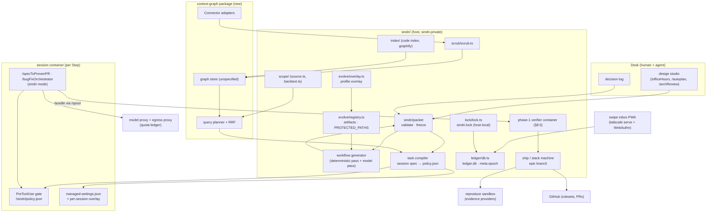
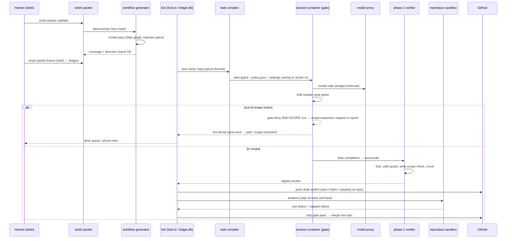

# Architecture Review: Sindri factory addendum (§17), revision 2

_Reviewed by `/archReview` on 2026-10-09_

Target: `docs/superpowers/specs/2026-10-09-sindri-factory-addendum.md` (cited as `A:<line>`), checked against
`docs/superpowers/specs/2026-10-07-sindri-design.md` (cited as `S:<line>`) and the code in `sindri/src`.

## Verdict: NEEDS WORK

The pipeline shape is right: a frozen packet, deterministic compilation of each session spec, budgeted injection,
and verification on the sindri side. Most of it fits the main spec. The review found no CRITICAL finding. It found
seven HIGH findings, and four of them are structural:

- **F1:** invariant 13 says scope is "computed by Sindri code", but a model proposes Step graphs, lens additions and
  injection plans.
- **F2, F3:** §17.5 says the container and the gate refuse out-of-scope reads, commands and MCP use. They can't. Only
  writes are enforceable, and only at bundle export. The holdout barrier depends on reads being enforced.
- **F4:** host handover depends on a fencing epoch that is local to one ledger, so it can't make a sleeping laptop
  passive.
- **F5:** the "no Sindri imports" rule for the context graph contradicts its own pipeline, which runs through
  Sindri's scrub, index, registry and backtest.

F6 (rule checks in the verifier) and F7 (lens allowlists are not protected) are HIGH because they would weaken the
§8.5 and §7.4 boundaries as written. Complexity scores 2 because of the structural findings, so the verdict is
NEEDS WORK.

## Scores

_Anchored 1–5 scale from `_shared/severity.md` (5 = no findings above LOW … 1 = CRITICAL or unaddressed)._

| Dimension | Score (1–5) | Notes |
|-----------|:---:|-------|
| Complexity | 2 | 15 sections and about 10 new subsystems: packet, workflow generator, lenses, rules, task compiler, policy compiler, evidence providers, context graph, phone authentication, host handover and quota routing. In several places the addendum claims enforcement that the layer it names can't provide (F2, F3, F4). |
| Scalability | 3 | Workflow generation runs once per deliverable, graph expansion has bounded depth, and budgets are enforced by the proxy. Invariant 5 (one heavy job per host) now serializes consolidation, index builds, image builds, perf evidence and standing workflows (F12). The quota ledger is per host (F13). |
| Maintainability | 3 | The context graph's component interfaces are a good idea, but the new `Connector` duplicates `Source` in `scope/source.ts` (F5). Lens and rule artifacts have no registry kind (F7). Standing workflows bypass invariant 14 (F10). |

## Component Diagram

## Data Flow Diagram

```mermaid
flowchart LR
  brief["brief / tracker item"] --> scopeMap["sindri scope → scope map"]
  scopeMap --> studio["design studio"]
  studio --> packetDir["packet dir\npacket.yaml + tasks + holdout"]
  packetDir -->|"sindri packet validate"| validated["validated packet"]
  validated --> detpass["lens trigger match\n(deterministic)"]
  detpass --> modelpass["model pass:\nStep graph, extra lenses,\ninjection plans"]
  modelpass --> coverage["coverage checks + direction check"]
  coverage -->|"sindri packet freeze (hash → ledger.db)"| frozen["frozen packet + workflow"]
  connectors["connectors (Linear, notes,\nConnectAI MCP, analytics)"] --> sanitize["sanitizeIngest + scrubber\n(scope/source.ts)"]
  sanitize --> graphdb["context graph store"]
  frozen --> compile["task compiler"]
  graphdb --> compile
  compile --> ro["/sindri (ro): pack, policy.json,\nsettings overlay"]
  ro --> session["session container"]
  session --> spool["/spool: out.bundle, requests,\nhook log, transcripts"]
  spool --> p1["phase-1 verifier\n(path guard, write-scope check, shape, scrub)"]
  p1 -->|"pass"| push["push sindri/<user>/<item> (draft)"]
  push --> p2["phase 2: reproduce sandbox\n+ evidence providers (base vs head)"]
  p2 --> epic["task PR → epic branch\n(epicMerge: auto)"]
  epic --> human["epic → default PR (human merges)"]
  p2 --> ledgerdb["ledger.db (verdicts, metrics)"]
  ledgerdb --> evolve["evolve: rule/lens/workflow proposals"]
```

## Sequence Diagram

The critical flow is one build Step from a frozen packet to a merged task PR, with the main error path
(an out-of-scope action) shown.

## Top Risks

| # | Risk | Impact | Likelihood | Mitigation |
|---|------|--------|------------|------------|
| 1 | Host handover lets two hosts act at once. The fencing epoch lives in each host's own `ledger.db` (`ledger/db.ts:257-270`), and the lock never looks past its own host (`lock/lock.ts:82`). A laptop that wakes with a copied ledger still thinks its epoch is current. | high | med | Add a shared lease before F7: a remote compare-and-swap epoch ref, or a lease service on the tailnet. Every outward action (push, merge, tracker write) checks the remote epoch. Make the Linux box the default active host. |
| 2 | Held-out acceptance examples leak to the implementer. The mounts expose the whole repo (`S:724-728`), and reads through Bash can't be gated. | high | med | Never commit holdouts to git or the mirror. Mount them only into evaluator Step containers. Add a `packet validate` check that refuses a holdout path inside the repo, and a doctor probe that runs `git grep` in an implementer container. |
| 3 | A lens allowlist (commands, MCP, network) is widened without a human: through the overlay before merge (`A:473`), through `selfMerge: auto`, or through a model-added lens (`A:308`). | high | med | Add lens and workflow-template allowlist fields to the protected surfaces (approval tier). Treat a model-added lens as review-only, with no extra commands, unless its trigger matched. |
| 4 | A rule check (for example eslint) runs repo code in the phase-1 verifier. That breaks "executes no session code" (`S:893`) and the forged-verdict guarantee. | high | med | Run `check` rules in the reproduce sandbox (phase 2), or in a third no-network container whose output is exit status only. The phase-1 verifier stays sindri-owned and deterministic. |
| 5 | The context graph is planned as a "separable package" but is entangled with sindri scrub, index, registry and backtest, and its store and single writer are unspecified. | med | high | Define ports (Scrubber, Sanitizer, CodeGraph, Store, Clock) that sindri injects. Name the graph store (a separate SQLite per profile) and its single writer. Keep evals in sindri and add the planner to `EVAL_MACHINERY`. |

## Edge Case Matrix

Boundaries are taken from the addendum's components and the existing code.

| Boundary | Dependency unavailable | Invalid/malicious input | Load 10x | State leakage |
|---|---|---|---|---|
| B1 Desk → `sindri packet validate/freeze` | OK — validation is local and deterministic, and a failed check blocks freeze (`A:173-183`) | F8 | OK — runs once per packet; the checks are graph and glob work (`A:173-181`) | F2 |
| B2 Workflow generator (model pass) → freeze | OK — a failed model pass leaves the packet unfrozen, and invariant 14 blocks the build (`A:58-59`) | F1 | OK — once per deliverable, not per turn (`A:301-302`) | F1 |
| B3 Task compiler → `/sindri/policy.json` + settings overlay | OK — the gate fails closed on a missing or unparsable policy (`S:697`) | F3 | OK — pure function of packet + lens + graph query (`A:189`) | F3 |
| B4 Session container ↔ gate / egress proxy | OK — no default route, so a dead proxy denies everything (`S:780-783`) | F2 | OK — per-container CPU and memory limits plus the session cap (`S:713-717`) | F2 |
| B5 Session `/spool` → phase-1 verifier (write-scope check) | OK — a missing or oversized bundle is refused (`S:887-890`) | F6 | OK — `verify.maxBundleMB` and object-count limits (`S:889`, `S:895`) | OK — regular files only, `O_NOFOLLOW`, quarantine on mismatch (`S:744-756`) |
| B6 Evidence providers ↔ reproduce sandbox / environment | F9 | F9 | F12 | OK — the sandbox can't write verdict files, and only exit status and capped stdout are read (`S:907-911`) |
| B7 Connectors → ingest/scrub → context graph store | F11 | F11 | F12 | F5 |
| B8 Query planner → injection plan sections | OK — a missing component drops its arm, and the backtest gates enabling it (`A:140-142`) | F11 | OK — bounded expansion depth and per-dimension budgets (`A:136-138`) | F5 |
| B9 Rules / lens registry (`evolve/registry.ts`, overlay) | OK — an unknown artifact fails closed to approval (`evolve/proposals.ts:69`) | F7 | OK — selection fills a per-lens budget and never carries the library (`A:245-246`) | F7 |
| B10 Ship / stack machine → epic branch | OK — a CI or GitHub outage leaves PRs unmerged; the gate needs green CI (`A:374-375`) | F10 | F10 | F10 |
| B11 Phone PWA (tailnet + WebAuthn) → ledger decision | OK — CLI verbs stay the authority, and the phone is a second path (`A:439-442`) | F14 | OK — binary decisions, one signed record each (`A:441-442`) | F14 |
| B12 Host handover (`lock.ts`, `ledger/db.ts`, mirrors, volumes) | F4 | F4 | OK — handover is rare and human-initiated (`A:455`) | F4 |
| B13 Model proxy / quota routing across accounts | OK — a rate limit puts the session into `quota-exhausted` as a known wait (`S:767-768`) | OK — fixed upstream with model and endpoint allowlists (`S:770-771`) | F13 | F13 |

### Findings

- **F1 (HIGH): invariant 13 contradicts the model-proposed workflow.**
  - Location: `A:55-57`, `A:306-308`.
  - Problem: the invariant says scope, context, lenses and handoff are "computed by Sindri code". The model pass
    produces the Step graph, which lenses build or review, where parallel work happens, and every Step's injection
    plan. It may also add lenses. Each added lens brings its own `commands`, `mcp`, `skills` and `agents`
    allowlists, which widen the compiled sandbox (`A:196`, `A:209-212`).
  - Problem: the addendum doesn't say who freezes an amendment. It says "only the affected tasks are re-planned and
    re-frozen" (`A:185`), and §17.12 only says that packet freezes stay at the desk.
  - Mitigation, invariant text: change it to say that security-relevant fields are pure functions of frozen,
    human-approved inputs.
  - Mitigation, fields a model may never propose: `write`, `sandbox`, `commands`, `network` and `mcp` come only from
    the packet's task records plus the lens catalog.
  - Mitigation, fields a model may propose: Step order, review placement and injection-plan ranking.
  - Mitigation, lens additions: a model-added lens whose trigger didn't match runs as review-only. It gets read
    tools and no extra commands.
  - Mitigation, amendments: every re-freeze, including an amendment, is a desk action with a diff of the workflow
    against the previous freeze.

- **F2 (HIGH): read scoping and the holdout barrier can't be enforced as written.**
  - Location: `A:208`, `A:179`, `A:318`.
  - Problem: the session mounts `/mirror`, `/workspace/base` and a full clone in `/workspace/src` (`S:724-731`).
    Any `cat`, `rg` or `git show` in Bash reads the whole repo. The gate can deny the Read tool by path, but that is
    pattern enforcement (`S:186-198`), not a boundary.
  - Problem: packet plans are generated into the repo so the plan-file tracker sees them (`A:171`). If the packet
    directory, holdout included, is committed, the implementer can read the holdout. The validate check "stored
    where the implementer can't read it" has no concrete definition.
  - Mitigation: in §17.5, say that reads are repo-wide by design and only secrets and deny paths are kept out.
  - Mitigation: the packet stores holdouts and evaluator notes under sindri-private state, never in git. They are
    mounted only into evaluator Steps.
  - Mitigation: `packet validate` refuses any holdout path that resolves inside the repo or mirror.
  - Mitigation: add a doctor probe that greps the implementer container for a holdout canary.

- **F3 (HIGH): the compiled sandbox overclaims enforcement for commands, MCP, skills and hooks.**
  - Location: `A:202-213`, `A:339-341`.
  - Problem: "refused by the gate and the container, never left to the agent" holds only for:
    - network, through the egress proxy;
    - budgets, through the proxy;
    - writes, at bundle export (the verifier's write-scope check).
  - Problem: a lens command allowlist enforced by the gate on Bash strings is bypassable with `sh -c`, `node -e`,
    `npm run <script>` or `make`. The container gives write access to all of `/workspace/src`.
  - Problem: the "per-session settings overlay" is written at launch, but managed settings are image-level and
    root-owned (`S:209`, `S:810-812`). An overlay in the container user's own settings is writable by the agent.
  - Problem: the overlay "enables only the planned … hooks" (`A:340`). That conflicts with §5.3: the gate and the
    Stop gate can't be switched off (`S:235-237`), and hooks are approval-tier (`S:550`).
  - Mitigation: split §17.5's table into two columns, **pattern (hooks)** and **boundary (proxy, credentials,
    bundle verifier)**.
  - Mitigation: map each dangerous lens capability to a boundary control. Migrations and load tests are possible
    only when the egress proxy and `sindri cred run` provide the endpoint or credential.
  - Mitigation: put the overlay in `/sindri` (read-only) and load it from root-owned managed settings.
  - Mitigation: install only the allowlisted skills and agents in the image or the read-only mount, rather than
    toggling them.
  - Mitigation: exempt the gate, the Stop gate and the safety hooks from the overlay.
  - Mitigation: confirm in the F1 live probe that Claude Code can restrict skills, agents and MCP from managed
    settings.
  - Note: "`--permission-prompts none`" (`A:322`) is not a Claude Code flag I can verify. Pin the real mechanism
    (permission mode or settings) in the probe.

- **F4 (HIGH): host handover conflicts with the one-host fencing invariant.**
  - Location: `A:454-458`, invariant 1 (`S:101-102`), §9.1, §9.4.
  - Problem: the epoch is a row in each host's own `ledger.db` (`ledger/db.ts:257-270`), and `fenced()` compares
    against that same local database (`ledger/db.ts:275-279`).
  - Problem: after the ledger is copied and the target bumps its epoch, the source's copy still holds the source's
    epoch. A laptop that wakes up passes its own fencing check. Nothing makes it "stay passive".
  - Problem: the lock never takes over another host (`lock/lock.ts:82`). `hosts.active` is a profile key
    (`profile/schema.ts:182`), and changing it needs an interactive `profile approve` (`S:940-941`).
  - Problem: the shared `Lease` adapter is deferred (`S:131`).
  - Problem: the stated value of F7 is "Builds continue when the laptop closes" (`A:501`). An asleep laptop can't
    checkpoint, and its spool, WIP bundles and per-item `/state` volumes (`S:732`) are stranded on it.
  - Mitigation: before F7, specify the shared lease. One option is a remote epoch ref updated by compare-and-swap
    (`git push --force-with-lease refs/sindri/epoch`) or a tailnet lease service.
  - Mitigation: every outward side effect (push, epic merge, tracker write, notifier) checks the remote epoch, not
    the local one.
  - Mitigation: handover moves `hosts.active` through a signed ledger record, not a profile edit.
  - Mitigation: unplanned failover resumes only from state already synced off the laptop. Spool and WIP bundles
    replicate to the always-on box every tick.
  - Alternative: make the Linux box the default active host and drop "neither is the default" (Q3).

- **F5 (HIGH): the context graph's component boundaries are inconsistent.**
  - Location: `A:97-148`.
  - Problem: "a separable package with no Sindri imports" (`A:147`), but the pipeline's steps live in Sindri:
    - ingest uses `sanitizeIngest`, `fence` and `clean` in `scope/source.ts:47-106`;
    - scrub is the protected `sindri/src/scrub/`;
    - `CodeGraph` is "the existing code index, unchanged", and `index/db.ts` imports `../deps.js` and
      `index/graph.ts` imports `../scrub/scrub.js`;
    - adapter pins are registered artifacts, but `ARTIFACT_KINDS` (`evolve/registry.ts:11`) has no
      adapter/lens/workflow kind;
    - the proof is `sindri scope --backtest`, which is Linear-specific (`scope/backtest.ts:21`).
  - Problem: the new `Connector` (`sync`/`fetch`) duplicates `Source.find(keywords)` (`scope/source.ts:22-25`),
    and the migration of the five existing sources isn't stated.
  - Problem: the graph store is unspecified: its location, its single writer (the ledger rule in `S:174`), and how
    the `consolidate` heavy job writes model-suggested edges.
  - Problem: "freshness by commit sha" (`A:133-134`) doesn't apply to tickets or threads.
  - Problem: separation of work and personal sources relies on profile naming only. Nothing partitions the store
    per profile.
  - Mitigation: define the package's ports (Scrubber, Sanitizer, TrustTagger, CodeGraph reader, Store) with Sindri
    injecting implementations, and keep `CodeGraph` as a reader over the index's JSON or CLI.
  - Mitigation: keep the backtest and evals in sindri, and add the planner and fusion to `EVAL_MACHINERY` so the
    graph can't certify itself (invariant 11).
  - Mitigation: one SQLite store per profile with sindri as its only writer.
  - Mitigation: use source cursor or `updatedAt` for freshness on non-code sources.
  - Mitigation: plan `Source` → `Connector` as an adapter shim, not a rewrite.

- **F6 (HIGH): deterministic rule checks would run session code in the phase-1 verifier.**
  - Location: `A:248-250`.
  - Problem: "A rule with a `check` is enforced at commit and by the sindri-side verifier". A check of
    `type: eslint` loads the repo's `eslint.config.*` and plugins, which is session-authored code. Phase 1 must
    "execute no session code" and writes a signed verdict (`S:893-901`), and the forged-verdict probe depends on
    that (`S:918`).
  - Mitigation: rule checks that load repo config run in the reproduce sandbox (phase 2), and only their exit
    status is read.
  - Mitigation: phase 1 keeps only sindri-owned checks (path guard, write scope, shape, scrub).
  - Mitigation: add a forged-verdict probe variant that uses a malicious eslint config.

- **F7 (HIGH): lens and rule allowlists can widen without approval.**
  - Location: `A:229-256`, `A:264-280`, `A:473`.
  - Problem: lenses carry `commands`, `mcp`, `skills` and `agents`, which are tool allowlists. Tool allowlists are
    an approval-tier protected surface (`S:550`).
  - Problem: three paths let a lens change take effect without a human:
    - §17.14 says "The overlay version applies until the merge", so a lens change is live before any human sees it;
    - `selfMerge: auto` merges PRs that touch no protected module (`S:671-675`);
    - lenses "can be imported from community subagent catalogs" (`A:283`).
  - Problem: rules have a later-wins layer order that ends at the packet (`A:242-243`). A packet co-authored by an
    agent can override a `kind: security` rule by id.
  - Mitigation: classify lens allowlist fields, workflow templates and `kind: security` rules as protected (approval
    tier).
  - Mitigation: a packet may add or tighten rules, but never override or retire security or engineering rules from
    a lower layer.
  - Mitigation: imported lenses land as `proposed` with empty allowlists.
  - Mitigation: add `lens`, `rule` and `workflow` to `ARTIFACT_KINDS` with tier classification.

- **F8 (MEDIUM): packet validation doesn't cover hostile manifests.**
  - Location: `A:160-181`.
  - Problem: write-scope globs (`**`, `../`, absolute paths, symlinked dirs) and "new: path" entries aren't
    normalized or capped, and `packet.yaml` links are followed from the packet.
  - Mitigation: reuse `normalizeRepoPath` (`evolve/registry.ts:41`) for every write-scope and "new:" path.
  - Mitigation: refuse `**` at the repo root and paths that hit protected paths.
  - Mitigation: links must resolve inside the packet directory, and the packet gets a size cap.

- **F9 (MEDIUM): the evidence providers' execution location and credentials are unspecified.**
  - Location: `A:390-422`.
  - Problem: `run(item, "base"|"head")` doesn't say whether it runs in the reproduce sandbox, an environment, or on
    the host.
  - Problem: `perf` load tests and `api-transcript` need endpoints. `publish` is an outward write that must go
    through the §8.5 filter.
  - Problem: `applies()` sees `ChangedFiles` from session output, which is untrusted.
  - Mitigation: state that every `run` happens in the reproduce sandbox with `sindri cred run` credentials.
  - Mitigation: `verify` reads only exit status and capped stdout, and `publish` goes through the outward-write
    filter.
  - Mitigation: changed files come from the verified bundle diff.

- **F10 (MEDIUM): stacked epics and standing workflows bypass existing gates.**
  - Location: `A:372-378`, `A:353-365`.
  - Problem: `epicMerge: auto` must undraft task PRs, but undraft is "always denied" in the session and
    needs-approval by default (`S:690-691`, `S:913-914`). The ship gate lists CI, threads, evidence and rounds, but
    not "phase 1 + phase 2 passed at an unchanged head SHA".
  - Problem: merging a lower stack PR rebases the PRs above it and changes their head SHA, so they need
    re-verification.
  - Problem: there is no composed-behavior evidence at the epic head before the human PR.
  - Problem: standing workflows at the `act` tier (PR babysitter) and `propose` (incident resolver) write code
    without a frozen packet. That contradicts invariant 14 and leaves their write scope undefined (invariant 13).
  - Problem: under 10x load, many open stacks rebase in cascades on every merge.
  - Mitigation: the epic ship gate includes the §8.5 undraft-gate conditions at the current head. Undraft into
    `epic/*` is a sindri action, allowed only by a profile key.
  - Mitigation: protect the epic branch with rulesets.
  - Mitigation: re-run the full evidence plan at the epic head before opening the human PR.
  - Mitigation: give standing workflows that write code a generated mini-packet. The babysitter inherits the
    original task's write scope, and the resolver gets a desk-frozen micro-packet.

- **F11 (MEDIUM): connector unavailability and graph-expansion injection.**
  - Location: `A:113-138`.
  - Problem: `Connector.sync` has no specified retry or degrade behavior. The existing `Result` and `AdapterError`
    kinds cover it (`adapters/types.ts:4-5`), but the addendum doesn't require them.
  - Problem: expansion follows `mentions` edges extracted from untrusted text. A crafted ticket can pull chosen code
    or records into many packs.
  - Mitigation: connectors return `Result` with `rate-limited` and `retryable` kinds, and a missing dimension is
    marked as absent in the pack.
  - Mitigation: expansion weights edges by trust and provenance. Untrusted `mentions` edges and model edges never
    seed a second hop.
  - Mitigation: injected graph text stays fenced as `<untrusted>` (`scope/source.ts:103-106`).

- **F12 (MEDIUM): invariant 5 becomes a throughput bottleneck.**
  - Location: `A:118`, `A:349-365`.
  - Problem: memory `consolidate`, index rebuilds, image builds, `perf` evidence, nightly inspectors and benchmarks
    all take the one per-host heavy lock (`S:110`, `S:813-818`). The addendum adds no scheduling policy, so builds
    can starve behind nightly jobs.
  - Mitigation: give heavy jobs priority classes (build Steps first, then evidence, then consolidation and nightly
    jobs) with a starvation bound.
  - Mitigation: track lock wait time as a §17.2 metric.

- **F13 (MEDIUM): quota routing is per host and per account, but the ledger isn't shared.**
  - Location: `A:477-484`.
  - Problem: with two possible hosts, each proxy keeps its own quota ledger, so `reserveForHuman` is miscounted
    after a handover.
  - Problem: rotating accounts to get around rate limits may conflict with subscription terms. The addendum notes
    this (`A:484`) but still schedules it in F7.
  - Mitigation: the quota ledger moves with the handover, or lives on the always-on box.
  - Mitigation: gate account rotation on confirmed terms, with API-key mode as the default for unattended use.

- **F14 (HIGH): phone decisions include a protected-surface change.**
  - Location: `A:433` and `A:367-368`.
  - Problem: the swipe inbox lists "raise a standing workflow's tier", but §17.9 says a tier change is an
    approval-tier profile change. Profile approval needs an interactive terminal and a typed confirmation
    (`S:940-941`), and `A:443-444` keeps protected surfaces at the desk.
  - Problem: "approve or reject a rule or evolve proposal" from the phone also covers approval-tier proposals unless
    it is narrowed.
  - Problem (state leakage): passkey enrollment and revocation, and the replay window of a signed decision, are
    unspecified.
  - Mitigation: remove tier raises from the phone list.
  - Mitigation: limit phone approvals to self-adopt-tier proposals and rules that aren't security or engineering
    kinds.
  - Mitigation: signed decisions carry a nonce and the item's current version, and a stale version is refused.
  - Mitigation: device enrollment is a desk CLI verb.

## Missing Error Handling

- `A:183-185`: freeze and amend. Nothing is specified for an amendment while dependent Steps are running. They
  should be checkpointed and parked before the re-freeze, and the amended packet hash should be checked at each Step
  start.
- `A:315-317`: the handoff output fails the next Step's input schema. There is no retry count or park reason. Add
  `handoff-invalid` with a cap, as in the 3-denials rule.
- `A:222-223`: relaunch on `maxContextTokens`. There is no cap on relaunches per Step. Reuse §9.2's "after 2
  relaunches, park" (`S:981`).
- `A:456-457`: handover. Nothing covers a checkpoint that fails or a sync that doesn't finish (the target ends up
  half-synced). Make handover a two-phase step that is abortable before the epoch bump.
- `A:480-481`: relaunch after a rate limit onto another account. Nothing says what happens to proxy credentials or
  to direction checks still in flight.
- `A:118`: `MemoryStore.consolidate` partial failure. Merges or decay applied halfway need a transaction or
  versioned snapshot.
- `A:441-442`: a phone decision's signature fails, or the decision races a CLI decision on the same item. One of
  the two must win deterministically, for example first ledger write wins and the second gets a typed refusal.

## Suggested Improvements (Prioritized)

_Severity per `_shared/severity.md` (legacy P0→CRITICAL, P1→HIGH)._

| Severity | Improvement | Effort | Impact |
|----------|------------|--------|--------|
| HIGH | Rewrite invariant 13 to list which fields a model may and may not propose. Make every re-freeze, amendments included, a desk action. (F1) | S | The invariant becomes testable, and the model can't widen the sandbox |
| HIGH | Split §17.5's enforcement table into pattern and boundary columns. Put the overlay in `/sindri` (read-only). Exempt the gate, the Stop gate and the safety hooks from the overlay. Map dangerous capabilities to egress and credentials. (F3) | M | The claims match what Claude Code hooks and containers can do |
| HIGH | Keep holdouts in sindri-private state, mounted only into evaluator Steps, with a canary probe. (F2) | S | Keeps the information barrier of invariant 3 |
| HIGH | Specify a shared lease or remote epoch before F7. Fence outward actions on it. Replicate spool and WIP to the always-on box. (F4) | L | Stops two active hosts from running at once |
| HIGH | Define context-graph ports, a store per profile with a single writer, a `Source`→`Connector` shim, and evals kept in sindri. (F5) | M | The package is actually separable and can't certify itself |
| HIGH | Move repo-config rule checks to phase 2. (F6) | S | Keeps the phase-1 verifier trusted |
| HIGH | Make lens allowlists, workflow templates and security rules protected. A packet can't override them downward. (F7) | S | Keeps invariant 11 and the §7.4 approval tier |
| HIGH | Remove tier raises and approval-tier proposals from the phone. Add a nonce and item version to decisions. (F14) | S | Keeps §8.7 profile integrity |
| MEDIUM | Add the undraft-gate conditions to the epic gate, re-verify after rebases, check evidence at the epic head, and give code-writing standing workflows a mini-packet. (F10) | M | Stacked epics stay inside §8.5, and invariant 14 holds |
| MEDIUM | Specify where evidence providers run, and harden packet path validation. (F8, F9) | S | Closes input and execution gaps |
| MEDIUM | Add heavy-job priority classes, a shared quota ledger, and connector degradation with trust-weighted expansion. (F11–F13) | M | Scale and robustness |
| LOW | Replace `--permission-prompts none` with the verified Claude Code mechanism. Exclude `prism-context.sh` and other host-only hooks from the session image. | S | Accuracy |

verdict: NEEDS_WORK
