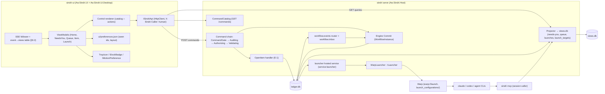
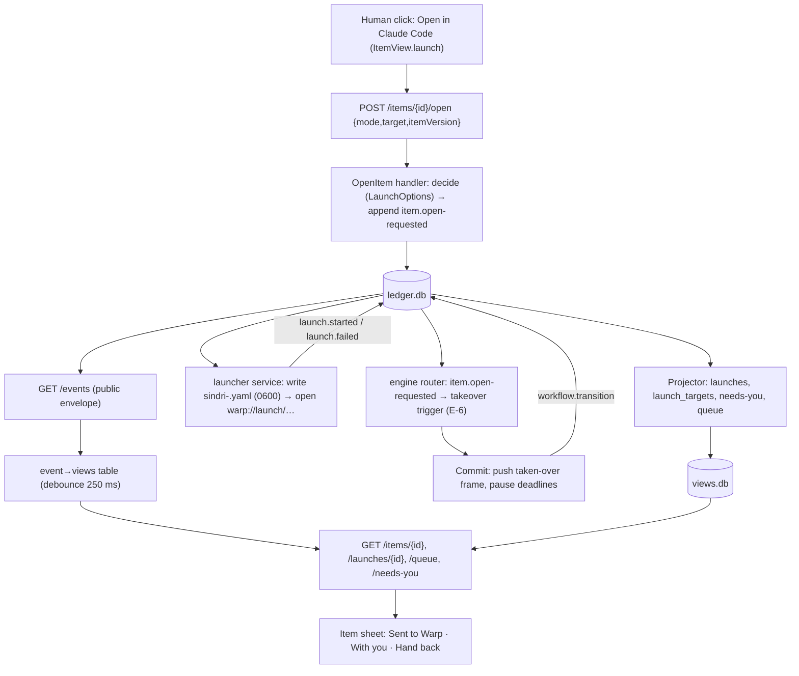

# Architecture Review: Sindri UI app design (control plane views, actions, launching sessions)

_Reviewed by `/archReview` on 2026-10-11_

Target: `docs/superpowers/specs/2026-10-11-sindri-ui-design.md` ("UI"), checked against the API surface spec ("API"),
the workflow engine spec rev 4 ("WF"), the dashboard spec ("DB") and `docs/sindri/README.md`. Layout and attention colour
are the owner's calls and were not reviewed. Threat model: honest mistakes, loopback only.

## Verdict: NEEDS WORK

The app's own rendering model is sound. The view models map fields, the catalog drives controls, the app re-queries
and never folds, and protected actions are copy-only. Six HIGH findings block it, all in the contract the UI needs from
the server: the launch pipeline (E-1, E-2, E-6, X20) and the engine command path (nonces, catalog variants,
`allowedCommands`).
- **F1:** the launcher service has no delivery or crash semantics.
- **F2:** E-6's router path doesn't fit the engine's router and inbox model or its actor rule.
- **F3:** `liveSession` (attach versus resume) has no data source in v0.
- **F4:** nobody owns stopping a running worker.
- **F5:** engine commands need a nonce, and the UI never mints one.
- **F6:** the `answer-reject` and `answer-resume` variants don't exist, so the fail-closed rule makes them `protected`.

F2 and F4 are structural to §6.7, so Complexity scores 2. Under the rule, any HIGH finding gives NEEDS WORK.

## Scores

_Anchored 1–5 scale from `_shared/severity.md` (5 = no findings above LOW … 1 = CRITICAL or unaddressed)._

| Dimension | Score (1–5) | Notes |
|-----------|:---:|-------|
| Complexity | 2 | The launch, takeover and stop pipeline in §6.4 and §6.7 needs rework: the router path (F2), worker stop (F4) and session liveness (F3) are structural. The UI layer itself is simple and logic-free |
| Scalability | 4 | Single user on loopback, re-query with a 250 ms debounce. Medium findings only: `launch.probed` adds a ledger row every 10 min forever (F11), and the event-to-view map falls back to `status` (F9) |
| Maintainability | 3 | Clean MVVM and catalog-driven controls. Some domain knowledge leaks into the client (F7 health word, F8 destructive rule, F9 event map, F6 verb-to-action-id mapping), and E-edits are missing for API §2.1/§4.1, WF §5.4/§6.3 and API §5.1 |

## Component Diagram



## Data Flow Diagram



## Sequence Diagram

```mermaid
sequenceDiagram
  actor Eng as Engineer
  participant UI as sindri-ui
  participant H as OpenItem handler
  participant LG as ledger.db
  participant LS as launcher service
  participant W as Warp + claude
  participant RT as engine router/Commit
  participant PJ as projector/views.db
  Eng->>UI: click "Open in Claude Code"
  UI->>H: POST /items/ITM/open {mode:open,target,itemVersion}
  H->>LG: append item.open-requested {launchId}
  H-->>UI: LaunchRequested(accepted, LCH-…)
  par launcher
    LG-->>LS: item.open-requested
    LS->>W: write yaml, open warp://launch/sindri-LCH.yaml
    alt Warp accepts
      LS->>LG: launch.started {sessionId}
    else open fails / CLI missing
      LS->>LG: launch.failed {SND-LAUNCH-001/003}
    end
  and engine
    LG-->>RT: item.open-requested (router, 5 s cadence)
    RT->>LG: workflow.transition → taken-over (F2: not a wait-satisfying event today)
  end
  LG-->>PJ: fold events
  PJ-->>UI: SSE "go re-read" → GET /launches/LCH, GET /items/ITM
  UI-->>Eng: "Sent to Warp" / failure with fix; item in With you
  Note over LS,LG: F1: crash between requested and started → re-launch or stuck "Sending to Warp…"
```

## Top Risks

| # | Risk | Impact | Likelihood | Mitigation |
|---|------|--------|------------|------------|
| 1 | Takeover never applies, or applies late, because E-6 routes `item.open-requested` through an inbox that only applies in matching waits (F2), while the launcher has already opened Warp | high | high | Make the open request a direct engine trigger kind, and have the launcher wait for the takeover transition before launching (F2) |
| 2 | Two processes on one session: a resume picked while the session still runs (F3), a re-launch after a crash (F1), or a double click (F1) | high | med | Session lifecycle facts, launch outcome keys with no re-launch on recovery, and a refusal while a launch is `requested` |
| 3 | Engine answers from the app fail or render as CLI-only: no nonce (F5), and undefined `answer-reject`/`answer-resume` variants are classified `protected` (F6) | high | high | Add E-12 and E-13 and the nonce flow to §9.1 |
| 4 | "Take over a running step" has no stop mechanism (F4), so a worker and a human session run on one item | high | med | Add an ILauncher stop operation and a `run.stopped` event, owned by an engine phase. Gate U6's running-step mode on it |
| 5 | Domain rules creep into the client (health word, destructive rule, event map) | med | high | Serve them from `/status`, catalog variants and `EventCatalog.invalidates` (F7–F9) |

## Edge Case Matrix

| Boundary | Dependency unavailable | Invalid/malicious input | Load 10x | State leakage |
|---|---|---|---|---|
| App ↔ ISindriApi (HTTP queries/commands) | OK — §4.1 Not running/Stale/Unreadable states, 2 s look-again, 3-failure "not responding" (UI §4.1, lines 158–163) | OK — plain text only, API sanitizes (U9; API §3.6 "Agent text"); 64 KiB body cap (API §2.1) | OK — 250 ms debounce per view (UI §9.2); 5 s fallback on 429 (API §5.4) | F5 (nonce not minted per click; stale form state reused) |
| App ↔ SSE `/events` + event→views table | OK — falls back to 2 s loop; 30 s staleness (UI §9.2, §4.1) | OK — payload never applied, re-query only (UI §9.2; API §5.3) | F9 (unlisted types → `status` only; views go stale) | OK — "seen" is presentation, keyed by row id, pruned (UI §5) |
| Control renderer ↔ CommandCatalog | OK — catalog re-read on connect and new epoch (UI §9.1) | F6 (unknown variants fail closed to `protected`; `allowedCommands` are verbs, not ids) | OK — static list, ~40 rows | F8 (destructive rule for `CloseItem cancelled` and `ReadsViews` kept in the client) |
| OpenItem handler ↔ ledger (E-1) | OK — CommandGate 5 s → `SND-API-009`, kept as "done, stale" (API §2.1; UI §4.1 l.168) | F1 (no fact key, so a double submit gives two launches); F14 (`chosenBy: perClick` in a view) | OK — handler only appends (E-1) | F1 (`requested` launches orphaned across restart) |
| launcher service ↔ WarpLauncher ↔ Warp/agent CLIs | F10 (no GUI session: `open`/`xdg-open`/NSWorkspace from a headless server); F1 (crash mid-launch) | F17 (repo path quoting in YAML `exec`) | F11 (probe every 10 min appends forever) | OK — YAML 0600, deleted after 60 s, ids only (UI §6.3 steps 1–3) |
| Engine router ↔ `item.open-requested` → takeover (E-6) | F2 (inbox applies only in matching waits; up to ~10 s of router+inbox cadence while Warp already opened) | F2 (actor "the human" stamped by the router contradicts API §2.1 actor rule / WF §5.7 producer check) | OK — one trigger per launch | F4 (running worker not stopped; X20 unowned) |
| `ItemView.launch` (E-2) ↔ projections | F3 (`liveSession`/ended has no source in v0; DB §7 liveness came from the collector, API §11) | F14 | OK — pure `LaunchOptions.For` over projections | F3 (stale "live" leads to resuming a running session) |
| Needs-you projection (E-7) ↔ engine park rows | OK — rebuild/stalled banners (UI §4.1) | F6 (`actions` for park rows need catalog ids from `allowedCommands`) | OK — cap 6 rows on Home (UI §3.2) | OK — row ids stable; focus kept by id (UI §3.3) |
| Health pill/strip ↔ `/status`, `/services`, `/profile` | OK — Not running / Stale words (UI §3.2) | OK — words only | OK | F7 (aggregate word "Healthy/Degraded" derived in the client) |
| Tray/dock adapters ↔ OS | OK — no OS notifications from the app (U8) | OK — no action runs from the tray (UI §5) | OK | OK — counts only, from `/needs-you` |
| Local preferences.json | OK — absent file → defaults (UI §12.3) | OK — 0600, no server meaning (UI §12.3) | OK — pruned seen ids (UI §5) | OK — nothing in it changes API decisions (UI §12.3) |

### Findings

| id | severity | lens | location | finding | recommended fix |
|---|---|---|---|---|---|
| F1 | HIGH | arch | §6.7 E-1, §6.6 | **The launcher service has no delivery or recovery contract.** E-1 says neither how the in-process `launcher` learns of `item.open-requested` (its own ledger cursor, like the router, or an in-memory channel) nor the fact keys for `launch.started` and `launch.failed`. It names no `launches` projection behind `GET /launches/{id}`, and doesn't cover a crash between request and outcome. The two failure modes are a launch stuck at "Sending to Warp…" forever, or a recovery that opens a second tab or resumes one Claude session twice (DB §7). Commands that create things aren't deduplicated (API §2.1), so a double click or `O O` gives two launches | (a) The launcher reads the ledger from a persisted `launcher_cursor`. (b) Keys `item.open-requested:<launchId>`, `launch.started:<launchId>` and `launch.failed:<launchId>`. (c) On startup, any request with no outcome becomes `launch.failed SND-LAUNCH-007 (interrupted; not retried)` and is never re-launched. (d) Declare the `launches` projection, and register all three events in `EventCatalog`. (e) The OpenItem handler (`ReadsViews`) refuses with `SND-LAUNCH-008` while the item has a launch in `requested` |
| F2 | HIGH | arch | §6.4, §6.7 E-6, §13 X18 | **E-6 doesn't fit the engine's router.** WF §5.7: the router accepts an event only when its envelope actor is the descriptor's `producer`, and writes inbox rows that apply only when the instance is in a matching *wait*. `takeover` is a command (WF §5.4: a nonce per version), not a wait-satisfying event, so a running Step, or any state without that wait, holds the row and never takes over. E-6's "actor the human" makes the engine stamp a human actor, against API §2.1 ("Actor is composed by the host", "EventFactory never makes up a `human:` actor"). The launcher also opens Warp before the takeover lands (router 5 s plus inbox 5 s), so automation runs beside the new session in that window | Add a WF §5.4 trigger kind `open-request`: id = the source sequence, key `wf:{instance}:open:{launchId}`, applied directly in `Commit` in any state where takeover is allowed (exempt from the nonce and approval like `takeover`, keyed by the ledger fact), actor `service:engine`, causation = the `item.open-requested` event. A no-op when the instance is already `taken-over` (attach, or a second open). The launcher launches only after the engine records that transition (causation match), or at once when the item has no active instance, and times out to `launch.failed`. Record this as a WF §5.4/§5.7 edit, not only an API edit |
| F3 | HIGH | arch | §6.2, §6.7 E-2, §6.6 | **`liveSession` and "ended or crashed" have no data source.** §6.6 says "Sindri can't see inside Warp", and no event records a session starting or ending. DB §7's liveness came from the collector (API §11, later). E-2's `liveSession {since, tabTitle}` and the Attach-versus-Resume choice are therefore undecidable in v0, and a wrong guess resumes a running session (two writers corrupt it, DB §7) | Either add session lifecycle facts: the launched session's per-provider hooks (SessionStart/SessionEnd adapters, which have `AW_SINDRI_LAUNCH`) report through `sindri mcp` as `launch.session-started` / `launch.session-ended` (a `session` caller, `request`-like class, repo-scoped). Or, for v0, drop automatic Attach/Resume: Attach only focuses Warp and names the tab, and Resume is offered for `claude-code` with "only if that tab is closed" and stays disabled while `launch.started` is under N minutes old |
| F4 | HIGH | arch | §6.2 "Take over a running step", E-6, E-10, §13 X20 | **Nobody owns stopping a running worker.** E-6/X20 require the engine to stop a factory worker "at the next safe point" before a resume is offered. WF P5 only pauses deadlines (WF §5.1, §5.6). E-1's `ILauncher` only launches interactive Warp tabs, but WF W20 also makes `ILauncher` the engine's `launcher` Step runtime (`run.runtime: desk\|launcher`), and the UI spec's redefinition drops that role. E-10 depends only on WF P5 | Add an E-12 or WF edit: `ILauncher` gains a headless worker mode and `Stop(runToken)`, the engine records `run.stopped`, and `launch.resumable` appears only after it. Name the owning phase (an engine phase after WF P6, or API P10b). Until it ships, the server's `launch.modes` omits takeover-of-running and shows `sindri workflow takeover` with "the worker keeps running". Move U6's running-step signal behind that phase |
| F5 | HIGH | arch | §4.4, §7, §9.1 | **The UI never mints an engine nonce.** Every engine command (`ApplyCommand:*`, `CompleteStep`) needs a nonce from `POST /workflow/instances/{a}/nonce`, unused, for the current version and live for 10 min (WF §5.3 step 3, §5.4). The UI spec doesn't mention it, and doesn't map `SND-WF-009` (stale nonce), `-002` (version conflict), `-003` (wrong answer for the reason), `-004` (refused) or `-005` (stale run token). The nonce POST also appends no ledger event, so it's an unclassified POST under ARCH-CQRS-001 | §9.1: mint the nonce at click time, never when a form renders. Treat `SND-WF-009` and `-002` like `SND-ITEM-409` (refresh and "changed since you looked"), and show `-003`/`-004`/`-005` `detail` inline. Flag a cross-spec row: the nonce mint is either a tested query-by-POST carve-out or a catalog row whose class is that of the command it's for |
| F6 | HIGH | arch | §4.4, §7, E-7 | **Undefined variants and verb-shaped `allowedCommands`.** `ApplyCommand:answer-reject` and `ApplyCommand:answer-resume` appear in no API row (API §2.1 lists answer, handback, cancel, complete, takeover, plus grant/accept). Under the fail-closed rule "an unknown variant is `protected`", the desk Reject and Resume buttons would render CLI-only. API §2.1 also lists `complete` as an `ApplyCommand` variant while the UI uses `CompleteStep`. WF §6.3's `allowedCommands` are verbs with WF actor classes (`human-terminal`), not catalog action ids, so intersecting them with the catalog makes the UI map verbs to ids, which is logic | E-12 (API §2.1/§4.1): define `answer-text`, `answer-resume` and `answer-reject` as `desk`, and settle `complete` versus `CompleteStep`. E-13 (WF §6.3): each `allowedCommands` entry is `{actionId, cli}` with ids filled, the class taken from the catalog. E-7's park-row `actions` come from the same ids |
| F7 | MEDIUM | arch | §3.2 health pill, §4.8 health line | The pill's aggregate word ("Healthy", "Degraded", "Stalled") and "N services failed" are derived from several fields in the client. That breaks U1 ("never derives a state") | Add `health: {word, problems: [{code, text}]}` to `GET /status`, computed by a `Core` `HealthSummary.For(...)`, and render it verbatim. Add it as an E-edit |
| F8 | MEDIUM | arch | §6.7 E-8, §4.5, §4.1 Rebuilding | `destructive: bool` per catalog row can't express "`CloseItem` only when cancelled" (no variant), so the client keeps that rule. §4.1 disables "actions that read views" during a rebuild, but `ReadsViews` isn't in the `GET /commands` row (API §3.1) | Split `CloseItem:done` and `CloseItem:cancelled`, the latter `destructive`. Expose `readsViews` on each catalog row in E-8 |
| F9 | MEDIUM | arch | §9.2 | The event-to-views table copies server knowledge into the client. Unlisted types (`outbox.refused`, `recipe.*`, `workflow.request`, `views.rebuilt`) re-query only `status`, so needs-you and the open item go stale until the next event. "the launch view" is ambiguous between `/launches/{id}` and `/launch/targets` | Add `invalidates: [viewName]` to each `EventCatalog` entry, served with the public envelope or in a `GET /events/catalog`, and have the client apply it verbatim. Unknown types re-query every visible view |
| F10 | MEDIUM | arch | §6.3 recipe, E-3 | Probes and launches run in `sindri serve`, which may have no GUI session: `open warp://…`, `xdg-open` without `DISPLAY`/`WAYLAND_DISPLAY`, an NSWorkspace bundle lookup from a headless .NET process, or a launchd/systemd-started server. The server also writes into Warp's config folder | Specify that the launcher records `terminal.present=false, problem: no-gui-session` when it can't reach the user's GUI session, and say so in the target menu. Have the P10 spike test a server started by `sindri` from a terminal and by launchd |
| F11 | MEDIUM | arch | E-3 | `launch.probed` is appended every 10 min forever (the ledger never deletes), and a stale probe hides a fresh install for up to 10 min | Append only when the probe result changes. Add a "Check again" control (`ProbeLaunchTargets`, `job` class) |
| F12 | MEDIUM | arch | §7 | No control for `StartInstance` (`workflow start`, desk) or recipe `workflow command <verb>`. An item created in the app can't start its workflow from the app | Add a Start control from the catalog, or list it in §7 as CLI-only on purpose, with the reason |
| F13 | MEDIUM | arch | U6, §3.2, §6.2 | "Attach" means two different commands: focusing Warp for a with-you session, and taking over a running worker (pause). U6 calls attach a takeover, but §6.2 requires the item to be with you already | Label the running-worker case **Take over** (`ApplyCommand:takeover`) and keep **Attach** for focusing. Say that `OpenItem:attach` reaches the engine as a no-op takeover (F2) |
| F14 | LOW | arch | E-2 | `chosenBy: perClick` can't appear in a stored view, because a per-click choice exists only at request time | Drop `perClick` from `ItemView.launch.chosenBy`, and record the choice on `LaunchView` |
| F15 | LOW | arch | §13 X2, X5 | The settled answers need edits with no E-row: API §5.1 still says the app "drives … OS notifications", and WF §6.2's `ui` row is to be dropped | Add E-rows (or README X-row "Changes") for API §5.1 and WF §6.2 |
| F16 | LOW | arch | §16, §17, Status | Of the §16 mockups, only `shotgun/*` exist; the 11 `mockups/*.html` are missing. §17 reads "(Filled after `/autoplan`)" while Status says "Revised after `/autoplan`" | Generate the mockups before approval, and fill §17 |
| F17 | LOW | arch | §6.3 step 1 | The YAML `exec` interpolates the repo path and CLI. A path with spaces or quotes breaks the guard (honest-mistake class) | Quote values as YAML scalars and shell-quote inside `exec`. Add a test with a path containing spaces and `'` |
| F18 | LOW | arch | E-11 | The body has `mode: attach`, but the CLI has only `--resume` | Add `--attach`, or say that bare `sindri open` resolves the mode from `ItemView.launch` |

## Missing Error Handling
- §6.7 E-1: no outcome for a launch interrupted by a process restart, and no timeout from `requested` to `failed` (F1).
- §6.4 / E-6: no failure path when the engine refuses the takeover (instance cancelled or terminal between click and router), so the launch should fail rather than proceed (F2).
- §9.1: no mapping for `SND-WF-002/003/004/005/009` from engine commands (F5).
- §6.6: no row for "no GUI session" (F10) or for "interrupted" (F1).
- §4.4 `escalated: child`: no handling when the child changes between render and click. Answer through the parent (WF §5.7 forwards it) and map `SND-WF-009`.

## Suggested Improvements (Prioritized)

_Severity per `_shared/severity.md` (legacy P0→CRITICAL, P1→HIGH)._

| Severity | Improvement | Effort | Impact |
|----------|------------|--------|--------|
| HIGH | Rewrite E-6 as a WF `open-request` trigger kind (`service:engine` actor, ledger-keyed), with the launcher waiting for the takeover (F2) | M | Takeover actually happens, before the session starts |
| HIGH | Give the launcher a cursor, outcome keys, interrupted-launch recovery, a `launches` projection and a refusal while a launch is `requested` (F1) | S | No duplicate sessions or stuck launches |
| HIGH | Add a session lifecycle source, or drop automatic Attach/Resume in v0 (F3) | M | Never resumes a running session |
| HIGH | Give `ILauncher` stop and worker modes and an owning engine phase; gate the running-step mode on it (F4) | M | X20 has an owner |
| HIGH | Add the nonce flow and WF error mapping to §9.1 (F5); add E-12 (variants) and E-13 (`allowedCommands` as action ids) (F6) | S | Engine answers work from the app without client-side mapping |
| MEDIUM | Server-side health word, catalog `readsViews` and destructive variants, `EventCatalog.invalidates` (F7–F9) | S | The client really holds no logic |
| MEDIUM | GUI-session detection, probe on change only, Start control, rename the Attach/Take over labels (F10–F13) | S | Fewer silent launch failures; clearer controls |
| LOW | F14–F18 | S | Polish and documentation completeness |

verdict: NEEDS_WORK
