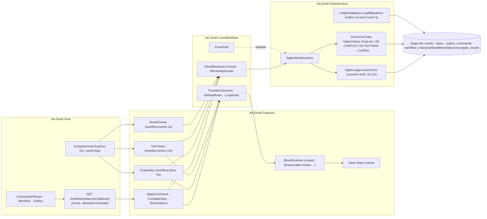
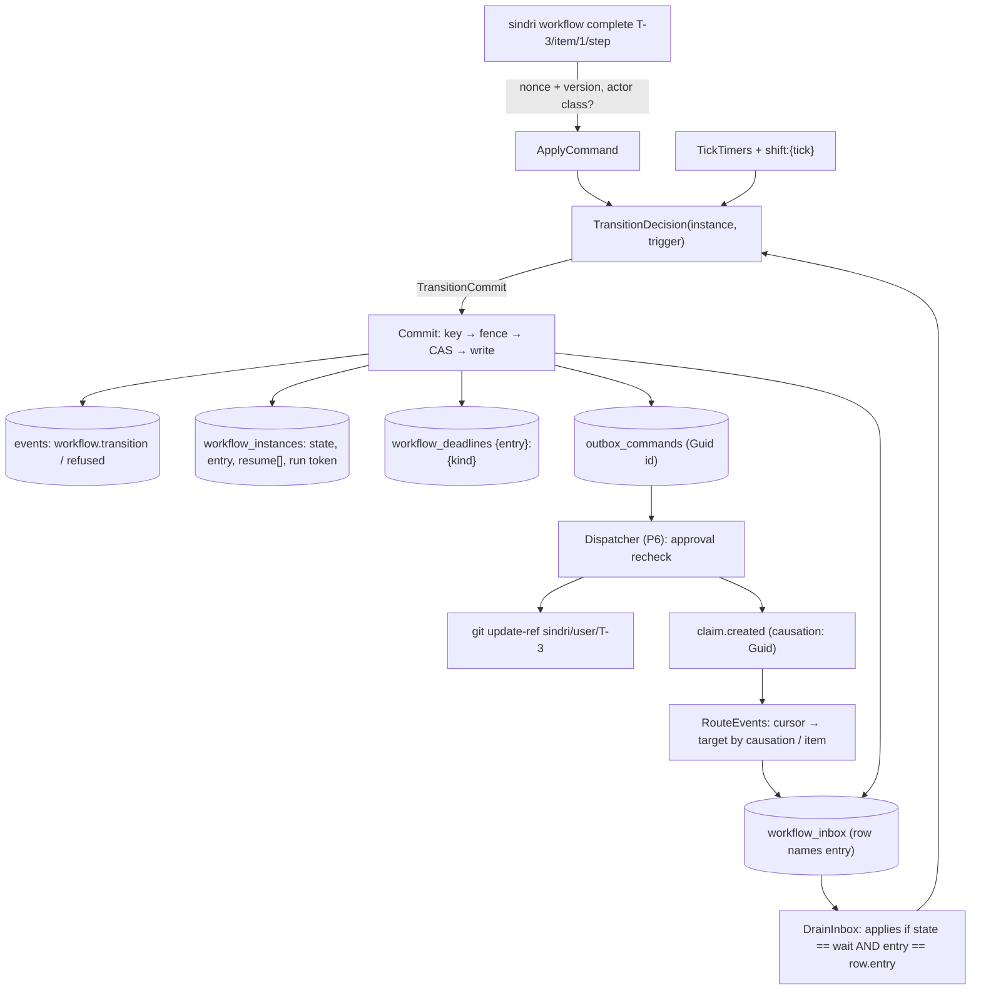

# Architecture Review (pass 2): Sindri workflow engine, revision 2

_Reviewed by `/archReview --slim` on 2026-10-10_

Target: `docs/superpowers/specs/2026-10-10-sindri-workflow-engine-design.md` rev 2 (`WE §n` / `WE:line`). Pass 1:
`arch-review.md` (F1–F25) and `consolidated-review.md` (C1–C32). Checked against `.agents/rules/csharp.md`,
`csharp-testing.md`, and the S1 branch at `.claude/worktrees/sindri-s1-app-shell` (HEAD `0e685cb`, read only). Threat
model: honest mistakes and at-least-once delivery. §13 written answers are accepted unless a finding below says otherwise.

## Verdict: NEEDS WORK

Revision 2 resolves most of pass 1 in structure. Trigger-keyed commits checked key-first (F1–F3), defined refusals
(F4), the router and inbox (F5), event descriptors (F6), the resume stack (F7), children created in the parent's
`Commit` (F15), backed `produces` and the new validator rules (F11, F12), DI-injected runtimes (F18) and long-form
normalization (F19) all hold up. One new HIGH drives the verdict. **R1:** the `entry` counter "rises by 1 each time a
state is entered" (WE:288), and every identity in the engine hangs off it: inbox rows, run tokens, child ids and
deadline ids. Popping the resume stack re-enters a state, so the pop breaks W15, W16 and W17 on their main paths. A
parked or taken-over instance's pending inbox rows expire. A desk run token goes stale at handback. Re-entering the
`child` wait creates a second child. A park plus its answer counts a loop round. And keeping the old entry instead
leaves the timeout re-armed under a deadline id that has already fired, so it never fires again. The MEDIUMs are mostly
gaps between rev 2 and S1's real types (R2 actor, R3 Guid outbox ids, R7 dense migrations), fold coverage (R4),
children (R5), phase signals (R6), revoke (R8), the nonce (R9) and the desk runtime (R10). Scores: Complexity 3,
Scalability 4, Maintainability 3.

## Scores

| Dimension | Score (1–5) | Notes |
|-----------|:---:|-------|
| Complexity | 3 | One trigger-key scheme now (W12), but the `entry` identity is overloaded across six mechanisms, and push and pop are underspecified (R1). Non-transition commits (shift, `takeoverIdle`, inbox expiry) have no event shape (R4) |
| Scalability | 4 | Per-instance shift through `Commit`, indexes named (A-F25), cadences fit S1's `Cadence.Min = 5s`. LOW: the built-in services run one after another in S1's `SchedulerHost.RunDue` loop, so a slow rung-2 gate in the drain delays timers and routing (R16) |
| Maintainability | 3 | The placement and contract plan follow the rules. Several rev-2 promises don't match S1's types (`OutboxCommand.Id : Guid`, `EventScope` per process, dense migration versions), and the phase graph has signals that can't pass in their phase (R2, R3, R6, R7) |

## Component Diagram



## Data Flow Diagram



## Sequence Diagram

The main path that R1 breaks: a child parks, the parent parks by propagation, the human answers the parent with
`--grant` (the P7 signal).

```mermaid
sequenceDiagram
  participant H as Human CLI
  participant P as Parent T-5/item/1 (running, entry 4)
  participant C as Child T-5/item/1/step (id …/step.4)
  participant IB as workflow_inbox
  C->>C: checks failed ×2, same findings → parked(no-progress), entry 9
  C->>IB: row → parent "parked(no-progress)"
  IB->>P: Drain: push {running, entry 4}; enter parked (entry 5)
  H->>P: answer --grant 1 (actor human-terminal)
  P->>IB: forward answer to child (system trigger; grant needs human-terminal → R5)
  IB->>C: answer applies? pop → re-enter produce (entry 10, round counted → R1)
  C->>IB: row → parent "resumed"
  IB->>P: pop → re-enter running (entry 6)
  alt entry rises on pop (WE:288)
    P->>P: entering the child wait creates child …/step.6 (second child, R1)
    Note over P: rows naming entry 4 expire; the original child's terminal no longer matches
  else entry restored to 4
    P->>P: re-armed timeout id 4:state already fired → key exists → never fires (R1)
  end
```

## Pass-1 resolution check

| Pass 1 | Status in rev 2 | Note |
|---|---|---|
| F1 idempotency on the trigger | Resolved (W12, §5.4) | Deadline ids lost F1's "arm version": see R1 |
| F2 refusal keys | Resolved | A refusal consumes its trigger by design (W14) |
| F3 key before CAS | Resolved (§5.3 order) | |
| F4 refusal consequences | Resolved (§5.4) | Precedence of "from a wait" vs "budget gate" unstated (R15) |
| F5 event intake | Resolved in structure (W15, §5.6) | Target set and entry expiry (R1, R11); causation is a Guid (R3) |
| F6 event descriptors | Resolved (§2, RCP-EVENT-001) | §12 doesn't declare `item.routed`'s facts, so `produces: [fact:stepSpec]` fails RCP-WIRE-002 (R15) |
| F7 resume stack | Shape resolved (W16) | Push and pop break the `entry` identity (R1) |
| F8 child propagation | Mostly resolved (§5.6 table) | Forwarded answers, escalation and cancel gaps (R5) |
| F9 sleep | Resolved (per-instance `shift`, wall minus monotonic) | Downtime now counts as a shift, which reverses F9(c) without a written answer (R14) |
| F10 fold | Partial (W21) | Refusals that change state, non-transition commits and child start events (R4) |
| F11, F12 validator | Resolved | `waitFor: answer` and `resource: heavy` have no producer and no rule (R15) |
| F13 retry, claim | Partial | `retry` re-emission is a no-op or aborts `Commit` against Kernel's outbox (R3) |
| F14 idle takeover | Resolved (W19) | `takeoverIdle` "changes no state" but must clear itself (R4) |
| F15 child in the parent's commit | Resolved | Re-entry on pop creates a second child (R1) |
| F16 phase signals | Partial | New ordering problems (R6) |
| F17 S1 deps | Corrected | Missing S1 changes: actor (R2), outbox ids (R3), migration numbering (R7) |
| F18, F19 | Resolved | |
| F20–F25 | Answered in §13 | F20's reuse is rolled back with the failed commit (R12) |

## Edge Case Matrix

Boundaries: **B1** reader and validator · **B2** registry and approval · **B3** `TransitionDecision` and the resume
stack · **B4** `Commit` ↔ S1 ledger, lease and outbox · **B5** built-in services ↔ `SchedulerHost` · **B6** router and
inbox · **B7** children · **B8** desk runtime and block runtimes · **B9** Host CLI/API (actor, nonce) · **B10**
migrations.

| Boundary | Dependency unavailable | Invalid/malicious input | Load 10x | State leakage |
|---|---|---|---|---|
| B1 reader + validator | OK — unknown block `RCP-BLOCK-001`, W5 (WE:28) | R15 (`item.routed` facts, `answer`/`heavy` waits) | OK — 256 KiB and depth-32 caps (WE:113–114) | OK — pure, catalog as data (WE:465) |
| B2 registry + approval | R8 (revoke or a pin change strands running instances) | OK — challenge nonce, `SND-RECIPE-004` (WE:248–261) | OK — keyed `(id, version, hash)` | R8 (dispatch refusal never reaches the instance) |
| B3 decision + resume stack | OK — unavailable gate refuses, Step parks `SND-WF-010` (W5) | R1 | OK — pure over one row | R1 |
| B4 Commit ↔ S1 | OK — fence `LeaseDecision.Holds` (S1 `LeaseDecision.cs`), key-first (WE:314) | R3 (Kernel `SqliteOutbox.Enqueue` returns `Conflict` on a duplicate id) | OK — one row CAS per trigger, 3 retries (WE:321–325) | R4, R12 |
| B5 services ↔ scheduler | OK — S1-D8 owned by P4; the lease gates runs (`SchedulerHost.ExecuteAsync`: `held.Current`) | R14 | R16 (serial `RunDue`) | R4 (`takeoverIdle` stays due) |
| B6 router + inbox | R11 (events before the wait, or for parked instances, have no target) | R3 (causation is `Guid?`, not `cmd:…`) | OK — cursor-paged `ReadAfter(seq, max)` (S1 `ILedgerStore`) | R1 (rows expire on pop) |
| B7 children | R5 (forwarded answer has no actor) | R5 (escalation and cancel of a taken-over child) | OK — depth ≤ 4, `RCP-CHILD-003` | R1 (second child on pop) |
| B8 desk + block runtimes | R10 (`IStep.Start` timing vs `Commit`) | R10 (a missing `--output` costs a round) | OK — no I/O beyond hashing outputs | R10 (`retry` stales the human's token) |
| B9 CLI/API | OK — `serve` auto-start, exit 2 (WE:394, 422) | R2 (actor class has no carrier), R9 (nonce) | R9 (every GET mints a nonce) | R2 |
| B10 migrations | R7 (adding one renumbers `outbox_commands` → `SND-LEDGER-001`) | OK — checksum and dense-sequence checks (`MigrationChecks.CheckApplied`) | OK — indexes named (A-F25) | R7 (P5 ∥ P6 claim the same version) |

### Findings

| id | severity | location | finding | recommended fix |
|---|---|---|---|---|
| R1 | HIGH | §5.1 `entry` (WE:288), W15–W17, §5.5 park and handback, §5.6 children | **`entry` has no defined behaviour on a resume-stack pop, and both readings break something.** If a pop re-enters the state (WE:288, "rises by 1 each time a state is entered"): (a) inbox rows name the wait's entry, so a pending row for a parked or taken-over instance is marked `expired` on resume (WE:371–373). That contradicts W15 ("never lost while parked or taken over") and the children row "applies at handback". (b) A desk Step's run token `{entry}.{n}` is stale after handback, so the human's `complete` gets `SND-WF-005`. `taken-over` allows only `handback`, so there's no other moment to report (WE:218). (c) Re-entering the `child` wait creates a new child (WE:378), with id `{parent}/{recipe}.{newEntry}`, while the old child keeps running and its rows no longer match. (d) "Each entry … counts one round" (WE:162), so a park and its answer, or a takeover and handback, uses up a revision. The P7 grant signal lands exactly at the cap. If the pop restores the pushed entry instead: the park's answer "re-arms the state's full timeout" (WE:361) under deadline id `{entry}:state`, whose key `wf:{instance}:{entry}:state` already exists from the timeout that caused the park. So the re-armed deadline returns `AlreadyApplied` and never fires again, and the instance has no timeout | Define push and pop as **suspend and resume, not exit and enter**. The stack frame stores `{state, entry, run, deadlines.remaining, child}`. A pop restores them with no Step start, no child creation and no loop count. Give deadlines an arm sequence (`{entry}:{kind}:{arm}`, as pass-1 F1 proposed) so a re-arm is a new trigger. State that inbox rows match by `(entry)` against the frame being waited on, including frames on the stack. Tests: `Answer_after_timeout_park_rearms_a_deadline_that_fires`, `Handback_keeps_the_desk_run_token`, `Pop_to_child_wait_creates_no_child`, `Event_pending_during_park_applies_after_answer` (the last one exists in §10; it fails under WE:288 as written) |
| R2 | MEDIUM | W22, §5.2 "actor is set by the host", S-L3, §7.2 | **The actor class has no carrier.** S1's `EventScope` is one process-wide singleton (`host:sindri`, `EventScope.cs`, registered in `SindriCoreServiceCollectionExtensions`), and `EventFactory.Entry` stamps it on every event. §7.2 adds `item` and `causation` (S1-D7) but no per-request actor. The server is a loopback HTTP peer and can't observe the CLI's TTY, so `human-terminal` is necessarily a client assertion. That is the same body flag C23 rejected for approve (S1's `ApproveProfileRequest(Hash, Confirmed)`), yet `--grant` and `--accept` rely on it with no challenge. And "CLI without a TTY" maps to `human`, so a Claude Code session running `sindri workflow complete … --outcome passed` from its Bash tool is recorded as a human. That is exactly the honest mistake W22 exists to stop: an agent self-reporting its own `checks` | Add S1-D9: `EventFactory.Entry` takes the actor class per call (from a scoped request context the endpoint fills). Use S1-D5's challenge for `--grant` and `--accept` too, not only for approve. Classify a CLI call as `session` when the session launcher's marker is present (an env var the session hooks set), and refuse `complete` and `answer` from `session` with `SND-WF-007`, or say explicitly that desk Steps trust the session |
| R3 | MEDIUM | §3.4 `retry` (WE:174–176), A-F21, §5.6 router "through causation", S1-D3 | **The derived string outbox ids don't fit Kernel's outbox.** `OutboxCommand.Id` and `CausationId` are `Guid` (`Aw.Kernel/Outbox/OutboxCommand.cs`), and the ledger's `causation_id` is a Guid too (`SqliteLedger.Insert`). So `cmd:{instance}:{entry}:{n}` can't be the id, and the router can't "read the instance and entry from the id". `SqliteOutbox.Enqueue` is `ON CONFLICT (id) DO NOTHING` and then returns `KernelErrors.Conflict` when 0 rows change. So `retry`'s same-id re-emission either aborts the whole `Commit` (the timer then retries forever and the second timeout never parks), or, if the error is swallowed, re-dispatches nothing: a dispatched or dead-lettered command stays that way. `retry` on `claimed` therefore can't recover anything | Derive the id as UUIDv5(`cmd:{instance}:{entry}:{n}`), and keep the `(instance, entry, n)` triple in the payload or in a `workflow_outbox` map that the router joins on. Treat `Conflict` from a re-emission as success inside `Commit`. Either drop `retry` re-emission (the dispatcher's own `OutboxRetryPolicy` is the recovery) or define it as "requeue if dead-lettered" through a new Kernel outbox operation |
| R4 | MEDIUM | W21, §5.2, §5.3, §5.5, §10 row 1 | **The fold has commits it can't see.** (a) A refusal that re-runs a Step (loop count, run `n+1`), parks or escalates changes the row, but `workflow.refused` (WE:304) carries no post-state delta. (b) `shift:{tick}`, the `takeoverIdle` firing and inbox expiry are commits with no `from → to`, and no event type is defined for them. (c) A child row inserted in the parent's `Commit` gets no `workflow.started` of its own, and W13 says "the event", singular: two events need two idempotency keys in one transaction. (d) "Version rises by 1 per applied transition" (WE:296), but shifts and re-runs rewrite the row too. Without a bump, a concurrent `Commit` built on the old version overwrites them. (e) `takeoverIdle` "changes no state" (WE:360), yet if it doesn't clear itself it stays due, and every 15 s tick re-tries the key and gets `AlreadyApplied` | Every row change is a versioned commit with one event carrying the full delta: `workflow.transition` (with `from == to` allowed, `kind: shift\|notify\|expire`) and `workflow.refused` with its delta. A parent commit that creates a child writes two events (`…:{trigger}` and `…:{trigger}:child`). `takeoverIdle` clears itself in its commit. `Folding_the_events_rebuilds_the_row` must run over these cases |
| R5 | MEDIUM | §5.6 children table, W7, W22, P7 signal | (a) "The answer is forwarded to the child" (WE:384) through an inbox row, which is a `system` trigger, but `--grant` needs `human-terminal` (W7). Either the child refuses the grant, so the P7 signal fails, or the actor check is bypassed. (b) An escalated child makes the parent `escalated`, but the parent's `--accept` and `--reject` (WE:217) apply "the escalated transition", which the parent doesn't have. Forwarding is defined only for parks. (c) "Parent cancelled → every child is cancelled", but `taken-over` has no `cancel` exit (WE:218), and the mechanism isn't stated (a multi-row write in the parent's `Commit` without the child's CAS, or an inbox row that "stays pending" while the child is taken over) | Forwarded rows carry the original trigger's actor and nonce, and the child checks them. Forward `--accept` and `--reject` to the escalated child too. Add `cancel` to `taken-over`'s exits (it ends the takeover). Cancel children through inbox rows that apply in any state, including `taken-over` |
| R6 | MEDIUM | Phases graph and signals | (a) The P2 signal approves `workflow.step`, but approval "requires the `evals` files to exist" (WE:848) and those files are P3's (WE:863), which runs in parallel in wave 2. (b) The P4 signal runs `workflow start`, which re-checks approval (`RCP-CAP-003`, through P2's `IRecipeApprovals` SQLite adapter), yet the graph makes only P6 depend on P2 (WE:771). P4 and P5 need P2 too. (c) The P4 signal "re-sending a `complete` with its used nonce" has no CLI path: the CLI always fetches a fresh nonce (WE:397) and §6.2 has no `--nonce`. (d) P6's "after revoke, a second instance's effect is refused at dispatch": a second instance started after the revoke is refused at start (`SND-RECIPE-005`), not at dispatch. The signal works only if the instance starts before the revoke and parks before its effectful transition, and the doc doesn't say so | Move the `workflow.step` eval files (or one stub case) into P1(e). Draw P2 → P4. Add a hidden `--nonce` (or `--replay`) to the CLI, or prove the replay with an HTTP call in the signal. Spell out P6's order: start, revoke, complete the desk Step, then dispatch is refused |
| R7 | MEDIUM | Hotspots "reserved migration ranges W0xx…W4xx" (WE:793), §7.1 | Kernel's `MigrationRunner` requires versions `1..n`, dense, with name and checksum checked per version (`MigrationChecks.CheckSequence` / `CheckApplied`). S1 appends `outbox_commands` at `own.Count + 1` (`LedgerDatabase.LoadMigrations`). So the first embedded migration P2 adds moves `outbox_commands` from version 3 to 4, and any ledger.db S1 created fails with `AW-DATA-006` (`SND-LEDGER-001`). Reserved ranges can't exist under dense versions, and P5 ∥ P6 both take "the next number", so the second to merge has to renumber | Pin the outbox migration explicitly (`SqliteOutboxSchema.CreateMigration(3)`, with embedded files `0004+` after it), as an S1 change owned by P2. Replace the ranges with "the integrator assigns the next version at merge, in merge order", and add a migration test on a copy of the previous phase's schema (the rules require it) |
| R8 | MEDIUM | W11, §3.8 revoke text (WE:221), RCP-CAP-003 | **Revocation and pin invalidation don't reach running instances.** Approval is re-checked only at start and at dispatch. Nothing triggers the `spec-conflict` park that §3.8 describes after a revoke. A dispatch refusal (`SND-RECIPE-005`/`006`) is recorded on the outbox row and doesn't feed back, so the instance waits for an event that won't come until its timeout (`claimed` 10 m, then retry, then park; `notify.desk` lost silently). A binary upgrade that bumps a block's `Version` does the same to every in-flight instance | A dispatch refusal writes an inbox row for the instance (from the command's `(instance, entry)`, per R3) that parks it with `spec-conflict`. Revoke fans out the same row to the running instances of the revoked hash and of its cascaded generated recipes. Test `Revoked_recipe_instance_parks_spec_conflict` |
| R9 | MEDIUM | §5.4 Command row, §6.1, §6.2 GET | **The nonce model is unspecified.** It doesn't say where nonces are stored (no table in §7.1), how long they live, or whether they're random or derived per `(instance, version)`. `GET /workflow/instances/{address}` returns one on every read, so UI polling and every `status` mint nonces. If they're derived per version, a refused command consumes that version's nonce ("recorded once under its nonce", WE:347; a refusal doesn't bump the version), and a different follow-up command at the same version then gets `AlreadyApplied` for the refusal's sequence, silently. Also, `complete` is both a command (nonce) and a Step result (run token), and the doc doesn't say which key it uses | Random nonces in a `workflow_nonces (nonce, instance, version, issued_at)` table with a 10-minute TTL, minted only on an explicit `POST …/nonce` (the CLI calls it before a write; the GET doesn't mint). A refusal or conflict returns a fresh one. Key `complete` by the run token, and check the nonce only for freshness |
| R10 | MEDIUM | §2 desk runtime, W20, §3.4 `retry` | (a) `complete` without a declared output, or with an outcome the descriptor doesn't declare, reaches the engine as a result that fails "the result carries [outputs]" (WE:66). That makes it a refusal from `active`, which re-runs the Step and counts a round (§5.4). A typo by a human walks the Step towards a `no-progress` park. (b) `checks: timeout 30m then: retry` re-runs a desk Step under a new run token, so a human halfway through gets `SND-WF-005` on submit and loses the report. (c) The `IStep.Start` contract doesn't say whether `Start` runs before or after `Commit`. A launcher-backed `Start` that launches a session before `Commit` gets re-run on each of the 3 conflict retries | Validate a desk report at the endpoint against the descriptor (outcomes and outputs), and return `SND-WF-0xx`, exit 1, without consuming the trigger. Forbid `retry` on desk-runtime active states (or make it keep the run token). Make `Start` pure (it returns a run spec), and have the launch be an outbox command written in the entry's `Commit` |
| R11 | LOW | §5.6 router "instances … that wait for that kind" | Resolving through `item` selects instances whose *current* state waits for the kind, so a parked or taken-over instance (whose wait is on the stack) gets no row. An event that arrives before the instance reaches the wait (for example `item.routed` emitted before `workflow start`) is dropped | Target the frames on the stack too (R1). Either say that pre-arrival events are dropped by design, or have the wait's entry commit look up `Latest(kind, item)` |
| R12 | LOW | §5.3 VersionConflict, A-F20 | Gate results are written "in" `Commit` (WE:319), so a conflicted commit rolls them back. Reuse holds only within one call's 3 retries, and the next drain or tick re-asks the judge | Write gate results in their own short transaction before `Commit`, keyed by `(instance, trigger, block, headSha)` |
| R13 | LOW | §6.2 exit codes, P2 signal | "Exit codes follow S1", but S1's `profile approve` exits **2** on a missing terminal (`SND-PROFILE-004`, `docs/csharp/sindri.md:25`), and `profile validate` exits 2 when invalid. Here `recipe approve` exits 1 (`SND-RECIPE-004`) and `recipe validate` exits 1 | Pick one convention and change the other, or say why they differ |
| R14 | LOW | W18 "(and downtime …)", §5.5 | Counting process downtime as a sleep reverses pass-1 F9(c) without a §13 answer. Separately, `FakeTimeProvider.GetTimestamp` moves with its `UtcNow`, so the `Sleep_gap_shifts_deadlines` test needs a custom fake clock that splits wall time from monotonic time (and that fake needs its own contract test) | Add a written answer for the downtime choice, and name the split-clock fake in `Aw.Sindri.Testing` |
| R15 | LOW | §12, §3.4, §5.4 | The §12 events table gives `item.routed` no facts, but `triaged → startable` declares `produces: [fact:stepSpec]` (`RCP-WIRE-002` fails `workflow.item`). `waitFor: { answer }` has no question declaration, no rule and no verb that satisfies it, and `{ resource: heavy }` has no producer in any phase. A budget-gate refusal from a `wait` matches two rules in §5.4 (park `needs-answer` or park `budget`). The repo for the claim ref is still unstated (pass-1 F13) | Add `facts: [fact:stepSpec]` to `item.routed`. Either drop `answer`/`heavy` from v1 or add `RCP-WAIT-001` and the satisfying verb. State the precedence (budget wins) and the item → repo mapping |
| R16 | LOW | §5.5 built-in services, S1 `SchedulerHost.RunDue` | The scheduler awaits services one after another in one loop. A drain that runs a rung-2 gate (a judge call) delays `workflow.timers` and `workflow.events`. Monotonic sleep detection keeps this from causing a false shift | Note it, and move gate I/O off the drain (evaluate gates in the trigger's own service), or run the built-in services as their own loop |

## Missing Error Handling

- §5.5/§5.6: a pop's identity semantics (entry, run token, child, deadline arm), R1.
- §6.2 `complete`: report validation before the engine, R10(a).
- §5.6: dispatch refusals and revokes that never reach the instance, R8.
- §5.3 step 4: `Conflict` from a duplicate outbox id inside `Commit`, R3.
- §5.5 `takeoverIdle`: clearing the fired deadline, R4(e).
- §5.6: a forwarded answer's actor, and cancelling a taken-over child, R5.

## Suggested Improvements (Prioritized)

| Severity | Improvement | Effort | Impact |
|----------|------------|--------|--------|
| HIGH | Resume-stack frames that suspend and resume (entry, run, child, deadlines), plus an arm sequence on deadline ids (R1) | S | W15, W16 and W17 hold on their main paths, and the P7 signal can pass |
| MEDIUM | S1 and Kernel fit: a per-request actor (R2), UUIDv5 outbox ids with an instance map (R3), a pinned outbox migration with integrator-assigned numbers (R7) | S | Rev 2 compiles against S1's real types, and existing ledgers keep opening |
| MEDIUM | Every row change is a versioned commit with a delta event; a child start event (R4) | S | The fold property is real |
| MEDIUM | Children forwarding with the actor, escalation forwarding, cancel from `taken-over` (R5); revoke and dispatch refusal feeding back (R8) | M | No silent stalls after a revoke or an escalation |
| MEDIUM | The nonce table and endpoint; desk report validation; a pure `Start` (R9, R10) | S | Commands are unambiguous; a human typo doesn't cost a round |
| MEDIUM | Phase graph: P2 → P4; eval stubs in P1; signal steps for P4 and P6 (R6) | S | Every signal can pass in its phase |
| LOW | R11–R16 | S | Polish |

verdict: NEEDS_WORK
