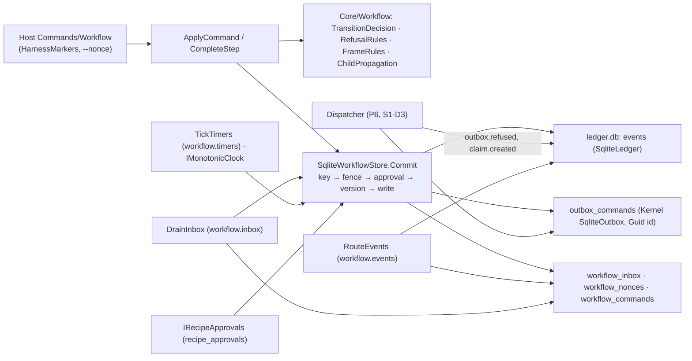

# Architecture Review (pass 3 of 3): Sindri workflow engine, revision 3

_Reviewed by `/archReview --slim` on 2026-10-10_

Target: `docs/superpowers/specs/2026-10-10-sindri-workflow-engine-design.md` rev 3 (`WE §n` / `WE:line`). Earlier
passes: `arch-review.md` (F1–F25), `arch-review-r2.md` (R1–R16), `consolidated-review.md` (C1–C32),
`consolidated-review-r2.md` (E1–E24) and §13. Checked against `.agents/rules/csharp.md`, `csharp-testing.md`, and the
S1 branch at `.claude/worktrees/sindri-s1-app-shell` (HEAD `a7d2ada`, read only). Scope, as asked: only (1) earlier arch
findings that are still open and (2) new correctness problems that revision 3 introduced. Resolved items and §13 written
answers aren't raised again.

## Verdict: NEEDS WORK

Revision 3 closes R1–R16 in structure. Frames replace exit-and-enter (R1). There is a per-call actor and a challenge
(R2). Ids are UUIDv5 with a `workflow_commands` map (R3). Every row change goes through a versioned `Commit` (R4).
Forwarding keeps the actor, and `cancel` works from `taken-over` (R5). The phase graph is fixed (R6), the outbox
migration is pinned (R7), and revokes wake instances (R8). Nonces have a table (R9), desk reports are validated and
`Start` runs after the commit (R10). R11–R16 are resolved too.

Five new HIGHs come from the rev-3 mechanisms themselves:
- **N1:** "a pop resumes the frame exactly" has no continuation. After a grant or an answer, nothing runs, and the P7
  signal can't pass.
- **N2:** "approval is checked on every `Commit`" blocks `cancel`, which is the only exit from a `spec-conflict` park.
- **N3:** the outbox id formula isn't unique per commit, so repeated engine notifications abort their `Commit`.
- **N4:** `eventHold` expires the child rows of a suspended parent.
- **N5:** the Prover can't run any human-class signal from an agent session.

Scores: Complexity 3, Scalability 4, Maintainability 3.

## Scores

| Dimension | Score (1–5) | Notes |
|-----------|:---:|-------|
| Complexity | 3 | Frames, arms, nonces, inbox holds and forwarding are each sound alone. Their interactions are underspecified: pop continuation (N1), the stack past depth 2 and pops below the top (N6), hold versus suspended frames (N4) |
| Scalability | 4 | Per-instance shifts, cursor-paged router, separate service loops. Nothing new at 10x; every shift bumps every instance's version and invalidates outstanding nonces (L1) |
| Maintainability | 3 | The placement and slices follow `csharp.md`. Some rev-3 promises don't fit Kernel's outbox (no immediate dead-letter for a dispatch refusal, N8), the bulk-error analyzer baseline (UUIDv5 needs SHA-1, L2), or the Prover role (N5) |

## Component Diagram

## Sequence Diagram (N1: grant on a child no-progress park, the P7 signal)

```mermaid
sequenceDiagram
  participant H as Human (TTY)
  participant P as Parent T-5/item/1
  participant C as Child …/step.N
  participant S as Commit
  C->>S: checks step.completed(failed, same findings) → produce
  S-->>C: no-progress → push park over the frame (run consumed)
  C-->>P: inbox: child parked (propagate) → push mirror park
  H->>P: answer --grant 1 (challenge)
  P->>C: forwarded grant (actor human-terminal)
  C->>S: pop → "resume the frame exactly" (same entry and run token)
  Note over C: the run's result was already consumed and no Step re-runs:<br/>the child sits in its frame with no open task until its timeout parks it again
  C-->>P: inbox: child resumed → parent pops back to its wait
```

## Edge Case Matrix

Boundaries: **B1** reader and validator · **B2** registry and approval · **B3** decisions and frames · **B4** `Commit` ↔ S1
ledger, lease and outbox · **B5** built-in services · **B6** router and inbox · **B7** children · **B8** desk runtime ·
**B9** CLI/API (actor, nonce, challenge) · **B10** dispatcher · **B11** phase signals.

| Boundary | Dependency unavailable | Invalid/malicious input | Load 10x | State leakage |
|---|---|---|---|---|
| B1 reader + validator | OK — unknown block `RCP-BLOCK-001`, `RCP-RES-001` (WE:616) | L7 (`then: retry` on a child wait) | OK — 256 KiB and depth-32 caps (WE:110) | OK — pure catalog (WE:548) |
| B2 registry + approval | OK — revoke wakes instances (W11, WE:355) | OK — challenge, `SND-RECIPE-004`/`009` (WE:241–249) | OK — snapshot invalidated by `recipe.*` (WE:335) | N2 (`cancel` refused after a revoke), L5 |
| B3 decisions + frames | OK — `SND-WF-010` park (W5) | N1, N7 | OK — pure over one row | N1, N6, L3 |
| B4 Commit ↔ S1 | OK — `LeaseDecision.Holds` (S1 `LeaseDecision.cs:49`) | N3 (`SqliteOutbox.Enqueue` returns `Conflict` on a duplicate id, `SqliteOutbox.cs:24,49`) | OK — 3 re-decisions (WE:342) | L4 |
| B5 services | OK — S1-D8/D10 owned by P4 | OK — keyed `shift:{tick}` (WE:354) | L1 (each shift bumps every version) | OK — `takeoverIdle` clears (WE:390) |
| B6 router + inbox | OK — producer check (WE:397) | N9 (a replayed refused command reports success) | OK — cursor `ReadAfter` (S1 `ILedgerStore`) | N4 (hold expires a suspended frame's rows), N11 (late retry events expire) |
| B7 children | N4 | N10 (a forwarded challenge is bound to the parent) | OK — depth ≤ 4 (`RCP-CHILD-003`) | N6 |
| B8 desk runtime | OK — park, never retry (W20) | OK — `SND-WF-008` before the decision (WE:379) | OK | OK — run token keys `complete` (WE:350) |
| B9 CLI/API | OK — `Output.Error` 1 not running, 2 otherwise (S1 `Output.cs:29`) | L1 (nonce validity isn't a `Commit` step) | L1 | OK — reads mint no nonce (WE:359) |
| B10 dispatcher | N8 (a refusal has no terminal outbox state) | N8 (engine `notify.desk` is re-checked against the recipe approval) | OK — `notBefore` computed from `enqueued_at` | N3 |
| B11 phase signals | N5 (the Prover is `session`) | N12 (`dev-notify` target state) | OK | L6 |

### Findings

| id | severity | location | finding | recommended fix |
|---|---|---|---|---|
| N1 | HIGH | W16, §5.1 "Push and pop" (WE:297–303), W7, §5.5 items 3–4, P7 signal (WE:1078–1080) | **A pop has no continuation, so an answered park does nothing.** "A pop resumes the frame exactly: the same `entry`, run token, child", with no round counted. That is right for a takeover and handback, and for `--resume` on a timeout escalation. It's wrong for every park whose cause consumed the trigger: (a) a `rounds` or `no-progress` park, whose result was consumed and whose re-run or blocked transition was withheld; (b) a `needs-answer` park after `step.failed` with no transition, or after a wait refusal ("the event is consumed, held resources are released", WE:376); (c) a `budget` park on a transition gate. After the pop, the frame's run is already completed, or its event, slot or child is already gone, so nothing starts and nothing will arrive. The instance sits until its re-armed timeout parks it again. The P7 signal "`--grant 1` … resumes both" therefore shows `active` with no desk task, or `running` waiting on a child that never moves | Store the **deferred action** on the suspended frame when it's pushed: `rerun(n+1)`, `transition(t)`, `rewait` or `none`. Define the answer per reason: `--grant n` adds n to the cap and performs the deferred action (a re-run or the withheld transition, entering the target with a new entry); `--text` on `needs-answer` records `fact:answer` and re-runs the Step (run `n+1`, not counted); a park from a wait re-requests its resource or re-checks the child; takeover, handback and `--resume` keep "resume exactly". Tests: `Grant_after_no_progress_reruns_produce`, `Answer_after_step_failed_reruns_the_step`, `Wait_refusal_answer_rewaits_and_rerequests_the_slot` |
| N2 | HIGH | W11, §5.3 step 3 (WE:335–336), §3.8 `spec-conflict` row (WE:214), §5.7 "Parent cancelled" | **The approval check on every `Commit` blocks the only exit from a revoke.** `RCP-CAP-003` runs on every `Commit`. On a system trigger a mismatch "turns the commit into a park"; on a command it can only refuse (`SND-RECIPE-005`/`006`). So once a recipe is revoked or a pin drifts, the human's `cancel`, the only way out of `spec-conflict` in §3.8, is refused. The instance stays in `--needs-me` forever. Worse, a parent's cancel reaches the child as an inbox row, which is a system trigger, so for a drifted child it becomes a `spec-conflict` park instead of a cancel. The same applies to `takeover` and to the parent-cancel cascade over a revoked generated recipe | Exempt the triggers that run no recipe block from step 3: `cancel` (command, cascade and tracker), `takeover`, `handback` into an engine-owned frame, and `takeoverIdle`. Check the approval only on triggers that evaluate a recipe transition, gate or effect, or that start a Step. Tests: `Cancel_after_revoke_cancels`, `Parent_cancel_cancels_a_drifted_child` |
| N3 | HIGH | §5.4 outbox ids (WE:360–361), §6.3 notifications (WE:482–485), Kernel `SqliteOutbox.Enqueue` | **The UUIDv5 input `cmd:{instance}:{entry}:{n}:{try}` isn't unique per commit.** `n` is undefined: it could be the run number or the effect index. And engine-owned `notify.desk` commands (parks, escalations, `takeoverIdle`) are written in commits that **don't change `entry`**, because a push keeps the suspended entry. Two parks in one entry produce the same id: timeout, answer, timeout again, or takeover, idle, handback, takeover, idle. Kernel's `Enqueue` is `ON CONFLICT (id) DO NOTHING`, and it returns `AW-KERNEL-003 Conflict` when zero rows change (`SqliteOutbox.cs:24,49`). That aborts the whole `Commit`. The system trigger then fails on every tick: the second park is never written, and the instance keeps its timeout firing into an error | Derive command ids from the commit's trigger key, which W12 already makes unique per commit: UUIDv5(`{instance}:{trigger key}:{effect index}`). Keep a separate, stable **effect identity** (`{instance}:{entering entry}:{effect index}`) in the payload for existence checks such as `effect.claim.ref`. A `retry` is a deadline trigger with its own key, so it gets a new id with no `try` field. Test `Second_park_in_one_entry_notifies_again` |
| N4 | HIGH | §5.7 inbox (WE:401–405), W17, the `running` state in §12 (`2d then park`) | **`eventHold` expires the child rows of a suspended parent.** Child propagation goes through the inbox (W17). A row for an instance "that isn't waiting" is held for up to 24 h and then expires. A parent parked by its own `running` timeout (2 d, which the child's 2 d desk Steps can reach) isn't waiting. When the child then finishes, the terminal row expires 24 h later if the human hasn't answered the park yet, which over a weekend is the normal case. The answer pops the parent back to a wait on a child that is already terminal, so its re-armed timeout parks it again, and it does that forever. The same applies to "Resumed" rows and forwarded-command rows held while the parent is taken over | Rows that target a frame that is **live** (current or suspended on the stack) never expire by hold; they expire only when that frame ends. `eventHold` applies only to rows that match no frame yet (early events). Also, a pop into a `child` wait re-reads the child's current state. Test `Child_finishing_during_a_long_parent_park_resolves_on_answer` |
| N5 | HIGH | W22 / §6.2 (WE:449–455), Roles "Prover" (WE:934), signals P2 and P4–P7 | **The Prover can't run the signals.** The Prover is an agent in the `/specToProvenPR` session, so `CLAUDECODE` and the other harness markers are set. Every CLI call it makes is `session`, and its Bash tool has no TTY. `workflow start`, `complete`, `takeover`, `handback`, `cancel` (human) and approve, grant and accept (human-terminal) are all refused with `SND-WF-007`/`SND-RECIPE-004`. Unsetting the markers is named a crafted bypass (§13). As written, the P2 approve signal, P4 steps 1–3, P5, P6 and P7 can't be produced by the role that owns them. P4 step 4 relies on this very refusal | Say who runs them: the Prover writes each signal as a script, the **owner** runs it in a terminal, and the Prover records the transcript as evidence. Alternatively, add a dev-profile-only, ledger-labelled `actor: prover` class that the production profile schema refuses. Integration tests keep stamping the actor at the endpoint |
| N6 | MEDIUM | W16 "at most two deep", §5.7 children table | **The stack can exceed two frames, and child rows can need to pop a frame that isn't on top.** One reachable sequence: a mirror park (1), then a takeover of the parent (2), then the child, answered at its own address, resumes and later escalates, which pushes a third frame. Another: the "Resumed" row arrives while the takeover frame is on top. Neither overflow nor a pop of a non-top frame is defined | Child rows apply only to the mirror frame. While a takeover is on top, they stay pending (exempt from hold, N4) and apply at handback. A child escalation replaces the mirror frame in place instead of pushing. State a depth invariant test, `Stack_never_exceeds_two` |
| N7 | MEDIUM | §5.5 item 1, W7 `--grant-tokens`, the `startable → claimed` transition in §12 | **A budget-gate park can be a dead end, and it keeps the slot.** `gate.budget.available` on `workflow.item` (which has no recipe budget) refuses: that parks with `budget`, and `status` suggests `--grant-tokens`, capped at "the original budget", which is none here. The gate also reads a budget that a grant doesn't raise. And because rule 1 wins over rule 4, the "held resources are released" step doesn't run, so the parked item holds a session slot indefinitely | Release held resources on **every** park or escalation out of a wait, not only under rule 4. Split the two cases: recipe budget exhaustion is answered with `--grant-tokens`; a budget-gate refusal is answered with `--resume`, which re-evaluates the gate, plus N1's `rewait` |
| N8 | MEDIUM | §5.4 Dispatcher (WE:362–364), S1-D3, Kernel `IOutbox` | (a) **A dispatch refusal has no terminal outbox state.** `IOutbox` has only `MarkDispatched` and `MarkFailed`; `MarkFailed` retries under `OutboxRetryPolicy` and dead-letters only when the policy gives up. A refused command is therefore re-dispatched and re-refused, writing `outbox.refused` again each time. (b) **Engine-owned `notify.desk` goes through the same recipe-approval recheck.** So the notification that tells the human a revoke parked their instance is itself refused at dispatch (the recipe is revoked) and dropped | (a) Add a Kernel operation that dead-letters now with an error (`MarkRefused`), and key `outbox.refused` by command id; this is a Kernel change, so name its owner. (b) Mark engine-emitted commands `origin: engine` and skip the recipe recheck for them; the allowlist check still runs |
| N9 | MEDIUM | §5.3 step 1 (WE:333), §5.5 item 5 (WE:377) | **A replay of a refused command reports success.** A refused command is recorded under its nonce. Re-sending it (a script retry after a dropped connection) hits the key and returns `AlreadyApplied`: exit 0, "already applied". The original returned exit 2 with `SND-WF-004` | Store the outcome with the trigger key. A replay returns the recorded result: the same status header, or the same error code |
| N10 | MEDIUM | §5.7 forwarding row (WE:416), §4.2 | **A forwarded challenge can't be re-verified at the child.** The challenge's action text names the parent address (`grant 1 T-5/item/1`), and the nonce is single-use and consumed in the parent's `Commit`. "Forwarded … with the original actor and challenge" means the child either re-checks a consumed or mismatched challenge, which refuses, or doesn't check it at all, which is undefined | The parent verifies the challenge and consumes the nonce. The forwarded row carries the server-stamped actor class and the parent's trigger key, and the child accepts engine-written rows by actor class. The preview names the child that will receive it |
| N11 | MEDIUM | §3.4 `retry` (WE:171–173), §5.4, §12 `claimed: 10m then retry` | **`retry` mixes up entry and identity.** `retry` re-enters "in a new frame entry" yet re-emits "with the same effect identity" under an id that contains `{entry}`. If the map names the old entry, the retried `claim.created` routes to an ended frame and expires, and the second timeout parks. If the identity includes the new entry, `effect.claim.ref` sees a ref with another identity and reports `claimExists`, so the item goes to `dropped`. A late first-attempt event always expires, which is acceptable only if the retry's event applies | With N3: the `workflow_commands` row of a retried command names the **new** entry, and the effect identity keeps the original entry. Test `Claim_retry_after_slow_dispatch_reaches_running` |
| N12 | MEDIUM | P6 signal 2 (WE:1059–1060), §12 `workflow.dev-notify` | If `dev-notify`'s effect transition enters a terminal state (§12 says only "a desk Step, then a transition with `effect.notify.desk`"), T-5 is terminal before the revoke. The revoke wake can't park a terminal instance, so `status` shows `done`, not `parked: spec-conflict`, and the signal fails | Make the effect transition enter a non-terminal `wait` (for example, waiting on a desk answer), and say so in §12 |
| L1 | LOW | §5.3, §5.4 nonces | Nonce validity (unused, unexpired, current version) isn't one of `Commit`'s steps. It has to come after the key check, or P4 signal 3's replay gets `SND-WF-009` instead of `already applied`. `SND-WF-002` and `SND-WF-009` overlap on a version change. Every shift, expiry or notification bumps the version, which kills a nonce fetched before a 5-minute challenge was typed | Add "1b. nonce valid" after the key check. Fetch the command nonce after the challenge is typed. Map a nonce on a stale version to `SND-WF-002` |
| L2 | LOW | §5.4 UUIDv5 | UUIDv5 needs SHA-1. Under `dotnet_analyzer_diagnostic.severity = error` (`.editorconfig:33`), `SHA1.HashData` raises CA5350 as a build error | Suppress CA5350 at that one call site with a justification (it's not used for security), or use a name-based UUIDv8 over SHA-256 |
| L3 | LOW | §5.1 deadline ids `{entry}:{kind}:{arm}` | The arm's scope is unstated. If it resets per frame, a second takeover in the same entry re-creates `{e}:takeoverIdle:1`, which gets `AlreadyApplied` and never fires (the rev-2 R1 bug again) | Make the arm a per-instance monotonic counter |
| L4 | LOW | §5.2 "exactly one event" (WE:307) vs `workflow.started` for a child "in its parent's `Commit`" (WE:311) | Two events in one transaction need two idempotency keys | Key the child's start `wf:{child}:started`, and reword "one event per row" |
| L5 | LOW | §5.4 wake row "revoke or drift" (WE:355) | Drift has no `recipe.revoked:{seq}`. It's caught only at the next `Commit` (`Pin_drift_parks_on_next_commit`), so an idle 7 d wait keeps its drifted pins | Drop "or drift" from the row, or scan for drift at startup and wake with `drift:{buildId}` |
| L6 | LOW | §6.4 desk-task sample (WE:501–503) | A new child at round 1/3 shows `--run 4.1`. Its first entry is 1, so the token is `1.1` (the `.4` is the parent's entry in the address). Golden files will pin the wrong token | Fix the sample |
| L7 | LOW | §3.4 `retry`, `waitFor: child` | `then: retry` on a `child` wait re-enters it under a new entry, which creates a second child with id `{parent}/{recipe}.{newEntry}` while the first keeps running | Refuse `retry` on child waits in `RCP-TIME-001` |
| L8 | LOW | §12 events, `claim.created` producer "the dispatcher" | The router matches `producer` against the envelope's actor. "The dispatcher" needs a concrete actor id that S1-D7's per-call actor stamps | Name it (`sindri:dispatcher`) in the descriptor and in S1-D7 |

## Missing Error Handling

- §5.1/§5.5: the continuation after a pop for each park reason (N1).
- §5.3 step 3: approval-exempt triggers (N2).
- §5.4: duplicate outbox ids inside `Commit` (N3), and a terminal state for a dispatch refusal (N8a).
- §5.7: hold versus live suspended frames, and child rows under a takeover (N4, N6).
- §5.3 step 1: the recorded outcome for a refused trigger (N9).

## Suggested Improvements (Prioritized)

| Severity | Improvement | Effort | Impact |
|----------|------------|--------|--------|
| HIGH | Deferred action on suspended frames, and per-reason answers (N1) | S | Grants and answers move the instance; the P7 signal passes |
| HIGH | Exempt `cancel`, `takeover` and `handback` from the approval check (N2) | S | A revoked or drifted instance can always be cancelled |
| HIGH | Command ids from the trigger key, effect identity separate (N3, N11) | S | Repeated parks notify; `claimed` retries recover |
| HIGH | Holds don't expire live frames' rows (N4) | S | Child outcomes are never lost |
| HIGH | The owner runs the human-class signals, and the Prover records them (N5) | S | Every phase's signal can run |
| MEDIUM | N6–N10, N12 | S–M | Defined stack bounds, budget park, dispatch refusal, replay results, forwarding, P6 signal |
| LOW | L1–L8 | S | Polish |

verdict: NEEDS_WORK
