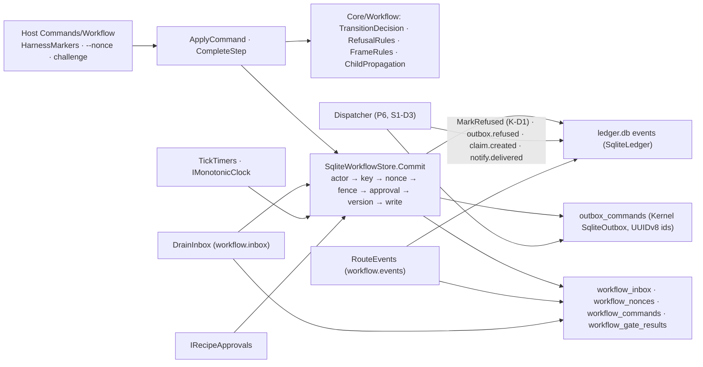
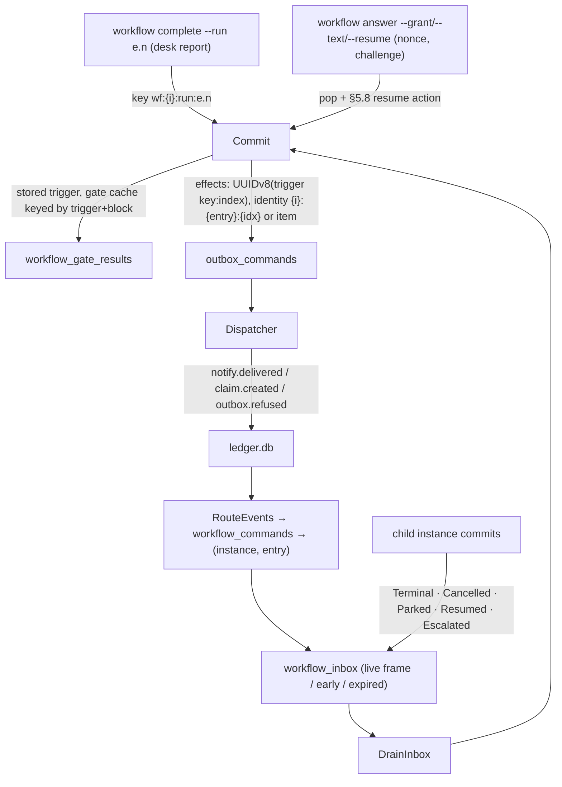

# Architecture Review (pass 4 of 5): Sindri workflow engine, revision 4

_Reviewed by `/archReview --slim` on 2026-10-11_

Target: `docs/superpowers/specs/2026-10-10-sindri-workflow-engine-design.md` rev 4, cited as `WE §n` or `WE:line`.
Earlier passes: `arch-review.md` (F), `-r2.md` (R), `-r3.md` (N1–N12, L1–L8), the consolidated reviews (C, E, G) and
§13. Checked against `.agents/rules/csharp*.md` and the S1 worktree `sindri-s1-app-shell` (HEAD `ae8b6da3`, read only):
`Aw.Kernel/Outbox/IOutbox.cs`, `Aw.Kernel.Data/SqliteOutbox.cs`, `SqliteOutboxSchema.cs` and `LedgerDatabase.cs:106`.

As asked, this pass reports only (1) earlier arch findings that are still open and (2) new correctness problems in the
rev-4 mechanisms. Resolved items and §13 answers aren't raised again.

## Verdict: NEEDS WORK

Rev 4 resolves N2 (exemptions), N3/L2 (UUIDv8 over the trigger key), N4 (live-frame rows), N5 (owner runbook), N8 (K-D1
and the engine-owned exemption), N9 (recorded results), N10 (`onBehalfOf`), N11 (`retry` keeps its entry), N12
(`dev-notify` waits on `notify.delivered`), L3–L8, and N7 in part.

Three new HIGHs come from the new mechanisms:
- **H1:** §5.8's `rerun` re-runs the frame's own Step. For `workflow.step`'s loop, that frame is `checks` or `verify`,
  not `produce`, so the P7 grant signal can't pass. N1 is resolved only for the in-state gate loop.
- **H2:** a child that ends while its parent mirrors it leaves the parent stuck, because only a `Resumed` row pops the
  mirror frame.
- **H3:** step 2 of §5.3 replays the **recorded refusal** for a key. A desk report's key is its run token, and `rearm`
  keeps that token. So any recorded refusal of a report (nonce, version, fence, malformed) poisons the desk task for
  good.

Scores: Complexity 3, Scalability 4, Maintainability 3.

## Scores

| Dimension | Score (1–5) | Notes |
|-----------|:---:|-------|
| Complexity | 3 | §5.8 is the right shape. It has gaps: two kinds of rounds park (H1), pop triggers for mirror frames (H2), which refusals are recorded (H3), and the reuse of cached gate answers on `reevaluate` (M1) |
| Scalability | 4 | Nothing new at 10x. Live-frame rows are bounded by frames. The version churn on challenges (L1, carried) is still the only pressure point |
| Maintainability | 3 | The term "engine-owned commands" in step 5 reads as the engine verbs (M2). The outbox table has no `origin` column (M2). Effect-identity entry semantics are left implicit (M5) |

## Component Diagram



## Data Flow Diagram



## Sequence Diagram (H1 and H2: the P7 grant on a child no-progress park)

```mermaid
sequenceDiagram
  participant H as Owner (TTY)
  participant P as T-7/item/1 (running)
  participant C as …/step.N (checks, entry 4)
  participant S as Commit
  C->>S: checks step.completed(failed, same findings), withheld checks→produce
  S-->>C: push park(no-progress) over the checks frame, resume action = rerun
  C-->>P: inbox Parked(propagate) → push mirror frame
  H->>P: answer --grant 1 (challenge) → forwarded with onBehalfOf
  P->>C: forwarded grant (system trigger)
  C->>S: pop → rerun "the frame's Step" = step.checks run 4.2 (H1)
  Note over C: the signal expects produce to re-run; checks re-runs on the same output instead
  alt the human cancels the child at its own address instead (H2)
    C-->>P: inbox Cancelled → aimed at the base frame, suspended under the mirror
    Note over P: no Resumed row will ever come, so the mirror never pops and the parent shows a dead park
  end
```

## Edge Case Matrix

Boundaries: **B1** reader and validator · **B2** registry and approval · **B3** decisions, frames, §5.8 · **B4** `Commit`
↔ S1 ledger, lease and outbox · **B5** built-in services · **B6** router and inbox · **B7** children · **B8** desk
runtime · **B9** CLI/API (actor, nonce, challenge) · **B10** dispatcher · **B11** phase signals.

| Boundary | Dependency unavailable | Invalid/malicious input | Load 10x | State leakage |
|---|---|---|---|---|
| B1 | OK — `RCP-BLOCK-001`, `RCP-RES-001` (WE:694) | OK — `RCP-TIME-002`, `RCP-TRIG-002` (WE:175, 183) | OK — 256 KiB / depth 32 (WE:110) | OK — pure |
| B2 | OK — revoke wake, drift wake at startup (WE:378) | M6 (a new child of a revoked child recipe starts) | OK — snapshot invalidated by `recipe.*` (WE:357) | M3 (a drift wake on an already-suspended instance; `reevaluate` of a wake) |
| B3 | OK — `SND-WF-010` park (WE:221) | H1, M1 | OK — pure over one row | H1, M1, M4, M7 |
| B4 | OK — `LeaseDecision.Holds` step 4 (WE:356) | H3 | OK — at most 3 re-decisions (WE:365) | OK — UUIDv8 per trigger key; Kernel `Enqueue` conflict can't recur (`SqliteOutbox.cs:24,49`) |
| B5 | OK — separate loops (S1-D10) | OK — `shift:{tick}` keyed | L1 (carried) | OK — `takeoverIdle` clears (WE:422) |
| B6 | OK — producer check (WE:429) | M5 (which entry a command maps to) | OK — cursor | M8 (`outbox.refused` aimed at an ended frame expires) |
| B7 | H2 | M9 (forwarded commands: which verbs, what's reported) | OK — depth ≤ 4 | H2 |
| B8 | OK — park, never retry (W20) | H3 (a malformed or refused report poisons the token) | OK | OK — run token keys reports (WE:373) |
| B9 | OK — `Output.Error` (W27) | L9 (nonce key reuse with a different body) | L1 | L10 (`workflow.request` and the version) |
| B10 | OK — K-D1 `MarkRefused` over `dead_lettered_at` (`SqliteOutboxSchema.cs`) | M2 (no `origin` column; exemption keyed how?) | OK — `notBefore` | L11 (atomicity of `MarkRefused` and `outbox.refused`) |
| B11 | OK — owner runbook under `script` (WE:1074–1077) | H1 (P7), M5 (P6 signal 1) | OK | L12 (P5 signal's second instance) |

### Findings

| id | severity | location | finding | recommended fix |
|---|---|---|---|---|
| H1 | HIGH | §5.8 row 1 (WE:461), §3.8 rows 1–2, §5.5 item 3, §12 `workflow.step`, P7 signal (WE:1229–1231) | **`rerun` targets the wrong Step for a loop that's closed by a transition.** There are two sources of a `rounds` or `no-progress` park. (i) A gate refusal re-runs the **same** active state (§5.5 item 3); there, "rerun the frame's Step" is right. (ii) The loop's back-edge: `checks → produce` or `verify → produce`, where `produce` carries `loop: revisions`. Here the cap or the no-progress check fires when that transition would enter `produce`. The frame being suspended is `checks` or `verify`, whose run has already completed. §5.8's "`rerun`: a new run `n+1` of the frame's Step" therefore re-runs `step.checks` on the unchanged output, which fails the same way. It never re-enters `produce`. The P7 signal ("re-runs the child's `produce`") can't pass, and `--text` on `no-progress` has the same defect. This is the rest of N1 | Give the case (ii) parks the resume action `transition`: perform the withheld back-edge into the loop state with a new `entry` and run `1` (counted, or under the grant). Store the target state on the suspended frame. Keep `rerun` for case (i). Tests: `Grant_after_back_edge_cap_enters_produce` and `Text_on_no_progress_reenters_produce`. Rewrite §3.8 rows 1–2 as "re-enters the loop state" |
| H2 | HIGH | §5.7 children table (WE:446–452), §5.1 stack rules (WE:321) | **Only `Resumed` pops a mirror frame.** A child can leave its park or escalation without a separate resume: it is cancelled at its own address; `--accept` on a child escalation fires straight into `done`; or it parks, gets resumed and escalates again before the parent drains. The parent's `Terminal`/`Cancelled` row is aimed at the base frame, which is suspended under the mirror. By §5.7 it waits "until that frame is current again", and that never happens. The parent shows a park whose child no longer exists, and its forwarded answers go to a terminal child. Only a parent `cancel` gets it out | Every child row (`Terminal`, `Cancelled`, `Resumed`, `Escalated`, `Parked`) first pops any frame that mirrors that child (by child id, as §5.1 says), then applies. A child that escalates or parks again while mirrored replaces the mirror frame in place. Tests: `Child_cancelled_while_mirrored_satisfies_the_parent_wait` and `Child_accept_to_done_while_mirrored_resolves_the_parent` |
| H3 | HIGH | §5.3 step 2 (WE:352–353), §5.4 report key (WE:373), §5.5 item 5 and the desk-report paragraph (WE:409–412), §5.8 `rearm` (WE:466) | **A recorded refusal poisons a desk run token.** A command's key is its nonce, so recording its refusal is harmless: the CLI fetches a new nonce. A desk report's key is `run:{entry}.{n}`. If a report is refused and the refusal is recorded under that key, every later `complete --run e.n` replays that refusal (exit 2). The refusals in question are a nonce on a stale version after a shift or inbox commit (`SND-WF-009`), `SND-WF-002`, `SND-LEASE-003` during a handover, or a malformed report (`SND-WF-008`), if it goes through `Commit`. The task can't be reported. A timeout park and `--resume` (`rearm`) keep **the same run token**, so they don't recover it; only `cancel` does. Also, a version-conflict refusal at step 6 rolls back the transaction, so it can't be "recorded" or "consume the nonce" as §5.4 says | State that only **decision** outcomes are recorded under the key: an applied result, and the §5.5 refusals that commit a `workflow.refused` event. Refusals at steps 1, 3, 4 and 6, and `SND-WF-005`/`008`, are returned without being recorded, and they leave the key and the run open. Test `Report_refused_for_a_stale_nonce_can_be_resent_with_the_same_run` |
| M1 | MEDIUM | §5.3 gate cache (WE:364–365), §5.8 `reevaluate` rows (WE:463, 465, 467) | `workflow_gate_results` is keyed by trigger and block, and `reevaluate` runs "the withheld transition with its stored trigger". Read literally, the re-evaluation reuses the cached `fail` from the original trigger, so `--grant-tokens` after a `gate.budget.available` refusal, and `--text` after a wait refusal, park again every time | Key gate results by the **evaluating** trigger, which is the answer's key on a resume. The cache is for version-conflict re-decides within one trigger only. Test `Grant_tokens_reevaluates_the_budget_gate_fresh` |
| M2 | MEDIUM | §5.3 step 5 (WE:357–359) vs W11 (WE:35) and §3.5 "engine verbs" (WE:183); Kernel `outbox_commands` columns (`SqliteOutboxSchema.cs`) | (a) Step 5 exempts "engine-owned commands". §3.5 calls `answer`, `complete`, `grant` and the rest "engine verbs", so a reader can exempt `complete` and `answer --resume`, which would run transitions on a revoked recipe. W11 says "engine-owned notifications". (b) At dispatch, nothing distinguishes an engine-owned `notify.desk` from a recipe's `effect.notify.desk`: the table has `kind`, `actor` and `causation_id` but no origin. If the exemption keys on `kind`, P6 signal 2's recipe notification is dispatched instead of refused | (a) In step 5, say "engine-emitted notifications (outbox only)". (b) Put `origin: engine\|recipe` in the payload and exempt only `origin: engine`. Test `Recipe_notify_desk_is_refused_after_revoke` |
| M3 | MEDIUM | §5.4 wake row (WE:378), §5.8 drift row (WE:467), §5.1 stack rules | (a) A drift park from the startup wake has no withheld trigger, so "`reevaluate` the trigger that parked it" re-runs the wake, which "always parks". (b) A drift or revoke wake on an instance that is already parked or escalated isn't defined. A revoke replaces the stack, but a drift park would sit on a park, which breaks "a park sits on the base frame" | (a) A wake-caused drift park resumes with `rearm` (the frame unchanged, the same run). (b) A drift wake on a suspended instance is a no-op: the human's next answer is a command and gets `SND-RECIPE-006`, which names the re-approval |
| M4 | MEDIUM | §5.1 "counts one, except after a grant" (WE:316), W7 | `--grant n` adds n to the cap, and the re-run it starts isn't counted. So `--grant 1` yields two more runs (the free one, plus round cap+1). That contradicts `Grant_adds_n_rounds…` | Count the resumed run against the granted rounds, or keep the cap and grant exactly n uncounted runs. Pick one and name it in the test |
| M5 | MEDIUM | §5.4 `workflow_commands` and effect identity `{instance}:{entry}:{effect index}` (WE:383–389), P6 signal 1 | An effect is written in the `Commit` that leaves one entry and enters the next, and "entry" doesn't say which. If the map records the leaving entry (`ask`), `notify.delivered` is aimed at an ended frame and expires, so `T-4` never reaches `done`. That fails P6 signal 1. The same applies to `claim.created` for `claimed` | Both the map row and the identity name the entry the transition **enters**. `retry` and `reemit` keep it. Test `Delivered_event_routes_to_the_entered_wait` |
| M6 | MEDIUM | W11, `RCP-CAP-003` (WE:283), §5.7 "Created" | A parent pins its children's hashes, and a revoked child keeps its hash, so the parent's check passes. In the parent's `Commit`, the new child of a revoked `workflow.step` is created (`workflow.started`), and its desk task opens. Every `complete` is then refused with `SND-RECIPE-005` (a command), and no wake comes, because the revoke happened before the child existed | Check the child's own approval in the parent's `Commit` that creates it. On a mismatch, park the parent with `spec-conflict` and create no child. Test `Entering_a_child_wait_on_a_revoked_child_parks_the_parent` |
| M7 | MEDIUM | §5.5 items 1 and 4, §13 "slot is released at the park", §5.8 `reevaluate` with the stored trigger | The precedence is top to bottom, so a `gate.budget.*` refusal on `startable → claimed` is item 1, which doesn't release. §13 says it does. If the slot is released, `reevaluate` replays the stored `wait.satisfied` (the slot grant) and fires `→ claimed` holding no slot. If it isn't released, the slot is held for the whole park. The same goes for a `needs-answer` park from a resource wait | Release held resources on every park out of a wait, and make the resume action for a resource wait `rewait`: re-request the resource, then evaluate. Don't replay a stale grant |
| M8 | MEDIUM | §5.4 dispatcher (WE:392–395), §5.7 expiry (WE:440) | `outbox.refused` is routed like an event, so a row whose frame has ended **expires**. Take an effect on a transition into an `active` state (or one where the instance moved on before dispatch). If an allowlist or profile refusal arrives late, it's dropped with only `workflow.expired`, and the instance continues as if the effect had happened | `outbox.refused` applies to the instance's **current** frame whatever it is (a park), and is pending only while a takeover is on top. Test `Late_dispatch_refusal_parks_the_moved_on_instance` |
| M9 | MEDIUM | §5.7 forwarding row (WE:451), §6.3 `answer` prints "the resume action it ran" (WE:536), §6.4 layout 1 | (a) "A command to the parent" is forwarded, but `cancel` and `takeover` must stay with the parent (layout 1 lists only `answer` as forwarded). (b) Forwarding goes through the inbox, so the parent's `answer` returns before the child applies it. It can't print the resume action, and a refusal at the child (for example `SND-WF-003` because the child moved on) is never reported to the human, whose command already exited 0 | (a) Forward only `answer`. (b) Before the parent's `Commit`, check the forwarded answer synchronously against the child's current frame (the same `SND-WF-003` rules), then print `forwarded to <child>`. A child-side refusal writes `workflow.refused` on the child and shows on the parent's `child` line |
| L1 | LOW | §4.2 (WE:252), §5.4 (carried from r3) | The nonce and challenge are bound to the instance version, but when the CLI fetches the nonce relative to the typed challenge is still unstated. Any `Commit` in the 5-minute window (an inbox row, a child row) refuses the answer | Fetch the nonce after the challenge is typed, and bind the challenge to the frame stack rather than the raw version |
| L9 | LOW | §5.3 step 2, command key = nonce | A different command sent with a used nonce hits the key and gets the **first** command's recorded result (exit 0), not `SND-WF-009` | Store a request hash with the key; a mismatch is `SND-WF-009` |
| L10 | LOW | §5.2 `workflow.request` "changes no state" (WE:335) | If it's a `Commit` on the instance, it bumps the version, so a session's MCP requests invalidate the human's pending nonce and challenge | Don't bump the instance version for `workflow.request` (or write it outside the instance `Commit`) |
| L11 | LOW | §5.4 dispatcher, K-D1 | `MarkRefused` and the `outbox.refused` ledger event have to be one transaction. Both live in `ledger.db` (`LedgerDatabase.cs:106`), so that's possible, but it isn't said. A crash between them leaves a dead command with no event | One unit of work, S1-D2 style |
| L12 | LOW | P5 signal (WE:1182–1186), layout 5 (`T-2/dev-timeout/1 … taken-over`) | The parked first instance and the taken-over sample are both `T-2` attempt 1. If the second instance is `T-2 --attempt next`, a bare `T-2` resolves to it, not to "the first instance" | Give the second instance its own item (for example `T-8`) in both the signal and the sample |

## Missing Error Handling

- §5.8: the back-edge resume action (`transition`) for loop parks (H1); `rewait` for resource waits (M7); `rearm` for
  wake-caused drift parks (M3).
- §5.7: pop rules for every child row while that child is mirrored (H2); synchronous validation of a forwarded answer
  (M9b); `outbox.refused` applying to the current frame (M8).
- §5.3: which refusals are recorded under the key (H3); gate-cache keying on resume (M1); the wording of the
  exemption (M2a).
- Parent `Commit` creating a child: the child's approval (M6).

## Suggested Improvements (Prioritized)

| Severity | Improvement | Effort | Impact |
|----------|------------|--------|--------|
| HIGH | Add a `transition` resume action for back-edge loop parks (H1) | S | The P7 grant re-enters `produce`; N1 fully closed |
| HIGH | Any child row pops that child's mirror frame first (H2) | S | A parent never sticks on a child that already ended |
| HIGH | Record only decision outcomes under the key (H3) | S | Desk tasks can always be re-reported |
| MEDIUM | M1–M9 | S each | Resumes re-evaluate fresh; the exemption can't widen; the grant count is exact; delivered events route; no revoked child starts; slots are honest; late refusals park; forwarding reports truthfully |
| LOW | L1, L9–L12 | S | Polish |

verdict: NEEDS_WORK
