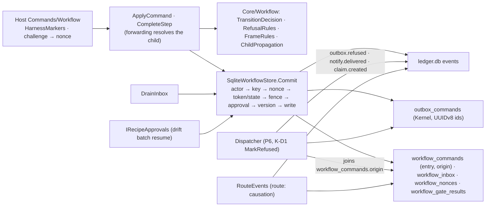
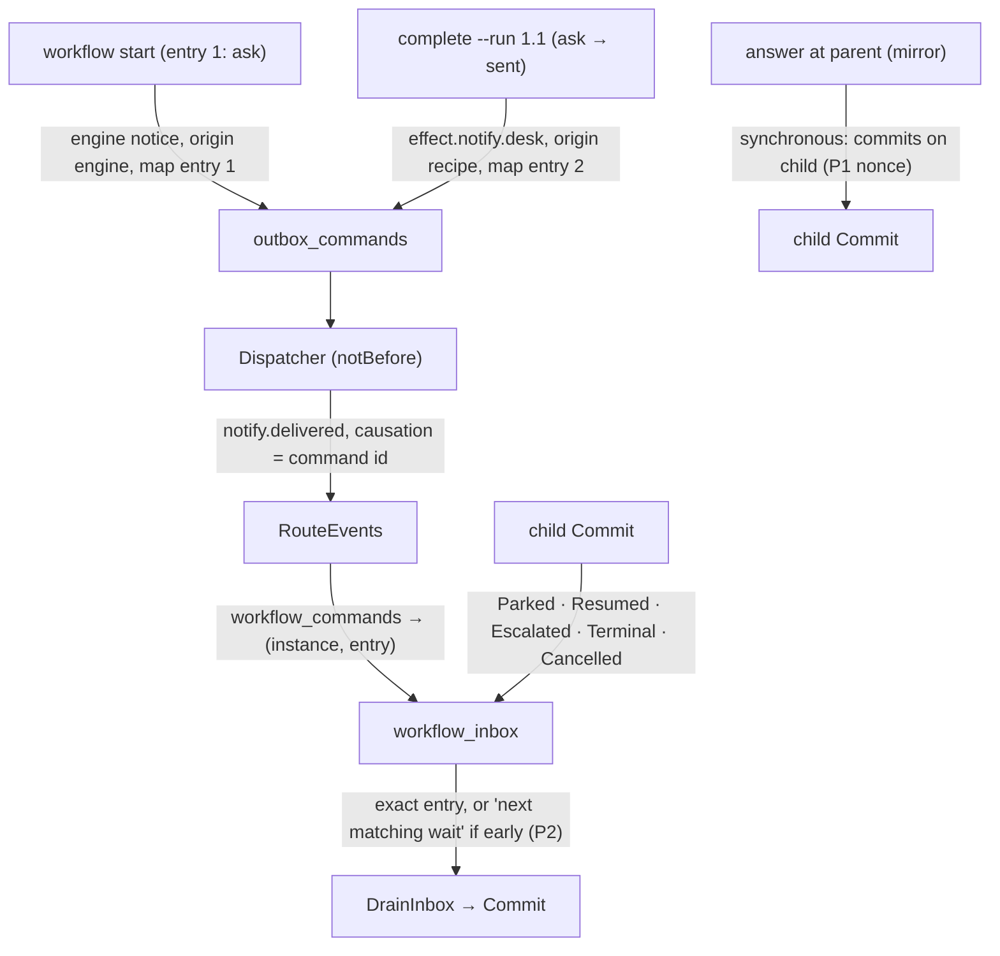
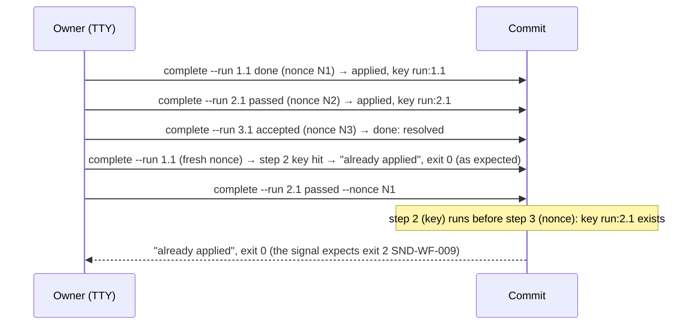

# Architecture Review (pass 5 of 5, final): Sindri workflow engine, revision 5

_Reviewed by `/archReview --slim` on 2026-10-11_

Target: `docs/superpowers/specs/2026-10-10-sindri-workflow-engine-design.md` rev 5, cited as `WE §n` or `WE:line`.
Earlier passes: `arch-review.md`, `-r2.md`, `-r3.md`, `-r4.md` (H1–H3, M1–M9, L1, L9–L12), and §13 (pass-4 table
H1–H20 plus the written answers). Checked against `.agents/rules/csharp*.md` and the S1 worktree
`sindri-s1-app-shell` (HEAD `2a31206a`, read only): `Aw.Kernel/Outbox/IOutbox.cs`, `Aw.Kernel.Data/SqliteOutboxSchema.cs`
and `Aw.Sindri.Infrastructure/Ledger/LedgerDatabase.cs:106`.

As asked, this pass reports only (1) earlier arch findings that are still open and (2) new correctness problems in the
rev-5 mechanisms. Resolved items and §13 answers aren't raised again.

## Verdict: NEEDS WORK

**Resolved since r4:** H2 (any child row pops the mirror, WE:479), H3 (only decisions are recorded, W12 and WE:379),
M1 (resumes run under the answer's key, WE:381–383 and 503–504), M2 (`origin`, WE:372 and 410–412), M3 (WE:497 and
505–506), M5 (the entered entry, WE:402–405), M6 (WE:256), M7 (`rewait`, WE:434–435), M9 (only `answer` is forwarded,
synchronously, WE:481), L1, L9 (the args hash, WE:365), L10, L11 and L12. H1 is resolved for back-edge parks. M4 and M8
are resolved apart from what P5 and P6 below describe.

**Two HIGHs remain.** Both are small text fixes:
- **Q1:** P4 signal step 3 can't pass. With the new `Commit` order the key is checked before the nonce, and the
  report it sends (`--run 2.1`) was already applied, so it prints `already applied` and exits 0, not `SND-WF-009`.
- **Q2:** `transition` is now the only resume action for a `rounds` park. A `rounds` park can also come from a gate
  refusal at the cap (§5.5 item 3). Read literally, a grant there performs the gate-refused transition, which bypasses
  the gate. This is the case (i) half of r4 H1, which needed `rerun` kept.

The MEDIUMs are gaps in the new mechanisms: P1 (a forwarded answer's nonce is minted for the parent), P2 (the early-row
clause still lets an engine notification's delivery satisfy a later wait), P3 (a parent parked by a revoked child pin
can only be cancelled), P4 (the drift batch resume has no trigger key), P5 (a park arriving on an instance that is
already parked) and P6 (who owns a claim can't be stored in a git ref).

Scores: Complexity 3, Scalability 4, Maintainability 4.

## Scores

| Dimension | Score (1–5) | Notes |
|-----------|:---:|-------|
| Complexity | 3 | §5.3 and §5.8 are now coherent. The leftovers are edge interactions: the key-before-nonce order against the P4 signal (Q1), the two sources of a `rounds` park (Q2), and parks on parks (P5) |
| Scalability | 4 | Nothing new at 10x. The drift batch resume fans out one `Commit` per instance (P4), which is fine if keyed |
| Maintainability | 4 | `origin`, `route: causation`, the args-hash key and the entered entry make the routing explicit. Some small items are still unnamed: the `route` field on `EventDescriptor` (L13) and the report digest (L14) |

## Component Diagram

## Data Flow Diagram

## Sequence Diagram (Q1: P4 signal step 3 under the rev-5 `Commit` order)

## Edge Case Matrix

Boundaries: **B1** reader and validator · **B2** registry, approval, pins · **B3** decisions, frames, §5.8 · **B4**
`Commit` ↔ S1 ledger, lease and outbox · **B5** built-in services · **B6** router and inbox · **B7** children and
forwarding · **B8** desk runtime · **B9** CLI/API (actor, nonce, challenge) · **B10** dispatcher · **B11** phase
signals.

| Boundary | Dependency unavailable | Invalid/malicious input | Load 10x | State leakage |
|---|---|---|---|---|
| B1 | OK — `RCP-BLOCK-001`, `RCP-RES-001` (WE:739) | OK — `RCP-TRIG-002`, `RCP-TIME-002` (WE:183, 175) | OK — 256 KiB / depth 32 (WE:110) | OK — pure |
| B2 | OK — revoke wake, startup drift wake (WE:396) | P3 (a revoked child pin parks the parent as `revoked`) | P4 (batch resume: one `Commit` per instance, no key) | P4 |
| B3 | OK — `SND-WF-010` → `restart` (WE:498) | Q2 (gate-refusal `rounds` park → `transition`) | OK — pure over one row | Q2, P5, L15 (§5.1 "except after a grant") |
| B4 | OK — `LeaseDecision.Holds` step 5 (WE:370) | OK — validation steps record nothing (WE:379); args-hash key (WE:365) | OK — at most 3 re-decides (WE:383) | L14 (report key and gate cache have no report digest) |
| B5 | OK — separate loops (S1-D10, WE:444) | OK — `shift:{tick}` (WE:395) | OK | OK — `takeoverIdle` clears (WE:449) |
| B6 | OK — producer check (WE:456) | P2 (the early-row clause defeats `route: causation`) | OK — cursor | P2 |
| B7 | OK — any row pops the mirror (WE:479) | P1 (a forwarded nonce is for the parent) | OK — depth ≤ 4 | P5 (child `Parked` on a parent already parked) |
| B8 | OK — park, never retry (W20) | L14 | OK | OK — only decisions are recorded under `run:e.n` (W12) |
| B9 | OK — `Output.Error` (W27) | OK — challenge then nonce (WE:1085) | OK | OK — `workflow.request` doesn't bump the version (WE:1086) |
| B10 | OK — `workflow_commands` is in `ledger.db` beside `outbox_commands` (`LedgerDatabase.cs:106`), so the dispatcher can join `origin` | P5 (`SND-WF-011` refusal on a parked or taken-over instance) | OK — `notBefore`, `ReadPending` oldest first (`IOutbox.cs`) | OK — one transaction with `MarkRefused` (WE:1087) |
| B11 | OK — owner runbooks (WE:1171–1175) | Q1 (P4 step 3), L16 (P5 `0m 40s`) | OK | P6 (P7 claim re-ownership) |

### Findings

| id | severity | location | finding | recommended fix |
|---|---|---|---|---|
| Q1 | HIGH | P4 Signal step 3 (WE:1263–1264), §5.3 steps 2–3 (WE:363–367), §5.4 report key (WE:391) | **The P4 signal contradicts the new `Commit` order.** The key (step 2) is checked before the nonce (step 3), and a desk report's key is `run:{entry}.{n}`. In signal step 2, `--run 2.1` (the `checks` run, `passed`) was already applied, so `complete --run 2.1 --outcome passed --nonce <step-2 nonce>` hits the key and prints `already applied` with exit 0. The signal expects exit 2 with `SND-WF-009`, so P4 can't be proven as written | Send a report whose key was never recorded, for example `--run 4.1` on the finished instance, or `--run 1.1` on a fresh instance whose nonce was used. Then the key misses and the nonce check gives `SND-WF-009`. Or add a report digest to the key (L14) and send a different outcome. Add `Used_nonce_with_unrecorded_key_is_SND_WF_009` |
| Q2 | HIGH | §5.8 row 1 (WE:491), §3.8 row 1 (WE:215), §5.5 item 3 (WE:428–432) | **`transition` is the only resume action for `rounds`, but `rounds` has two sources.** §3.8 now defines `rounds` only as "on the transition back into a looped state". §5.5 item 3 still parks with `rounds` when a **gate refuses** a Step trigger from an `active` state at the loop's cap. There, the withheld transition is the gate-refused one (for example `produce → checks`). Performing it on `--grant` skips the gate that refused it, and that is an invariant break. r4 H1's fix was to add `transition` for back-edges **and keep `rerun` for case (i)**. Only the first half landed | Split the row. A `rounds` or `no-progress` park from a back-edge resumes with `transition`. A `rounds` park from a gate refusal at the cap resumes with `rerun` (run `n+1` in the same entry, with the refusal as findings, the first granted round). Store which source it was on the suspended frame. Test `Grant_after_gate_refusal_at_cap_reruns_and_regates` |
| P1 | MEDIUM | §5.7 forwarding row (WE:481), §5.4 nonces `(nonce, instance, version)` (WE:398), §4.2 (WE:263–264), P7 signal (WE:1329–1331) | **A forwarded answer's nonce belongs to the wrong instance.** The CLI fetches its nonce from `POST /workflow/instances/{a}/nonce` with `a` = the parent (`T-7`). The command then "commits on the child, as the child's own trigger", and step 3 checks the nonce against the child's instance and version. Read literally, it's `SND-WF-009`, and the P7 grant fails. The challenge is already bound to the child's address and version. The nonce isn't | The nonce endpoint resolves forwarding the same way the challenge does. For a parent whose current frame mirrors a child, it mints the nonce for the child's instance and version and returns the child's address. The CLI prints `forwarded to <child>`. Test `Forwarded_grant_uses_a_child_bound_nonce` |
| P2 | MEDIUM | §5.7 inbox rule (WE:463–464) vs `route: causation` (WE:457–460), §5.4 engine notices (WE:410–412), §12 `dev-notify` | **The early-row clause reopens H6.** An engine notice written in `start` maps to entry 1 (`ask`). If it is delivered while the instance is still in `ask` (the owner takes longer than `dispatchDelay`), the `notify.delivered` row "was written before that wait began". So it "applies in the next matching wait", which is `sent`, and the recipe's own wait is satisfied by the engine's notice. Routing by causation alone doesn't stop this | Rows routed by causation are **exact-frame** rows: they apply only in the entry their map row names, and are never early or next-wait. A delivery whose command has `origin: engine` writes no inbox row at all. Extend `Engine_notification_delivery_routes_by_causation_only` with the slow-owner timing |
| P3 | MEDIUM | §4.1 child pins (WE:254–257), §3.8 `spec-conflict: revoked` (WE:220) vs `drift` (WE:221), `RCP-CAP-003` (WE:294) | **A parent parked by a revoked child pin can't recover.** The parent's recipe isn't revoked, only its pin is out of date. That is a pin mismatch (`SND-RECIPE-006`, drift). But §4.1 parks it with `spec-conflict` (revoked), whose only way out is `cancel`. §4.1 also says re-approving the parent pins the latest child, and that drift approval resumes "the instances parked on that drift", which excludes these parents. Every `workflow.item` that reaches `running` after a `workflow.step` revoke has to be cancelled and restarted, which re-claims the item | Park the parent with `spec-conflict: drift` (child pin revoked). The parent's drift re-approval then re-pins and batch-resumes it, and creates the child from the new pin. Keep `revoked` for the instance whose own hash is revoked. Test `Parent_of_a_revoked_child_resumes_after_reapproval` |
| P4 | MEDIUM | §4.1 batch resume (WE:252), §5.8 drift row (WE:497), §5.4 trigger table (WE:388–396), §5.2 "one event per `Commit`" | **The drift batch resume has no trigger key or actor.** A resume "commits under the answer's own key", but one approval resumes N instances. That needs N `Commit`s (one event each), and one nonce can't key them all. Re-evaluating "that trigger" also can't reuse the parked trigger's key, which the park already recorded | Add a trigger row: `recipe.approved:{seq}` per instance, actor `system`, written after the approval's own `Commit` by the inbox (like the revoke wake). Then `rearm` runs under that key. Test `Drift_approval_resumes_each_instance_once` |
| P5 | MEDIUM | §5.1 stack rules (WE:328–332), §5.4 dispatch refusal "whatever frame it is in now" (WE:419–420), §5.7 `Parked (propagate)` and `Escalated` (WE:477, 480) | **Undefined: a park arrives while the instance is already parked.** The stack allows one park or escalation on the base frame, with a takeover on top. Three new rev-5 paths push a second park. (a) `outbox.refused` with `SND-WF-011` "parks … whatever frame it is in now", including a park or a takeover. (b) A revoke wake parks the parent (P3), and then the child's own `Parked (revoked)` row "pushes a park" on it. (c) A startup drift park on a parent in `running`, followed by a child `Parked` row | One rule. A revoke park absorbs every later park row. Any other park row that arrives while a park, escalation or takeover is current stays pending on the base frame (it never expires) and applies when the base frame is current again. A mirror replaces a mirror for the same child. Test `Dispatch_refusal_during_a_takeover_parks_after_handback` |
| P6 | MEDIUM | §5.4 claim (WE:405–408), §12 `effect.claim.ref` (WE:847, 861–862) | **A git ref can't record who owns the claim.** A ref is only a commit id, and §12 points `sindri/{user}/{item}` at the default branch head, so the ref has nowhere to hold "the owning instance". The rule "created when it owns the ref, or the owner's attempt has ended" also leaves open whether attempt 2 re-points the ref or records itself as the new owner | Keep ownership in Sindri: the effect identity row `(item) → owning instance`, in `ledger.db`. The ref stays a plain marker. When the owner's attempt has ended, the new attempt takes over the row (`created`) and leaves the ref alone. Test `Claim_reowned_after_the_earlier_attempt_ends` |
| L13 | LOW | §2 `EventDescriptor` (WE:75–79) vs §5.7 `route: causation` | The record has no route field, so the router can't read `route: causation` from the descriptor | Add `EventRoute Route` (`Item` \| `Causation`) to `EventDescriptor` |
| L14 | LOW | §5.4 report key (WE:391), §5.3 gate cache (WE:381) | A desk report's key and its gate cache are keyed by the run token only. A different outcome sent for an applied token gets `already applied` (exit 0). A retry after `SND-WF-002` with a changed `--output` reuses gate answers computed for the earlier content | Key reports as `run:{entry}.{n}:{sha256 of outcome and outputs}`. A mismatch on an applied token is `SND-WF-005` (the token is no longer open) |
| L15 | LOW | §5.1 (WE:327) vs §3.8 and §5.8 | §5.1 still says a resumed re-run "counts one, except after a grant", while §3.8 and §5.8 say it is "the first granted round". These read as the r4 M4 off-by-one | §5.1: "counts one round; after a grant it counts against the granted rounds" |
| L16 | LOW | P5 Signal (WE:1279) vs §6.4 durations (WE:625–626) | The signal expects `paused timeout 0m 40s left`, but §6.4 prints `40s` under a minute (layout 5). The Prover's line match fails | Use `paused    timeout 40s left` in the signal |
| L17 | LOW | §5.5 item 1 (WE:426) vs item 4 and §13 N7 | A `gate.budget.*` refusal out of `startable` is item 1, and only item 4 releases held resources. `rewait` implies the slot was released, but item 1 doesn't say so | Item 1: "from a wait, release held resources as in item 4" |

## Missing Error Handling

- §5.8: `rerun` for a `rounds` park caused by a gate refusal at the cap (Q2).
- §5.7: the nonce for a forwarded answer (P1); exact-frame routing for causation rows (P2); park-on-park (P5).
- §4.1 and §5.4: a trigger key for the drift batch resume (P4); the park kind when a child pin is revoked (P3).
- Claim ownership storage (P6).

## Suggested Improvements (Prioritized)

| Severity | Improvement | Effort | Impact |
|----------|------------|--------|--------|
| HIGH | Q1: use an unrecorded run token in P4 signal step 3 | S | P4 can be proven |
| HIGH | Q2: keep `rerun` for gate-refusal `rounds` parks | S | A grant can't bypass a refused gate |
| MEDIUM | P1–P6 | S each | Forwarded grants validate; engine notices never satisfy waits; parents recover from child revokes; batch resumes are keyed; parks never stack; claims have a real owner record |
| LOW | L13–L17 | S | Polish |

verdict: NEEDS_WORK
