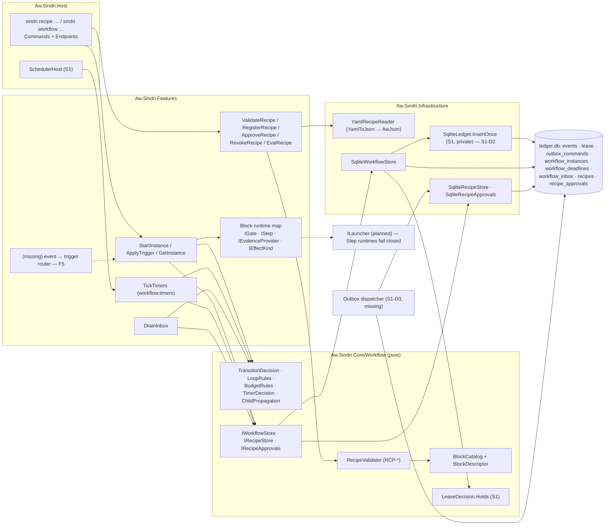
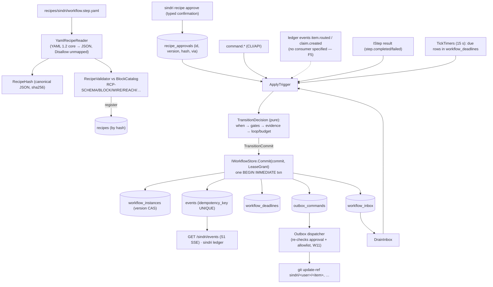

# Architecture Review: Sindri workflow engine (recipes, blocks, validator, engine)

_Reviewed by `/archReview` on 2026-10-10_

Target: `docs/superpowers/specs/2026-10-10-sindri-workflow-engine-design.md` (the doc, cited as `WE §n` / `WE:line`).
Checked against: factory addendum §17.20–17.21, §17.22 D2/D9/D10, §17.23.13, §17.28 (all), §17.29 (`A`); core design
§9.1–9.3 (`D`); `.agents/rules/csharp.md`, `.agents/rules/csharp-testing.md`, `docs/csharp/bugfix.md`; and the S1 app
shell on `.claude/worktrees/sindri-s1-app-shell` (read only): `Aw.Sindri.Core/{Ledger,Lease,Scheduling,Control}`,
`Infrastructure/Ledger/{SqliteLedger,LedgerDatabase,LedgerSql}.cs`, `Ledger/Migrations/*.sql`,
`Host/Server/SchedulerHost.cs`, `Core/Events/EventFactory.cs`, `src/Aw.Kernel/Outbox`, `src/Aw.Kernel.Data/SqliteOutbox.cs`.
Threat model: gates guard honest agent mistakes and at-least-once delivery, not adversarial agents (A §17.28.3).
No finding below depends on a hostile agent.

## Verdict: NEEDS WORK

The overall design is sound and fits the C# rules and S1's ports: a pure Core decision, one fenced transaction per
transition, deadlines as data, a closed recipe grammar, fail-closed blocks, and approval kept out of the file. Seven
HIGH findings drive the verdict, none of them structural to the layering. **F1/F2** (the idempotency key identifies the
instance's version, not the trigger, so a stale `step.completed` can be applied to a later round, and a refusal can
block the same transition for good); **F4** (nothing defines what happens after `workflow.refused`); **F5/F6** (no
component delivers external events to instances, and event outcomes are declared nowhere the validator can see, so
`workflow.item` can't validate or run as written); **F7** (one `resumeTo` slot can't hold a takeover of a parked
instance, which is §17.29.3's main path); **F8** (a child's resume, cancel or refused drain has no propagation path).
Each has a contained fix in the doc's own vocabulary. Scores: Complexity 3, Scalability 4, Maintainability 3.

## Scores

_Anchored 1–5 scale from `_shared/severity.md` (5 = no findings above LOW … 1 = CRITICAL or unaddressed)._

| Dimension | Score (1–5) | Notes |
|-----------|:---:|-------|
| Complexity | 3 | The layering is right-sized (descriptor-only validator, explicit catalog, one `Commit` port). But three key schemes coexist (W12 `fromVersion` key, "keyed by the deadline id" WE:252, "keyed by the child event's key" WE:265). Refusal, inbox retention and the resume model are underspecified (F1, F2, F4, F7, F8) |
| Scalability | 4 | One host, one SQLite writer, and a 15 s tick are fine for the P1 load. Only MEDIUM/LOW items: the shift is a cross-instance write (F9), and the due/inbox/item indexes aren't specified (F25) |
| Maintainability | 3 | The Core/Features/Infrastructure placement and the contract-test plan follow the rules. HIGH gaps in validator coverage (F6) and replayability of the event payload (F10) would make recipes fail at run time in ways the validator says it prevents |

## Component Diagram



## Data Flow Diagram



## Sequence Diagram

The most critical flow is `workflow.item` with its `workflow.step` child: start, the claim effect, the child parks,
the parent parks by propagation (the WE Phase 7 signal). Error paths are marked.

```mermaid
sequenceDiagram
  participant H as Human (sindri CLI)
  participant API as Host endpoint
  participant AT as ApplyTrigger
  participant TD as TransitionDecision
  participant WS as SqliteWorkflowStore.Commit
  participant DB as ledger.db
  participant D as Outbox dispatcher
  participant DI as DrainInbox
  H->>API: sindri workflow start workflow.item --item T-3
  API->>AT: StartInstance(recipe@hash, item, attempt)
  AT->>DB: read recipe_approvals (RCP-CAP-003)
  alt hash unapproved / revoked
    AT-->>H: SND-RECIPE-003 / -005
  end
  AT->>WS: Commit(started → triaged, grant)
  WS->>DB: lease Holds? · INSERT instance · INSERT event(key)
  Note over AT: item.routed arrives — who routes it to T-3? (F5)
  AT->>TD: wait.satisfied{outcome: startable} @v1
  TD->>TD: gate.route.startable
  alt gate fails
    TD-->>WS: workflow.refused @v1 (same key space as the transition — F2)
    Note over AT: instance stays in triaged; no defined next step (F4)
  end
  AT->>WS: Commit(triaged→startable, fromVersion=1)
  AT->>WS: Commit(startable→claimed + outbox effect.claim.ref)
  WS->>DB: CAS version · INSERT event · INSERT outbox_commands
  alt stale epoch / version
    WS-->>AT: StaleEpoch (SND-LEASE-003) / VersionConflict (SND-WF-002)
  end
  D->>DB: ReadPending → recheck approval → git update-ref (create-only)
  D->>DB: claim.created event
  AT->>WS: Commit(claimed→running + inbox row "start child workflow.step")
  DI->>WS: Commit(child: started → produce)
  Note over DI: step.produce runtime unavailable (W5)
  DI->>WS: Commit(child produce→parked(needs-answer), SND-WF-010) + inbox row → parent
  DI->>WS: Commit(parent running→parked(needs-answer, child ref)) keyed by child event key
  alt parent is taken-over / version moved
    Note over DI: drain refused — is the inbox row kept? (F8)
  end
  H->>API: sindri workflow status T-3
  API-->>H: parked (needs-answer, child workflow.step/…)
```

## Top Risks

| # | Risk | Impact | Likelihood | Mitigation |
|---|------|--------|------------|------------|
| 1 | A duplicate or late trigger (`step.completed` redelivered, an event replayed by an adapter) is applied to a later round, because the key comes from the instance's current version, not from the trigger (F1) | high | med | Key on the trigger's source id, and refuse triggers whose state-entry token isn't current |
| 2 | A refused transition blocks the same transition at that version for good, because refusals and transitions share one key space (F2) | high | med | A separate key prefix for refusals; the transition key never collides with one |
| 3 | `workflow.item` can't validate or run: event outcomes aren't declared anywhere (F6), and nothing delivers ledger events to instances (F5) | high | high | Event descriptors in the catalog, plus an event-intake service with a durable cursor and buffering |
| 4 | Instances strand after a refusal, a takeover of a parked item, a child resume or a refused drain, and recover only through a timeout that can be 2 to 7 days (F4, F7, F8) | high | high | Define the consequence of a refusal; give the resume state a stack; inbox rows on resume and cancel; keep a refused inbox row until it applies |
| 5 | Replay doesn't reproduce the row: the event payload lacks deadlines, facts and the park and resume fields, and the Phase 3 test re-decides instead of folding the recorded events (F10) | med | high | A separate `Apply(instance, event)` fold, and an integration test that the fold of the ledger equals the stored row |
| 6 | Phase signals that can't be produced as written: Phase 1 needs descriptors that arrive in Phase 2; Phases 5 and 6 use fixture blocks the production binary doesn't register (F16) | med | high | Move the step descriptors into Phase 1; add a dev block pack behind an explicit flag |

## Edge Case Matrix

Boundaries (the Step 3 named list): **B1** recipe reader + validator · **B2** recipe registry and approvals ·
**B3** `TransitionDecision` (pure engine) · **B4** `IWorkflowStore.Commit` ↔ S1 ledger and lease · **B5**
`workflow.timers` ↔ `SchedulerHost` · **B6** engine inbox / `DrainInbox` · **B7** outbox dispatcher · **B8** block
runtimes (`IGate`/`IStep`/`IEvidenceProvider`, `ILauncher` absent) · **B9** external event intake · **B10** Host
CLI/API.

| Boundary | Dependency unavailable | Invalid/malicious input | Load 10x | State leakage |
|---|---|---|---|---|
| B1 reader + validator | OK — unknown block refused, `RCP-BLOCK-001` (WE:327, W5 WE:24) | F6, F11, F12, F19 | OK — pure, descriptor-only validator (W1 WE:20); about 20 blocks | F23 |
| B2 registry + approvals | OK — start refused without an approved hash, `RCP-CAP-003` / `SND-RECIPE-003` (WE:205, WE:310) | F12 (same id+version, different hash, not refused) | OK — approvals keyed by `(id, version, hash)` (WE:193); small table | F12 (child recipe pinned by id, not hash) |
| B3 TransitionDecision | OK — unavailable gate runtime refuses, unavailable Step parks (W5 WE:24) | F1, F4, F12 (unmatched outcome, no `step.failed`) | OK — pure function over one row | F7 |
| B4 Commit ↔ ledger/lease | OK — stale epoch refused in-txn: `LeaseDecision.Holds` (S1 `LeaseDecision.cs`), read inside BEGIN IMMEDIATE (`SqliteUnitOfWork.Begin`, `SqliteLedger.Append`) | F2, F3, F17 (S1-D2: `InsertOnce` commits its own session, `SqliteLedger.cs:56`) | F25 (no `item` index on `events`; only `events_type_seq` in `0001_events.sql`) | OK — tenant and ring on every row (WE §5.1; `events.tenant/ring`, `0001_events.sql`) |
| B5 timers ↔ scheduler | OK — nothing runs without the lease (`SchedulerHost.ExecuteAsync`: `held.Current`); cadence 15 s accepted (`Cadence.Min = 5s`) | F9 (sleep vs downtime; shift key) | F9 (the shift is a bulk cross-instance write); F25 (`due` index) | F9 (the shift races a concurrent `Commit` that rewrites deadlines) |
| B6 inbox / DrainInbox | F8 (child start fails to drain → the parent waits for a child that doesn't exist; F15) | F8 (drain refused while the parent is taken-over: retention unspecified) | F25 (no pending index specified) | F8, F15 (instance id collides on re-entry) |
| B7 outbox dispatcher | F17 (S1-D3 status wrong: the table exists, the dispatcher doesn't); OK — retries and dead-letter (`OutboxRetryPolicy.Default`, `SqliteOutbox.MarkFailed`) | F13 (D9 "already exists" check turns our own claim into `claimExists`) | OK — `ReadPending(max)` bounded, pending index (`SqliteOutboxSchema`) | F21 (command id derivation unspecified) |
| B8 block runtimes | OK — fail closed with `SND-WF-010` (W5, WE:382) | F18 (the runtime map risks service location) | F20 (gate re-run on `VersionConflict` re-asks the judge) | F18 (captive scoped blocks in a singleton map) |
| B9 external event intake | F5 (no component) | F6 (event kinds and outcomes unvalidated) | F5 (no cursor or backpressure) | F5 (item→instance correlation undefined) |
| B10 Host CLI/API | F17 (S1-D6 partly met: SSE `/sindri/events` exists, no item filter) | OK — typed confirmation at a TTY, `SND-RECIPE-004` (WE:311, S1 `SND-PROFILE-004` precedent) | OK — loopback API, one host (A §17.29.2) | F24 (retry semantics of `SND-WF-002` for internal callers) |

### Findings

| id | severity | lens | location | finding | recommended fix |
|---|---|---|---|---|---|
| F1 | HIGH | correctness | W12 (WE:31), §5.3 | **The idempotency key identifies the instance's version, not the trigger.** The CAS on `version` already gives "one commit per `fromVersion`", so putting `fromVersion` in the key adds nothing for same-instance writes. It also loses the protection the key exists for (A §17.20: "retries and a second worker can't apply anything twice"). A trigger delivered at least once is re-read at the new version, gets a new key and passes the CAS. Concretely, in `workflow.step` a redelivered `step.completed` from `checks` (outcome `failed`, moving to `produce`) arrives while the instance is in `produce`. `produce`'s `step.completed → checks` has no `when`, so it applies: the new round skips `produce`, and `checks` runs on the previous `fact:output`. The same applies to a redelivered `claim.created`, or an inbox row drained twice under W12's key | Each trigger carries a **source id**: the ledger seq or event id of an external event, a step-run token issued at state entry, a command nonce, or a deadline id plus its arm version. Each instance records the **state-entry version** of its current state. The key becomes `wf:{instance}:{sourceId}`, and `TransitionDecision` refuses (SND-WF-003) a step result or deadline whose run or arm token isn't the current state entry's. Keep `fromVersion` in the CAS only. This also unifies the three key schemes in WE:31, WE:252 and WE:265 |
| F2 | HIGH | correctness | §5.2 `workflow.refused` (WE:234), W12 | A refusal is "keyed at the refused `fromVersion`" in what reads as the transition's key space (`wf:{instance}:{transition}:{sha}:{fromVersion}`). A refusal at v followed by the same transition passing at v (for example `gate.budget.available` refuses, then budget frees up) hits the existing key: `AlreadyApplied`, so the transition can never apply at that version | Refusals get their own key (`wf-refused:{instance}:{sourceId}`, per F1) and never share a key with an applied transition. A later attempt with a new source id is evaluated afresh |
| F3 | MEDIUM | correctness | §5.3 steps 2–3 (WE:243–244) | CAS runs before the key check, so a replay at a moved version returns `VersionConflict` (SND-WF-002, "re-read and retry"), not `AlreadyApplied`. `AlreadyApplied` is effectively unreachable for same-instance replays, and the Phase 4 signal (the cancel run twice records one event) passes while the second call reports a conflict | Check the key first (as S1's `InsertOnce` already does, `SELECT seq … WHERE idempotency_key`), then CAS. Add contract tests that a replay of a committed trigger returns `AlreadyApplied(sequence)` |
| F4 | HIGH | correctness | §3.4 last paragraph (WE:147–149), §3.7, W5 | **Nothing is defined after `workflow.refused`.** State and version are unchanged. In a `wait` state the satisfying event is consumed and won't come again. In an `active` state the Step has finished and nothing re-runs it. Either way the instance waits for its timeout (`triaged` 7d, `startable` 3d, `produce` 4h). `startable → claimed` refused by `gate.budget.available` also holds the granted slot, and contradicts §3.6 ("exhausting a budget is `→ parked(budget)`, never an error"). A refused transition from an unavailable gate runtime (W5) strands the same way | Give every refusal a defined consequence. The default: a rung-1 failure or an unavailable runtime parks with `needs-answer` (with the gate results in the park), a rung-2/3 below-threshold or uncertain result on the top rung escalates (invariant 4), and `gate.budget.*` parks with `budget`. Optionally allow a transition-level `onRefused: stay` only for `wait` states whose event can recur, enforced by a validator rule. Release resources granted to a refused `wait` |
| F5 | HIGH | completeness | §6.1 slices, Phase 7 | **No component delivers external events to instances.** `waitFor: { event: item.routed }` and `{ event: claim.created }` need a consumer that reads the ledger with a durable cursor, correlates an event to an instance (by item? by causation?), turns it into `wait.satisfied{outcome}` and handles events that arrive while the instance isn't in that wait (parked, taken over, still committing the effect). None of `ApplyTrigger`, `DrainInbox` or `TickTimers` does this, and the Phase 7 signal depends on it | Add an `EventIntake` scheduled service (or route it through the inbox): it consumes `ReadAfter(cursor)`, correlates by `item` plus the `causation` that names the instance's effect, writes inbox rows and keeps them until the instance can take them (see F8). Add its cursor table to the migrations and the slice to Phase 4 or Phase 6 |
| F6 | HIGH | validator | §3.5 (WE:155), §7 `RCP-WHEN-001`, WE:442–443 | `RCP-WHEN-001` accepts outcome names only from "the Step's descriptor (or a child recipe's terminal states)". A `wait` on `event: item.routed` with `when: { outcome: startable }` has no descriptor that declares `startable`/`notStartable`. WE:442 says the `effect.claim.ref` descriptor declares `created`/`claimExists`, but that is an effect on a different transition. Either `workflow.item` fails its own validator, or the rule is unenforced for `wait` states. `waitFor.event` kinds and `waitFor.answer` question ids aren't validated at all, so a misspelt event kind waits until its timeout, which W5's "nothing passes by default" doesn't cover | Add **event descriptors** to the catalog (`EventDescriptor(kind, outcomes, facts it carries)`, or `BlockKind.Event`), with rules `RCP-EVENT-001` (unknown event kind) and `RCP-WHEN-001` extended to the `wait` source. Resource waits declare no outcomes. Answers declare their question ids in the recipe |
| F7 | HIGH | data model | §5.1 `state, resumeTo, parkReason?`, §3.7, §5.4 | One `resumeTo` slot can't represent **takeover of a parked instance**. That is the main path of A §17.29.3 ("between steps, at a gate, parked: `sindri open <item>` … taken over until handback"). Taking over overwrites `resumeTo` (the park's target) and drops `parkReason`, so handback can't return to `parked(reason)` and then to the original state. The same goes for park during takeover, if that is allowed | Model the resume as a small stack, or give takeover its own tuple `takenOverFrom { state, resumeTo, parkReason, deadlines.remaining }`. State the allowed nesting (takeover over parked: yes; park over taken-over: no, refused). Add tests `Takeover_of_parked_hands_back_to_parked_with_its_reason` |
| F8 | HIGH | composition | §5.5 (WE:262–271), W16 | Child-to-parent propagation is incomplete. (a) Inbox rows are written only on a child's terminal, `parked` or `escalated` transition, yet WE:269 says "the child's resume brings the parent back": a resume writes no row, so the parent stays parked. (b) An answer to the *parent* resumes it to `running` while the child stays parked: the wait then lasts until the 2d timeout. (c) A **cancelled** child (cancelled directly) isn't in the propagation list, and isn't one of W6's outcomes. (d) A drain whose parent transition is refused (the parent is `taken-over`, or `VersionConflict`) has no retention rule. The doc doesn't say that consuming the inbox row is part of the parent's `Commit` | Write inbox rows on every child state change the parent cares about: terminal, `parked`, `resumed`, `escalated` and `cancelled`. Route an answer on a parent parked by propagation to the child, or refuse it with a pointer to the child. Delete or mark the inbox row inside the parent's `Commit`. A row the parent can't take now stays pending and is retried after handback; give it a dead-letter after N tries, surfaced in `status`. Add `cancelled` to the propagated cases |
| F9 | MEDIUM | timers | W14, §5.4 Sleep (WE:253–254) | (a) The shift moves deadlines on every instance outside the per-instance CAS. A concurrent `Commit` built at version v with the pre-shift deadlines writes them back (a lost update), because WE:245 writes "the deadlines" as state, not as deltas. (b) `workflow.deadlines.shifted` has no idempotency key, and the replay fold doesn't handle it. (c) "The gap since the last tick" can't tell a sleep from the process being down: Claude Code sessions in Warp keep running while Sindri is down, so a shift then is wrong. (d) A slow tick (GC, a busy SQLite) over 15 s triggers a shift | Apply the shift per instance through `Commit` (version bump, key `wf-shift:{instance}:{gapStart}`), or make `Commit` write deadline deltas (arm or clear by id) so the shift can't be overwritten. Detect sleep as wall-clock elapsed minus monotonic elapsed between ticks (the monotonic clock source on macOS has to exclude sleep: verify which `Stopwatch` uses), with a tolerance (gap > 2 × cadence). Treat process downtime as not a sleep. Persist the last-tick pair in the ledger. S1's `ServiceSchedule.Advance` already skips missed slots, so `ScheduledRun.Slot` alone isn't a gap measure |
| F10 | MEDIUM | replay | §5.2 payload (WE:233), §8 row 1 (WE:342) | "Replaying an event log reproduces the same instance" needs the event payload to carry everything the row holds. Missing: deadlines armed (`due` depends on `now`), facts written (`ref, sha256, headSha`), `parkReason`, `resumeTo` and the takeover tuple, and `headSha` changes. The Phase 3 test folds `TransitionDecision` over trigger sequences, which re-decides (and would re-run gates such as the judge) rather than replaying recorded events | Split `Decide(instance, trigger, blockResults) → TransitionCommit` from `Apply(instance, event) → instance`. The events carry the full delta. Unit: `Apply` over `Decide`'s output equals `Decide`'s new row. Integration (Phase 4): `fold(Apply, ledger.ReadAfter(0) for instance) == workflow_instances row` |
| F11 | MEDIUM | validator | W2, §2 wiring (WE:75–77), §3.4 `produces` | `produces` is a recipe-side claim that nothing at run time checks or backs. A recipe can declare `produces: [fact:x]` on a transition where no block outputs `x`, and W2 then passes a wiring that will refuse at run time: exactly the "latent runtime refusal" W2 exists to prevent (an honest authoring mistake). Also, the static check treats facts as permanent, while at run time they are invalidated when `headSha` changes (WE:223) | `produces` must be backed: a fact counts only if a block on that transition declares it as an output (the `from` state's Step outputs for `step.*`, gate and evidence outputs, or the event descriptor's facts, per F6). `RCP-WIRE-002` for an unbacked `produces`. At commit, refuse (SND-WF-0xx) when a declared fact wasn't registered. Document that wiring is necessary, not sufficient, under SHA invalidation |
| F12 | MEDIUM | validator | §7 table (WE:324–336) vs A §17.28.5 | The §17.28.5 bullets are all mapped; that part is good. Missing rules that matter for honest mistakes: (a) **outcome exhaustiveness and `step.failed`**: `workflow.step` has no `step.failed` transition and no rule demands one, so a Step failure strands until its timeout (4h); likewise a declared outcome with no matching transition. (b) **child recipe cycles** (`workflow.step` starting itself, or A→B→A). (c) **child pinning**: `child: { recipe: workflow.step }` names an id, not a hash, so a recipe frozen with a packet (A §17.28.1) doesn't freeze its child, and receipts can't name what ran. (d) a rung-2/3 gate with no `threshold`. (e) registering a different hash under an existing `(id, version)`. (f) `RCP-EXIT-001` should say it ignores the universal transitions | `RCP-EXHAUST-001` (every declared outcome of the `from` state's source, plus `step.failed`, matches a transition, or falls to an explicit universal default such as `parked(needs-answer)`); `RCP-CHILD-002` (no cycle in the child graph); child references resolve to `id@hash` at register, recorded in the parent's approval; `RCP-THRESH-002`; `SND-RECIPE-00x` on version reuse |
| F13 | MEDIUM | recipe | `workflow.item` `claimed` (WE:398), D9 | `claimed`'s `then: retry` re-enters the `wait` without re-emitting `effect.claim.ref`, which belongs to the incoming `startable → claimed` transition, so the retry waits for an event nobody will send, then parks. Separately, D9 has the dispatcher check "whether the effect already exists" before retrying. For a create-only ref, the instance's own first attempt then looks like `claimExists`, and the item is dropped | Either let `retry` re-run the entry transition's effects (with the same outbox ids, so it stays idempotent), or forbid `retry` on a `wait` fed by an effect (a validator rule). The claim ref's target or reflog names the instance id, so "exists and is mine" maps to `created`. State which repo the ref is created in (item → repo mapping) |
| F14 | MEDIUM | takeover | W15, §5.4, D §9.3 | D §9.3 requires an idle-takeover notification ("after `takeover.idleTimeout` (default 2 h) … needs-answer notification"). With deadlines paused, a forgotten takeover holds the instance (and its slot) forever. The design also doesn't say whether a takeover of a parent pauses its children | Add a `takeover` deadline kind (not paused by the takeover) that raises the needs-answer notification. Specify that takeover is per instance and children keep running, or that it cascades through the inbox |
| F15 | MEDIUM | composition | §5.5 bullet 1, §5.1 `id` | Starting the child via an inbox row means a failed drain (the child recipe is unapproved or revoked, `RCP-CAP-003`) leaves the parent waiting for a child that doesn't exist. The instance id `(recipe, item, attempt, parent)` also collides if the parent re-enters the child-wait state (future recipes: review rounds that start a child per round) | Insert the child row directly in the parent's `Commit`: an insert of a new row needs no CAS, so it doesn't break "one version per commit". Check the child's approval at the parent's decision time. Include the parent's state-entry version in the id derivation |
| F16 | MEDIUM | phasing | Phases 1, 5, 6, 7 | (a) The Phase 1 signal validates `workflow.step.yaml`, but `step.produce/checks/verify` descriptors are a Phase 2 deliverable ("the real descriptors…", WE:482), and `RCP-CHILD-001` needs a recipe store (Phase 2). (b) The Phase 5 and 6 signals use `step.fixture.*`/`effect.fixture.echo`, which live in `Aw.Sindri.Testing` and aren't registered in the production `sindri` binary. (c) The Phase 5 signal is inconsistent: a parked instance has its deadlines cleared (WE:258), so "taken-over … remaining 0:40" must be a second instance. (d) Phase 6 uses `sindri outbox list`, which isn't in the S1 dependency list. (e) Phase 7 is sized M but holds the inbox, drain, propagation, router and slot stubs, two gates, and F5's event intake: that is L | Move the step descriptors (data only) into Phase 1, and resolve children from `recipes/` files in Phase 1 or defer `RCP-CHILD-001` to Phase 2. Add a `dev` block pack, registered only under an explicit `--dev-blocks` or profile flag that the doctor reports, for the Phase 5/6 signals. Rewrite the Phase 5 signal with two instances. Add `outbox list` to S1-D3. Re-size Phase 7 as L or split it (7a inbox and children, 7b item lifecycle) |
| F17 | MEDIUM | S1 deps | §6.2 table (WE:286–294) | The table is partly out of date against the S1 branch. **S1-D3:** `outbox_commands` already exists in `ledger.db` (`LedgerDatabase.LoadMigrations` appends `SqliteOutboxSchema.CreateMigration`); only the dispatcher and the dispatch-time recheck hook are missing. **S1-D6:** `GET /sindri/events` (SSE over `ReadAfter`) exists; missing are an item filter, a `sindri ledger` verb and an `item` index. **S1-D7:** `actor` is set by `EventScope` (met), but `EventFactory.Entry` hardcodes `Item: null` and takes no `causation`, which the engine needs for item filtering and child propagation. **S1-D2:** `InsertOnce` calls `session.Commit` itself (`SqliteLedger.cs:56`), so the helper has to be split into a non-committing insert that returns `AlreadyRecorded`, with the caller rolling back | Correct the statuses, and add "EventFactory takes `item` and `causation`" as S1-D8. Spell S1-D2 as "a non-committing `TryInsert(ISqliteSession, entry, epoch) → Inserted(seq) \| Exists(seq)`" |
| F18 | MEDIUM | C# rules | §2 Registration (WE:72) | `runtime.Register(id, factory)` at run time means a singleton map that calls factories, which either service-locates (`ARCH-DI-001` allows `IServiceProvider` only inside `Add…()` registration lambdas) or captures scoped blocks in a singleton | Register each block runtime as an ordinary scoped service of its kind interface (`IGate`, …), each exposing its `BlockId`. The scoped `BlockRuntimes` takes `IEnumerable<IGate>` etc. by constructor injection and indexes them by id. The DI validation test then covers every block |
| F19 | MEDIUM | C# rules / schema | W19, §3 intro, §3.8 | The short and long forms (`block id \| { use, with }`, `evidence key \| { kind, at, expect }`) and the closed `when` union need custom STJ converters. `JsonSchemaExporter` can't describe a custom converter (it emits `{}`/`true` for it), so the "generated" schema would be permissive exactly where W3 wants it closed, and `JsonUnmappedMemberHandling.Disallow` doesn't apply inside a custom converter. §3.8's canonical JSON doesn't pin number and string canonicalization | Model the unions as records with a discriminator in the C# model and normalize short forms in the reader (YAML → long-form JSON), so the source-generated context and the exporter see plain records. Or hand-write the union fragments with a test that each fixture's schema verdict matches the reader's. Canonicalize with RFC 8785 (JCS) over the normalized long form, or keep the short/long distinction deliberately (WE:180), but state which |
| F20 | LOW | cost | §5.3, `docs/csharp/bugfix.md` judge-once | Gates run before `Commit`. A `VersionConflict` makes the caller re-read and re-run them, re-asking rung-2 judge questions (bugfix's "judge once per candidate") | Cache gate results per `(instance, sourceId, gate, headSha)` and record them in the refused or applied event |
| F21 | LOW | outbox | §5.3 step 4, D9 | Outbox command ids aren't derived. D9 wants the keys to include the event sequence | `OutboxCommand.Id = UUIDv5(transitionKey, effectIndex)`, with the event `seq` in the payload |
| F22 | LOW | model | W6, §3.7 | The closed outcome set has no `cancelled` or `escalated`, and `escalated` has no defined exit (terminal? answerable?), which receipts and the parent mapping (F8) need | Declare `cancelled` and `escalated` as engine terminal outcomes, or make `escalated` an answerable park-like state with a `resumeTo` |
| F23 | LOW | validator | `RCP-EFFECT-001` (WE:334) | Validation depends on the profile's allowlist, so the same hash validates differently under different profiles | Record the profile hash in the validation output and the approval. Dispatch already re-checks (W11) |
| F24 | LOW | ergonomics | `SND-WF-002` (WE:314) | Internal callers (timers, drain, intake) need a bounded re-read-and-retry policy, and the CLI's `--version` requirement needs a default (current) for human verbs | Specify a retry of 3 with re-decision for internal callers; CLI verbs default to the current version and print it |
| F25 | LOW | performance | §6.1 migrations | Indexes aren't specified: `workflow_deadlines(due) WHERE due IS NOT NULL`, `workflow_inbox(pending)`, `workflow_instances(item)`, and `events(item, seq)` for `sindri ledger --item` (only `events_type_seq` exists) | Name them in the migration plan |

## Missing Error Handling

- WE §3.4 / §5.2: what follows a `workflow.refused` (F4). No retry, no park, no resource release.
- WE §5.5: `DrainInbox` when the parent transition is refused or conflicts. Row retention and dead-lettering (F8).
- WE §5.5 bullet 1: a child start that fails at drain (unapproved or revoked child recipe) is never reported to the parent (F15).
- WE §10 `workflow.step`: no `step.failed` transitions, so a Step failure has no handling short of the 4h timeout (F12a).
- WE §5.4: a forgotten takeover has no idle notification (D §9.3) (F14).
- WE §5.3: a replay returns `VersionConflict` instead of `AlreadyApplied` (F3). Internal callers have no retry policy (F24).
- WE §6.2 S1-D2: the joint-transaction ledger insert has to signal "exists" without committing, and the caller has to roll back the CAS (F17).
- WE `workflow.item` `claimed`: a retry doesn't re-emit the effect it waits on (F13).

## Suggested Improvements (Prioritized)

_Severity per `_shared/severity.md` (legacy P0→CRITICAL, P1→HIGH)._

| Severity | Improvement | Effort | Impact |
|----------|------------|--------|--------|
| HIGH | Key transitions on the trigger's source id, with a state-entry token; separate the refusal keys; check the key before the CAS (F1, F2, F3) | S | Duplicate and late triggers become no-ops; one key scheme instead of three |
| HIGH | Define the refusal consequences: park or escalate by rung, `budget` parks, resource release (F4) | S | No instance strands for days after a gate says no |
| HIGH | Event descriptors in the catalog, plus an `EventIntake` service with cursor, correlation and buffering (F5, F6) | M | `workflow.item` validates and runs; misspelt event kinds fail validation |
| HIGH | A resume stack or takeover tuple; inbox rows on resume and cancel; inbox consumption inside the parent's `Commit`; the child row inserted in the parent's commit (F7, F8, F15) | M | §17.29.3's "open a parked item in Warp" and the propagation properties actually hold |
| MEDIUM | An `Apply` fold with full-delta events, and a fold(ledger)==row integration test (F10) | M | The replay property is tested for real, not by re-deciding |
| MEDIUM | Deadline deltas or a per-instance shift; monotonic-vs-wall sleep detection (F9) | S | No lost updates; downtime isn't treated as sleep |
| MEDIUM | Validator: backed `produces`, exhaustiveness and `step.failed`, child cycles and pinning by hash, threshold-required (F11, F12) | M | The validator catches the honest-mistake classes it claims to |
| MEDIUM | Re-cut the phases: descriptors in Phase 1, a dev block pack, the Phase 5 signal fixed, Phase 7 split or re-sized as L; fix the S1 dependency statuses (F16, F17) | S | Each phase's signal can be produced from the real binary |
| MEDIUM | A DI-injected block runtime map; record-modelled unions with JCS hashing (F18, F19) | S | Complies with `ARCH-DI-001`; the schema is actually closed |
| LOW | Gate result caching, outbox id derivation, outcome set, the profile hash in validation, retry policy, indexes (F20–F25) | S | Polish and cost |

verdict: NEEDS_WORK
