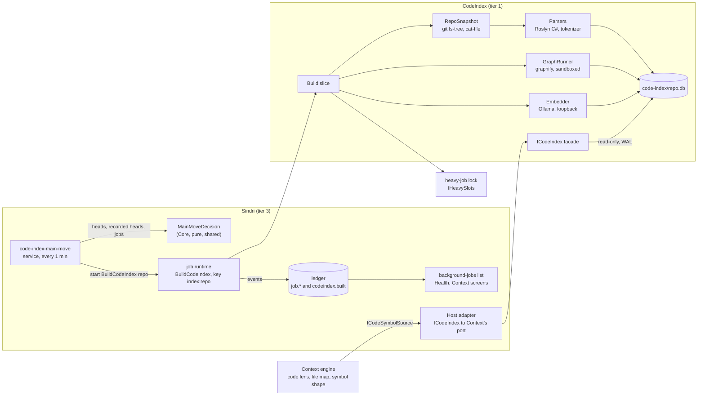

# The Sindri code index block: symbols, callers and callees, built in the background when main moves

**Status:** design, revision 2 (autoplan round 1), for the owner's review · **Date:** 2026-10-19 · **Owner decisions:** 2026-10-19 (§1: CI1, CI2,
CI4; the shared trigger is the owner's F1) · **Builds on:** the first Sindri design `2026-10-07-sindri-design.md` (D), §6.2
(the TypeScript index this replaces), the factory addendum `2026-10-09-sindri-factory-addendum.md` §17.29.4 step 4 (the code
index block is its own block), the context retrieval spec `2026-10-10-sindri-context-retrieval-design.md` (CTX), Phase 9 and
S-9, the scoping station spec `2026-10-15-sindri-scoping-station-design.md` (SC), C3, `index-not-built` and Q15, the API
surface spec `2026-10-10-sindri-api-surface-design.md` (API), the sandbox spec `2026-10-18-sindri-sandbox-design.md` (SB),
`docs/csharp/sindri-context.md`, `docs/csharp/sindri.md`, `docs/sindri/index.md` (what the TS index does today) ·
**Lane:** the ideas lane writes it; the context lane owns S-9 and the shared trigger; the API lane owns the job runtime ·
**Next:** the owner reads it and answers §15; then /specToProvenPR takes §14's phases to PRs.

## 0. Why

The scoping station's code lens cannot say who calls what. `GET /sindri/context/code` answers `callers` and `callees` with
`unavailable`, reason `index-not-built`, and the station records that as a limit (SC §5.1, C3). Context Phase 9 (S-9) wants
symbol-level `implements` links and an `symbols` column in the file map, and it is marked "blocked: the code index block"
(CTX phase table). The block has no C# build and no spec.

What exists is the TypeScript index (`sindri/src/index`, 3,356 lines, documented in `docs/sindri/index.md`). It is built by
hand with `sindri index build`, or by an hourly and a nightly launchd job. It parses only TypeScript and JavaScript, reads
the working tree, and its one graph, from graphify, is stored but read by nothing. Its freshness is a clock ("older than 24
hours is stale"), not a fact about the repo.

This spec rebuilds it as a Sindri block in idiomatic C#. It is not a translation (AGENTS.md, `.agents/rules/csharp.md`
"Porting a TS package"): the TS package tells us what the pieces are for (symbols, clones, dependencies, embeddings, a
graph, offline) and nothing about how. The owner's rule for how it runs (CI1) is the main change: **the owner never builds
it.** Sindri builds it in the background whenever a registered repo's main checkout moves, shows the job in the app, and the
rest of Sindri reads it.

## 1. Decisions

| # | Decision | Reason |
|---|---|---|
| CI1 | **The build is never a command the owner runs.** No `sindri index build`, no hourly or nightly timer. A built-in Sindri service ticks every minute and starts a background job when a profile repo's main checkout has moved (§6). `sindri services run code-index-main-move` stays as the generic "tick now" every service has; there is no build verb | Owner, 2026-10-19. A step the owner must remember is a step that is stale by Thursday |
| CI2 | **One trigger for everything built from main, not one per feature.** Whether "the head moved" is one pure function in `Aw.Sindri.Core/Scheduling/` (`MainMoveDecision`), shared by the context map's service and this one, with a job kind each. The index's kind is `BuildCodeIndex`, its service `code-index-main-move` | Owner's F1: the context lane is building the shared trigger now. Two copies of "did main move, back off, raise needs-you" would drift |
| CI3 | **A build reads git objects at one commit, never the working tree.** The inventory is `git ls-tree` at the recorded head; contents come from `git cat-file --batch`; graphify's snapshot is written from the same filtered inventory. The index says exactly which commit it describes. Git runs hardened (§5.1); graphify's snapshot is built from the same filtered file list, not a raw `git archive` (§5.5) | The TS index reads whatever is checked out, so "uncommitted work there becomes base data". The trigger is a commit; the data should be that commit |
| CI4 | **A new package, `CodeIndex`, tier 1, shape Core · Features · Infrastructure (no Host).** It is a sibling of `Context`, separable, with no Sindri imports. Sindri composes it (`compose` edge) and reaches it through `ICodeIndex` in `Aw.CodeIndex.Core`. Core and Features import only `Aw.Kernel` (ARCH-DIR-005), so everything Sindri-side comes in through ports the package owns: `IHeavyJobLock` (adapted over `IHeavySlots`, as `SindriHeavyJobLock` does for Context), `CodeIndexSettings` (its own record, built by Sindri from the profile's `index:` section), `IBodyScrubber` (implemented in Infrastructure over `Aw.Redaction`). The job request and result records (`BuildCodeIndexRequest`, which must implement `IJob<TResult>`) and the `BuildCodeIndexService` wrapper that calls `ICodeIndex` live in `Aw.Sindri.Features`, the way Context's job records do. Infrastructure sets `AwAotCompatible=false` with its reason (Roslyn is not trim-safe; precedent `Aw.Sindri.Workflows.csproj`), and the Roslyn package gets its own pin comment (today's pin is the analyzer API, referenced only by `Aw.Analyzers`) `Context` does not reference it: S-9 adds a port to Context's Core and Sindri's Host adapts the facade to it, as it does for the labeler's model port (`deps.yaml`, "the labeler's model port") | Owner, 2026-10-19 (a block). Tier-1 packages cannot reference each other (project edges point strictly down), and the port keeps both separable |
| CI5 | **Per-repo jobs.** The service starts one `BuildCodeIndex` job per moved repo, key `index:<repo>`, so one repo's failure never holds back another's head, and the jobs list reads "code index · repo · commit" | A single job over many repos has to be Failed or Succeeded as a whole, and the trigger compares against the newest Succeeded job |
| CI6 | **Dependencies are local and pinned, installed by `setup.sh`, only checked by the build.** graphify at an exact version with an `--exclude-newer` date, the Ollama embedding model by name and digest; both pins in `context/code-index.lock` (same shape and check script style as `context/onyx.lock`). The service never installs, pulls or downloads; a missing piece makes that layer `unavailable` with a fix line | The owner never runs `index setup` either (CI1), and a background job that downloads is a supply-chain hole |
| CI7 | **Layers fail alone.** Structure, clones and deps are in-process and always built. Graph and embeddings are optional: when either is missing, pinned wrongly, over its cap or fails, its layer is `unavailable` with a code and reason and the job still Succeeds. Only a failure that leaves no usable index (git unreadable, store damaged beyond rebuild) fails the job | Same rule as the TS index, and the callers/callees consumers need structure and the call edges, not vectors |
| CI8 | **Reads never wait for a build.** A build writes a new database file under a new name and publishes it by atomically replacing a small pointer file (§4.1); readers open the file the pointer names read-only, and never see a path reused under them, so they see the whole old index or the whole new one. The index keeps one commit per repo (§4.3) | A build of a big repo takes minutes under the heavy-job lock; the station's gather step must not stall on it |
| CI9 | **Repo text is untrusted, always.** Names, signatures, paths and bodies are fenced and escaped on the way out; bodies are scrubbed (`Aw.Redaction`) before they are stored; deny globs are enforced at ingest and again at read. Agent sessions read through the same repo scope as the context lenses | CTX §7 egress rules; the TS index's `<untrusted>` fence |
| CI10 | **No byte or state compatibility with the TS index.** New schema, new files under a new directory, no migration; the TS index keeps running until the switch and the two never share a file | AGENTS.md "C# build"; the owner's rule for every port |
| CI12 | **Roslyn parses untrusted text inside the host, so it is bounded.** Every syntax walker checks `RuntimeHelpers.EnsureSufficientExecutionStack()` and a depth cap, a file's parse has a time limit, and the parse runs on a thread with a fixed large stack; a file that trips any of them is stored as `parsed = 0` and counted `too-deep`, never an error. A stack overflow cannot be caught in .NET and a thread cannot be aborted, so the build writes the blob id it is about to parse to `<repo>.inflight` before each file and deletes it after; a start that finds one appends that blob id to the durable `<repo>.quarantine` list (fsynced, kept until the blob is no longer in the head, not cleared by a parser-id change, capped at 100 entries with a count in the structure layer's note) and parses it as `parsed = 0`, `too-deep`, so two hostile files in one repo, a build that never publishes, and an out-of-memory kill that was not the file's fault all still converge instead of crash-looping on the 1-minute tick. `<repo>.building` is reset at the start of every build. **Gate:** the CI-4 PR does not merge unless the hostile-parse fixtures (CI-0c: a 100,000-term `a+b+...`, deeply nested parentheses and generics) pass under these guards in the host; if they cannot, a child-worker unit CI-4b is added to the plan and CI-6 waits for it (the owner is told in the PR) | Security review of round 1: one hostile file must not stop `serve` or crash-loop on the 1-minute tick |
| CI11 | **Shape signals, the pre-commit overlay, the spool and `evolve`'s identifier gate are not part of this block.** They are consumers of an index and are their own work; the block exposes `Similar` (§7) so they can be rebuilt on it | They are record-only today and bound to the frozen hook contract (spec §4c). Mixing them in would make this spec the size of the TS package |

## 2. Goals, non-goals, anti-goals

**Goals**
- Callers and callees of a symbol, and the symbols a file defines, answered from an index of the commit that is on the
  default branch in each registered repo, with the commit named in the answer.
- Built with no owner action: first build after a repo is registered and approved, then a new build per new main commit.
- Visible: each build is a ledger-recorded job in the app's background-jobs list; each repo's index shows its commit, age
  and layer states in Health and in the Context screens.
- Offline. Code goes only to a process on this machine; graphify has no network; Ollama is on loopback.
- Honest about confidence: a call edge says whether it came from syntax or from graphify, and how sure it is. "Unknown
  callers" is never shown as "no callers".
- Sized for the owner's repos: a first build of a 200 MB tracked tree finishes in the background without holding more than
  one heavy-job slot, and a build after one merge touches only the changed files.

**Targets** (measured and reported, not gated; a miss goes to the owner, nothing happens automatically)

| Measure | Target |
|---|---|
| First build of this repo's C# (structure layer) | under 10 minutes, one heavy slot |
| Build after one merge (structure) | under 1 minute |
| A quiet 1-minute tick | under 200 ms per repo, no parsing |
| Time from a commit on main to a published index | under 2 minutes after the tick plus the build |
| Call sites left unresolved / left ambiguous | shown on Health per repo; no cut-off until the quality probe has numbers |
| `callers` / `callees` precision and recall (50 hand-marked pairs) | reported from CI-4 on; the owner decides from them (Q3) |

**Non-goals**
- Semantic call resolution through the compiler (Roslyn `SemanticModel`, `dotnet build` of the target repo). The build never
  restores, builds or runs the indexed repo's code (§9, anti-goals).
- A history of past indexes: one commit per repo (§4.3). An as-of read of an older map version is answered with the current
  index, marked `stale`, never silently (§7.3).
- Shape signals, the pre-commit overlay, the spool, evolve's identifier gate (CI11); the bare mirror; `sindri repo onboard`.
- A search UI of its own. The surfaces are the existing ones (§10).
- Cross-repo callers. Edges stay inside one repo; a call into another repo's package is a dependency row, not an edge.

**Anti-goals** (a failure even if it works)
- A build that runs because the owner typed something, or one that never runs because the owner didn't.
- Any request that leaves the machine: a non-loopback embedding URL, a cloud model, graphify with a network, a redirect followed.
- A symbol body, path or name in a ledger payload, a log line, a job progress line or an error message. Counts, shas, repo
  names and codes only.
- A build that changes the indexed repo: no checkout, no `git fetch`, no `git gc`, no file written under the repo.
- A build that starts from a branch the default branch does not contain.
- Two builds of one repo at once, or a build that holds a heavy-job slot while it waits for another.

## 3. Terms

- **Registered repo:** a repo in the approved profile, with its main checkout path (`repos[*].path`).
- **Head:** the commit `HEAD` of that checkout names. **Default branch:** the first of `origin/HEAD`'s target, `main`,
  `master` that exists as a local ref (no fetch). A head is **on main** when it is the default branch's tip or one of its ancestors.
- **The shared trigger:** CI2 and §6.
- **Layer:** one kind of data in an index: `structure`, `clones`, `deps` (always), `graph`, `embeddings` (optional).
- **Symbol:** a function, method, constructor, property accessor, local function, lambda that is assigned a name, class,
  record, struct, interface or enum, with a stable **ref**: `<repo>:<path>#<qualified name>[/<arity>][@<h>]`, where `@<h>` is
  the first 4 hex digits of the hash of the parameter-type text and separates same-name overloads in one file (equal
  hashes in one file take `-2`, `-3` by order). A ref survives edits to other overloads; it does not survive a signature
  change, and consumers must not store refs across commits.
- **Edge:** a directed `calls` or `inherits` relation (imports are the deps layer; containment is the qualified name) between two symbols or a symbol and an external
  name, with a **basis** (`syntax` or `graphify`) and a **confidence** (`certain`, `likely`, `ambiguous`, `unresolved`).
- **Build report:** the counts and layer states a build returns; the job's result.

## 4. What is stored

### 4.1 Where

One SQLite file per repo, `$AW_SINDRI_HOME/code-index/<repo>.db` (mode 0600, directory 0700), opened through
`Aw.Kernel.Data` with `Microsoft.Data.Sqlite`, foreign keys on; the build file is written in WAL (the factory forces it) and
converted before publishing, below. A build writes a new file `<repo>.<ulid>.db`, copying the
current one first when it is an incremental build, and publishes it by writing the new name to `<repo>.current.tmp` and
renaming that over the pointer file `<repo>.current` (a one-line text file, the only thing ever replaced; this also works
where a database file cannot be renamed over while open). An incremental build runs `PRAGMA quick_check(1)` on the file it is about to copy; a failure there is `SND-CODEIDX-010` and the build starts from scratch. Before publishing, the build runs `PRAGMA quick_check(1)`,
`wal_checkpoint(TRUNCATE)`, `journal_mode=DELETE`, closes, and deletes any `-wal` and `-shm` beside it, so a published file
is immutable and has no sidecars. Readers read the pointer, then open that file `mode=ro`; a missing pointer is "no index".
Superseded files and leftovers matching exactly `<repo>\.[0-9A-HJKMNP-TV-Z]{26}\.db(-wal|-shm)?` (and no looser glob, since a repo may be called `a.b`) are deleted when no pointer names them, they are not the build file the running build
recorded in `<repo>.building`, and they are older than 10 minutes (readers hold a file only for one call), at the start and end of each build; the heavy lock means no two builds of a repo run. Files are
created 0600 explicitly. A repo name is `[A-Za-z0-9_-][A-Za-z0-9._-]{0,63}` (no leading dot; refused otherwise, `SND-CODEIDX-001`) before it goes into any file name,
and the pointer is opened without following symlinks and must match a ULID, else the index is `damaged`. An incremental build and an
embeddings continuation each copy the current file once (the cost of immutable files; a large index is hundreds of MB).
The index is derived data: a different `user_version` is rebuilt from scratch, never migrated (CI10).

### 4.2 Schema (version 1)

```sql
CREATE TABLE meta   (key TEXT PRIMARY KEY, value TEXT NOT NULL);         -- commit, default_branch, built_at, schema, parser_id, lock_sha
CREATE TABLE layers (layer TEXT PRIMARY KEY, stamp TEXT NOT NULL, status TEXT NOT NULL,      -- ok | unavailable | disabled | pending
                     code TEXT NULL, detail TEXT NOT NULL, built_at TEXT NOT NULL);
CREATE TABLE files  (path TEXT PRIMARY KEY, blob TEXT NOT NULL, size INTEGER NOT NULL,       -- blob: the git object id, so "changed" costs no hashing
                     lang TEXT NOT NULL, parsed INTEGER NOT NULL);                            -- parsed: 0 when only graphify or deps read it
CREATE TABLE symbols (
  id INTEGER PRIMARY KEY, file TEXT NOT NULL REFERENCES files(path) ON DELETE CASCADE,
  ref TEXT NOT NULL UNIQUE, name TEXT NOT NULL, qualified TEXT NOT NULL, kind TEXT NOT NULL, arity INTEGER NOT NULL,
  start_line INTEGER NOT NULL, end_line INTEGER NOT NULL, exported INTEGER NOT NULL, utility INTEGER NOT NULL,
  signature TEXT NOT NULL,                                                            -- scrubbed and cut at 400 characters
  shape_hash TEXT NOT NULL, token_count INTEGER NOT NULL, complexity INTEGER NOT NULL,
  minhash BLOB NULL);                                                                         -- null under 30 tokens; such symbols have no clone rows (a tiny getter would make a huge exact-clone group)
CREATE INDEX symbols_name ON symbols(name); CREATE INDEX symbols_file ON symbols(file); CREATE INDEX symbols_shape ON symbols(shape_hash);
CREATE TABLE edges (
  src INTEGER NOT NULL REFERENCES symbols(id) ON DELETE CASCADE,
  dst INTEGER NULL REFERENCES symbols(id) ON DELETE SET NULL,                                 -- null: the callee is not in this repo or not resolved
  dst_name TEXT NOT NULL,                                                                     -- always kept, so an unresolved call still reads
  kind TEXT NOT NULL, basis TEXT NOT NULL, confidence TEXT NOT NULL, line INTEGER NOT NULL,
  candidates INTEGER NOT NULL);                                                               -- how many symbols the name matched, kept even when only 8 edges are
CREATE UNIQUE INDEX edges_uq ON edges(src, dst_name, kind, basis, line, IFNULL(dst, 0));   -- NULL dst included; writes are INSERT OR IGNORE (two identical calls on one line are one edge)
CREATE TABLE call_sites (                                                                      -- raw syntax calls, so edges can be re-resolved without re-parsing
  src INTEGER NOT NULL REFERENCES symbols(id) ON DELETE CASCADE, kind TEXT NOT NULL,         -- calls | inherits
  name TEXT NOT NULL, arity INTEGER NOT NULL, receiver TEXT NOT NULL, line INTEGER NOT NULL);                                              -- receiver: this | base | type:<name> | other
CREATE INDEX call_sites_name ON call_sites(name);
CREATE INDEX edges_src ON edges(src); CREATE INDEX edges_dst ON edges(dst); CREATE INDEX edges_name ON edges(dst_name);
CREATE TABLE bands  (key TEXT NOT NULL, symbol_id INTEGER NOT NULL REFERENCES symbols(id) ON DELETE CASCADE,
                      PRIMARY KEY (key, symbol_id));                                          -- 64 hashes, 16 bands of 4 rows; near clone: estimated Jaccard >= 0.8, at least 30 tokens
CREATE INDEX bands_key ON bands(key);
CREATE TABLE deps   (manifest TEXT NOT NULL, name TEXT NOT NULL, version TEXT NOT NULL, kind TEXT NOT NULL, tags TEXT NOT NULL,
                     PRIMARY KEY (manifest, name));                                          -- package.json, *.csproj, Directory.Packages.props
CREATE TABLE bodies (symbol_id INTEGER PRIMARY KEY REFERENCES symbols(id) ON DELETE CASCADE, text TEXT NOT NULL);   -- scrubbed; dropped once embedded
CREATE TABLE embeddings (symbol_id INTEGER PRIMARY KEY REFERENCES symbols(id) ON DELETE CASCADE, model TEXT NOT NULL, vector BLOB NOT NULL);
CREATE TABLE graph_nodes (id TEXT PRIMARY KEY, file TEXT NULL, name TEXT NULL, line INTEGER NULL, community INTEGER NULL);
CREATE TABLE graph_edges (src TEXT NOT NULL, dst TEXT NOT NULL, relation TEXT NOT NULL, confidence TEXT NOT NULL);
```

The `edges` rows with `basis = syntax` are rebuilt from `call_sites` after every structure write, and the `basis = graphify` rows are added in the same build right after the graph layer runs (§5.7 order: structure, graph, resolve and merge), from `graph_nodes` and `graph_edges`, which are emptied at the start of every build and refilled by that build's graphify run; when the graph layer is not `ok` they stay empty and no stale graph edge is ever served (one set-based pass over all call sites, so a callee that
moved, appeared or vanished in a changed file corrects the edges of callers in files that were not re-parsed); an edge
whose `dst` was set null by a cascade is re-resolved, never left `certain`. `bodies` is a separate table so no read path loads text by accident, and so the text can be dropped once the embeddings layer
has used it (§15 Q7). `graph_nodes` and `graph_edges` keep graphify's output as it came, trimmed to the fields below; the
`edges` table holds the merged, resolved view that callers/callees read (§5.4).

### 4.3 One commit

`meta.commit` is the 40-hex commit the index describes. A build of a new head replaces the index; it does not keep the old
one. So an as-of read (a map version's commit that is not the index's) gets the current index with `commit` in the answer and
`stale: true` when they differ; the context lane decides how to label that (§7.3). Keeping several commits is a later
change to §4.2, not a reason to design for it now. The published file's commit is also the only place a recorded head is
read from (§6.2), never a job result.

## 5. Components and data flow



### 5.1 The snapshot (`RepoSnapshot`, Infrastructure)

For repo path P and commit C: `git -C P ls-tree -r -z --full-tree C` gives mode, type, blob id, size (`--long`) and path. The
snapshot keeps regular files only (mode 100644 and 100755); symlinks (120000) and submodules (160000) are skipped and
counted. A path that matches a deny glob (the built-in secret globs, then the profile's `index.denyPaths`, then the repo's;
case-insensitive; additions only, as in the TS index) is skipped as `denied`, a file over `index.maxFileKB` as `too-large`.
The sum of kept sizes over `index.maxTotalMB` stops the build with `SND-CODEIDX-003` before any content is read. Contents
come from one long-lived `git cat-file --batch` process per build, fed blob ids; no file is read from the working tree, so
there is no symlink or race to defend against, and a path swapped after the commit does not matter. The git calls clear the
environment variables `GIT_DIR`, `GIT_WORK_TREE`, `GIT_INDEX_FILE`, `GIT_OBJECT_DIRECTORY`, `GIT_ALTERNATE_OBJECT_DIRECTORIES`, `GIT_NAMESPACE`, `GIT_CEILING_DIRECTORIES`, `GIT_COMMON_DIR` and every `GIT_CONFIG_*` the way `Aw.Context.Infrastructure.Git.GitCli` does (that class is
`internal` to Context, so CodeIndex has its own thin copy with a shared contract test), and add: `GIT_OPTIONAL_LOCKS=0` (no index lock
in the owner's checkout), `--no-replace-objects` (a replace ref in the repo must not swap what a blob id means),
`-c protocol.allow=never` plus `GIT_NO_LAZY_FETCH=1` where git knows it (git 2.44 and later; this box has 2.43, which ignores it, so `protocol.allow=never` is the guard and a contract test with a promisor-repo fixture proves a missing blob is a `missing` skip and a layer note, never a network fetch),
`GIT_CONFIG_NOSYSTEM=1`, `GIT_CONFIG_GLOBAL=/dev/null`, `-c core.fsmonitor=false -c core.hooksPath=/dev/null`, and never
`safe.directory=*`; a repo git refuses as unsafe is `SND-CODEIDX-002`. Roslyn's depth and time guards are CI12. Every path from `ls-tree` is validated at inventory: a component that is empty, `..`, `.git` (any case), contains a backslash or NUL, or an absolute path is skipped as `unsafe-path`, and every write of the graphify snapshot asserts the resolved path is under the snapshot root. Fixed ceilings live in `CodeIndexRules`: 100,000 files, 5,000 symbols and 20,000 call sites per file, a 2 GB index file, a 2-hour build; passing one fails that file or the build with a count, never a hang.

### 5.2 Incremental planning (`BuildPlanner`, Core, pure)

Inputs: the snapshot's `(path, blob)` list, the live index's `files` rows, the **structure stamp**, and each layer's
stamp. Output: files to parse, files to drop, and per layer whether it is current. The structure stamp is
`parser_id + sha8(utilityGlobs, scrub.extraPatterns)`: a new parser version, new utility globs or a new scrub pattern
re-parses everything, because they change stored rows. A file is re-parsed when its blob id differs. Call edges are not planned here: they are re-resolved from `call_sites` for the whole repo after every structure write (§4.2),
so an unchanged caller is always right. The graph layer's stamp includes the commit: graphify runs on the whole snapshot
each build, so "touches only the changed files" holds for structure, clones and deps, and the graph layer is the cost of every
build. The planner is a pure
function with a table of cases; the TS `writeStructure` has the same idea, written here as data in and plan out.

### 5.3 Parsers (`ISymbolParser`, one per language)

- **`CSharpParser`** (Infrastructure, Roslyn `Microsoft.CodeAnalysis.CSharp`, already pinned in `Directory.Packages.props`):
  syntax only, no compilation and no references. It yields symbols with their span, signature text, exported flag
  (`public` or `protected` on a visible type), cyclomatic complexity (decision nodes plus short-circuit operators), the
  normalized shape hash (node kinds, identifiers and literals blanked), the token list for MinHash, base types (as `inherits` edges), and call sites
  (`InvocationExpression`, `ObjectCreationExpression`, `ConditionalAccess`, method group conversions) as
  `(name, arity, receiver, line)` into `call_sites`.
- **`TokenParser`** (Core, pure): for any other source file (`ts tsx js mjs py go rs java kt rb php c cc cpp h swift`) it
  yields no symbols itself. Those files' symbols and edges come from graphify (§5.5), because a lexical symbol finder
  would be worse than the tree-sitter one graphify already runs. The tokenizer is still used for the clones layer on the
  symbols graphify names, using their line spans.
- A parser is chosen by file extension through a table in Core. For a language only graphify covers, callers and callees
  exist only if the CI-0d spike shows the pinned graphify emits call edges for it (§5.5, §15 Q1); otherwise they are
  `unavailable` for that language and say so, never an empty list. Adding a language is one parser plus one table row.

### 5.4 Resolving calls (`CallResolver`, Core, pure)

Syntax gives `(caller, name, arity, line)`. The resolver looks the name up in the repo's symbols:
exactly one candidate of that arity gives `certain` when the call is on `this`, an unqualified name in the same type, or a
type name that matches the candidate's container, and `likely` otherwise; several candidates give one `ambiguous` edge per
candidate, ranked by closeness (same file, then same namespace, then same project directory (the nearest manifest), then path order; all derivable from stored rows;
at most 8; `candidates` keeps the true count, so `Handle` with 300 matches reads "1 of 300", not a guess); none gives an `unresolved` edge with `dst = NULL`
(a call into a library, or generated code). Graphify edges (§5.5) are merged in as `basis = graphify`, never replacing a
syntax edge for the same pair. `Callers` can follow `inherits` edges from an interface or base member to its implementations when asked (`includeImplementations`), because dispatch through an interface is the common case in this repo. A reader asking for callers gets the confidence with every row and a count of unresolved
callees of the symbol, so the caller can tell "no callers" from "unknown".

### 5.5 Graph layer (`IGraphRunner`, Infrastructure)

graphify runs on a snapshot of the commit written from the filtered inventory of §5.1 (so the index's deny globs apply and
`export-ignore` does not change what is read) into a temp directory (the same shape as
`Aw.Context.Infrastructure.Extract.GraphifySnapshot`, which is `internal` to Context, so this is a copy kept honest by a shared contract test: files copied under the file and total caps, the reserved
`graphify-out/` and `.sindri-tmp*` paths never copied), with `extract <dir> --code-only --no-viz`, a private temp and cache
directory inside the snapshot, a cleaned environment, a time limit, and at most 64 KB kept from each output stream. It runs
only under a sandbox that denies the network and confines writes to the snapshot (bubblewrap on Linux,
`sandbox-exec` on macOS, absolute paths, root-owned, never from `PATH`); with none, the layer is `unavailable`
`SND-CODEIDX-007` and graphify never runs unsandboxed. `graph.json` is size-capped (`index.graph.maxMB`) and read with a streaming reader that stops at the node and edge caps, read as a regular
file through no symlink, parsed with `System.Text.Json` into a strict DTO (anything unexpected is `SND-CODEIDX-008`), and
treated as untrusted. Nodes with a file and line are matched to `symbols` by file and the enclosing span; an unmatched node
becomes a `symbols` row of kind `graph-symbol` (ref as §3, `signature` empty, `end_line` = its line, no clone rows) when graphify's file is a
language no parser covers (every language but C#). Node ids and files are kept only if the file is in the snapshot's
file list; names are scrubbed and cut like signatures. `graph.json` also has node and edge caps
(`index.graph.maxNodes` 500,000, edges four times that; over either is `SND-CODEIDX-008`). graphify runs with a memory limit
(`RLIMIT_AS`) as well as the time limit. The spec does not guess graphify's output: **the CI-0d spike runs the pinned graphify on a
small TypeScript and Python fixture, records the real `graph.json` as a test fixture, and writes the DTO field names, whether
there are call edges, whether nodes have end lines and the confidence words into this section before CI-7 starts** (the
repo's current graphify fixture is synthetic; `docs/sindri/index.md`). Call edges become
`edges` rows with `basis = graphify`. Community ids are stored on the nodes for the day Context's cluster source reads them
(§15 Q2). The version is checked against the pin in `context/code-index.lock` before every run (`SND-CODEIDX-009`).

### 5.6 Embeddings layer (`IEmbedder`, Infrastructure)

`POST {url}/api/embed` through a `SocketsHttpHandler` with `UseProxy = false` and `AllowAutoRedirect = false`, on the profile's URL, which must be `127.0.0.1` or `[::1]` with no credentials (never `localhost`:
it can resolve elsewhere) and not a model whose name contains `cloud`; redirects are errors; a bad URL or model is
`SND-CODEIDX-005`. The model must be present with the pinned digest (`/api/tags`), else the layer is `unavailable`
`SND-CODEIDX-009`. Texts are `name + scrubbed signature + scrubbed body`, cut at 2,000 characters, in batches of 32, written to the
store as each batch returns. At most 4,096 symbols are embedded per build (a first build of a big repo finishes over
several builds: `pending`, "N of M embedded", and the service schedules a continuation, §6.3). The
embedding step skips `class`-like symbols, as the TS index does. Nothing in the unit lane talks to Ollama (§11).

### 5.7 The build slice (`BuildCodeIndex`, Features)

1. Take a heavy slot (`IHeavySlots`, holder `sindri code-index:<repo>`), waiting up to 10 minutes; busy past that ends the job `Succeeded` with `deferred: heavy-busy` and no commit (§6.3 throttles the retry),
   never Failed: lane gates hold slots by design, and a busy box must not raise the owner's needs-you row. `SND-CODEIDX-004` is the result's code.
2. Snapshot at the requested commit (re-checked: it must still be on main; a head that left main since the tick is a
   `Succeeded` job with `skipped: not-on-main` and no change).
3. Plan, parse, write structure, call sites, clones and deps into the build file in one transaction per 200 files, reporting a
   progress line each time (`structure 1,400 of 3,100 files`; counts only).
4. Graph layer (it empties and refills the graph tables), then resolve: one set-based pass builds the syntax edges from `call_sites` and merges the graphify edges; then the embeddings layer. Each layer is in its own try; failure becomes layer status.
5. Write `meta`, check, convert and close the file, switch the pointer (§4.1), append `codeindex.built` (§8). `result.commit` is set
only when an index at that commit was published, else null.
Cancellation is honored between files and between batches; a cancelled build deletes its build file and leaves the live
index alone. The slot is released in a `finally`.

## 6. The background trigger

### 6.1 The shared pure function

```csharp
// Aw.Sindri.Core/Scheduling/MainMoveDecision.cs — one decision for every kind built from main (CI2, owner F1)
public static MainMoveAction Decide(
    string? head,                  // this repo's checkout HEAD, null when it is not on the default branch
    string? recordedHead,          // the commit the kind's own stored state says it built; null: none
    bool running,                  // a job of this kind and key is Running
    IReadOnlyList<MainMoveAttempt> finishedNewestFirst,   // this key's ended jobs: Failed?, EndedAt
    DateTimeOffset now);           // -> Nothing | JobRunning | BackoffNotDue | Start
```

It is the `SyncGapDecision` pattern: a moved head (a head that differs from the recorded one, or with none recorded) with nothing running starts a job; after N failed jobs in a row the next one waits 5, 10, 20, 40, then 60
minutes from the newest failure (`MainMoveDecision.Wait` is `SyncGapDecision.Wait`); any other ending resets the count.
The context lane writes it and its tests first (owner F1); this spec uses whatever signature it lands with, and the index
adds no variant of its own. One thing is asked of that signature (round 1 finding, to settle with the context lane before
they merge): the decision is **per repo and per key**, called once per repo with that repo's recorded head and that
key's attempts, because `SyncGapDecision` is global and one repo's failures must not back off another (CI5); a test with
two repos, one in backoff, is part of its suite. If it lands set-based, the index's service calls it once per repo with a
one-entry set. Reading heads is also shared (`IRepoHeads`: `git rev-parse HEAD`, then `git merge-base
--is-ancestor HEAD <default>` against **local refs only**, no fetch, and the default branch found as `origin/HEAD`'s target,
else `main`, else `master`). A repo whose checkout is on a branch main does not contain is not in `heads`, so it is never
indexed from a feature branch, and the Health row says why ("checkout is not on main").

### 6.2 The service

`code-index-main-move` is an `IScheduledService` registered as a `BuiltInService` with `Cadence` 1 minute (a profile
`services:` entry of the same name overrides the cadence, as for `context-sync-gaps`). One tick:

1. Scope: no approved profile is a quiet run (not a failed run).
2. Heads: `IRepoHeads` for the profile's repos (a few `git` calls per repo; nothing is built or parsed on a quiet tick).
3. Recorded heads: **`ICodeIndex.Heads` is authoritative** (the pointer and file header, no git: a few small reads); `view_code_index` is for display only, so a stalled projector can never cause a rebuild of the same commit. A missing, damaged or `user_version`-mismatched index counts as no recorded head, so a deleted file rebuilds. Attempts: the newest 10 ended jobs of the key per repo (a bounded read by key and kind, never the whole list), fed to `Decide` for backoff and to `IndexContinuationDecision` (§6.3).
4. For each repo: `MainMoveDecision.Decide(...)`; on `Start`, run the `BuildCodeIndexRequest(repo, commit)` command chain as
   `service:code-index-main-move` (gate, audit, authorization, `command.handled`; never the runner directly). `SND-JOB-409`
   with `runningJob` is a quiet run; another refusal fails the run.
5. `BackoffNotDue` is a quiet run (no per-minute failure record while a repo waits out its backoff). After **3 failed jobs in a
   row** for any repo, the run is a failed service run and the needs-you row `failure:service:code-index-main-move`
   appears (existing behavior for any service), once, not again on every tick. A `deferred: heavy-busy` job is not a failure.

### 6.3 Pending layers and first builds

A job that ends with embeddings `pending` records `layersPending: ["embeddings"]` in its result. The service then calls
`Decide` with that repo's recorded head withheld (null), so a continuation is the same function with a different input,
not a second path. When to withhold it, and when to suppress a start, is its own small pure function in `CodeIndex.Core`, `IndexContinuationDecision`, called before `Decide` on every tick and every start, including a moved head (inputs: the head, the recorded head, the repo's newest
jobs with their results' `layersPending`, `embedded` counts and `deferred` flag, and the clock; outputs: `Pass`, `Suppress` (no `Decide` call this tick) or `WithholdRecorded`): after a job that embedded something it says
"continue" from 2 minutes later; after one that embedded nothing, and after a `deferred: heavy-busy` job (which publishes nothing and writes no
`codeindex.built`, so `Decide` alone would start it every minute), `Suppress` for 10 minutes, for a moved head as well; after 3 in a row that embedded nothing, never until the head moves. (A large repo's first
build takes about ten continuations; Health shows the percentage.) A layer that was `unavailable` for a fixable cause
(`SND-CODEIDX-007` to `009`: graphify, sandbox, Ollama or pin missing) is probed at most every 10 minutes (`ICodeIndex.ProbeLayers`:
the same lock check the build does, no work) and, when it has become available, starts a layers-only continuation, so
fixing the box with `./setup.sh` is enough; nobody has to wait for the next commit to main. A repo registered and approved for the first time has no recorded head, so the next tick starts its first
build; the owner does nothing.

## 7. The facade (`ICodeIndex`, Aw.CodeIndex.Core/Facade)

Core records only; every call takes a `CodeIndexScope` (`CodeIndexSettings`, the repos and the caller)
and returns `Result<T>` (`Aw.Kernel`). Reads open the repo's file read-only and never create it.

| Call | Answers | Used by |
|---|---|---|
| `Build(scope, repo, commit, progress)` | the build slice (§5.7): the only write; called by Sindri's `BuildCodeIndexService` | the job |
| `Status(scope)` | per repo, **from the files only**: `state` (`missing`, `ok`, `damaged`; `stale` once Sindri compares the commit with the checkout's head), `building` and `waiting` are overlaid by Sindri from its jobs and service state, `commit`, `builtAt`, `layers[]` (status, code, detail), counts (files, symbols, edges; stored in `meta`, never counted per call) | Health, doctor, the code lens' `searched.code-index` row |
| `Heads(scope)` | per repo: the commit the index describes, from stored state only (no git, no live probe), or none when the file is missing or damaged | the service's recorded heads (§6.2); doctor |
| `ProbeLayers(scope)` | per repo: which unavailable layers can now be built (lock and tool check, no work) | §6.3 |
| `FindSymbols(scope, SymbolQuery)` | by exact name, `path`, `path#name` or ref; `prefix` search; ordered, at most 200; each hit with ref, kind, span, signature, exported | S-9 `symbol` shape; `context query --symbol` |
| `FileSymbols(scope, repo, paths[])` | the symbols each of up to 200 files defines | S-9 symbol-level `implements`; the file map's `symbols` column |
| `Callers(scope, SymbolRef, CallDepth)` | edges into the symbol, depth 1 to 3, at most 100 per level, each with basis and confidence, plus `unresolvedCount` | SC C3 (code lens `callers`) |
| `Callees(scope, SymbolRef, CallDepth)` | edges out of the symbol, same shape | SC C3 (code lens `callees`) |
| `Similar(scope, SymbolRef)` | exact clones (same shape hash) and near clones (MinHash bands, then estimated Jaccard at or above the threshold) | later shape signals (CI11); `index query` in the TS build |
| `Neighbors(scope, text, k)` | the k nearest symbols by embedding; the text is embedded by the same loopback model; `unavailable` with the layer's code when the layer is | CTX `code` source "embedding neighbors" |

### 7.1 Answers

Every answer carries `repo`, `commit`, `builtAt`, `state`, and the layer it depends on. Names, signatures and paths are
returned as data with `untrusted: true` on the record; control and bidirectional-override characters are stripped from anything the CLI prints; symbol name search uses exact and range-prefix matches, never `LIKE` with caller-supplied wildcards; Sindri's presentation layer fences them for sessions (CTX "Egress by
caller") and the CLI prints them as plain text for humans. Limits are fixed in `CodeIndexRules` (not profile keys), like
`CodeRules` in Context.

### 7.2 Context's port (S-9)

`Aw.Context.Core` gets `ICodeSymbolSource` (`FileSymbols`, `FindSymbols`, `Callers`, `Callees`, `Heads`) with its own
records and a fake; Sindri's Host adapts `ICodeIndex` to it in a `CodeIndexSymbolSource` (the `JudgeCatalog` pattern: the
index's container stays its own). Context never sees SQLite or a path of the index. The code lens fills `callers` and
`callees` from it, and the `code-index` row of `searched.sources` goes from `unavailable / index-not-built` to
`ok`, `degraded` (reason `stale`, `checkout-not-on-main`, or a layer `unavailable`) or `unavailable` with the real reason. The lens' source state vocabulary is the existing one (`ok`, `not-configured`, `unavailable`, `degraded`; `SearchedState`); this block's `state` words (§7.3) map onto it in the adapter, and `stale` is never a state of the lens.

### 7.3 Stale, missing, as-of

| Situation | What the consumer sees |
|---|---|
| no index file yet (new repo) | `unavailable`, reason `index-not-built`, `SND-CODEIDX-013`; Health says "first build queued" or "building" |
| index commit is the checkout's head | `ok` |
| head moved, build not done yet | `stale` (answers still served from the old commit, `commit` and `builtAt` in the answer) |
| as-of commit (a map version's) differs from the index's | `stale`, with both commits named; the lens marks the rows `asOfMismatch` |
| file damaged or unreadable pages | `damaged`, `SND-CODEIDX-010`, and the next tick deletes and rebuilds it |
| graph layer unavailable | structure-only callers and callees (`basis = syntax`), the answer says `graph: unavailable`; the lens source is `degraded` |
| checkout not on main | the old index is served and `stale`; Status `stale`, Health "checkout is not on main", the lens `degraded` with reason `checkout-not-on-main` |
| _lens mapping_ | block state to `SearchedState` (the `Reason` word and, where there is one, the `Code`): `ok` to ok, including a layer that is `disabled` by the profile or embeddings still `pending` (a note, not a degradation); `stale`, `checkout-not-on-main` or a layer `unavailable` to degraded (reason `stale` / `checkout-not-on-main` / the layer, code the layer's `SND-CODEIDX`); `missing`, `damaged`, `building` (no old index) to unavailable (reason `index-not-built` / `index-damaged` / `index-building`, code `-013` / `-010` / none); a repo with no approved profile entry to not-configured (structure is always on, so a layer setting never makes it not-configured). `Degraded` is documented as "last run failed" today; its comment widens to "answered from an older or partial index" in S-9a |
| `waiting` (a repo whose build is deferred or in backoff) | the old index, if any, `stale`; Health says "waiting for a free build slot" or "retrying in N min" |
| a repo outside the caller's scope, or no such repo | the same `SND-CODEIDX-013`/`-011` not-found as a repo with no index; `Status` lists only the caller's repos, so a session learns nothing about others |

## 8. Ledger, jobs, events

- **Job kind** `BuildCodeIndex`, registered with `AddJob<BuildCodeIndexRequest, BuildCodeIndexResult, BuildCodeIndexService>`
  keyed `index:<repo>`; so a second start for the same repo is `SND-JOB-409` with `runningJob`. The two shares are the success measure after shipping: the share of call sites that resolve to nothing in the repo, and the share that stay ambiguous, shown on Health. Its summary line:
  `<repo> @ abcdef0: 3,100 files, 41,000 symbols; graph ok, embeddings pending`.
- **Job events** (the P6 runtime writes them): `job.started` (kind, key, request digest), `job.progress` (lines from §5.7,
  throttled by `JobProgressBudget`), `job.finished` (state, summary, code).
- **Domain event** `codeindex.built`, appended by the job's work (with its held grant) just before the runner appends `job.finished`; the two are separate appends, so the projector tolerates a built event with no finished job. Idempotency key `codeindex.built:<repo>:<commit>:<ulid>`; it needs a typed payload record, a `SindriJsonContext` entry and an `ApiViews` name, listed in CI-9. Payload: `repo`, `commit`, `layers` (name,
  status, code), `files`, `symbols`, `edges`, `unresolvedShare`, `ambiguousShare`, `embeddedPercent`, `ms`, `incremental`. No name, path or text. It joins `GetEventCatalog` and
  invalidates the views `ApiViews.CodeIndex` and the jobs list.
- **View** `view_code_index` (projector): the newest `codeindex.built` per repo, so Health and the Context screens read one
  row, not the job history. Rebuildable by `sindri views rebuild` like every view.
- **Needs-you:** only the service-failure row of §6.2. A layer `unavailable` is a Health warning, not a queue item.
- **Doctor rows:** `code-index:<repo>` (ok / warn stale / fail damaged, with the fix line), `code-index:graphify` (version
  and sandbox against the pin), `code-index:ollama` (reachable, model digest against the pin; `warn`, never `fail`, when
  embeddings are off or the box has no Ollama), `code-index:lock` (the lock file parses and matches the build's embedded copy).

## 9. Security and the sandbox

- **Pins** (CI6): `context/code-index.lock`, rows `graphify <version> <exclude-newer-date> <requirements-sha256>`, `ollama-model <name> <digest>`,
  `need disk-bytes <n>`; its graphify version must equal the TS pin in `sindri/package.json` (the check script compares them, so the
  two cannot drift before the switch); checked by `scripts/code-index-lock.sh check` (shape) in CI and embedded into the build, as
  `onyx.lock` is. A version change is a reviewed change to the file. `scripts/install-deps.sh` (run by `setup.sh`) reads it
  to install graphify into its own virtual environment from a hash-pinned requirements file (`uv pip install --require-hashes`, transitive packages included, `--exclude-newer <date>`) and to `ollama pull` the model (a new step: today's script has no Ollama step);
  that script is the only thing that touches the network.
- **graphify's isolation** is the TS index's, kept: no network, writes confined to its private snapshot, credential stores
  hidden by name and by real path, `/run` masked so D-Bus and docker.sock are unreachable (Linux), no `launchctl` and no
  LaunchServices (macOS), clean environment. This is the existing wrapper in `Aw.Context.Infrastructure.Extract.GraphifySandbox`, which is `internal` to Context. Be exact about what it does: on Linux it binds the root read-only and hides named credential paths and `/run`; it is a deny list, not a read allowlist, and macOS runs `(allow default)` with denials. A compromised graphify could read other files on the box and put them in `graph.json`. So the build treats `graph.json` as hostile: node ids and files are kept only if they name a path in the snapshot, names are scrubbed and cut, and the node and edge caps of §5.5 apply. Pins are checked against the binary at an absolute path inside the dedicated environment (never `PATH`), by version and by the requirements hash; the model digest comes from the local Ollama server, so a local process that fakes port 11434 is outside this threat model (the toolkit guards against honest mistakes, not a local attacker).
  **The sandbox spec (SB) governs agent sessions** (`ISandbox`, SB12); it does not cover a Sindri-run tool like graphify. Two
  consequences, both settled here: (1) the index build runs host-side, as a Sindri job, never inside an agent session's
  sandbox (SB14: heavy work goes through Sindri); (2) when SB-1's `ISandbox` lands, the graphify wrapper moves onto it in one
  change and the copy goes away (§15 Q2). Until then this block carries its own wrapper (a copy) and a contract test, shared with Context's wrapper so the two cannot drift, that a
  request from inside it fails (Context's tests only compare argv strings today). The test-only sandbox seam is not reachable from a profile key or an environment variable.
- **Roslyn parses text, nothing else.** No `MSBuildWorkspace`, no analyzer or source generator of the indexed repo is loaded,
  no `dotnet restore`. A repo's `.csproj` is read as XML for the deps layer only.
- **Scrubbing:** every stored free-text field (bodies, signatures, deps `version` and `tags`, graph node names) is scrubbed (`Aw.Redaction`) and then cut, in that order, while the key columns (paths, symbol names, refs, `dst_name`, call-site names) are git and parser identifiers and are never scrubbed (a scrubbed ref could collide on `UNIQUE`; the deny globs keep secret-named files out), before it is stored; layer `detail`, job results and progress lines hold codes and counts only, never the stderr of git, graphify or Roslyn; and the embedded text is the scrubbed one; a literal in a signature (`string key = "AKIA..."`) does not reach disk.
- **Egress:** the facade returns repo text marked untrusted; sessions read only their own repo's index, enforced in Sindri's
  query handlers as for `context lenses`, not by the caller's arguments; the repo inside a ref (`<repo>:<path>#...`) is scope-checked the same way, a mismatch
  answers the uniform not-found, and every query is parameterized (a ref is parsed into parts, never concatenated into SQL or a path).
- **Disk:** the state directory holds source text (bodies, until embedded). Keep `$AW_SINDRI_HOME` out of cloud sync and
  backups you do not control (the TS index says the same).

## 10. Surfaces

| Surface | What | Notes |
|---|---|---|
| Jobs (CLI) | `sindri jobs` lists a row per build: `code index · <repo> · @abcdef0`, state, elapsed, the progress line, the summary or code | the app has no job view today (`docs/csharp/sindri-ui.md` says `job/` links open a "not served yet" placeholder), so this block builds none: the owner sees builds in `sindri jobs` and on the Health card, and a job view is the UI lane's own work |
| Health | a `Code index` card: per repo the commit, age, layer words (`structure ok · graph ok · embeddings pending 31%`), the unresolved and ambiguous call shares, or "checkout is not on main" / "first build queued" / "waiting for a free build slot" / "retrying in N min" / "index damaged, rebuilding" / "no repos in the profile" / "building the first index" | reads `view_code_index` and `Status`. The shipped Health page is a fixed table of status parts, so this is its own UI slice (CI-10, with the `ISindriApi` method and labels): a stale or unavailable layer is a warning word on the card and never changes the overall pill; a state is always a word, never colour alone |
| Context screens | the file map's `symbols` column (S-9) and the code lens's callers and callees panels | the mockup `docs/superpowers/specs/2026-10-13-sindri-ui-screens-design/mockups/context-filemap.html` has only a disabled "symbols · index not built" lens checkbox, not a column; S-9 adds the column design to that mockup and the screen. An unresolved-call count reads "N calls not resolved", and an as-of mismatch reads "from <short commit>, not <asked commit>" |
| CLI (read only) | `sindri code-index status [--json]`, `sindri code-index symbols <query> [--repo R] [--json]`, `callers <ref>`, `callees <ref>` | `status` takes `--repo R`; reads go through the running control plane like the workflow reads (exit 1 `SND-API-001` when it is down, never starting it); exit 0 ok (for `symbols`, `callers`, `callees` a stale-but-served answer is ok and says `stale` on its first line; for `status`, any repo not `ok` is 1), 1 attention (missing index, serve down, and the not-found answers `SND-CODEIDX-011`/`-013`, so a repo out of scope looks the same as one never built), 2 error (including `-012`). `--json` on every command; `callers`/`callees` take `--depth 1..3` (default 1) and `--repo R`. No `build`, no `setup` (CI1, CI6). Text is repo text: fenced when a session calls it |
| HTTP | `GET /sindri/code-index/status`, `/symbols`, `/callers`, `/callees` (query class, repo-scoped for sessions) | catalog rows and goldens in the same PR as the handler |
| MCP / blocks | none in version 1; read blocks `code.callers` and `code.symbols` for Steps are a later row of the blocks-over-MCP list | keeps the tool list fixed (BM) |

## 11. Testing

Per `.agents/rules/csharp-testing.md`: red first, fakes with contract tests, builders, golden files, architecture tests.

- **Unit lane (under 10 s for the package):** `BuildPlanner` (table of cases: new file, changed blob, removed file, stamp
  change, empty repo), `CallResolver` (every confidence), shape hash and MinHash (known vectors; two
  files that differ only in identifiers and literals hash equal), `InputRules` (deny globs, caps, symlink and submodule
  skip), tokenization, `CodeIndexRules` limits, error construction, the lock-file parser.
- **Fakes** in `Aw.CodeIndex.Testing`: `FakeRepoSnapshot` (an in-memory tree at a commit), `FakeGraphRunner`,
  `FakeEmbedder` (deterministic vectors from a hash of the text), `FakeIndexStore`, `FakeRepoHeads`. Each fake has a
  **contract base class** the real adapter's tests also derive from (`RepoSnapshotContract`, `GraphRunnerContract`,
  `EmbedderContract`, `IndexStoreContract`, `SymbolParserContract`; `FakeRepoHeads` is the context lane's fake and contract): same cases, so a fake cannot drift.
- **Integration lane (under 60 s):** the real `SqliteIndexStore` on a temp file (schema, a build and an incremental build
  over `FakeRepoSnapshot`, pointer swap with a reader open across it, a stale `-wal` beside a file, a copy of a published file, damaged file, user_version change), the real `GitRepoSnapshot` against a temp repo
  made by the test with `git init` (symlink, submodule, deny glob, over-cap, a path swapped after the commit), `CSharpParser`
  on fixture files, the facade over a built fixture index, and the architecture tests (no Sindri import in `CodeIndex`; Context does
  not reference `CodeIndex`).
- **Sindri-side tests** (in `Aw.Sindri.Tests`, their own lane budgets, not CodeIndex's): the service over a fake clock and a fake jobs view
  (heads moved, running, per-repo backoff at 5/10/20/40/60 with a second repo unaffected, the third failure raising needs-you once, a
  head not on main, a first build, a deleted index file rebuilding, a deferred job, a continuation), the `codeindex.built` projector and its API
  goldens, the `IHeavyJobLock` adapter.
- **Parser safety (integration):** a 100,000-term `a+b+...`, deeply nested parentheses and generics: the file ends `parsed = 0`, `too-deep`, the process lives (CI12).
- **Incremental correctness (unit and integration):** change a callee's file only; the unchanged callers' edges are re-resolved (`certain`, not null).
- **Heavy lane (nightly, and once by hand in each adapter PR):** real graphify at the pin inside the real sandbox on a
  fixture repo (graph layer ok; a request from inside the sandbox is denied; a graph.json over the cap is `SND-CODEIDX-008`);
  real Ollama with the pinned model (vectors are the model's dimension; `Neighbors` ranks a known near-duplicate first;
  a non-loopback URL and a cloud model are refused before any request); a full build and an incremental build of this repo
  (the heavy-job lock is taken, the slot released on cancel, the live file is untouched by a cancelled build).
- **End to end (owner check, `scripts/owner-check.sh code-index up`):** a scratch Sindri home with a fixture repo
  registered and approved; move its main (`git commit` on the default branch); within two minutes a `BuildCodeIndex` job
  appears in `sindri jobs`, finishes, and `sindri code-index callers <ref>` returns a known caller; a second commit gives an
  incremental build; moving the checkout to a feature branch gives "checkout is not on main" and no job.
- **Quality probe:** `callers` and `callees` precision and recall on a labeled sample of this repo's C# (symbol pairs the
  owner or the lane marks by hand, 50 each), reported by the heavy lane with the numbers, not gated at first. The
  scoping station's recall bars that exclude callers and callees (SC §10, "callers and callees excluded while…") are
  revisited with these numbers (§15 Q3).

## 12. Errors

Area `SND-CODEIDX` (new; free: the TS `SND-INDEX-*` codes stay documented until the switch and are not reused). Declared in
`Aw.CodeIndex.Core/CodeIndexErrors.cs` and listed in the package doc `docs/csharp/code-index.md` and the C# error table in `docs/csharp/sindri.md`. `docs/sindri/errors.md` is generated from the TS `errors.ts` and has no C# section, so it is not edited. Kinds are `Aw.Kernel`'s `ErrorKind` (`Invalid`, `NotFound`, `Unavailable`, ...).

| Code | Kind | Meaning | Fix line |
|---|---|---|---|
| `SND-CODEIDX-001` | Invalid | the `index:` section has a bad key or value (the message starts with the key path) | edit the profile, `sindri profile validate` |
| `SND-CODEIDX-002` | NotFound | the repo path is not a git repo, or the commit is not in it | check the repo's path in the profile |
| `SND-CODEIDX-003` | Invalid | the tracked input is over `index.maxTotalMB` | add generated or vendored paths to `index.denyPaths`, or raise the cap |
| `SND-CODEIDX-004` | Unavailable | every heavy-job slot stayed busy past the wait (returned only as the job's result code, never as an error to a caller; the job ends `deferred`, not Failed) | none needed; the service retries after 10 minutes |
| `SND-CODEIDX-005` | Invalid | the embedding URL is not loopback, or the model is a cloud model | set `index.embeddings.url` to `http://127.0.0.1:11434` or turn embeddings off |
| `SND-CODEIDX-006` | Unavailable | the embedding server failed or answered in an unexpected shape (a layer code) | start Ollama; `sindri doctor` shows the pin |
| `SND-CODEIDX-007` | Unavailable | no network sandbox for graphify (a layer code) | Linux: install bubblewrap (`./setup.sh`); or set `index.graph.enabled: false` |
| `SND-CODEIDX-008` | Unavailable | graphify is missing, failed, timed out, or wrote no usable or too large graph (more than `graph.maxMB`, `graph.maxNodes` or the edge cap) (a layer code) | `./setup.sh` installs the pin; raise `index.graph.maxMB` for a big graph |
| `SND-CODEIDX-009` | Unavailable | a tool or model does not match `context/code-index.lock` (a layer code) | `./setup.sh` re-installs the pin |
| `SND-CODEIDX-010` | Unavailable | the index file is damaged; it is deleted and rebuilt on the next tick | none |
| `SND-CODEIDX-011` | NotFound | the symbol ref names no symbol in this index | `sindri code-index symbols <name>` |
| `SND-CODEIDX-012` | Invalid | a query is empty, too broad, or over a limit | narrow it |
| `SND-CODEIDX-013` | NotFound | no index for this repo yet | none; the first build is queued |
| `SND-CODEIDX-014..029` | | reserved | |

Reused: `SND-JOB-409` (a build already running), `SND-AUTH-*` (the caller), `SND-API-*`. Layer codes (006 to 009) are carried in
the layer row and the build report only (no HTTP status of their own); they fail a request only on the call that depends on the layer (`Neighbors`).

## 13. Profile

The existing `index:` section (`IndexSettings`, today only `denyPaths`, for map extraction) grows; unknown keys still fail
validation. A repo entry's `index:` unions its `denyPaths` and `utilityGlobs` with the profile's, and replaces every scalar key (and each `embeddings.*` / `graph.*` key) it names. The nested `embeddings` and `graph` records carry the unknown-key rejection attribute, so `scripts/check-profile-doc.mjs` checks their keys. Validation of a bad key is the profile's own (the existing `sindri profile validate` error with the key path); `CodeIndexSettings.Create` in `CodeIndex.Core` re-checks and raises `SND-CODEIDX-001`.

| Key | Default | Meaning |
|---|---|---|
| `denyPaths` | `[]` | added to the built-in secret globs (never replacing them) |
| `utilityGlobs` | `[]` | globs of internal utility modules; their exports are flagged `utility` |
| `maxFileKB` | 512 | larger files are skipped as `too-large` |
| `maxTotalMB` | 200 | larger input stops the build (`SND-CODEIDX-003`) |
| `embeddings.enabled` / `.url` / `.model` | true / `http://127.0.0.1:11434` / the lock's model | loopback only; a cloud model is refused |
| `graph.enabled` | true | off leaves the graph layer `disabled` |
| `graph.maxMB` | 256 | largest `graph.json` read |
| `graph.maxNodes` | 500000 | most graph nodes read (edges: four times that) |

`maxAgeHours` is gone: freshness is the head, not a clock. `docs/csharp/sindri-profile.md` lists every key
(`scripts/check-profile-doc.mjs` enforces it).

## 14. Phases and the lane plan (for /specToProvenPR)

Each phase is one PR, built from layered commits (Core, Infrastructure, Features, Host), each green alone. Every unit starts
red: the test, the request and response records and a stub service that throws `NotSupportedException`, committed first
(`/new-slice`). Builders run on Sonnet (owner), four at a time; a unit may stack on one whose PR is open (up to three deep)
so a lane is never idle waiting on a merge.

Not every phase shows in the app: CI-1 to CI-8 have a test or heavy-lane signal as their observable, and the first in-app signal is CI-9.

**Prerequisite, not ours:** `MainMoveDecision` and `IRepoHeads` from the context lane (owner F1), called per repo (§6.1). CI-9 is the first
unit that needs them; every earlier unit is independent of it. CI-9 may start on a local stub behind the same signature, but does not merge until the real one has.

| Phase | Unit | Depends on | Observable signal |
|---|---|---|---|
| **CI-0a** | Pins: `context/code-index.lock` (graphify version and date, Ollama model name and digest, disk need), `scripts/code-index-lock.sh check` and its bash test, and `scripts/install-deps.sh` reading it (graphify into its own environment from the hash-pinned requirements with `uv`; a new `ollama pull` step for the model; the graphify row must equal `sindri/package.json`'s pin), modelled on `scripts/onyx-lock.sh` and its tests | none | `./setup.sh --dry-run` prints the graphify and model steps from the lock; `bash scripts/tests/code-index-lock.test.sh` passes (shape, and the lock-vs-`package.json` parity) |
| **CI-0d** | The graphify spike (§5.5): the pinned graphify on a small TypeScript and Python fixture, the real `graph.json` recorded as a fixture, §5.5 filled in from it, and a written go/no-go with pass criteria: **pass** means the TypeScript fixture's known calls appear as call edges whose both ends carry a file and line; otherwise TypeScript and the other graphify-only languages answer `unavailable` for callers and callees and Q1 is settled with the owner in this PR | CI-0a | the recorded `graph.json`, the §5.5 text and the verdict are in the PR |
| **CI-0b** | Profile keys: `IndexSettings` (in `Aw.Sindri.Core`) grows the §13 keys with the profile's own validation, nested records marked unknown-key-rejecting, and `docs/csharp/sindri-profile.md` (each nested key listed as its own backticked name, since `scripts/check-profile-doc.mjs` matches constructor parameters by name, or the checker learns dotted paths in this PR) | none | `sindri profile validate` accepts the new keys and rejects a bad one with its key path |
| **CI-0c** | Test assets: the fixture C# project with known calls (`tests/fixtures/code-index/`), the hostile-parse files (CI12) and the 50-pair labeled sample for the quality probe (marked by the lane, reviewed by the owner) | none | the builder makes a repo the tests can read; none in the app |
| **CI-1** | Package scaffold (`/new-package`: `Aw.CodeIndex.Core · Features · Infrastructure`, tests, testing, `deps.yaml` node and edges, `docs/csharp/code-index.md` stub); Core contracts: records, ports (`IRepoSnapshot`, `IIndexStore`, `ISymbolParser`, `IGraphRunner`, `IEmbedder`, `IRepoHeads`, `IHeavyJobLock`, `IBodyScrubber`), `CodeIndexSettings`, `CodeIndexErrors`, the facade interface (including `Build`); the temp-repo builder (`git init`, commits, symlinks, a submodule entry, a swapped path, a promisor-clone fixture) in `Aw.CodeIndex.Testing`; the `deps.yaml` project edge turns `current` when Features first references Core, the compose edge in CI-9; the Roslyn pin comment and `AwAotCompatible=false` for Infrastructure | none | `node scripts/check-deps.mjs` passes with the new node; `dotnet test` shows the one red test the scaffold leaves |
| **CI-2** | `GitRepoSnapshot` and `InputRules` (ls-tree, cat-file batch, deny globs, caps, symlink and submodule skip, hook env cleared); `FakeRepoSnapshot` and `RepoSnapshotContract` | CI-1 | the contract tests run against a temp repo and the fake; none in the app |
| **CI-3** | `SqliteIndexStore`: schema v1, writes, atomic swap, sweep, damage detection, user_version rebuild; `FakeIndexStore`, `IndexStoreContract`; `BuildPlanner` (pure) | CI-1 | a store contract run on a real temp file, including a killed build that leaves the live file intact; none in the app |
| **CI-4** | `CSharpParser` (Roslyn syntax: symbols, spans, signatures, complexity, shape hash, call sites) and `CallResolver` (pure) with fixture files; a separate Roslyn version for CodeIndex.Infrastructure (`VersionOverride`: the central 5.9.0 serves `Aw.Analyzers`, which must stay on the SDK's compiler); the CI12 guards and crash quarantine | CI-1, CI-0c | golden symbols and edges for a fixture project, including each confidence and the hostile-parse files; the precision and recall of the resolver on the 50-pair sample are printed (reported, not gated) so the weak spots show before CI-6; none in the app |
| **CI-5** | Clones and deps: tokenizer, MinHash/LSH (`Clones`), `Similar` logic, manifest readers (`package.json`, `.csproj`, `Directory.Packages.props`) | CI-1 | known vectors and a near-duplicate pair found; none in the app |
| **CI-6** | `BuildCodeIndex` slice (structure; clones and deps register into it when CI-5 merges, which does not hold CI-6 back) over the fakes and real store: heavy slot, incremental plan, progress lines, cancel, report; the facade `Build` and the reads that need only these layers (`Status`, `FindSymbols`, `FileSymbols`, `Callers`, `Callees`; `Similar` after CI-5) | CI-2, CI-3, CI-4 merged (its Core and Features parts start on CI-1's fakes before they do) | a heavy-lane test that builds this repo and prints the report (files, symbols, edges, shares, ms) and asserts `Callers` on a known method; no separate host; first thing a person can run, still not in the app |
| **CI-7** | `GraphRunner` (graphify, sandboxed, pin check, snapshot, strict `graph.json` parse, merge into `edges`); `FakeGraphRunner`, contract; (pins from CI-0a, DTO from the CI-0d spike) | CI-0a, CI-0d, CI-1 (contract), and the owner's Q1 answered; CI-6 to merge | heavy lane: graphify at the pin on a fixture repo yields call edges, a request from inside the sandbox is denied; the heavy-run output is pasted in the PR |
| **CI-8** | `OllamaEmbedder` (loopback, redirect refusal, digest check, batches, resume), the embeddings layer and `Neighbors`; fake and contract | CI-1 (contract); CI-6 to merge | heavy lane: real Ollama at the pinned model; `Neighbors` ranks a known near-duplicate first; the heavy-run output is pasted in the PR |
| **CI-9** | Sindri job and service: `BuildCodeIndex` registered as a job (`index:<repo>`), `code-index-main-move` (built-in, 1 min), `codeindex.built` event, catalog rows, the `view_code_index` projector; `SindriFeatures` and Host registration (compose edge flips to `current`; `Aw.Sindri.Features` reaches the project fan-out limit of 4 with this edge), the `BuildCodeIndexRequest`/`Result` records and `BuildCodeIndexService` wrapper, the `IHeavyJobLock` adapter, the event's payload record, key and `ApiViews` name | CI-6; the context lane's `MainMoveDecision` and `IRepoHeads` (merged) | **In the running app:** commit to a registered repo's main; within two minutes a `BuildCodeIndex` job is in `sindri jobs` , runs, and ends `succeeded` with the repo and commit; a second commit builds incrementally; a checkout on a feature branch starts nothing |
| **CI-10a** | Reads: HTTP routes and goldens, `sindri code-index status|symbols|callers|callees`, scope checks | CI-9 | **In the running app:** `sindri code-index callers <ref>` answers over a built index; a session gets the uniform not-found for another repo |
| **CI-10b** | Health and recovery: the Health card (its UI slice, `ISindriApi` method, words keyed by the §7.3 state, text-fit canary and accessible names), doctor rows, `IndexContinuationDecision` wiring and layer recovery (§6.3), the failed-job backoff and the needs-you row proven end to end | CI-10a, CI-7, CI-8 (so its signal shows real graph and embeddings states) | **In the running app:** Health shows "Code index: repo @ abcdef0, 3 min old, structure ok · graph ok · embeddings pending 31%"; `sindri code-index callers <ref>` answers; breaking graphify on purpose (wrong pin) shows `graph unavailable` and the job still succeeds; three failed jobs in a row raise `failure:service:code-index-main-move` |
| **CI-11** | Proof: `scripts/owner-check.sh code-index`, the heavy-lane suite wired to the nightly, `docs/csharp/code-index.md`, `docs/sindri/index.md` (the C# note), the error table in `docs/csharp/sindri.md`, the README X-row; the `code-index` stage added to `scripts/owner-check.sh` and its test | CI-7, CI-8, CI-10a (its docs and owner-check parts open on main; the Health parts rebase on CI-10b) | **In the running app:** `scripts/owner-check.sh code-index up` runs the §11 end-to-end on a scratch home; `sindri doctor` is all ok on the owner's box |
| **S-9a** | The Context side on a fake: `ICodeSymbolSource` in Context's Core with its fake and contract, the lens and file-map changes and their goldens, the `Degraded` comment, and the file-map `symbols` column designed in `mockups/context-filemap.html` with its empty states (not built, building, stale, as-of mismatch) | CI-1 (the interface only) | goldens in the Context tests with the fake; none in the app |
| **S-9** | **Final phase, the context lane (merges after CI-11):** `CodeIndexSymbolSource` in Sindri's Host over the real facade (S-9a's port); the code lens fills `callers` and `callees`; the `code-index` source row goes live; file map `symbols` column and `coverage.code.level` from `file` to `symbol`; symbol-level `implements`; `context query --symbol path:name` | CI-10a (S-9 stacks on it; S-9a is its half) | **In the running app:** `sindri context lenses <anchor> --json` and `GET /sindri/context/code` show real `callers` and `callees` with `basis` and `confidence` and `searched.code-index: ok`; the file map shows symbols; `context query --symbol` on a C# symbol returns the features it implements (the TypeScript example of CTX Phase 9, `src/layout/SplitPane.ts:setOrientation`, is the signal only if the CI-0d spike shows graphify call and containment data for TypeScript; otherwise that path answers `unavailable` for its language and CTX Phase 9's signal is amended with the owner's Q1 answer); a scoping run no longer records `index-not-built` |

### 14.1 The lane plan

Four builders, four lanes (A to D). A lane takes the next unit the moment its last PR opens. "Red" is the first commit of
each unit.

| Wave | Lane A | Lane B | Lane C | Lane D |
|---|---|---|---|---|
| 0 | **CI-1** scaffold and contracts | **CI-0a** pins and install | **CI-0b** profile keys, then **CI-0d** the graphify spike | **CI-0c** test assets |
| 1 | **CI-2** snapshot | **CI-3** store and planner | **CI-4** Roslyn parser and resolver | **CI-5** clones and deps |
| 2 | **CI-6** build slice (starts on CI-1's fakes; real adapters join as CI-2 to CI-4 merge; CI-5's layers plug in later) | **CI-7** graph layer (on the CI-0a pins) | **CI-8** embeddings layer | D starts **S-9a** (the row above; it needs only CI-1, not the context lane's trigger) |
| 3 | **CI-9** job and service, then **CI-11** install and proof | **CI-10a** reads (stacks on CI-9) | **CI-10b** Health and recovery (stacks on CI-10a) | D finishes **S-9** (adapter in Host over the real facade, the signals above; stacks on CI-10a) |

Wave 0 keeps all four lanes busy while the scaffold lands: CI-0a, CI-0b and CI-0c touch no CodeIndex code, so they run beside CI-1 and merge in any order; CI-2 to CI-5 open as soon as CI-1 opens (they stack on it). Dependencies that decide the order: CI-6 needs CI-2, CI-3 and CI-4 (CI-5 plugs in later); CI-7 and CI-8 need only the CI-1 contract to be
built and the CI-6 slice to merge; CI-9 needs CI-6 and the shared trigger (merged); no stack is deeper than three open PRs: CI-10 stacks on CI-9, CI-11's owner-check and doc parts open on main and rebase once CI-10b merges; CI-10a needs CI-9, CI-10b needs CI-10a, CI-7 and CI-8; CI-11 needs the adapters and
CI-10a; S-9's adapter needs CI-10a. S-9 stays the final phase because its observable result needs the real data; its
Context-side half (S-9a) depends only on the CI-1 interface and runs in parallel with wave 2. If the context lane's shared
trigger is late, CI-9 starts on a local stub of `MainMoveDecision` behind the same signature and swaps it in when it merges.

Stage rules from the owner (2026-10-12, 2026-10-18, memory): each phase ships as one PR, layered commits; a lane's gate runs
the build and the unit lane of the projects it touched, and the merges go through the meta's batch; Sindri PRs that add
catalog rows or action ids also run `Aw.Sindri.Ui.Tests` in their own gate (CI-9, CI-10a, CI-10b).

## 15. Open questions for the owner (plain words)

Defaults are what the builders do if you say nothing.

- **Q1. Which languages need callers and callees in version 1?** The index reads C# itself, with the same parser the .NET
  tools use (accurate for names, not for which overload a call hits). For TypeScript, Python, Go and the rest it can only
  use what graphify finds, which is coarser. *Default:* C# first-class, everything else through graphify and marked
  lower confidence. If your work repos are mostly TypeScript, say so: a TypeScript parser (a small Node tool, pinned) would
  be a phase of its own. This one decides the plan: the TS index you have today parses TypeScript itself, so the C# build
  would give TypeScript less than you have now unless graphify's call data (checked in CI-0a) is good enough. Please answer before CI-7.
- **Q2. Graphify now runs in two places.** The context map already runs it to group files into features, with its own
  safety wrapper; the index will run it again on the same commit. *Default:* the index carries its own copy for now (its own
  wrapper and its own safety tests) and, once the sandbox work lands, Context's map reads the index's graph instead and its
  copy is deleted. Say if you want the sharing first, which delays CI-7 by one cleanup PR.
- **Q3. Is "callers and callees" good enough to count in the scoping station's recall bars?** Today the bars leave them out.
  The heavy lane will report precision and recall on 50 hand-labeled pairs of this repo. *Default:* report only; you decide
  from the numbers whether to put them in the bars.
- **Q10. Clones, dependencies and embeddings have no reader in version 1.** The code lens needs symbols, callers and callees; clone
  detection, dependency rows and vectors wait for later consumers (CI11), and together they are two of about fifteen units (CI-5, CI-8). *Default:* build
  them. CI-5 and CI-8 sit in waves 1 and 2 but nothing else waits on them, so they cost the callers and callees nothing. Dropping them removes CI-5 and CI-8, the `embeddings.*` keys, the Ollama pin and doctor row, and `Neighbors` and `Similar`; the structure path is unchanged.
- **Q4. Do we build embeddings at all in version 1?** Callers and callees do not need them. They serve "find code like this"
  (the context spec's `code` source) and cost an Ollama model on the box and a longer first build (a large repo takes about ten background continuations, an hour or two). *Default:* build them (CI-8), Decided together with Q10 (what a drop removes is listed there).
- **Q5. Who pulls the Ollama model?** The background job must never download. *Default:* `./setup.sh` pulls the pinned model
  and installs the pinned graphify (CI-0a); the build only checks. A box set up before this lands shows "embeddings
  unavailable, run ./setup.sh" in Health.
- **Q6. A repo whose checkout is on a feature branch main does not contain is never indexed** (your F1 rule). The index of
  that repo stays at its last main commit, marked stale, and Health says why. Is that what you want when you are working
  in the main checkout itself on a long branch? *Default:* yes; the worktrees are where work happens.
- **Q7. Keep symbol text on disk?** The index stores each symbol's text (secrets scrubbed) so it can embed it later.
  *Default:* keep it only until the embedding is made, then drop it; the cost is that a changed model means re-reading the
  file from git, which is cheap. Say if you would rather keep it for faster rebuilds.
- **Q8. Sessions reading the index.** An agent session may ask for symbols and callers in its own repo, with names fenced as
  untrusted, the same as the context lenses. *Default:* yes.
- **Q9. One commit per repo.** The index keeps only the newest commit, so a scoping run that asks "as of last month's map"
  gets today's callers marked stale. *Default:* accept that for version 1.

## 16. Settled here, left to the builder

- Package name `CodeIndex` and project prefix `Aw.CodeIndex`; table, column and ref formats of §3 and §4.2 (any change is a
  `user_version` bump); the 200-row batch, 32-text embedding batch and 4,096-symbol cap carried from the TS index because they
  were measured there, to be re-measured in the heavy lane.
- The service and job names (`code-index-main-move`, `BuildCodeIndex`) and the event name `codeindex.built`; the CLI group
  `code-index` (the TS `index` group stays the TS build's).
- `CodeIndexRules` limits (200 hits, 100 edges per level, depth 3).
- File layout inside the package follows the slice recipe (`Features/BuildCodeIndex/`, `Features/Status/` and so on); every
  file under 300 lines, every method under 40, one top-level type per file (`.agents/rules/csharp.md`).
