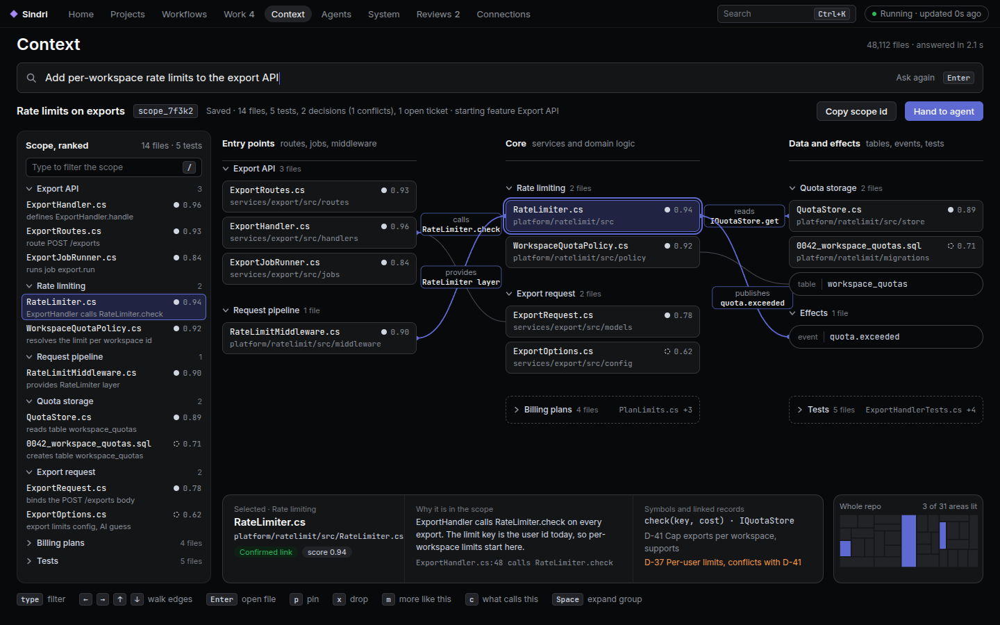

# Sindri's Context page: ask a question, get the files to touch

Status: draft (ideas lane, 2026-11-12). Serves #2959 (context map direction) and uses the row / peek / full grammar of #2978.
Reviews: 3 /autoplan rounds plus the screenshot review, before ready (no owner read).

## 0. Why

The owner's words: "the visual experience is ass. The agent driven experience is good enough but not great. Imagine having to scope out a
project in a 10 million line repo, it gets really really hard to find what files to use." LSP navigation and types can't be relied on; Effect
TypeScript is the named case.

What the Context page does on main today (driven 2026-11-12 on a real index of this repo, screenshots in §13):

- It opens on a grid of equal concept cards (#2976). A question only narrows that grid; it never returns files, tests or decisions (#2974).
- The concept map draws six colours and cuts its labels (#2813, #2809). Clicking a concept doesn't open the three-band view (#1281).
- Near-duplicate suggested concepts show as separate cards with the same terms (#2975).
- While the first index and map build run, the page says "No map yet" with a Build map button and no progress; the Files tab shows an
  error row with a CLI fix (#2766, and the new first-run issue in §12).
- Under the page, the engine misses the edges that matter in Effect code: 32% of TS import edges stop at a barrel `index.ts`, so 43% of the
  files that `yield* SqlClient` have no edge to `SqlClient.ts` (#2983). graphify takes 3 min and 2.76 GB on 1.1M lines and runs twice per
  commit; at 10M lines that is ~25 GB (#2984).

The job, from #2959: from a plain question ("add a refund reason to orders") to **the set of files to touch, with why, in under a minute**,
in a repo of 10M lines. Everything on this page serves that job or goes.

## 1. The bar

The research is the prior-art ledger, `docs/sindri/prior-art/context-map.md` (#3009). "Ledger N" below is its problem N; each row
there has the links, the sources and the numbers. This section only says which rows this spec builds and where.

| Step of the scoping loop | Ledger | Best tool today | What we take | Here |
|---|---|---|---|---|
| Type a feature word, get matching files | 1 | Sourcegraph on Zoekt (trigram index) | a lexical leg that answers in < 300 ms on 10M lines | §4.1 |
| Rank definitions above mentions | 2 | aider repo map (def/ref tags + personalized PageRank, cut to a budget) | the ranking model | §4.2 |
| Find a concept by meaning | 3 | Cursor, Augment (chunk embeddings) | the semantic leg, optional (embeddings may be off) | §4.1 |
| Callers and callees without an LSP | 4 | scip-typescript; tree-sitter name resolution | syntactic edges first, SCIP opt-in and benchmarked | §5.1 |
| What a service needs and provides | 5 | `@effect/language-service`; effect-analyzer (MIT) | the same facts from syntax; effect-analyzer as the test oracle | §5.1 |
| What breaks if I change this | 6 | Nx affected `--explain`, dependency-cruiser `reaches` | the "why" line on each row | §3, §6.1 |
| Find the sibling feature to copy | 7 | **nobody** | ours | §3 (read rows) |
| Save and share the scope | 9 | **nobody** | the scope is a saved object | §3 |
| Hand the scope to an agent in a budget | 10 | aider, repomix | `context_scope` with a token budget | §8 |
| Keep it fresh per commit | 11 | aider mtime cache | one incremental extract | §5.2 |
| Structure without a hairball | 8, 12 | Nx graph, dependency-cruiser collapse | the neighbourhood (<= 40 nodes) and the treemap | §6.3, §6.4 |
| Decisions, tests and docs beside the files | 13 | **nobody** | test rows; decisions and docs in peek | §3, §6.2 |

What not to build on (ledger, "What not to build on"): stack-graphs is archived (2025-09-09); Serena and Sourcetrail are GPL, so ideas only.

Two lessons on pictures: whole-repo call graphs fail as a working surface (dense clusters, overlapping labels, layouts that choke on cycles),
and CodeSee, the product built on the visual map, shut down. Ranked lists with one line of why, plus a small subgraph around one seed, are
what the working tools hand to people and models.

**The bar in one line:** a question returns a ranked, grouped list of files in under 5 s (p95, 10M lines), each with the edge that put it
there and the Effect services it provides and needs; one key opens a small neighbourhood around any row; the list is saved as a scope an agent
can open.

## 2. Decisions

1. **The scope is the object; the map is a view of it.** The page opens on the question box. The answer is a scope (§3). The concept map stays
   as an orientation view, never the landing.
2. **Rows, not cards.** The scope is a list in the #2978 row grammar (32 px rows, Space peeks, Enter opens). Cards go.
3. **Never draw more than the screen can label.** The neighbourhood view (§6.3) shows at most 40 nodes, every label whole. The whole repo is
   a treemap for orientation (§6.4), never a node-link graph.
4. **Edges come from syntax, with no new parser in ship 1.** Each edge kind is a pass with a fixture and an answer key (§5.1). TS passes
   build on the import scanner that ships today (`TsExports.cs`, `TsWorkspace.cs`, `TsResolver.cs`, which move into `Aw.CodeIndex.Core` after
   the §5.1 item 0 fixes land, §5.2); C# passes build on CodeIndex's Roslyn parser.
   tree-sitter is not in the repo. It is a later decision of its own, behind a spike (platforms, NativeAOT, locked restore) that has to
   beat the pattern passes on the benchmark. An LSP or SCIP index, when there is one, only adds precision; nothing waits on it.
5. **One extract per commit, owned by CodeIndex.** The code index and the map read the same extract, stored in its own mutable SQLite file,
   updated per changed file (§5.2, #2984).
6. **Measured.** Every index or ranking change reports its delta on the scoping benchmark the context lane owns (§7). Answer keys live on real
   repos (Effect-TS/effect at 1.1M lines, this repo); the 10M copy is for budgets only; precision is reported next to recall (#2959 comments).
7. **Same object for people and agents.** `context_query` stays as it is. `sindri context scope ask` and the MCP `context_scope_*` tools
   answer, read and edit scopes. The app opens an agent's scope by id, and an agent opens the owner's (§8).
8. **The page ships behind the floor.** The new page becomes the Context page only when the benchmark meets the §7 floor, measured on
   `scope ask` (`--via scope`), the verb the page uses. Until then, the card landing stays the default, and the new page is behind the
   profile key `context.landing: scope` (default `cards` until R1). The owner can set `scope` to try the page early, from Settings or
   with `sindri profile set context.landing scope`. Phase R1 (§14) flips the default to `scope` once the floor holds and Q1 passes;
   the cards stay reachable with `context.landing: cards`. Phase R2 deletes the cards and the key, at least a week after R1, with the
   floor still holding. The bad case this stops: a ranker that misses the files to edit replaces a page that at least lets you browse, and
   leaves no way back.

## 3. The scope

A scope is a named, saved answer to one question.

| Field | What it holds |
|---|---|
| `id` | `scp_<ulid>` |
| `name` | empty until someone keeps the scope (`s`, `rename`); unique per repo |
| `version` | starts at 1, +1 per edit; every write names the version it read (§8, code 264) |
| `question` | the words the person or agent typed, run through `Aw.Redaction` before the ledger event |
| `repo`, `commit`, `extractorVersion` | the repo, the indexed commit it was answered at, and the extract's version |
| `who`, `parent` | who asked (the owner or a session); the scope it was copied from, when it is a copy |
| `groups[]` | one per concept or area: `name`, `why` (one line), `rows[]` |
| `rows[]` | one per file: `path`, `fileHash` (the extract's hash of the file at `commit`), `role` (`touch` / `read` / `test`), `why` (the edge or evidence that put it there, one line), `score`, `services` (provides / needs, Effect), `pinned`, `dropped` |
| `edits[]` | what the person or agent changed: pin, drop, move to touch/read, "more like this", "what calls this", in order, with who |
| `searched[]`, `degraded[]` | the legs that ran, and what was missing. Each `degraded` entry is `{code, detail}`: `semantic-off`, `semantic-stalled` (`detail`: embedded of total, e.g. "8576 of 26249"), `edges-building` (`detail`: percent), `behind` (`detail`: commits), `parse-timeout` (`detail`: file count). Agents branch on `code`; the page and the CLI text print the label |
| `asOf` | when it was answered; a row is `stale` when the file's hash at the indexed commit differs from `fileHash` |

Roles: **touch** = the change edits it; **read** = needed to understand it (callers, the service it uses, the schema); **test** = the tests
that cover a touch row. The answer-key files of the benchmark are the touch rows.

Scopes are stored by Sindri (ledger events `scope.created`, `scope.edited`, `scope.kept`, `scope.handed`, `scope.linked`, `scope.deleted`,
`scope.expired`; a view of the latest state). They never write to the repo. The C# type is `ScopeAnswer`, because `ContextScope`
(`Aw.Context.Core/Engine/ContextScope.cs`) is already the caller's profile, `ScopeGraph` is the scoping graph and `FileScope`
(`Aw.Context.Core/Extract/DataStores/FileScope.cs`) is the data-store pass's store scope. `ScopeAnswer` lives in its own namespace,
`Aw.Context.Core.Scopes`. "Scope" stays the word on the page.

**Saved and kept.** Every answer is saved, so an agent's scope can be opened by id. A scope with no name is dropped 7 days after its
last edit (`context.scopes.keepDays`, whole days 1 to 365, default 7; outside the range is SND-CONTEXT-001 with the key path). Naming
it (`s` on the page, `rename` for agents) keeps it until someone deletes it. The saved list shows named scopes first, then the last 10
unnamed ones, each unnamed one with "unnamed, kept until 19 Nov"; an agent's scopes carry the session's name.

**Who drops them.** A Sindri service tick (`scope-sweeper`, hourly, in the Sindri host like the other `services`) finds unnamed scopes past
`keepDays` and, for each, appends a `scope.expired` ledger event and removes the row from the view. The ledger is append-only: the
`scope.created` event stays, and it holds the question already run through `Aw.Redaction`, so nothing unscrubbed outlives the view.
A name from `rename --name` gets the same redaction. A `scope.created` event carries the rows (a 200-row answer is about 60 KB); F1
reports the ledger's growth per 1000 asks, and a per-session cap is added if it matters.

**Copies.** A session's first edit of the owner's scope (or another session's) makes a copy: a new id, `parent` set to the original.
The edit's result returns the new id, and later edits use it. The original never changes behind its author's back.

The exact wire shape is S0's (§14): a JSON schema and an API golden, the first PR of P3. This section fixes the fields and the behaviour.

## 4. Answering a question

### 4.1 Legs

1. **Lexical:** trigram search over paths, symbol names and text. Seeds: the question's words, their identifier forms (`refundReason`,
   `refund_reason`, `RefundReason`), and the concept aliases from the map. The index is an FTS5 table with `tokenize='trigram'` and
   `detail=none`, in the extract's SQLite file (§5.2). `detail=none` gives up phrase queries; seeds are single words, so nothing is lost.
   Three FTS5 facts a spike proves before P2 starts: a trigram needs 3 or more characters, so a 1- or 2-letter seed (`id`, `db`) falls
   back to a path and symbol-name prefix scan; `bm25()` under `detail=none` still ranks; and a seed that matches most files (`order`) is
   cut to the top N inside SQL, so the 300 ms bar holds.
   The extract keeps each file's scrubbed text, and the FTS5 table indexes it as external content, so peek and full read the same text.
   A changed file is a delete plus an insert (the delete reads the old row's text first). Size: ~400 MB of text at 10M lines, plus the trigram index at about 1-3x the text
   (~0.4-1.2 GB). The benchmark reports the real size per fixture. It replaces the file and path rows of today's in-memory
   `SqliteMapSearchIndex`, which keeps concept titles only.
2. **Structural:** the seeds' definitions, then their edges (§5.1): who provides the service, who uses it, the layer that wires it, the
   tables a file reads and writes, the routes, the tests.
3. **Semantic (optional):** embeddings over chunks of a file, when `index.embeddings` is on. Ship 1 cuts by size: 1,500 characters
   (about 400 tokens), cut at a line break, with the last 200 characters repeated at the start of the next chunk. Why: one chunk holds
   about one idea and sits far under the embedding model's context, and the overlap keeps a declaration that straddles a cut whole in one
   of two chunks. At 10M lines (~400 MB of text) that is roughly 300k chunks (an estimate; F1 reports the real count and the embed time).
   Chunks by top-level declaration wait for the parser spike (§5.1): the §5.1 passes are regexes over comment-stripped text and don't
   know where a declaration starts or ends. Off, the scope says "meaning search off" in its footer and in `degraded[]`, not an error.

### 4.2 Ranking

Personalized PageRank over the file graph, seeded by the lexical and semantic hits (aider's method), with edge weights per kind (a provides
edge beats an import). Definitions beat mentions. A file reached only through a barrel counts as reaching the defining file (§5.1).
Grouping: rows group by concept when the map has one for them, else by top-level package. The touch / read split: a row is **touch** when the
question's nouns hit its definitions (it defines the entity, the schema field, the route, the service); **read** when it is reached only by
edges; **test** when a test -> subject edge points at a touch row.

The file graph is held in memory as compressed rows (CSR: one offset array, one target array, one weight array), loaded once per
extract version and swapped when a new one lands. PageRank stops at 20 iterations or a change under 1e-4. The benchmark reports the
graph's node and edge counts and its memory at 1.1M and 10M lines; above 1.5 GB for one graph it is a perf issue (F1). The swap holds two graphs for a moment, so F1 also checks 2x that figure.

### 4.3 Budgets (10M-line copy, the box this runs on)

| Step | Budget |
|---|---|
| first build: new repo -> questions work (lexical ready) | < 3 min at 1.1M lines, < 10 min at 10M |
| question -> first rows on screen | p95 < 1 s (lexical leg alone) |
| question -> full ranked scope | p95 < 5 s |
| "more like this", "what calls this" on a row | p95 < 1 s |
| page first frame with a saved scope | < 300 ms |
| touch recall of the answer-key files in the top 25 (`scope ask`) | >= 0.8; decoys in the top 10 gated by the §7 ceiling |

## 5. Engine requirements (context lane)

### 5.1 Edges from syntax

Each is a pass with a fixture repo, an answer key and a test. Order is the context lane's plan on #2959. The parser per pass, in ship 1:

| Pass | Parser |
|---|---|
| 0, 1, 5 (resolver, barrels, tests) | the TS import scanner that ships today (`TsExports.cs`, `TsWorkspace.cs`, `TsResolver.cs`), moved into `Aw.CodeIndex.Core` after item 0 below lands (§5.2) |
| 2, 3, 4 (Effect services, schemas, SQL and routes) | regex passes over the same comment-stripped text (the scanner is regexes, not a token stream): each pattern below is a call shape, not a type fact |
| 6 (C#) | CodeIndex's Roslyn parser (`CSharpParser`) |

A pattern pass is wrong where a type checker is needed (a service passed through a variable). Each pass reports its precision and recall
on its answer key, so a tree-sitter or TS compiler spike has a number to beat. This spec requires:

0. **Fix the TS resolver first** (context's correction on #2983: graphify is not the cause of the missing edges). Two small Core fixes
   come before any new pass:
   - `export * as X from "./y"` is dropped today: `TsExports.cs:36` filters out every star export with a namespace group. It becomes a
     namespace re-export, so `X.Foo` resolves to the file that defines `Foo`.
   - `TsWorkspace.cs:29` turns a package.json `exports` map into one entry file: `Target` follows the first condition key it knows and
     never keeps the subpath keys. Subpath entries (`"./sql"`, `"./*"`) become their own entries, so `@pkg/x/sql` lands on a file.
   Item 0 lands first, in `Aw.Context.Core` where the files are today. P2's move PR (§5.2) starts after it merges and moves the fixed
   files, so the two never edit `TsExports.cs`, `TsWorkspace.cs` and `TsResolver.cs` at the same time.
   scip-typescript stays opt-in and benchmarked (ledger 4); it is not on the default path.
1. **Barrels collapse.** An import of `x/index.ts` that re-exports `Foo` becomes an edge to the file that defines `Foo` (#2983). Done first:
   every edge kind below depends on it. The walk follows at most 8 re-export hops, keeps a visited set (a cycle ends the walk with the
   last file reached), and caches each file's resolved exports per extract version. `export * as X` from item 0 goes through the same walk.
2. **Effect services.** `Context.Tag("id")`, `Context.GenericTag`, `Effect.Service<X>()("id", {...})` (and v4's `ServiceMap.Service`) ->
   a service node; `dependencies: [...]` -> needs edges; `Layer.succeed/effect/scoped(X, ...)` -> provides; `Layer.provide/merge/provideMerge`
   -> wiring; `yield* X` inside `Effect.gen`, `X.pipe(...)`, `Effect.flatMap(X, ...)` -> uses.
3. **Schemas and errors.** `Schema.Struct/Class/TaggedError`, `Data.TaggedError` -> schema and error nodes, so "add a field to orders"
   finds the schema.
4. **SQL and routes.** `sql` template reads and writes -> table edges; `HttpRouter` / `HttpApiEndpoint` -> route nodes.
5. **Tests.** A test file -> the subject files it imports (after barrel collapse).
6. **C#** keeps its Roslyn parser. DI registrations (`AddScoped<IX, X>()` and friends) are the C# equivalent of 2, and endpoint maps
   (`MapGet`, `MapPost`) are the equivalent of 4. They are in ship 1, as P1's second wave. This repo is a benchmark fixture and mostly
   C#, so the floor (§7) can't be met without them.

### 5.2 One extract, incremental, in SQLite

One extract per commit, shared by the code index and the map (today they run graphify twice, #2984). It is stored in SQLite and updated per
changed file, so a commit that touches 20 files re-parses 20 files. A full build is only for a new repo. Each pass carries its own
`extractorVersion`: a changed pass re-runs only the files of its language, not the whole repo.
Budget: full build of 10M lines < 30 min and < 4 GB peak; a 20-file commit < 30 s, because it upserts 20 files into a mutable file
and copies nothing.

- **Owner.** `Aw.CodeIndex` owns the extract file and is its only writer. It holds files (path, content hash, scrubbed text), symbols,
  file-level edges (provides, needs, uses, imports, tests, with node kinds for service, schema, route and table) and the lexical table
  (§4.1). The TS passes are the writer's, so they move: `TsExports`, `TsWorkspace`, `TsResolver` and the other readers of
  `Aw.Context.Core/Extract/Imports/` go to `Aw.CodeIndex.Core` (a new `Imports/` folder; P2's first PR, which starts after P1's
  item 0 has merged and moves the fixed files, §5.1). `Aw.CodeIndex.Core` has one
  project reference (`Aw.Kernel`), so `deps.yaml`'s `projectFanOut: 4` holds, and `Aw.CodeIndex.Infrastructure` (already at 4) gets no new
  reference. No new package is added. The Context callers of that scanner (`ImportEdges`, `DataStorePass`, `DrizzleAdapter`) read the
  extract through the port instead, in the same PR.
- **The port.** `IExtractReader`, declared in `Aw.Context.Core/Scopes/` and bound by the Sindri host (the pattern the vectors use, but a
  data read, not a compute call). Five methods: `SearchText(seeds, limit)` (the FTS5 match, already cut to `limit`), `FileEdges()` (a
  stream of every file-level edge, for the CSR), `ReadFile(path)` (scrubbed text and `fileHash`), `FileHashes(paths)` (for the `stale`
  check) and `Version()` (the commit and `extractorVersion`). The host adapter calls matching additions to `ICodeIndex` and holds the
  long-lived read connection the CSR swap needs. Context never opens the file itself, so `deps.yaml` gains no project edge between the two;
  `node scripts/check-deps.mjs` must still pass.
- **Order of a first build.** Files and the lexical table are written first and committed as one milestone: questions work from then on
  (§4.3, §6.5 row 2). Symbols and edges follow, file by file.
- **Two files, two update models.** The published call-graph index keeps `IIndexStore`'s contract (immutable once published; an
  incremental build copies it, edits the copy and swaps a pointer) and its schema: no bump, no rebuild of it. The extract is a separate
  file next to it, mutable, in WAL mode, with per-file upserts. A first build writes the extract in a transaction per batch of files; a
  crash mid-commit rolls the open transaction back and leaves the extract at its last commit. Each question reads in one read
  transaction, so it sees one commit's graph. Nothing is copied, so a 20-file commit stays under 30 s at 10M lines, where a copy of a
  1.5-3 GB file plus an integrity check would not.
- **What goes away.** graphify no longer extracts files or edges. It stays for concept clusters only (the map's names), runs once per
  commit off the question path, and takes its input from the extract (the host writes the extract's scrubbed files to a temp snapshot,
  `GraphifySnapshot`, never straight from disk). The runner that stays is Context's (`GraphifyClusterSource`, `GraphifyProcess`,
  `GraphifySnapshot` in `Aw.Context.Infrastructure/Extract/`). CodeIndex's own `GraphifyRunner`, `IGraphRunner`, `GraphLayer`,
  `GraphMerge` and the `graph_nodes` / `graph_edges` tables are deleted in P2, in its last PR, after the benchmark shows the call-graph
  index lost no non-C# symbol (TS exports now come from the passes). The file and path rows of `SqliteMapSearchIndex` go (§4.1). `context.db` keeps
  the map: concepts, pins, pages.
- **Secret files never enter it.** The extract takes CodeIndex's input rules as they are: `.gitignore`, `InputRules.SecretGlobs` and the
  profile's added globs (`InputRules.IsDenied`). Every file body goes through `IBodyScrubber` before the lexical insert. A file over `InputRules`' size limit, and generated, vendor and
  minified files, are skipped (the same rules the code index uses), so one huge file can't dominate the lexical milestone; the scrub
  rate (MB per second) is on the benchmark list. Peek, full and
  `handoff` read text only from the extract, never straight from disk, so a path outside the repo root or a denied file has no text to
  show.
- **Parse failures.** A pass that times out on a file (the TS regexes stop at 1 s) must not drop edges silently. The file gets a
  `parse-timeout` fact, the scope's `degraded[]` carries the count, and `sindri doctor` shows it. The new passes run under CodeIndex's
  `IParseQuarantine` mark, like the Roslyn parse.
- **Upgrade.** A box with an `index is ok` map keeps answering from it until the first extract finishes. `sindri doctor` shows
  "extract building" until then. The call-graph index is not touched.

## 6. The page

### 6.1 Layout

Design's pick on #2959 (comment 6817891316) is direction 3, **map-led bands**, with two pieces taken from the other directions. qa agreed
and measured it (comment 6818215657). The reference frame, drawn on the real `Tokens.axaml` values at 1440x900:



```
┌ Context ──────────────────────────────────────────────── 48,112 files · answered in 2.1 s ┐
│ [ Add per-workspace rate limits to the export API                          Ask again ⏎ ] │
│ Rate limits on exports  scp_01JC…  6 touch · 8 read · 5 tests · 2 decisions, 1 conflict  [Hand to agent] │
├ Scope, ranked ─────┬ Entry points ──────┬ Core ───────────────┬ Data and effects ────────┤
│ [filter      /]    │ ▾ Export API 3     │ ▾ Rate limiting 2   │ ▾ Quota storage 2        │
│ ▾ Export API     3 │  ExportRoutes.cs   │ ┃RateLimiter.cs ┃───┼─reads IQuotaStore.get──▶ │
│  ExportHandler.cs  ├─calls RateLimiter.check─▶              │  QuotaStore.cs           │
│ ▾ Rate limiting  2 │  ExportJobRunner   │  WorkspaceQuota…    │  table workspace_quotas  │
│ ┃RateLimiter.cs   ┃│ ▾ Request pipeline │ ▾ Export request 2  │ ▾ Effects 1              │
│ ┃ Touches · Why · ┃│  RateLimitMiddle…──┼─provides RateLimiter layer─▶  event quota.exceeded │
│ ┃ actions         ┃│                    │ ▸ Billing plans 4   │ ▸ Tests 5                │
│ ...                │                    │                     │                          │
│ Suggested, not in scope yet: PlanLimits.cs [Add] · ...         │ Whole repo  3 of 31 lit  │
└────────────────────┴────────────────────┴─────────────────────┴──────────────────────────┘
```

- **The question box** is the full width of the page and has focus when the page opens. Its placeholder is whole at 1000 px. A quiet
  line under it names the repo it asks about: the top bar's repo.
- **The scope header**: the scope's name and id (`scp_…`, Copy id beside it), its counts ("6 touch · 8 read · 5 tests · 2 decisions,
  1 conflict"; the noun is singular at 1 and plural otherwise, and a zero count is left out), and Hand to agent. Saved scopes are a menu on the
  name (named first, then recent, each unnamed one marked "unnamed, kept until 19 Nov"; the page with no question shows the same list
  inline, §6.4). A scope the person hasn't named shows the same "unnamed, kept until" line under its name.
- **The ranked rail** (left, 280 px) is the scope as a list, under a header "Scope, ranked" with the counts "14 files · 5 tests" and the `/` filter box (placeholder "Type to filter the scope"): groups that fold, one file per row. A row's columns, left to right: the role
  glyph (`T` touch, `R` read, `Te` test, in ink, never colour alone), the file name, the dot, the score. The why is not a column: 280 px
  can't hold a name and a why on one line without cutting one (§6.7). The selected row shows its why in the in-place open, and Space shows
  it in peek. Hovering a row that is not selected shows the same why in a tooltip, so a mouse can scan the list. Width: 280 px minus 16
  of padding, a 16 px glyph, a 36 px score and an 8 px dot leaves about 190 px for the name, which holds a 23-character file name at 13 px
  (`WorkspaceQuotaPolicy.cs`). A longer name drops characters from the middle of its folder part, never from the file name; the full
  path is in the in-place open. A row marked `stale` shows the word "changed" (or "file gone") after the name, in ink, in place of the dot
  (§6.5). Inside a group, touch rows come first. There is no role filter chip in ship 1; `/` filters by name. Score is the rank normalised to 0-1 for this scope; a solid dot means an edge put the file there, a hollow dot means only the
  lexical or semantic leg did. There is no other badge colour: the frame's green "Confirmed link" becomes the word, in ink. This is aider's
  repo map (ledger problem 2 of `docs/sindri/prior-art/context-map.md`): rank by graph, then one line of reason.
- **The bands** (centre and right) draw the same files as cards in three columns: Entry points -> Core -> Data and effects. They need
  room: three 170 px columns, two 150 px gaps and a 24 px inset on each side are 858 px, plus the 280 px rail, so the bands draw from a
  window 1138 px wide. The gaps are a fixed 150 px; the columns take all extra width (at 1440: 1440 - 280 - 48 = 1112 px, minus 300 for
  the gaps, about 270 px per column). An edge label is whole or not drawn (#3674, #3678): it sits on the
  edge's free stretch between the two boxes, never under a box, and it is drawn only when that stretch is at least the label plus 8 px
  on each side. A shorter stretch drops the label; the edge's tooltip and the selected edge's side panel carry the text. A symbol is
  never cut in the middle ("CallerCo…Http" can't be searched for). Under that, the page is the rail and the in-place open
  only, and the bands are not drawn (the edges are what that gives up; §6.2 has the same rule for peek). A file's band
  comes from its strongest node kind: route, job, middleware or CLI command -> Entry points; service, layer, domain type -> Core; table,
  schema, event, migration -> Data and effects; tests fold into one Tests card there. Anything else goes to Core. The bands draw at most
  6 cards each: touch cards first, then by score. More fold into "+ N more". Groups fold to one card ("Billing plans · 4 files"). Every edge carries its verb ("calls RateLimiter.check", "reads IQuotaStore.get").
  Each band has a heading with a one-line gloss in ink-subtle ("Entry points · routes, jobs, middleware"; "Core · services and domain logic"; "Data and effects · tables, events, tests"). Inside a band, each group has a sub-heading with its name and file count ("Rate limiting · 2 files"). A file card shows the file name, its folder path under it, and the dot and score at the right. A node that is not a file (a table or an event) is a pill: the kind word ("table", "event") and the name. A folded group card shows its name, its file count and the first file name with "+ N" ("Billing plans · 4 files · PlanLimits.cs +3"; the Tests card the same). The 170 px column is a minimum and the 150 px gap is fixed: at 1440 only the columns grow to fill the width.
- **The in-place open** (taken from direction 1): the selected rail row grows in place to show *Edges*, *Why here*, the decisions that
  cite the file (with a conflict marked as one, "D-37 conflicts with D-41") and its actions.
  It replaces direction 3's bottom strip, which pulled the eye away from the row you are on.
- **The Suggested tray** (taken from direction 2): "Suggested, not in scope yet", up to 4 files with Add. A scope grows without a new
  question. Tab enters the tray; Left and Right move between its files; Enter on Add (`scope.add-suggested`) adds the file as a `read`
  row, moves the cursor to the new rail row, and fills the tray from the next-best file. While ranking the tray says "ranking…"; with
  nothing to suggest it says "Nothing else near these files". A suggestion nobody added comes back on the next `ask again`; there is no
  dismiss in ship 1.
- **Whole repo** (bottom right, 200 px): the treemap of §6.4, with the scope's areas lit. Its caption reads "Whole repo" and, right-aligned, "3 of 31 areas lit". Orientation only.  Ships in U2.
- The key bar lists only the keys that work on the selected row.
- **Dropped rows.** A drop removes the row from the rail and adds a line at its foot, "Dropped 2 · show", that lists them with Restore
  (`scope.restore`; Ctrl+Z undoes the last edit too). `dropped` stays a field of the row (§3), so the list survives a reload.

**What the redraw must fix** (qa, each measured on the frame above):
1. **Every drawn edge has a verb, or it isn't drawn.** Two grey curves have none today: ExportHandler -> ExportRequest.cs (under the
   `calls RateLimiter.check` pill) and WorkspaceQuotaPolicy.cs -> `table workspace_quotas`. A grey line with no label is exactly what
   fails on today's map (#2959, "what fails" frame 3).
2. **Edges are routed orthogonally, one row gap each.** The `provides RateLimiter layer` edge crosses ExportHandler -> ExportRequest at
   x ~640. Temporal's and n8n's canvases route this way.
3. **Group counts use ink-subtle** (138,143,152: 5.62:1 on the rail, 6.13:1 on the canvas), not ink-3 (4.12:1).
4. **The selected row's second line stays at or above 4.5:1 on the selected fill** (it is 4.64:1 today), held by a check in the Frames
   suite, not by eye.
5. **Rail rows are 32 px and one line** (the #2978 grammar), not 38 px and two. The why leaves the row (it shows in the in-place open
   and on Space; qa's "why column" doesn't fit 280 px, see the rail above). The frame's 10 open rows, 7 headers and one in-place open
   then fit the rail's 640 px at 1440x900, with no scroll (10 x 32 + 7 x 28 = 516 px, plus the open row; group headers are 28 px
   with no top margin, as the #2978 grammar draws them).

The redraw also brings the frame in line with this text where qa's list doesn't name it: the role glyph column, the "Confirmed link"
pill as a word in ink, the id as `scp_…`, the header counts above, and the key bar of §6.6. The frame's "Saved" label and ticket line go.

**One cursor, owned by the rail.** The 14 files show twice: in the rail and as band cards. There is one selection, and the rail owns it.
The bad case this stops: a band card highlighted while the rail shows another row, so Enter opens a file the person didn't mean.

| Click on | Cursor goes to | Focus |
|---|---|---|
| a file card | that file's rail row (its group opens) | the rail, so `j` / `k` work next |
| a group card or the Tests card | that group's header row, opened | the rail |
| "+ N more" | its first hidden row (its group opens); the accent label names the file, "ExportHandler.cs inside + 4 more" | the rail |
| an edge label | the rail row of the file the edge points to | the rail |
| a Suggested file | nothing moves; Add is the control (Enter on it, §6.1 tray) | the tray |
| a cell of Whole repo | the first rail row in that area, when the scope has one; otherwise nothing | the rail |
| a rail row | that row | the rail |

Band cards show a pointer and a hover fill, and no focus ring (they have no keyboard focus).

The card of the selected row is the one accent, with its edges. When the selected file is inside a folded group card or past the cap of
6, the folding card carries the accent. Space peeks from the rail; a band card has no keyboard focus of its own (the rail is the keyboard
path).

### 6.2 Peek (Space) and full (Enter)

- **Peek**, a side pane at 40% width: the file's outline (top-level symbols), the lines that matched with two lines of context, its edges
  in and out grouped by kind (each one a link that adds that file to the scope as read), the decisions and docs that cite it, and the why.
  Fit, in numbers: the bands need 858 px plus the 280 px rail (§6.1), 1138 px. Peek takes 40% of the window, so the bands stay drawn only
  when 60% of the window is at least 1138 px, a window 1897 px wide or more. At 1440 the left side is 864 px, minus the rail 584 px for
  bands that need 858: they don't fit. So below 1897 px, opening peek replaces the bands with one list, "Edges of this scope", one line
  per edge ("ExportRoutes.cs calls RateLimiter.check"), in band order; the rail stays, Whole repo hides, and Esc brings the bands back.
  The drawn edges are what that gives up; every label stays whole and nothing scrolls sideways. The page's minimum window width is
  1000 px: the rail 280, the edge list 320 and the peek 400. The peek never covers the selected row.
- **Full**, Enter: the file in a read-only code view at the matched line, with the same edges in a gutter. "Open in editor" is one key (`o`).
  It runs the profile's `context.editor` as an argv list, with the path as its own last argument after `--`, never through a shell.

### 6.3 Neighbourhood (n)

A full view opened from a row (the #2978 grammar: row, peek, full; meta's call). It is a node-link view of one file and what touches it, one hop out, two on request: at most 40 nodes (the seed counts), every label whole, laid out in four
bands: entry points -> core -> data / effects -> tests. Unlike §6.1, tests are not folded into Data and effects here: each test file is its
own node in a fourth band, "Tests · test files and fakes", drawn only when a test is in reach (#3674). The other three glosses are §6.1's,
except that Data and effects reads "tables, events" here. Nodes in a band keep at least 16 px clear on both axes (#3678). Services are nodes; every edge carries its verb and is routed orthogonally, as in the bands (§6.1, fixes 1 and 2). One accent marks the
seed and the rows already in the scope. When more than 40 nodes are in reach, a line says "Showing 40 of 112 nearest · narrow by kind",
with kind chips. Arrows walk edges; Enter adds the focused node to the scope; Esc goes back to the list with the same row selected.

### 6.4 Orientation (the whole repo)

A treemap of the repo by top-level package and folder, area = lines, with the scope's files lit in the accent. It answers "where in the repo
is this", not "what calls what". It ships in U2 (§14).

**The page with no question** (first visit, or after `c`) replaces the concept-card landing (#2976). It shows the question box, with
focus, and under it the saved scopes as a plain list, inline, with no menu: named scopes first, then the last 10 unnamed ones, each
row the name (or the question when unnamed), its counts, its age, and "unnamed, kept until 19 Nov" on an unnamed one. There is no
rail and no bands. On a first visit the list is replaced by two lines: "Ask where a change goes, in your own words. For example: add a
refund reason to orders." and "Every answer is saved here for 7 days. Press s on one to keep it." From U2 on, the treemap sits under
the list (with no list, under those two lines).

### 6.5 States

| State | What shows |
|---|---|
| no repo in the profile | the question box disabled; one line, "No repository yet. Add one to ask about its code.", and an **Add repo** button that opens the existing repo add flow (the same one as `sindri repo add <path>`); after it, the next row |
| first index building, lexical not ready | the question box disabled; a text line above it, "Indexing agentic-workflow: 41% · about 3 min left", in ink-subtle or darker (4.5:1) and a polite live region, so the progress doesn't live only in the box's placeholder; focus lands on the first enabled control (Map tools, then the saved list); the treemap (from U2) fills in as files land; no Build map button while a build runs |
| lexical ready, edges building | questions work; the header says "Answers get better as indexing finishes · 41%"; rows have hollow dots until edges land |
| index ready, no map | questions work (lexical + structural need no map); groups fall back to packages; a quiet line offers "Name areas" (the map) |
| a question with no hits | "Nothing in agentic-workflow matches 'refund reason'" plus up to 3 near words that do match, as plain words, never raw keys (#2809) |
| answer slower than 1 s | the lexical rows show first with "ranking…" in the header; the order settles once, no reshuffle after that; the cursor stays on the same file, not the same row index |
| index behind the checkout | a line in the header: "answered at 7f01aca, 3 commits behind" with Refresh |
| a failed read | "Couldn't read the code index" plus Retry and the log path; never an empty list that looks like "no matches". Retry asks the same question again against an index that exists |
| index build failed | "Indexing failed: <reason and code>" in the header and a **Retry build** button that starts the index build job again. It differs from a failed read: a failed read means the index exists and one question couldn't read it (Retry re-asks); a failed build means there is no usable index yet, so the question box stays disabled. When an earlier extract exists, questions keep answering from it and the line sits in the header with the same button |
| a row is `stale` (the file's hash changed since the answer) | the row shows "changed" in ink where the dot was; its actions are Refresh row (re-asks at the indexed commit; in the `.` menu, accelerator `r`), Drop and Open; Pin and role changes still work on the old row but the row keeps the word until a refresh; an edit that the server refuses with 265 shows "This file changed since the answer. Refresh the row." |
| a pinned file is gone | the row shows "file gone"; Drop is the only action besides Refresh; the in-place open says which commit still has it |
| meaning search off | one line in the header, "Meaning search is off · rows come from names and edges" (the `semantic-off` entry of `degraded[]`) and a **Turn on** button that sets the profile key `index.embeddings` to on (it applies on save, then the embed job starts); no error colour, no dialog |
| meaning search stalled or model-limited | the `semantic-stalled` entry: "Meaning search stopped at 8,576 of 26,249 · rows come from names and edges". Ollama failed: **Retry** starts the embed job now, without waiting for the failure backoff. Paused on a model limit: **Resume**. The real case is #3069 (Effect run: one Ollama error parked the layer as `unavailable`, `SND-CODEIDX-006`, and nothing retried it, so scoping answers held no code); #3069's fix makes the embed service retry that layer on its own, and the button covers the wait |
| parse timeout on some files | one line in the header, "12 files couldn't be read in time · see files" (the `parse-timeout` entry of `degraded[]`); the link opens that file list in the Files view. Today this shows only in `sindri doctor` |
| concept map older than the index | one line in the header, "Area names are from 7f01aca, 12 commits older" and the **Name areas** button, the same one as the "no map" row, re-running the map at the indexed commit. Groups keep the old names; files the old map doesn't know fall back to their package |
| version conflict (264) while editing | the edit is not applied; a line in the header, "Changed by <who> while you were editing. Reload", with Reload (reads the current version and keeps the cursor on the same file) |
| Hand to agent fails | the menu stays open and says why under the target: "<session> has ended" (270) or "Couldn't hand over. Try again"; nothing is recorded as handed |
| an agent edits the scope that is open | no reshuffle under the cursor; a line in the header, "<session> changed this scope · 2 edits", with Reload; the open file stays selected |

### 6.6 Keyboard and focus

The keys follow the shared grammar on #2978, in short: a list of 32 px rows; Space opens a peek pane beside the list; Enter opens the
full view; Esc goes back one layer. Its keys: `j`/`k` move, `/` filters, `c` creates, `.` opens the row's actions, Ctrl+K has every action
by name. #2978's rule: a bare letter never commits a write, and may differ per surface only when it opens something you can cancel. So
this page's bare keys only move, fold or open: Left / Right and `g` (design's page keys, #2959 comment 6818264541), `e`, `n` and `s`.
More like this, what calls this and refresh are writes, so they live in the `.` menu. The ui lane adds the page keys to #2978's table in U1.

| Key | Where | Does |
|---|---|---|
| (typing) | question box | edits the question; Enter asks and moves focus to the first rail row |
| Down | question box | moves focus to the rail without asking |
| Esc | question box | unchanged text: moves focus to the rail; changed text: puts the asked question back |
| Esc | rail, nothing open | with a `/` filter active: clears the filter; with none: moves focus to the question box. The in-place open is always on the selected row, so Esc ignores it |
| Esc | saved menu, Hand to agent menu, Suggested tray | closes the menu, or leaves the tray for the rail |
| `c` | rail | create: a new question, with focus in an empty question box |
| `e` | rail | edit the current question (focus in the box, text kept) |
| `/` | rail | filter the scope's rows by name |
| `j` / `k`, Up / Down | rail | move the cursor |
| Left / Right | rail | walk the selected file's edges: the previous or next edge lights up and its far file shows in the in-place open. Writes nothing |
| `g` | rail | fold or unfold the group of the selected row. Writes nothing |
| Space / Enter | rail | peek / open full, keeping the selection |
| Esc | peek, full, neighbourhood | closes the topmost one, back to the rail on the same row |
| `.` | rail | the row's actions: pin, drop, set touch / read, more like this (`m`), what calls this (`w`), refresh row (`r`, only when the row is `stale` or its file is gone). The letters in brackets work only while this menu is open; Esc closes it with nothing done |
| `n` | rail | the neighbourhood (§6.3) |
| `s` | rail | open the name field for the scope; Enter keeps it, Esc cancels, so the key itself writes nothing |

Letters act only while focus is in the rail; in the question box they type. Tab order: question box, rail, Suggested tray, header
(saved menu, Copy id, Hand to agent). Left / Right walk edges while focus is in the rail and move between files while it is in the tray. The header sits above the rail on screen, so this order is not top to bottom; that is deliberate,
the question and the files come first. Every action has a menu item for mouse use and the same action id in Ctrl+K and in
`context_scope_edit` (§8): `scope.pin`, `scope.drop`, `scope.touch`, `scope.read`, `scope.more`, `scope.callers`, `scope.add-suggested`,
`scope.keep`, `scope.copy-id`, `scope.handoff`, `scope.delete` (with Sindri's usual confirm), `scope.refresh`, `scope.ask-again`,
`scope.restore`. The frame's key bar still shows the old `p` / `x` / Space = expand group: the
redraw takes the table above.

Screen readers: the rail is a tree (group -> rows); a row reads "touch, ExportHandler.cs, calls RateLimiter.check, score 0.96". The bands
and the treemap repeat the rail and are hidden from the accessibility tree. A reduced-motion setting turns the "ranking…" settle and the
group fold into an instant change. "ranking…" and "answered at …" are a polite live region.

### 6.7 Visual bar

One accent (the selected file and its edges, lit treemap cells). Every text meets 4.5:1 on its own fill and every meaningful line or mark
3:1, held by a contrast check in the Frames suite over every rail row, band card and edge label (§6.1 fixes 3 and 4 among them). Ink for structure. No band or concept colours (#2813). Labels never cut (#2809). Type
scale and spacing from the tokens. Inspora is the reference (#2959 point 6).

## 7. The benchmark (context lane; P0 merged in #3068)

The answer keys are `tests/fixtures/scoping/<repo>/questions.yaml` (`effect` and `agentic-workflow` today), and their README defines
the fields. Each file names its `repo`, `commit` and `source`. Each question has a `plain` text (what a person types, no file names), a
precise `question`, and `touch`, `read` and `decoys` lists of `{path, why}`. A decoy is a file whose words match but which a right change
leaves alone, so it measures precision. For a "where is X" question, touch is the files that do X. One entry, cut short:

```yaml
- id: aw-01
  plain: "where is the heavy job slot lock taken and released"
  issue: 3047
  split: held-out          # tune | held-out; P0 follow-up, ranking changes are tuned on `tune` only
  touch:
    - { path: scripts/heavy.sh, why: "takes a slot in its wait loop and frees it in release() on the EXIT trap" }
    - { path: config/lib/locks.sh, why: "acquire_any_lock takes slot 1 with mkdir; release_lock removes it" }
  decoys:
    - { path: skills/_shared/skill-lock.sh, why: "a different lock, one skill at a time" }
```

The runner is `node scripts/scoping-bench.mjs --questions <file> [--via query|scope] [--k 25] [--json]`. `--via query` (the default)
asks a running Sindri `sindri context query --json` per question: it is the baseline, the "before" number on today's main, and it stays
because decision 7 leaves `context_query` as it is. `--via scope` asks `sindri context scope ask --json` and scores the rows with
`role` = `touch` for touch recall, so it measures the ranker the page ships (P4) and works once P3's first PR exists. Both print touch
recall, recall and P@25, decoys hit, and p50 / p95. Exit 0 means every question was answered,
1 a query failed, 2 usage. `--check` verifies every key path exists at the key's commit. It runs by hand, by the context lane or the
owner, never on CI, because the Effect fixture needs a clone of about 3 GB and an index. Results go on #2959 with the run's setup
(embeddings on or off, map version, sha, and `--via`).

To get a fixture running (about 3 GB for Effect, one time): clone the key's `source` and check out its `commit:`; run
`sindri repo add <clone>`; wait until `sindri doctor` shows the index as ok (the lexical milestone is enough for `--via scope` once
P2 lands); then run the runner with `--questions tests/fixtures/scoping/<repo>/questions.yaml`. Point `AW_SINDRI_HOME` at a scratch home
so the profile is not the owner's. The 10M-line copy has its recipe in `tests/fixtures/scoping/README.md` (follow-up 4).

P0 follow-ups the floor needs:

1. `split:` on every entry, then `--split held-out` and `--floor 0.6` on the runner (exit 1 below the floor).
2. 10 questions per fixture, half `tune` and half `held-out` (each fixture holds 5 today). #3047's question is in already (aw-01).
3. The extract's size, the graph's node and edge counts and its memory in `--json` (§4.1, §4.2), and the scrub rate and its share of
   the lexical milestone (§5.2).
4. A 10M-line copy, for budgets only: its repos, licences, disk and build time listed in `tests/fixtures/scoping/README.md`.
5. `--via query|scope` on the runner (default `query`). The `scope` mode lands with P3's first PR.
6. The extra held-out questions, from 5 to 20 (§14, P4), and the decoy ceiling below.

**Floor for decision 8**, read from `--via scope` on `scope ask`: touch recall at 25 >= 0.6, and decoys in the top 10 <= 1.0 per
question, both averaged over the held-out questions of both fixtures together (10 questions to start), and `scope ask` p95 under 5 s (§4.3) on the
same run. Before R1 flips the default, held-out grows to 10 per fixture (20 total), and all three must still hold. The target stays at 0.8 (§4.3).

**The "before".** No `--via query` baseline is posted on #2959 yet (the runner merged in #3068; the only number so far is touch recall 0.00
on the Effect home in #3069, taken while embeddings were stalled, so it is not a baseline). The first `--via query` run, on both fixtures, goes
on #2959 before P4 starts, and every later run quotes it.
 One miss on 5 questions
moves a fixture by 0.2; averaging over both fixtures and growing to 20 keeps a single question from deciding the ship.

Why 1.0 decoys: the keys list 4 decoys per question in `effect` and 2 to 3 in `agentic-workflow`, and 10 rows is what the rail shows
open at 1440x900 (§6.1 fix 5). One decoy in 10 rows is a quarter to a half of the decoys a key names, and a person scrolls past it. A
ranker that returns the words' neighbours (3 or more in the top 10) fails the floor even with full recall. The first `--via scope` run
reports the real number; if it sits far from 1.0 either way, the ceiling is reset once, on #2959, before R1, not per run.

A scope whose edits changed its touch set is offered as a new benchmark question in `sindri doctor`; the owner accepts it into the
answer key by hand, so the benchmark grows from real use. `sindri doctor` also counts scopes made, rows dropped and scopes handed to
agents, so use shows next to the benchmark.

## 8. Agents

`context_query` is unchanged. Scopes have their own verbs: one MCP tool per op, `context_scope_<op>` (the `workflow_*` pattern), and
`sindri context scope <op>` on the CLI.

| Op | Arguments | Does | Refused with (§9; any op can also get 262) |
|---|---|---|---|
| `ask` | `<question> [--repo R] [--item <id>] [--json]` | answers and saves a scope, `who` = the caller; with `--item`, links it to the work item and records `scope.linked` | 263 index not ready, 272 unknown item, 006 empty question (as on main) |
| `show` | `<id or name> [--json]` | one scope, with its `version` | 261 |
| `list` | `[--repo R] [--mine] [--max N] [--json]` | saved scopes, named first, then newest (default 20); `--mine` = `who` is the caller (the owner, or this session) | none |
| `edit` | `<id> --op pin\|drop\|restore\|touch\|read\|more\|callers --path P --version N [--json]` | one edit; the ops are the action ids that change rows (§6.6): `add-suggested` is `--op read --path P`, `keep` is `rename`, `copy-id` and `handoff` are not edits; on another's scope it returns the copy's new id (§3) | 261, 264, 265, 266, 271 |
| `refresh` | `<id> --version N [--json]` | asks again at the indexed commit, keeping pins and drops; a pinned file that is gone becomes a `stale` row with "file gone" | 261, 264, 268 |
| `handoff` | `<id> [--max-tokens N] [--format md\|json] [--to <session>]` | the block for an agent (`--format` default: `md` on the CLI, `json` over MCP); with `--to`, records `scope.handed` | 261 (no such scope), 267, 270 (no such session, or not one of this repo's) |
| `rename` | `<id> --name T --version N` | names it, which keeps it (§3) | 261, 264, 269 |
| `delete` | `<id> --version N` | deletes it | 261, 264 |

HTTP routes, all under `/sindri/context/scopes`, named by S0: `POST` (ask), `GET` (list), `GET /{id}`, `POST /{id}/edit`,
`POST /{id}/refresh`, `POST /{id}/handoff`, `POST /{id}/rename`, `DELETE /{id}`. Exit codes follow the context family (§9): `0` an
answer, `1` attention (the refused calls listed in the last column, not running), `2` a tool error or a usage error. S0's JSON schema is
the contract for every `--json` field list.

Order of work: `ask`, `show`, `list` and `handoff` (the loop agents need) ship first in P3; `edit`, `refresh`, `rename` and `delete` follow
with the page's pin, drop and keep actions. S0's wire shape lists all eight, so the later ops add no rework.

- Ids print as `scp_` plus the ulid; `show` also takes the name. `--json` carries keys, text carries labels (#2809).
- Every answer carries `searched[]` and `degraded[]` (§3), so an agent sees `semantic-off` or `behind` as data, with the numbers in `detail`.
- A session reads and edits scopes of the repos its `X-Sindri-Repo` header names, and no other repo's. A session's edit of a scope it
  didn't make edits a copy (§3).
- Repo text in every op's result (matched lines, why lines, the question, names) is fenced as untrusted, like every other Sindri MCP
  result: every op, over MCP and in `--json`. A later op doesn't skip the fence.
- `handoff --to` accepts only a running session of the repo the call names; a session of another repo is 270.
- `handoff` returns the question, then the touch / read / test files with their why, cut to `--max-tokens` (default 6000, counted with
  the same tokenizer as `context_query`'s budget).
- The app's Hand to agent opens a small menu (new session, or one of the repo's running sessions), shows "about 6k tokens, 14 files",
  and leaves a row "Handed to <session>" with a link. With no running session, the menu offers a new one only. A Work item's "Scope this"
  (#2961 point 5) runs `ask` on the item's title and links the scope to the item (`ask --item <id>`; an unknown item is 272).
- P3 moves the skills that call `context_query` to find files over to `context_scope_ask` (a skills PR), so agents see scopes from day one.

## 9. Errors

Reserved now: SND-CONTEXT-261 to 279 (250-260 are taken; 261-279 are free on main).

CLI exits follow the context family on main (`docs/sindri/context.md` "Exit codes"; `docs/csharp/sindri-context.md` error table): a call
Sindri refuses on its content or scope (006 a refused question, 003 unknown anchor, 005, 020 a session read refused, 021) is exit 1, and
exit 2 is a tool error (the store, 001 profile, 011 every source down) or a usage error from the CLI parser (SND-CLI-001). The scope
verbs do the same: every refusal in the table is exit 1, and exit 2 is a usage error. `context page set` and `context pin set` use 2 for
input that "can't be written" because they write a profile; a scope edit refused by the server is a refusal like 003, not a profile
write, so it stays 1. HTTP statuses stay as in the table.

| Code | Meaning | HTTP | CLI exit |
|---|---|---|---|
| 261 | scope not found | 404 | 1 |
| 262 | scope for a repo the session's header doesn't name, or not in the profile | 403 | 1 |
| 263 | index not ready; the error carries `percent` and `etaSeconds` | 409 | 1 |
| 264 | write names an old version; the error carries the current one | 409 | 1 |
| 265 | edit on a stale row (the file changed since the answer) | 409 | 1 |
| 266 | unknown edit op (the CLI parser refuses it before sending: a usage error) | 400 | 2 |
| 267 | `--max-tokens` too small for the question and one file | 400 | 1 |
| 268 | the scope's commit is no longer in the clone; `refresh` fixes it | 409 | 1 |
| 269 | the name is taken in this repo | 409 | 1 |
| 270 | `handoff --to` names a session that is gone, or not a session of this repo | 404 | 1 |
| 271 | `edit --path` names a file that is not in the extract (denied, ignored or outside the repo) | 400 | 1 |
| 272 | `ask --item` names a work item that does not exist | 404 | 1 |

Each has a sentence for the app and a `fix:` for the CLI, written in S0. An empty or over-long question reuses SND-CONTEXT-006 at its
exit on main (1). A `context.scopes.keepDays` or `context.landing` value that is out of range or unknown is SND-CONTEXT-001 with the key path (exit 2), as for every context key.

## 10. Goals and non-goals

Goals: the job in §0 inside the §4.3 budgets; the page in §6; the agent surface in §8.
Non-goals for this spec: precise (compiler-grade) TS types; cross-repo scopes; editing code from the page; the concept map's authoring
tools (pins, pages) beyond keeping them reachable from a menu.

## 11. What happens to today's views

| Today | After |
|---|---|
| concept card grid landing | stays the default until decision 8 holds; R1 then replaces it with the question box + saved scopes (§6.4); R2 deletes the cards. A link to a concept runs `ask` on the concept's name and aliases and opens that (unnamed, saved) scope |
| concept map (three bands of concept cards) | the scope's bands of files (§6.1) on the page; one file's neighbourhood (§6.3) opened from a row |
| Files tab | the scope's rows, or all files in the treemap's selected folder when no question is open |
| Pages / pins / review panels | a menu on the page header (Map tools), unchanged |

## 12. Gaps found driving main (2026-11-12)

One first run on this repo (main 7f01aca3b8, `scripts/context-first-run.sh up --no-ui --no-embeddings`, 2026-11-12). Each gap is an
issue, `Part of #2959`:

| What happened | Number | Issue | Spec part that fixes it |
|---|---|---|---|
| The first index took ~18 min (graphify ran twice) | 1080 s to `index is ok` | #2984 | §5.2 one incremental extract |
| The page says "No map yet / Build map" while the first build runs, no progress | — | #3015 | §6.5 row 1 |
| After publish, the header says "v1" and the body still says "No map yet" | v1: 11,768 nodes, 236,033 edges | #3046 | §6.5 |
| "where is the heavy job slot lock taken and released" ranks C# interfaces; `scripts/heavy.sh` and `config/lib/locks.sh` never show, though both are nodes | 0 of 2 touch files | #3047 | §4.1, §4.2; a P0 answer key |
| repo-docs misses the default deadline on every query | 240 records found, 0 read | #3048 | §4.3 budgets |
| The missing-profile fix text has a typo | — | #3016 | — |
| The Files tab still shows its error row with a CLI fix | — | #2766 | §6.5 |

## 13. Proof

- The benchmark numbers before and after each phase, on #2959.
- Screenshots of every §6.5 state at 1280 and 1440 wide, the page at 1000 wide (no bands), peek open at 1440 (the edge list) and at 1820
  (bands redrawn), the no-question page (first visit and with saved scopes), plus the neighbourhood with 40 nodes, every label whole.
- A test plants a token in a `.env` and in a gitignored file: neither shows as a row, a peek line or a handoff line (P2 and S0).
- A side-by-side with design's direction 3 frame (§6.1) at 1440x900: no unlabelled edge, no crossing, rail rows 32 px, and a click on a band card
  moving the rail cursor.
- A person (ux) and an agent each scope the held-out questions of both fixtures and get the touch files without a follow-up.

## 14. Phases and parallel plan (for /specToProvenPR)

| Phase | What | Lane | Starts | Needs |
|---|---|---|---|---|
| P0 | benchmark + answer keys + runner (merged, #3068); then the §7 follow-ups: split, floor flag, 10 per fixture, sizes | context | now | — |
| P1 | wave 1: the two TS resolver fixes (§5.1 item 0, which lands first, in `Aw.Context.Core`), barrel collapse, the Effect services pass. Wave 2: C# DI registrations and endpoint maps (§5.1 item 6) | context | now (wave 2 on a second builder) | P0 for its delta |
| P2 | one extract per commit in its own mutable SQLite file, owned by CodeIndex, lexical table first (§5.2, #2984); first PR moves the TS import readers (with item 0's fixes) into `Aw.CodeIndex.Core`, and starts only after P1's item 0 merges; last PR deletes CodeIndex's `GraphifyRunner` and graph tables; `check-deps` stays green | context | with P1 (third builder); the move PR after P1's item 0 | P1 item 0 for the move PR |
| P3 | the scope: events, view, retention and the `scope-sweeper` tick, `context_scope_*` MCP + `sindri context scope` CLI (`ask`, `show`, `list`, `handoff` first, §8); `context_query` unchanged; skills move to `ask`; the runner's `--via scope` | api (+ context for the ranker call) | now, against a stub ranker | the §3 fields |
| P4 | ranking + touch/read/test split; also writes the extra held-out questions (5 to 20, 10 per fixture) with a builder who isn't tuning the ranker, so the keys don't bend to it | context | after P1 (both waves) and P2's lexical milestone | P0, P1, P2 |
| D1 | design: the contact sheet is done (direction 3 picked, #2959). Left: the redraw with qa's 5 fixes (§6.1), then peek, neighbourhood and the §6.5 states | design | now | #2978 row tokens |
| S0 | the wire shape as a JSON schema + API golden (scenario row + Ui GoldenContract slug), the ledger migration (aot-smoke `ledger schema N/N`), `scope.*` events (EventCatalogTests), PublicAPI files, `context_scope_*` in aot-smoke's tools/list, routes through the integration lane; the profile keys `context.landing` (`scope`\|`cards`) and `context.scopes.keepDays` (1 to 365): `ContextSettings` (`Aw.Context.Core/Engine/ContextSettings.cs`, an unknown or out-of-range value is SND-CONTEXT-001), their rows in `docs/csharp/sindri-profile.md`, `sindri profile set` accepting them, and `scripts/tests/check-profile-doc.test.sh` in the gate | api | first PR of P3 | §3, §8, §9 |
| U1 | the page behind `context.landing: scope`: question box, ranked rail with in-place open, bands, Suggested tray, one cursor, peek, keys, states (§6.1, §6.2, §6.5, §6.6) and the no-question page with the saved list (§6.4) on a fake scope; the profile key `context.editor` (argv list; none exists on main today) with the same `ContextSettings`, profile-doc and `check-profile-doc.test.sh` rows as S0's; the Frames contrast check (§6.7); the page keys added to #2978. If U1 runs late, the bands move to U2: the rail, in-place open and peek already do the job | ui | after D1's redraw | the P3 wire shape; the #2978 row / peek controls (`RowList`, `Row`, `PeekPane`; design + ui, no PR number yet; design's plan on #2978 stacks it on #2952's `RowKeys`) |
| U2 | neighbourhood + treemap (§6.3, §6.4) | ui | after U1 (the neighbourhood opens from U1's rows) | P1 edges for real data |
| F1 | perf: the §4.3 budgets on the 10M copy, one issue per broken budget; reports the scrub share of the lexical milestone and the ledger's growth per 1000 asks | perf | after P2 + U1 (it measures the U1 page's first paint, §4.3) | — |
| Q1 | ux + qa walk the held-out questions, person and agent | ux, qa | after P4 + U1 (U2 is not on its path) | — |
| R1 | the default flips: `context.landing` defaults to `scope`; `cards` stays reachable | ui | after Q1, with the floor (recall, decoy ceiling and p95, `--via scope`) holding on 20 held-out | §7 floor |
| R2 | the cards go: the card landing and the `context.landing` key are deleted | ui | at least one week after R1, floor still holding, no `cards` fallback used | R1 |

The page becomes the default only in R1, on the §7 floor (decision 8); the cards are deleted only in R2. Each phase updates its docs: `docs/csharp/sindri-context.md`, `docs/sindri/context.md` and the CLAUDE.md Commands entries for new verbs.

P0, P1, P2, P3 and D1 start the same day, so five lanes are busy from day one (P2's move PR waits for P1's item 0, which is one small PR; the rest of P2 doesn't). U1 builds on a fake scope from the P3 wire shape, so it
never waits on ranking.
