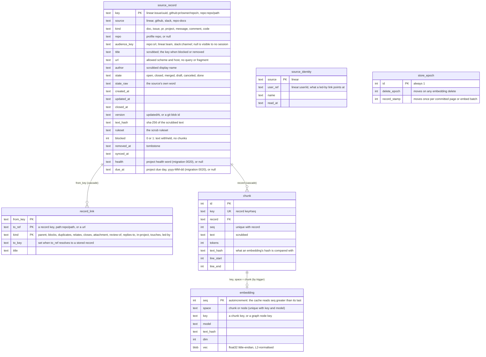

# Entity-Relationship Diagram -- SQLite stores

Every SQLite store in the toolkit is C#, opened through `Aw.Kernel.Data` (WAL, migrations embedded in the owning package
and never edited once merged, the schema version in `PRAGMA user_version`). The schemas are defined by those
migrations; this file is the map to them. The TypeScript ledger and code-index schemas that used to be drawn here left
with the TypeScript packages at the switch, and no TS state is migrated.

| Store | Path | Owner | Schema and contract |
|-------|------|-------|---------------------|
| Sindri ledger | `$AW_SINDRI_HOME/ledger.db` | `Aw.Sindri.Infrastructure` | `events`, `lease`, `outbox_commands`; Sindri is the only writer, hooks append to spool files instead (`docs/csharp/sindri.md` "State") |
| Sindri views | `$AW_SINDRI_HOME/views.db` | the projector | `projector_state` and one `view_<name>(key, row_json, seq)` table per view; derived, rebuilt from the ledger by `sindri views rebuild` (`docs/csharp/sindri.md`) |
| Temporal dev server | `$AW_SINDRI_HOME/temporal.db` | the pinned `temporal` binary | Not ours; the workflow engine's history (`docs/csharp/sindri-workflow.md`) |
| Code index | per repo, under the Sindri home | `src/CodeIndex` | Symbols, callers and callees; derived data (`docs/csharp/code-index.md`) |
| Context store | `$AW_SINDRI_HOME/context/context.db` | `Aw.Context.Infrastructure` | The graph, the intent layer, repo docs and the record store below; migrations `Store/Migrations/NNNN_*.sql` (spec `docs/superpowers/specs/2026-10-27-sindri-owned-index-design.md` §4) |
| Judge decisions | `$AW_STATE_DIR/judge/decisions.sqlite` | `Aw.Judge.Infrastructure` | `decisions`, `decision_details`, `failures`, `briefs` (`docs/csharp/judge.md` "State") |

`$AW_SINDRI_HOME` defaults to `$AW_STATE_DIR/sindri-app`.

## Context store (`context.db`)

Tables by migration: `source_cursor`, `doc`, `doc_chunk` (0001, the repo-docs snapshot, kept until the repo-docs feed has re-read the docs); `node`, `edge` and their evidence, aliases and the map versions (0002 and later: the graph); `intent_record`, `intent_link`, `intent_decision`, `intent_edge`, `intent_conflict` (0006, the intent layer; `intent_record.key` is the same string as `source_record.key`); `change_stamp` (0008) and `stamp_intent` (0009), the counters the graph and intent caches watch. The record store is migration 0018 (`s4_record_store`):

`chunk_fts` is an FTS5 table over `chunk.text` (external content, `unicode61`), kept by the triggers `chunk_fts_ai`, `chunk_fts_ad` and `chunk_fts_au`. `chunk_ad` and `chunk_au` delete a chunk's vector when the chunk goes or its text changes; `embedding_ad` moves `store_epoch.delete_epoch` on every vector removal. Migration 0020 (`project_fields`) adds `source_record.health` and `due_at`, the `source_identity` table (the owner's user per source, one row each), and resets the `linear` record feed's `source_cursor` row (`repo = 'records'`) to phase `recent` with no cursor, backfill cursor or backfill bound. `source_cursor` gains `phase` and `backfill_cursor`; a source's one position is its row with `repo = '*'`.
